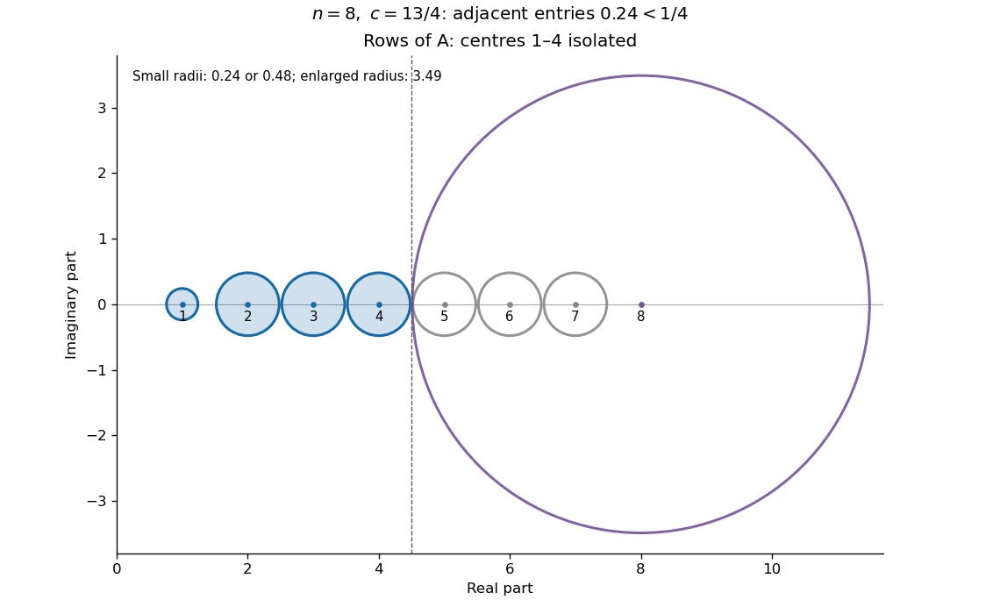
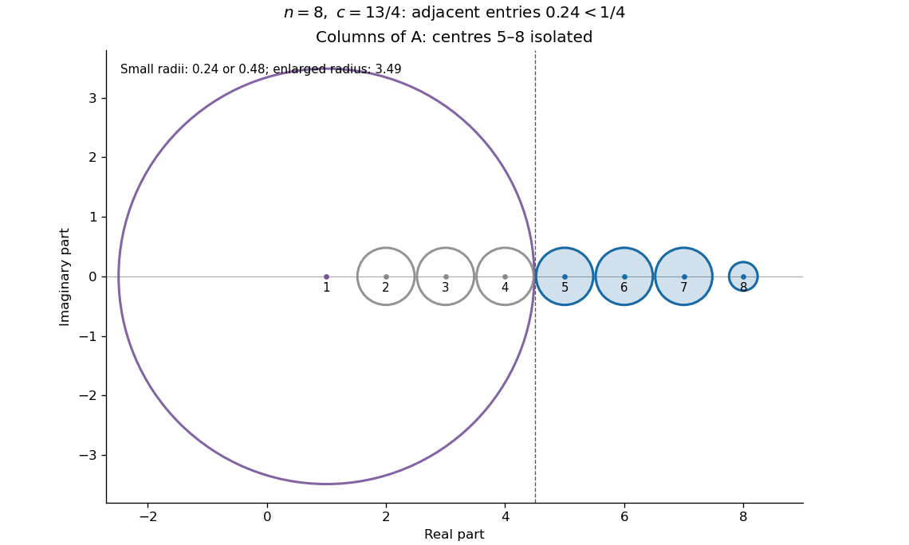

# 2014

↑ **Parent:** [Past exam of the numerical analysis course of the University of Oxford](../past-exam-of-the-numerical-analysis-course-of-the-university-of-oxford.md)

**Table of contents**

- [1](#1)
  - [a](#1/a)
    - [Solution](#1/a/solution)
  - [b](#1/b)
    - [Solution](#1/b/solution)
  - [c](#1/c)
    - [Solution](#1/c/solution)
  - [d](#1/d)
    - [i](#1/d/i)
      - [Solution](#1/d/i/solution)
    - [ii](#1/d/ii)
      - [Solution](#1/d/ii/solution)
    - [iii](#1/d/iii)
      - [Solution](#1/d/iii/solution)
  - [e](#1/e)
    - [Solution](#1/e/solution)
  - [f](#1/f)
    - [Solution](#1/f/solution)
- [2](#2)
  - [a](#2/a)
    - [Solution](#2/a/solution)
  - [b](#2/b)
    - [Solution](#2/b/solution)
  - [c](#2/c)
    - [Solution](#2/c/solution)
  - [d](#2/d)
    - [Solution](#2/d/solution)
  - [e](#2/e)
    - [Solution](#2/e/solution)
- [3](#3)
  - [a](#3/a)
    - [Solution](#3/a/solution)
  - [b](#3/b)
    - [Solution](#3/b/solution)
  - [c](#3/c)
    - [Solution](#3/c/solution)
  - [d](#3/d)
    - [Solution](#3/d/solution)
  - [e](#3/e)
    - [Solution](#3/e/solution)
  - [f](#3/f)
    - [Solution](#3/f/solution)

## 1

↑ **Parent:** [2014](2014.md)

<h3 id="1/a">a</h3>

↑ **Parent:** [1](#1)

<h4 id="1/a/solution">Solution</h4>

↑ **Parent:** [A](#1/a)

A [Givens rotation](../numerical-analysis.md#givens-rotation) acts as the [identity matrix](../vector-space.md#identity-matrix) outside two selected coordinates $i,j$, and has the following block on those coordinates:

$$
\boxed{G_{\{i,j\},\{i,j\}}=\begin{pmatrix}\cos\theta&-\sin\theta\\\sin\theta&\cos\theta\end{pmatrix}.}
$$

The convention with the opposite signs of the sines is equivalent after replacing $\theta$ by $-\theta$. A [Householder reflection](../linear-algebra.md#householder-transformation) with nonzero normal [vector](../vector-space.md#vector) $w\in\mathbb R^n$ is

$$
\boxed{H(w)=I-\frac{2ww^T}{w^Tw}.}
$$

It reverses the component parallel to $w$ and fixes the perpendicular [hyperplane](../vector-space.md#hyperplane). Both are [orthogonal matrices](../linear-algebra.md#orthogonal-matrix), so their transposes are their inverses and they preserve the [Euclidean norm](../normed-vector-space.md#euclidean-norm).

<h3 id="1/b">b</h3>

↑ **Parent:** [1](#1)

<h4 id="1/b/solution">Solution</h4>

↑ **Parent:** [B](#1/b)

If $u=0$, any nonzero $w$, for instance the first [Cartesian basis](../linear-algebra.md#cartesian-basis) vector $e_1$, gives $H(w)u=0$ and $\alpha=0$. Suppose $u\ne0$. Choose

$$
\alpha=-\operatorname{sgn}_+(u_1)\|u\|_2,\qquad w=u-\alpha e_1,
$$

where $\operatorname{sgn}_+(r)=1$ for $r\geq0$ and $-1$ otherwise. This choice ensures $w\ne0$, including when $u$ is already on the first coordinate axis. Since $\alpha^2=u^Tu$,

$$
w^Tu=u^Tu-\alpha u_1,\qquad w^Tw=u^Tu-2\alpha u_1+\alpha^2=2(w^Tu).
$$

Therefore the [Householder reflection](../linear-algebra.md#householder-transformation) satisfies

$$
\boxed{H(w)u=u-\frac{2w(w^Tu)}{w^Tw}=u-w=\alpha e_1.}
$$

The [orthogonality](../inner-product.md#orthogonal-vectors) of $H(w)$, used here to check length preservation, gives $|\alpha|=\|H(w)u\|_2=\|u\|_2$. The chosen sign also avoids [catastrophic cancellation](../floating-point-arithmetic.md#catastrophic-cancellation) in $w_1=u_1-\alpha$. This is a [Householder reflection sending a vector to a coordinate axis](../linear-algebra.md#householder-reflection-sending-a-vector-to-a-coordinate-axis) with no zero-normal exception.

<h3 id="1/c">c</h3>

↑ **Parent:** [1](#1)

<h4 id="1/c/solution">Solution</h4>

↑ **Parent:** [C](#1/c)

Set $A^{(0)}=A$. At step $k=1,\ldots,n-2$, let $u=A^{(k-1)}_{k+1:n,k}$ be the column below the diagonal. Choose a [Householder reflection](../linear-algebra.md#householder-transformation) $\widehat H_k$ sending $u$ onto its first coordinate axis, and embed it as

$$
P_k=\operatorname{diag}(I_k,\widehat H_k),\qquad A^{(k)}=P_k^TA^{(k-1)}P_k.
$$

If $u=0$, use $P_k=I$. Left multiplication annihilates entries $k+2,\ldots,n$ in column $k$. Right multiplication performs the matching operation on row $k$, because the [matrix](../vector-space.md#matrix) remains [symmetric](../set-theory.md#symmetric-relation). The first $k$ coordinates are fixed, so zeros already created in earlier columns and rows are preserved.

Here the [orthogonality](../inner-product.md#orthogonal-vectors) of each $P_k$ is used explicitly: $P_k^{-1}=P_k^T$, so each update is a [similarity transformation](../linear-algebra.md#similarity-transformation) and preserves [eigenvalues](../linear-operator-theory.md#eigenvalue). After $n-2$ steps,

$$
\boxed{T=Q^TAQ,\qquad Q=P_1P_2\cdots P_{n-2},}
$$

where $Q$ is [orthogonal](../inner-product.md#orthogonal-vectors) and $T$ is a real symmetric [tridiagonal matrix](../vector-space.md#tridiagonal-matrix). This is [Householder tridiagonalization](../numerical-linear-algebra.md#householder-tridiagonalization).

<h3 id="1/d">d</h3>

↑ **Parent:** [1](#1)

<h4 id="1/d/i">i</h4>

↑ **Parent:** [D](#1/d)

<h5 id="1/d/i/solution">Solution</h5>

↑ **Parent:** [I](#1/d/i)

A [QR factorization](../inner-product.md#qr-decomposition) of a real $n\times n$ [matrix](../vector-space.md#matrix) is

$$
\boxed{A=QR,\qquad Q^TQ=I,\qquad R\text{ upper triangular}.}
$$

Thus $Q$ is an [orthogonal matrix](../linear-algebra.md#orthogonal-matrix) and $R$ is an [upper triangular matrix](../linear-algebra.md#upper-triangular-matrix). It exists even if $A$ is singular; requiring positive diagonal entries of $R$ is a convenient uniqueness convention for nonsingular $A$, rather than part of the general existence statement. Over the complex numbers, replace [orthogonal](../inner-product.md#orthogonal-vectors) by [unitary](../vector-bundle.md#unitary-connection) and transpose by [conjugate transpose](../linear-operator-theory.md#conjugate-transpose).

<h4 id="1/d/ii">ii</h4>

↑ **Parent:** [D](#1/d)

<h5 id="1/d/ii/solution">Solution</h5>

↑ **Parent:** [Ii](#1/d/ii)

For an efficient [QR algorithm](../numerical-analysis.md#qr-algorithm), first reduce a general real [matrix](../vector-space.md#matrix) to [upper Hessenberg matrix](../vector-space.md#upper-hessenberg-matrix) by [orthogonal](../inner-product.md#orthogonal-vectors) similarities. For a real [symmetric matrix](../linear-algebra.md#symmetric-matrix), use [Householder tridiagonalization](../numerical-linear-algebra.md#householder-tridiagonalization); the resulting symmetric [tridiagonal matrix](../vector-space.md#tridiagonal-matrix) is the usual input in this setting. These structures are preserved by suitable [QR algorithm](../numerical-analysis.md#qr-algorithm) implementations and greatly reduce the work per iteration.

The output is the [eigenvalues](../linear-operator-theory.md#eigenvalue), together with an [orthogonal](../inner-product.md#orthogonal-vectors) reduction when the factors are accumulated. In the symmetric case the target is a diagonal [matrix](../vector-space.md#matrix), whose diagonal entries are the real [eigenvalues](../linear-operator-theory.md#eigenvalue); the accumulated orthogonal columns are [eigenvectors](../linear-operator-theory.md#eigenvector). For a general real [matrix](../vector-space.md#matrix), the target is the real form in a [Schur decomposition](../linear-operator-theory.md#schur-decomposition): an upper block triangular [matrix](../vector-space.md#matrix) with diagonal blocks of size one or two. The two-by-two blocks represent complex conjugate [eigenvalue](../linear-operator-theory.md#eigenvalue) pairs. An arbitrary unshifted iteration need not converge, so these describe the intended converged output, with appropriate shifts and [block deflation in the QR algorithm](../numerical-linear-algebra.md#block-deflation-in-the-qr-algorithm).

<h4 id="1/d/iii">iii</h4>

↑ **Parent:** [D](#1/d)

<h5 id="1/d/iii/solution">Solution</h5>

↑ **Parent:** [Iii](#1/d/iii)

With $A_0=A$, repeat the shifted [QR algorithm](../numerical-analysis.md#qr-algorithm):

$$
\boxed{A_k-\mu_kI=Q_kR_k,\qquad A_{k+1}=R_kQ_k+\mu_kI.}
$$

The [QR shift](../numerical-analysis.md#qr-shift) $\mu_k$ is chosen from $A_k$, for example its bottom-right entry or an [eigenvalue](../linear-operator-theory.md#eigenvalue) of a trailing two-by-two block. Explicitly using the [orthogonality](../inner-product.md#orthogonal-vectors) of $Q_k$ gives

$$
A_{k+1}=Q_k^T(A_k-\mu_kI)Q_k+\mu_kI=Q_k^TA_kQ_k.
$$

Thus each update is a [matrix similarity](../linear-algebra.md#matrix-similarity) preserving [eigenvalues](../linear-operator-theory.md#eigenvalue). Accumulate $Q_0Q_1\cdots Q_k$ if [eigenvectors](../linear-operator-theory.md#eigenvector) or the full reduction are wanted. Once a subdiagonal entry is negligible, [block deflation in the QR algorithm](../numerical-linear-algebra.md#block-deflation-in-the-qr-algorithm) separates the corresponding blocks and iteration continues on the active block.

<h3 id="1/e">e</h3>

↑ **Parent:** [1](#1)

<h4 id="1/e/solution">Solution</h4>

↑ **Parent:** [E](#1/e)

The initial bottom-right entry is zero, so the chosen [QR shift](../numerical-analysis.md#qr-shift) is $\mu_0=0$. One valid [QR factorization](../inner-product.md#qr-decomposition) is $Q_0=A$, $R_0=I$, using explicitly that $A^TA=I$. The update is

$$
A_1=R_0Q_0=A.
$$

It repeats forever and never approaches a diagonal [matrix](../vector-space.md#matrix). With the standard positive-diagonal convention for $R$, this factorization is unique, so **the Rayleigh-shift iteration is stationary and fails to diagonalize $A$**.

The failure is independent of harmless sign conventions. The columns of $A$ are already orthonormal, so another [QR factorization](../inner-product.md#qr-decomposition) can only replace $Q_0$ by $AD$ and $R_0$ by $D$, where $D$ is diagonal with entries $\pm1$. Then $A_1=DAD$ still has zero diagonal and off-diagonal magnitudes one. Subsequent bottom-right shifts remain zero and the off-diagonal magnitude never decreases. The [eigenvalues](../linear-operator-theory.md#eigenvalue) are $+1,-1$, with equal absolute values, explaining the lack of separation in the [unshifted QR algorithm](../numerical-linear-algebra.md#unshifted-qr-algorithm).

<h3 id="1/f">f</h3>

↑ **Parent:** [1](#1)

<h4 id="1/f/solution">Solution</h4>

↑ **Parent:** [F](#1/f)

Let the real [QR shift](../numerical-analysis.md#qr-shift) be $\mu$ and put $r=\sqrt{1+\mu^2}$. A valid [QR factorization](../inner-product.md#qr-decomposition), including the singular cases $\mu=\pm1$, is

$$
Q=\frac1r\begin{pmatrix}-\mu&-1\\1&-\mu\end{pmatrix},\qquad R=\begin{pmatrix}r&-2\mu/r\\0&(\mu^2-1)/r\end{pmatrix}.
$$

Here $Q^TQ=I$, and multiplying verifies $QR=A-\mu I$. Using this [orthogonality](../inner-product.md#orthogonal-vectors) in the shifted update gives

$$
A_1=Q^TAQ=\frac1{1+\mu^2}\begin{pmatrix}-2\mu&\mu^2-1\\\mu^2-1&2\mu\end{pmatrix}.
$$

It is diagonal exactly when $\mu^2-1=0$. Therefore **all real shifts giving the eigenvalues in one iteration are**

$$
\boxed{\mu=+1\quad\text{or}\quad\mu=-1.}
$$

The resulting diagonal is $(-1,1)$ or $(1,-1)$, respectively. Both [QR shifts](../numerical-analysis.md#qr-shift) are exact [eigenvalues](../linear-operator-theory.md#eigenvalue). Sign changes in the [QR factorization](../inner-product.md#qr-decomposition) conjugate $A_1$ by a diagonal sign [matrix](../vector-space.md#matrix) and do not alter its zero pattern. This is [Exact-shift diagonalization of a two-state swap matrix](../numerical-analysis.md#exact-shift-diagonalization-of-a-two-state-swap-matrix).

## 2

↑ **Parent:** [2014](2014.md)

<h3 id="2/a">a</h3>

↑ **Parent:** [2](#2)

<h4 id="2/a/solution">Solution</h4>

↑ **Parent:** [A](#2/a)

The [norm](../normed-vector-space.md#norm) induced by the specified [inner product](../inner-product.md) is the [L2 norm](../real-analysis.md#l2-norm)

$$
\boxed{\|u\|=\sqrt{(u,u)}=\left(\int_{-1}^1u(x)^2\,dx\right)^{1/2}.}
$$

A [polynomial](../polynomial.md) $p_n\in\Pi_n$ is a best [polynomial least-squares approximation](../uniform-approximation.md#polynomial-least-squares-approximation) when

$$
\boxed{\|u-p_n\|=\min_{q\in\Pi_n}\|u-q\|.}
$$

Minimizing this [norm](../normed-vector-space.md#norm) is equivalent to minimizing its square, the integrated squared error. Continuity ensures that a function with zero squared [norm](../normed-vector-space.md#norm) is identically zero: a nonzero value would give a neighbourhood on which the square has a positive integral.

<h3 id="2/b">b</h3>

↑ **Parent:** [2](#2)

<h4 id="2/b/solution">Solution</h4>

↑ **Parent:** [B](#2/b)

Write $p_n(x)=\sum_{j=0}^nc_jx^j$. The allowed [orthogonal projection](../hilbert-space.md#orthogonal-projection) characterization, applied to the [basis](../vector-space.md#basis) $1,x,\ldots,x^n$, gives the [normal equations](../normal-linear-model.md#normal-equation)

$$
\boxed{\sum_{j=0}^nG_{ij}c_j=d_i\quad(0\leq i\leq n),\qquad G_{ij}=\int_{-1}^1x^{i+j}\,dx,\quad d_i=\int_{-1}^1u(x)x^i\,dx.}
$$

Explicitly $G_{ij}=0$ if $i+j$ is odd and $G_{ij}=2/(i+j+1)$ if it is even. These equations can also be derived by differentiating $\int(u-\sum c_jx^j)^2dx$ with respect to each coefficient.

The [Gram matrix](../inner-product.md#gram-matrix) $G$ is a [symmetric positive-definite matrix](../linear-algebra.md#symmetric-positive-definite-matrix). For any nonzero real coefficient [vector](../vector-space.md#vector) $z$,

$$
z^TGz=\int_{-1}^1\left(\sum_{j=0}^nz_jx^j\right)^2dx>0.
$$

The [polynomial](../polynomial.md) inside the square is nonzero, so its square is positive on some interval. Hence $G$ has zero [kernel](../kernel-of-a-linear-map.md) and is invertible. Thus **the normal equations have exactly one solution**, giving exactly one best [least-squares polynomial](../uniform-approximation.md#polynomial-least-squares-approximation). This proves both existence and uniqueness. For completeness, if the residual is [orthogonal](../inner-product.md#orthogonal-vectors) to $\Pi_n$, then for every $q\in\Pi_n$ the [Pythagorean theorem](../euclidean-geometry.md#pythagorean-theorem) gives $\|u-q\|^2=\|u-p_n\|^2+\|p_n-q\|^2$, directly verifying minimality and uniqueness.

<h3 id="2/c">c</h3>

↑ **Parent:** [2](#2)

<h4 id="2/c/solution">Solution</h4>

↑ **Parent:** [C](#2/c)

Split the best [polynomial](../polynomial.md) into its [even](../calculus.md#even-function) and [odd](../calculus.md#odd-function) parts, $p_n=p_e+p_o$. Both parts belong to $\Pi_n$. Since $u$ is [odd](../calculus.md#odd-function), $u-p_o$ is odd and $p_e$ is even. Their product is odd, so its integral on the symmetric interval vanishes. The [orthogonality](../inner-product.md#orthogonal-vectors) gives

$$
\|u-p_n\|^2=\|(u-p_o)-p_e\|^2=\|u-p_o\|^2+\|p_e\|^2.
$$

The candidate $p_o$ cannot have a strictly smaller error than a minimizer. Consequently $\|p_e\|^2=0$, and continuity gives $p_e=0$. Thus $\boxed{p_n(-x)=-p_n(x)}$. For $n=0$ this means $p_0=0$, which is indeed an odd function. More generally this is [parity preservation by polynomial least-squares projection](../uniform-approximation.md#parity-preservation-by-polynomial-least-squares-projection).

<h3 id="2/d">d</h3>

↑ **Parent:** [2](#2)

<h4 id="2/d/solution">Solution</h4>

↑ **Parent:** [D](#2/d)

By [parity preservation by polynomial least-squares projection](../uniform-approximation.md#parity-preservation-by-polynomial-least-squares-projection), $p_2(x)=\beta x$: the constant and quadratic coefficients vanish. The remaining [normal equation](../normal-linear-model.md#normal-equation) is

$$
0=\int_{-1}^1(x^{1969}-\beta x)x\,dx=\frac2{1971}-\beta\frac23.
$$

Therefore

$$
\boxed{p_2(x)=\frac3{1971}x=\frac{x}{657}.}
$$

The residual is automatically [orthogonal](../inner-product.md#orthogonal-vectors) to $1$ and $x^2$ by parity and to $x$ by construction, so it is orthogonal to every element of $\Pi_2$. This checks the full [linear least squares](../probability-and-statistics.md#linear-least-squares) condition, rather than only a necessary coefficient equation.

<h3 id="2/e">e</h3>

↑ **Parent:** [2](#2)

<h4 id="2/e/solution">Solution</h4>

↑ **Parent:** [E](#2/e)

Projection onto the constant [polynomials](../polynomial.md) requires the residual to be [orthogonal](../inner-product.md#orthogonal-vectors) to $1$. For the original [inner product](../inner-product.md),

$$
0=\int_{-1}^1(x^2-p_0)\,dx=\frac23-2p_0,\qquad \boxed{p_0=\frac13.}
$$

For the weighted [inner product](../inner-product.md) the corresponding [normal equation](../normal-linear-model.md#normal-equation) is

$$
0=\int_{-1}^1x^{2n}(x^2-\bar p_0(n))\,dx=\frac2{2n+3}-\bar p_0(n)\frac2{2n+1}.
$$

Hence

$$
\boxed{\bar p_0(n)=\frac{2n+1}{2n+3}=1-\frac2{2n+3}\longrightarrow1.}
$$

It increases monotonically towards one. Although the weight vanishes at zero, it is positive elsewhere, and a nonzero continuous function is nonzero on an interval of positive weight. Thus the weighted expression really is an [inner product](../inner-product.md) and the constant minimizer is unique.

The normalized weight $(2n+1)x^{2n}/2$ has total mass one and assigns mass $r^{2n+1}$ to $[-r,r]$ for each $0<r<1$. Its mass therefore concentrates near $-1$ and $1$, where $x^2=1$. This explains why the weighted best constant tends to one rather than to the unweighted spatial average. It is [endpoint concentration in weighted constant approximation](../normal-linear-model.md#endpoint-concentration-in-weighted-constant-approximation).

## 3

↑ **Parent:** [2014](2014.md)

<h3 id="3/a">a</h3>

↑ **Parent:** [3](#3)

<h4 id="3/a/solution">Solution</h4>

↑ **Parent:** [A](#3/a)

The [Gershgorin circle theorem](../numerical-analysis.md#gershgorin-circle-theorem) states that every [eigenvalue](../linear-operator-theory.md#eigenvalue) of $A=(a_{ij})\in\mathbb R^{n\times n}$ belongs to at least one of the closed [Gershgorin discs](../numerical-analysis.md#gershgorin-disc)

$$
\boxed{D_i=\left\{z\in\mathbb C:|z-a_{ii}|\leq r_i\right\},\qquad r_i=\sum_{j\ne i}|a_{ij}|.}
$$

The [eigenvalue](../linear-operator-theory.md#eigenvalue) may be complex even though the [matrix](../vector-space.md#matrix) is real. To prove the theorem, choose a nonzero complex [eigenvector](../linear-operator-theory.md#eigenvector) $v$ with $Av=\lambda v$ and an index $i$ at which $|v_i|$ is maximal. Then $|v_i|>0$, and the $i$th row gives

$$
(\lambda-a_{ii})v_i=\sum_{j\ne i}a_{ij}v_j.
$$

The [triangle inequality](../topological-analysis.md#triangle-inequality) yields

$$
|\lambda-a_{ii}|\leq\sum_{j\ne i}|a_{ij}|\frac{|v_j|}{|v_i|}\leq\sum_{j\ne i}|a_{ij}|=r_i.
$$

Thus $\lambda\in D_i$, proving the assertion without any symmetry assumption.

<h3 id="3/b">b</h3>

↑ **Parent:** [3](#3)

<h4 id="3/b/solution">Solution</h4>

↑ **Parent:** [B](#3/b)

The second theorem, or [Gershgorin eigenvalue counting](../numerical-analysis.md#gershgorin-eigenvalue-counting), states: **if a union of $k$ indexed Gershgorin discs is disjoint from all remaining discs, it contains exactly $k$ eigenvalues, counted with algebraic multiplicity.** In particular, an isolated [Gershgorin disc](../numerical-analysis.md#gershgorin-disc) contains exactly one simple [eigenvalue](../linear-operator-theory.md#eigenvalue). The separation condition is essential; merely drawing overlapping [discs](../topology.md#topological-disc) does not assign one [eigenvalue](../linear-operator-theory.md#eigenvalue) to each.

<h3 id="3/c">c</h3>

↑ **Parent:** [3](#3)

<h4 id="3/c/solution">Solution</h4>

↑ **Parent:** [C](#3/c)

The [determinant](../multilinear-algebra.md#determinant) is invariant under [transpose](../vector-space.md#transpose). Therefore the [characteristic polynomials](../linear-operator-theory.md#characteristic-polynomial) coincide:

$$
\boxed{\det(\lambda I-A^T)=\det((\lambda I-A)^T)=\det(\lambda I-A).}
$$

Their [polynomial roots](../polynomial.md#root-of-a-polynomial), including their [algebraic multiplicities](../linear-operator-theory.md#algebraic-multiplicity), are the same, so $A$ and $A^T$ have the same [eigenvalues](../linear-operator-theory.md#eigenvalue). This allows column sums as well as row sums to supply [Gershgorin discs](../numerical-analysis.md#gershgorin-disc) for the same [spectrum](../linear-operator-theory.md#spectrum-functional-analysis).

<h3 id="3/d">d</h3>

↑ **Parent:** [3](#3)

<h4 id="3/d/solution">Solution</h4>

↑ **Parent:** [D](#3/d)

The first row has off-diagonal sum $a_{12}<1/4$. Rows $2,\ldots,n-1$ have sums less than $1/2$, and the last row has sum $c+a_{n,n-1}<5/4$, since $0<c<1$. Every row except the second therefore has its [Gershgorin disc](../numerical-analysis.md#gershgorin-disc) strictly away from zero: its centre is at least one in the first row and at least three in the remaining rows.

For the second row, an exact sufficient condition is $|b|>a_{21}+a_{23}$. Since the sum is strictly below $1/2$, the coefficient-independent bounds

$$
\boxed{b\leq-\frac12\quad\text{or}\quad b\geq\frac12}
$$

guarantee that zero is outside every [Gershgorin disc](../numerical-analysis.md#gershgorin-disc). Consequently zero is not an [eigenvalue](../linear-operator-theory.md#eigenvalue) and $A$ is an [invertible matrix](../linear-algebra.md#invertible-matrix). Equality at $\pm1/2$ is allowed because the off-diagonal entry bounds are strict. These are sufficient [strict diagonal dominance](../vector-space.md#strictly-diagonally-dominant-matrix) bounds; values of $b$ between them can also give invertible [matrices](../vector-space.md#matrix).

<h3 id="3/e">e</h3>

↑ **Parent:** [3](#3)

<h4 id="3/e/solution">Solution</h4>

↑ **Parent:** [E](#3/e)

Put $n=2m$. With $b=2$, the row [Gershgorin discs](../numerical-analysis.md#gershgorin-disc) have centres $1,2,\ldots,n$ and radii

$$
r_1<\frac14,\qquad r_i<\frac12\ (2\leq i\leq n-1),\qquad r_n<|c|+\frac14.
$$

Applying the theorem to the [transpose](../vector-space.md#transpose) gives column [Gershgorin discs](../numerical-analysis.md#gershgorin-disc) with radii

$$
s_1<|c|+\frac14,\qquad s_i<\frac12\ (2\leq i\leq n-1),\qquad s_n<\frac14.
$$

The enlarged disc moves from the last centre to the first centre. All small discs in either family are mutually disjoint, because adjacent centres are one unit apart and their radii have sum strictly below one.

For the row family, the small disc at any $i\leq m$ is also disjoint from the enlarged disc at $n$ if

$$
r_i+r_n<|c|+\frac34\leq m\leq n-i.
$$

For the column family, every small disc at $i\geq m+1$ is disjoint from the enlarged disc at $1$ by the same estimate, since $i-1\geq m$. Thus the [Gershgorin eigenvalue counting](../numerical-analysis.md#gershgorin-eigenvalue-counting) theorem certifies one simple [eigenvalue](../linear-operator-theory.md#eigenvalue) near each of $1,\ldots,m$ from rows, and near each of $m+1,\ldots,n$ from columns. The certified small discs from the two families are themselves disjoint, so these are $n$ different [eigenvalues](../linear-operator-theory.md#eigenvalue).

The largest nonnegative $c$ certified by these uniform row-and-column separation bounds is

$$
\boxed{c_{\mathrm G}=m-\frac34=\frac n2-\frac34.}
$$

More generally the argument works for $|c|\leq c_{\mathrm G}$. The endpoint is included because all actual entry bounds, and hence all actual radius estimates above, are strict. For $n=8$, $c_{\mathrm G}=13/4$: row discs isolate centres $1,2,3,4$, and column discs isolate centres $5,6,7,8$.

**[Figure 1](#3/e/image-for-n-8-and-c-13-4-the-row-gershgorin-discs-isolate-the-four-lower-centres-the-enlarged-disc-is-centred-at-8). For n=8 and c=13/4 the row Gershgorin discs isolate the four lower centres; the enlarged disc is centred at 8**.

**[Figure 2](#3/e/image-the-transpose-moves-the-enlarged-gershgorin-disc-to-centre-1-and-isolates-the-four-upper-centres). The transpose moves the enlarged Gershgorin disc to centre 1 and isolates the four upper centres**.

For $c>c_{\mathrm G}$, taking the adjacent entries sufficiently close to $1/4$ makes the enlarged row disc meet the small disc at $m$, and the enlarged column disc meet the small disc at $m+1$. Hence this particular uniform disc-separation certificate stops there. **This is a Gershgorin guarantee, not a necessary spectral threshold**: failure of disc separation does not prove repeated or nonreal [eigenvalues](../linear-operator-theory.md#eigenvalue) for the actual [matrix](../vector-space.md#matrix).

Finally, a real [matrix](../vector-space.md#matrix) has nonreal [eigenvalues](../linear-operator-theory.md#eigenvalue) in [complex conjugate](../complex-analysis.md#complex-conjugate) pairs. Every certified small disc has a real centre and is invariant under conjugation. A nonreal [eigenvalue](../linear-operator-theory.md#eigenvalue) in it would bring its distinct conjugate into the same disc, contradicting its count of exactly one. Therefore **all the certified eigenvalues are real and simple**. The two-family argument is [Complementary row and column Gershgorin isolation](../numerical-analysis.md#complementary-row-and-column-gershgorin-isolation).

<h3 id="3/f">f</h3>

↑ **Parent:** [3](#3)

<h4 id="3/f/solution">Solution</h4>

↑ **Parent:** [F](#3/f)

[Strict diagonal dominance](../vector-space.md#strictly-diagonally-dominant-matrix) gives

$$
|b_{ii}|>\sum_{j\ne i}|b_{ij}|\geq0.
$$

Thus every $b_{ii}\ne0$, and the diagonal [matrix](../vector-space.md#matrix) $D$ has inverse $D^{-1}=\operatorname{diag}(1/b_{11},\ldots,1/b_{nn})$. The iteration [matrix](../vector-space.md#matrix) has entries

$$
t_{ii}=0,\qquad t_{ij}=\frac{b_{ij}}{b_{ii}}\quad(i\ne j).
$$

Each row [Gershgorin disc](../numerical-analysis.md#gershgorin-disc) for $T$ is centred at zero and has radius

$$
\rho_i=\sum_{j\ne i}|t_{ij}|=\frac{\sum_{j\ne i}|b_{ij}|}{|b_{ii}|}<1.
$$

Therefore every [eigenvalue](../linear-operator-theory.md#eigenvalue) of $T$ satisfies

$$
\boxed{|\lambda|\leq\max_i\rho_i<1.}
$$

Equivalently, the induced [matrix norm](../vector-space.md#matrix-norm) satisfies $\|T\|_\infty<1$, bounding the [spectral radius](../analysis.md#spectral-radius). This is the usual [Jacobi convergence from strict diagonal dominance](../numerical-linear-algebra.md#jacobi-convergence-from-strict-diagonal-dominance); the Jacobi error [matrix](../vector-space.md#matrix) is $-T$, with the same eigenvalue magnitudes.

## ↑ Ancestors (9)

1. [Past exam of the numerical analysis course of the University of Oxford](../past-exam-of-the-numerical-analysis-course-of-the-university-of-oxford.md)
2. [Numerical analysis course of the University of Oxford](../university-of-oxford.md#numerical-analysis-course-of-the-university-of-oxford)
3. [Year 2 of the mathematics course of the University of Oxford](../university-of-oxford.md#year-2-of-the-mathematics-course-of-the-university-of-oxford)
4. [Mathematics course of the University of Oxford](../university-of-oxford.md#mathematics-course-of-the-university-of-oxford)
5. [Undergraduate course of the University of Oxford](../university-of-oxford.md#undergraduate-course-of-the-university-of-oxford)
6. [Course of the University of Oxford](../university-of-oxford.md#course-of-the-university-of-oxford)
7. [University of Oxford](../university-of-oxford.md)
8. [List of universities](../README.md#list-of-universities)
9. [Codex Wiki](../README.md)
