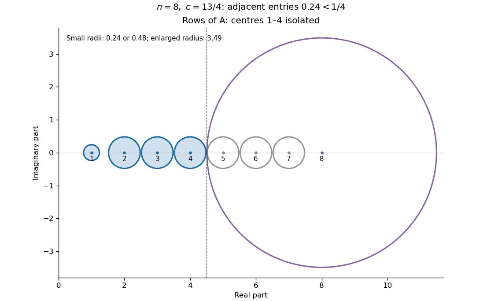
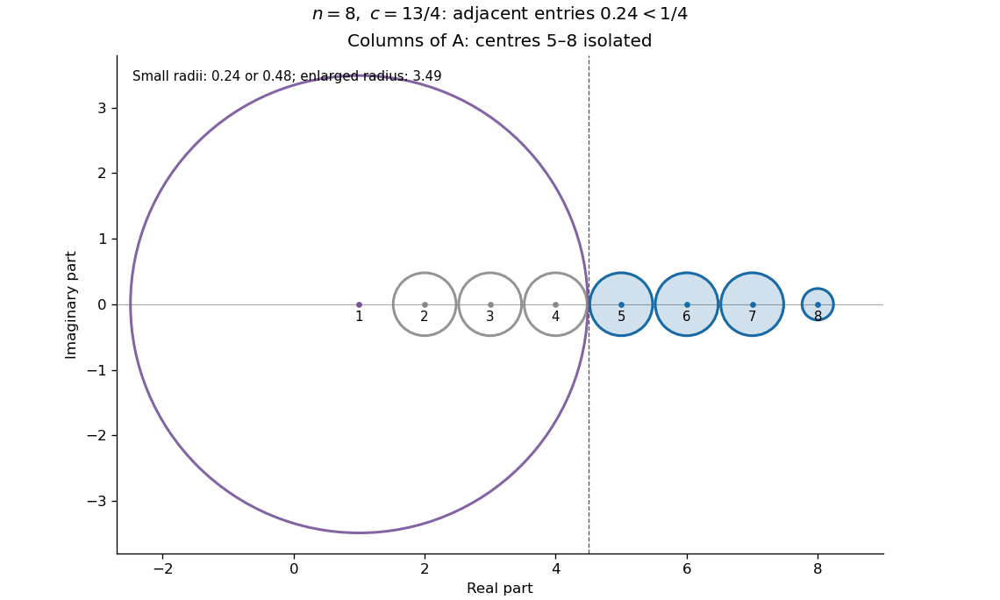

<h1 id="3/e/solution">Solution</h1>

↑ **Parent:** [E](../e.md)

Put $n=2m$. With $b=2$, the row [Gershgorin discs](../../../../gershgorin-disc.md) have centres $1,2,\ldots,n$ and radii

$$
r_1<\frac14,\qquad r_i<\frac12\ (2\leq i\leq n-1),\qquad r_n<|c|+\frac14.
$$

Applying the theorem to the [transpose](../../../../transpose.md) gives column [Gershgorin discs](../../../../gershgorin-disc.md) with radii

$$
s_1<|c|+\frac14,\qquad s_i<\frac12\ (2\leq i\leq n-1),\qquad s_n<\frac14.
$$

The enlarged disc moves from the last centre to the first centre. All small discs in either family are mutually disjoint, because adjacent centres are one unit apart and their radii have sum strictly below one.

For the row family, the small disc at any $i\leq m$ is also disjoint from the enlarged disc at $n$ if

$$
r_i+r_n<|c|+\frac34\leq m\leq n-i.
$$

For the column family, every small disc at $i\geq m+1$ is disjoint from the enlarged disc at $1$ by the same estimate, since $i-1\geq m$. Thus the [Gershgorin eigenvalue counting](../../../../gershgorin-eigenvalue-counting.md) theorem certifies one simple [eigenvalue](../../../../eigenvalue.md) near each of $1,\ldots,m$ from rows, and near each of $m+1,\ldots,n$ from columns. The certified small discs from the two families are themselves disjoint, so these are $n$ different [eigenvalues](../../../../eigenvalue.md).

The largest nonnegative $c$ certified by these uniform row-and-column separation bounds is

$$
\boxed{c_{\mathrm G}=m-\frac34=\frac n2-\frac34.}
$$

More generally the argument works for $|c|\leq c_{\mathrm G}$. The endpoint is included because all actual entry bounds, and hence all actual radius estimates above, are strict. For $n=8$, $c_{\mathrm G}=13/4$: row discs isolate centres $1,2,3,4$, and column discs isolate centres $5,6,7,8$.

**[Figure 1](#3/e/image-for-n-8-and-c-13-4-the-row-gershgorin-discs-isolate-the-four-lower-centres-the-enlarged-disc-is-centred-at-8). For n=8 and c=13/4 the row Gershgorin discs isolate the four lower centres; the enlarged disc is centred at 8**.

**[Figure 2](#3/e/image-the-transpose-moves-the-enlarged-gershgorin-disc-to-centre-1-and-isolates-the-four-upper-centres). The transpose moves the enlarged Gershgorin disc to centre 1 and isolates the four upper centres**.

For $c>c_{\mathrm G}$, taking the adjacent entries sufficiently close to $1/4$ makes the enlarged row disc meet the small disc at $m$, and the enlarged column disc meet the small disc at $m+1$. Hence this particular uniform disc-separation certificate stops there. **This is a Gershgorin guarantee, not a necessary spectral threshold**: failure of disc separation does not prove repeated or nonreal [eigenvalues](../../../../eigenvalue.md) for the actual [matrix](../../../../matrix.md).

Finally, a real [matrix](../../../../matrix.md) has nonreal [eigenvalues](../../../../eigenvalue.md) in [complex conjugate](../../../../complex-conjugate.md) pairs. Every certified small disc has a real centre and is invariant under conjugation. A nonreal [eigenvalue](../../../../eigenvalue.md) in it would bring its distinct conjugate into the same disc, contradicting its count of exactly one. Therefore **all the certified eigenvalues are real and simple**. The two-family argument is [Complementary row and column Gershgorin isolation](../../../../complementary-row-and-column-gershgorin-isolation.md).

## ↑ Ancestors (12)

1. [E](../e.md)
2. [3](../../3.md)
3. [2014](../../../2014-split.md)
4. [Past exam of the numerical analysis course of the University of Oxford](../../../split.md)
5. [Numerical analysis course of the University of Oxford](../../../../numerical-analysis-course-of-the-university-of-oxford.md)
6. [Year 2 of the mathematics course of the University of Oxford](../../../../year-2-of-the-mathematics-course-of-the-university-of-oxford.md)
7. [Mathematics course of the University of Oxford](../../../../mathematics-course-of-the-university-of-oxford.md)
8. [Undergraduate course of the University of Oxford](../../../../undergraduate-course-of-the-university-of-oxford.md)
9. [Course of the University of Oxford](../../../../course-of-the-university-of-oxford.md)
10. [University of Oxford](../../../../university-of-oxford-split.md)
11. [List of universities](../../../../list-of-universities.md)
12. [Codex Wiki](../../../../split.md)
