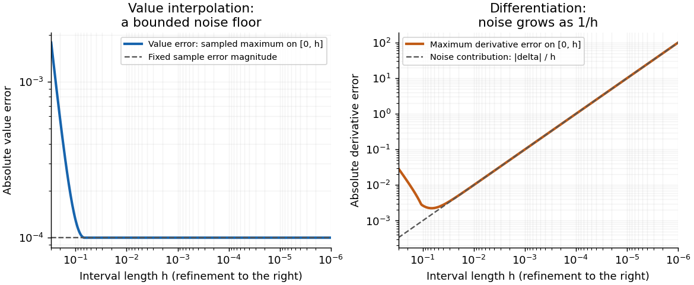

# 2015

↑ **Parent:** [Past exam of the numerical analysis course of the University of Oxford](../past-exam-of-the-numerical-analysis-course-of-the-university-of-oxford.md)

Source release: [Oxford examination archive](https://www.whatdotheyknow.com/request/maths_papers_2/response/1850333/attach/3/FOI%2020210708%201%20Data.zip?cookie_passthrough=1), member `FOI-20210708-1 - Data/a13759w1 (4).pdf`. The cover dates the examination to 26 June 2015.

Answer availability checked on 28 October 2026: a bounded search of official Oxford sources found no advertisement of complete or selected-part solutions for this exact paper. Oxford's stated policy excludes odd examination years apart from the exceptional release for 2019.[Mathematical Institute, “Past papers and model solutions”: release policy for odd examination years and the 2019 exception](https://www.maths.ox.ac.uk/members/students/undergraduate-courses/examinations-assessments/overview-examinations)

**Table of contents**

- [1](#1)
  - [a](#1/a)
    - [Solution](#1/a/solution)
  - [b](#1/b)
    - [i](#1/b/i)
      - [Solution](#1/b/i/solution)
    - [ii](#1/b/ii)
      - [Solution](#1/b/ii/solution)
  - [c](#1/c)
    - [i](#1/c/i)
      - [Solution](#1/c/i/solution)
    - [ii](#1/c/ii)
      - [Solution](#1/c/ii/solution)
  - [d](#1/d)
    - [Solution](#1/d/solution)
- [2](#2)
  - [a](#2/a)
    - [Solution](#2/a/solution)
  - [b](#2/b)
    - [Solution](#2/b/solution)
  - [c](#2/c)
    - [i](#2/c/i)
      - [Solution](#2/c/i/solution)
    - [ii](#2/c/ii)
      - [Solution](#2/c/ii/solution)
    - [iii](#2/c/iii)
      - [Solution](#2/c/iii/solution)
- [3](#3)
  - [a](#3/a)
    - [Solution](#3/a/solution)
  - [b](#3/b)
    - [Solution](#3/b/solution)
  - [c](#3/c)
    - [i](#3/c/i)
      - [Solution](#3/c/i/solution)
    - [ii](#3/c/ii)
      - [Solution](#3/c/ii/solution)
  - [d](#3/d)
    - [i](#3/d/i)
      - [Solution](#3/d/i/solution)
    - [ii](#3/d/ii)
      - [Solution](#3/d/ii/solution)
    - [iii](#3/d/iii)
      - [Solution](#3/d/iii/solution)

## 1

↑ **Parent:** [2015](2015.md)

<h3 id="1/a">a</h3>

↑ **Parent:** [1](#1)

<h4 id="1/a/solution">Solution</h4>

↑ **Parent:** [A](#1/a)

For $a<b$, the one-panel [trapezoidal rule](../runge-kutta-method.md#trapezoidal-rule) is

$$
\boxed{\int_a^b f(x)\,dx\ \approx\ T(f):=\frac{b-a}{2}\bigl(f(a)+f(b)\bigr).}
$$

It integrates the [linear interpolation](../function.md#linear-interpolation) between the two endpoint samples. Indeed the [affine function](../vector-space.md#affine-function)

$$
\ell(x)=\frac{b-x}{b-a}f(a)+\frac{x-a}{b-a}f(b)
$$

has [definite integral](../integral.md#definite-integral) $T(f)$. The two [quadrature nodes](../numerical-integration.md#quadrature-node) are $a,b$ and both [quadrature weights](../numerical-integration.md#quadrature-weight) are $(b-a)/2$.

<h3 id="1/b">b</h3>

↑ **Parent:** [1](#1)

<h4 id="1/b/i">i</h4>

↑ **Parent:** [B](#1/b)

<h5 id="1/b/i/solution">Solution</h5>

↑ **Parent:** [I](#1/b/i)

It suffices to assume $f\in C^2[a,b]$. The [polynomial interpolation error](../algebra.md#polynomial-interpolation-error) for the endpoint [linear interpolant](../function.md#linear-interpolant) gives, for every interior $x$, some $\xi_x\in(a,b)$ with

$$
f(x)-\ell(x)=\frac{f''(\xi_x)}2(x-a)(x-b).
$$

Let $M=\max_{[a,b]}|f''|$, which exists by [continuity](../calculus.md#continuous-function) of the [second derivative](../calculus.md#second-derivative) and the [extreme value theorem](../real-analysis.md#extreme-value-theorem). Since $(x-a)(b-x)\geq0$,

$$
|f(x)-\ell(x)|\leq\frac M2(x-a)(b-x).
$$

Integrating this pointwise inequality and using the [triangle inequality for an integral](../topological-analysis.md#integral-triangle-inequality) yields

$$
\begin{aligned}
\left|\int_a^bf(x)\,dx-T(f)\right|
&\leq\frac M2\int_a^b(x-a)(b-x)\,dx\\
&=\frac M2\int_0^{b-a}t\bigl((b-a)-t\bigr)\,dt
=\frac{M(b-a)^3}{12}.
\end{aligned}
$$

Thus

$$
\boxed{|I(f)-T(f)|\leq\frac{(b-a)^3}{12}\max_{[a,b]}|f''|.}
$$

This derivation does not require choosing $\xi_x$ as a continuous [function](../function.md) of $x$; the pointwise upper bound is sufficient.

The constant is sharp. Take the [quadratic polynomial](../polynomial.md#quadratic-polynomial) $f(x)=(x-a)^2$ and write $L=b-a$. Its exact [integral](../integral.md) is $L^3/3$, its [trapezoidal rule](../runge-kutta-method.md#trapezoidal-rule) value is $L^3/2$, and $\max|f''|=2$. Consequently

$$
|I(f)-T(f)|=\frac{L^3}{6}=\frac{L^3}{12}\max|f''|.
$$

Equality holds, so **no smaller universal constant than $1/12$ works** under these assumptions. This is the [sharp one-panel trapezoidal error bound](../runge-kutta-method.md#sharp-one-panel-trapezoidal-error-bound).

<h4 id="1/b/ii">ii</h4>

↑ **Parent:** [B](#1/b)

<h5 id="1/b/ii/solution">Solution</h5>

↑ **Parent:** [Ii](#1/b/ii)

The [trapezoidal rule](../runge-kutta-method.md#trapezoidal-rule) is exact for every [affine function](../vector-space.md#affine-function) $f(x)=\alpha+\beta x$, equivalently every [polynomial](../polynomial.md) of [polynomial degree](../polynomial.md#degree-of-a-polynomial) at most one: the [linear interpolant](../function.md#linear-interpolant) is the [function](../function.md) itself. These [functions](../function.md) have $f''=0$, so the preceding upper bound is also zero. There is **no contradiction**: zero error is precisely what the bound predicts.

The [degree of precision of a quadrature rule](../numerical-integration.md#degree-of-precision-of-a-quadrature-rule) is one, since the [quadratic polynomial](../polynomial.md#quadratic-polynomial) in part (i) is not integrated exactly. This does not exclude exactness for particular higher-degree or nonpolynomial [functions](../function.md). For example $f(x)=(x-m)^3$, $m=(a+b)/2$, has zero [integral](../integral.md) and opposite endpoint values, so the [trapezoidal rule](../runge-kutta-method.md#trapezoidal-rule) also gives zero. Its [second derivative](../calculus.md#second-derivative) is generally nonzero, making the upper bound positive; an upper bound need not be attained. Signed [quadrature error](../real-analysis.md#quadrature-error) can cancel.

<h3 id="1/c">c</h3>

↑ **Parent:** [1](#1)

<h4 id="1/c/i">i</h4>

↑ **Parent:** [C](#1/c)

<h5 id="1/c/i/solution">Solution</h5>

↑ **Parent:** [I](#1/c/i)

On a [partition of an interval](../real-analysis.md#partition-of-an-interval) $a=x_0<x_1<\cdots<x_N=b$, apply the [trapezoidal rule](../runge-kutta-method.md#trapezoidal-rule) separately to each panel and add:

$$
\boxed{T_N(f)=\sum_{j=1}^N\frac{x_j-x_{j-1}}2\bigl(f(x_{j-1})+f(x_j)\bigr).}
$$

For uniform spacing $h=(b-a)/N$, this [composite trapezoidal rule](../runge-kutta-method.md#composite-trapezoidal-rule) becomes

$$
\boxed{T_N(f)=h\left[\frac12f(a)+\sum_{j=1}^{N-1}f(a+jh)+\frac12f(b)\right].}
$$

Each interior sample occurs in two panels; their half-[quadrature weights](../numerical-integration.md#quadrature-weight) combine to $h$. The endpoint [quadrature weights](../numerical-integration.md#quadrature-weight) are $h/2$.

<h4 id="1/c/ii">ii</h4>

↑ **Parent:** [C](#1/c)

<h5 id="1/c/ii/solution">Solution</h5>

↑ **Parent:** [Ii](#1/c/ii)

Use the nonpolynomial [function](../function.md) $f(x)=1+\sin x$ on $[-1,1]$. Its exact [integral](../integral.md) is

$$
\int_{-1}^1(1+\sin x)\,dx=2,
$$

because the [sine](../geometry-and-topology.md#sine) is an [odd function](../calculus.md#odd-function).

For every uniform [partition of an interval](../real-analysis.md#partition-of-an-interval) with $N\geq1$ panels, the [quadrature nodes](../numerical-integration.md#quadrature-node) satisfy $x_{N-j}=-x_j$. Their [composite trapezoidal rule](../runge-kutta-method.md#composite-trapezoidal-rule) [quadrature weights](../numerical-integration.md#quadrature-weight) agree, so the two sampled sine values cancel. If there is a node at zero its sine value is already zero. The constant term is integrated exactly, giving

$$
\boxed{T_N(1+\sin x)=2\quad\text{for every }N\geq1.}
$$

This is [symmetric trapezoidal exactness for odd functions](../runge-kutta-method.md#symmetric-trapezoidal-exactness-for-odd-functions), applied after adding a [constant function](../function.md#constant-function) so that the resulting [definite integral](../integral.md#definite-integral) is nonzero. It is exactness for this particular [integrand](../integral.md#integrand), rather than a claim that every nonpolynomial [function](../function.md) is integrated exactly.

<h3 id="1/d">d</h3>

↑ **Parent:** [1](#1)

<h4 id="1/d/solution">Solution</h4>

↑ **Parent:** [D](#1/d)

Write $E(h)$ for the supplied approximation. The [asymptotic expansion](../asymptotic-expansion.md) is

$$
Y=E(h)+ch^2+r(h),\qquad r(h)=O(h^3),
$$

where $O$ is [Big O notation](../real-analysis.md#big-o-notation). At the refined parameter $h/3$,

$$
Y=E(h/3)+\frac{ch^2}{9}+r(h/3).
$$

Multiply this identity by nine and subtract the first one. The unknown leading [truncation error](../numerical-analysis.md#truncation-error) coefficient cancels:

$$
8Y=9E(h/3)-E(h)+9r(h/3)-r(h).
$$

Thus the [Richardson extrapolation](../numerical-analysis.md#richardson-extrapolation) estimate is

$$
Y_{\rm ext}(h)=\frac{9E(h/3)-E(h)}8,\qquad
Y-Y_{\rm ext}(h)=O(h^3).
$$

The two supplied values give

$$
\boxed{Y_{\rm ext}(1)=\frac{9\cdot3-2}{8}=\frac{25}{8}=3.125.}
$$

The correction to the finer approximation is $(3-2)/8=1/8$. Neglecting the higher-order remainder would also give $c=9/8$.

The conclusion is asymptotic: the leading error order improves from two to at least three when both parameter values are in the range of the stated [asymptotic expansion](../asymptotic-expansion.md). With no bound on the remainder constant, the two finite observations alone do not guarantee that $25/8$ is closer to $Y$. Indeed, for any proposed value $L$, the [polynomial](../polynomial.md) model

$$
E(h)=L-c_Lh^2-d_Lh^3,\qquad
c_L=13L-\frac{79}{2},\qquad d_L=\frac{75}{2}-12L
$$

satisfies $E(1)=2$, $E(1/3)=3$ and the required [asymptotic expansion](../asymptotic-expansion.md) with true [limit](../calculus.md#limit-of-a-function) $L$. This is why [finite observations do not certify Richardson extrapolation accuracy](../numerical-analysis.md#finite-observations-do-not-certify-richardson-extrapolation-accuracy): asymptotic cancellation provides an improved-order estimator, while a numerical error certificate needs quantitative remainder information.

## 2

↑ **Parent:** [2015](2015.md)

<h3 id="2/a">a</h3>

↑ **Parent:** [2](#2)

<h4 id="2/a/solution">Solution</h4>

↑ **Parent:** [A](#2/a)

The [polynomial](../polynomial.md) $p_n$ interpolates $f$ at the [interpolation nodes](../interpolation.md#interpolation-node) when

$$
p_n(x_i)=f(x_i)\qquad(0\leq i\leq n).
$$

For distinct [interpolation nodes](../interpolation.md#interpolation-node), define the [Lagrange cardinal polynomials](../interpolation.md#lagrange-cardinal-polynomial)

$$
\ell_i(x)=\prod_{j\ne i}\frac{x-x_j}{x_i-x_j}.
$$

The denominators are nonzero, each [polynomial degree](../polynomial.md#degree-of-a-polynomial) is at most $n$, and $\ell_i(x_j)=\delta_{ij}$, with $\delta_{ij}$ the [Kronecker delta](../multilinear-algebra.md#kronecker-delta). Therefore

$$
\boxed{p_n(x)=\sum_{i=0}^nf(x_i)\ell_i(x)}
$$

is a [Lagrange interpolation polynomial](../interpolation.md#lagrange-polynomial) belonging to the [vector space of univariate polynomials](../polynomial.md#vector-space-of-univariate-polynomials) $\Pi_n$, and it has all the required sampled values.

If $r_n\in\Pi_n$ also works, $p_n-r_n$ has $n+1$ distinct [roots of a polynomial](../polynomial.md#root-of-a-polynomial) while its [polynomial degree](../polynomial.md#degree-of-a-polynomial) is at most $n$. The [root bound for a polynomial](../polynomial.md#lagrange-root-bound-over-a-field) forces it to be the [zero polynomial](../polynomial.md#zero-polynomial), proving uniqueness. The phrase “degree $n$” denotes the allowed maximum; the actual [polynomial degree](../polynomial.md#degree-of-a-polynomial) may be smaller. No [continuity](../calculus.md#continuous-function) assumption is needed merely to construct the [interpolation polynomial](../interpolation.md#interpolation-polynomial) from these finitely many values.

<h3 id="2/b">b</h3>

↑ **Parent:** [2](#2)

<h4 id="2/b/solution">Solution</h4>

↑ **Parent:** [B](#2/b)

Assume $f\in C^{n+1}[a,b]$ and set $\omega(t)=\prod_{i=0}^n(t-x_i)$, a [monic polynomial](../polynomial.md#monic-polynomial) of [polynomial degree](../polynomial.md#degree-of-a-polynomial) $n+1$. Fix $x\in[a,b]$ distinct from all the [interpolation nodes](../interpolation.md#interpolation-node), and choose

$$
C=\frac{f(x)-p_n(x)}{\omega(x)}.
$$

The auxiliary [function](../function.md)

$$
F(t)=f(t)-p_n(t)-C\omega(t)
$$

vanishes at the $n+2$ distinct points $x_0,\ldots,x_n,x$. Order those points and repeatedly apply [Rolle's theorem](../calculus.md#rolle-theorem). After $n+1$ applications, there is some $\xi$ strictly between their smallest and largest values, hence in $(a,b)$, such that $F^{(n+1)}(\xi)=0$.

Because $p_n$ has [polynomial degree](../polynomial.md#degree-of-a-polynomial) at most $n$ and $\omega$ is monic of [polynomial degree](../polynomial.md#degree-of-a-polynomial) $n+1$,

$$
0=f^{(n+1)}(\xi)-C(n+1)!.
$$

Substituting the resulting value of $C$ proves the [polynomial interpolation error](../algebra.md#polynomial-interpolation-error) formula

$$
\boxed{f(x)-p_n(x)=\frac{f^{(n+1)}(\xi)}{(n+1)!}\prod_{i=0}^n(x-x_i).}
$$

At an [interpolation node](../interpolation.md#interpolation-node), both sides are zero, so any $\xi\in(a,b)$ works. Such an interior point exists because $n\geq1$ and the [interpolation nodes](../interpolation.md#interpolation-node) are distinct. The selected $\xi$ generally depends on $x$; the theorem makes an existence assertion, not a regularity assertion about that dependence.

<h3 id="2/c">c</h3>

↑ **Parent:** [2](#2)

<h4 id="2/c/i">i</h4>

↑ **Parent:** [C](#2/c)

<h5 id="2/c/i/solution">Solution</h5>

↑ **Parent:** [I](#2/c/i)

Assume $f\in C^{n+1}[a,b]$ and reorder the [interpolation nodes](../interpolation.md#interpolation-node) increasingly as $x_0<\cdots<x_n$. The [polynomial interpolation error](../algebra.md#polynomial-interpolation-error) $e=f-p_n$ vanishes at all of them. [Rolle's theorem](../calculus.md#rolle-theorem) supplies

$$
\eta_i\in(x_{i-1},x_i),\qquad e'(\eta_i)=0,\qquad i=1,\ldots,n.
$$

These $n$ points are distinct because their containing [intervals](../real-analysis.md#interval-mathematics) are disjoint. Thus $q=p_n'$ is a [polynomial](../polynomial.md) of [polynomial degree](../polynomial.md#degree-of-a-polynomial) at most $n-1$ that interpolates the [function](../function.md) $f'$ at the [interpolation nodes](../interpolation.md#interpolation-node) $\eta_1,\ldots,\eta_n$.

Apply the [polynomial interpolation error](../algebra.md#polynomial-interpolation-error) theorem to $f'$ with these $n$ [interpolation nodes](../interpolation.md#interpolation-node). Since the $n$th [derivative](../calculus.md#derivative) of $f'$ is $f^{(n+1)}$, for every $x\in[a,b]$ there is a $\xi_x\in(a,b)$ with

$$
\boxed{f'(x)-q(x)=\frac{f^{(n+1)}(\xi_x)}{n!}\widehat\pi_n(x),\qquad
\widehat\pi_n(x)=\prod_{i=1}^n(x-\eta_i).}
$$

For $x=\eta_i$ the equality is zero on both sides; otherwise the same auxiliary-[function](../function.md) and repeated-[Rolle's theorem](../calculus.md#rolle-theorem) proof applies. This also covers $n=1$, where $q$ is a [constant polynomial](../polynomial.md#constant-polynomial) and the proof is the ordinary [mean value theorem](../calculus.md#mean-value-theorem) for $f'$.

Writing $M=\max_{[a,b]}|f^{(n+1)}|$ gives the genuine error bound

$$
\boxed{|f'(x)-q(x)|\leq\frac M{n!}\prod_{i=1}^n|x-\eta_i|
\leq\frac M{n!}(b-a)^n.}
$$

The first formula is sharper, but its intermediate [interpolation nodes](../interpolation.md#interpolation-node) depend on $f$; the last bound eliminates those unknown locations. This is [derivative interpolation error from Rolle points](../algebra.md#derivative-interpolation-error-from-rolle-points).

<h4 id="2/c/ii">ii</h4>

↑ **Parent:** [C](#2/c)

<h5 id="2/c/ii/solution">Solution</h5>

↑ **Parent:** [Ii](#2/c/ii)

The remainder in part (b) involves an unspecified $\xi=\xi(x)$. Its existence for every $x$ does not ensure a differentiable selection. Even if such a selection existed and $f$ had an additional [derivative](../calculus.md#derivative), the [product rule](../calculus.md#product-rule) and [chain rule](../calculus.md#chain-rule) would give

$$
\frac{d}{dx}\left[\frac{f^{(n+1)}(\xi(x))}{(n+1)!}\omega(x)\right]
=\frac{f^{(n+2)}(\xi(x))\xi'(x)\omega(x)+f^{(n+1)}(\xi(x))\omega'(x)}{(n+1)!}.
$$

The first term cannot be discarded or bounded from the given information. Neither $f^{(n+2)}$ nor $\xi'$ is supplied by the original theorem.

For an explicit demonstration, interpolate the [cubic polynomial](../polynomial.md#cubic-polynomial) $f(x)=x^3$ at zero and one. Then $p_1(x)=x$, and

$$
f(x)-p_1(x)=x^3-x=(x+1)x(x-1).
$$

Differentiating correctly gives

$$
f'(x)-p_1'(x)=x(x-1)+(x+1)(2x-1)=3x^2-1.
$$

Treating the remainder coefficient $x+1$ as a constant would omit $x(x-1)$ and give a wrong answer at every interior point. **An existential intermediate point cannot be frozen when differentiating.** Part (i) instead applies [Rolle's theorem](../calculus.md#rolle-theorem) directly to the [polynomial interpolation error](../algebra.md#polynomial-interpolation-error).

<h4 id="2/c/iii">iii</h4>

↑ **Parent:** [C](#2/c)

<h5 id="2/c/iii/solution">Solution</h5>

↑ **Parent:** [Iii](#2/c/iii)

Write $\widetilde p_1$ and $\widetilde q$ for the quantities computed from the perturbed second sample. The endpoint [linear interpolation](../function.md#linear-interpolation) and its [derivative](../calculus.md#derivative) are

$$
\widetilde p_1(x)=\frac{x}{h}\bigl(\sin(ah)+a\epsilon\bigr),\qquad
\widetilde q(x)=\frac{\sin(ah)}h+\frac{a\epsilon}{h}.
$$

Compare them on their interpolation [interval](../real-analysis.md#interval-mathematics) $0\leq x\leq h$, with fixed $a>0$. Put $x=th$, $0\leq t\leq1$. The [Taylor series](../calculus.md#taylor-series) of the [sine](../geometry-and-topology.md#sine) gives, uniformly in $t$,

$$
\begin{aligned}
\widetilde p_1(th)-\sin(ath)
&=at\epsilon+\frac{a^3h^3}{6}(t^3-t)+O(h^5),\\
\widetilde q-f'(0)
&=\widetilde q-a=\frac{a\epsilon}{h}-\frac{a^3h^2}{6}+O(h^4).
\end{aligned}
$$

Here the second equality compares with $f'(0)=a$. More generally, the exact [derivative](../calculus.md#derivative) is $f'(th)=a\cos(ath)$ and

$$
\widetilde q-f'(th)=\frac{a\epsilon}{h}+a^3h^2\left(\frac{t^2}{2}-\frac16\right)+O(h^4).
$$

The input perturbation itself changes the value [interpolant](../interpolation.md#interpolant) by exactly $a\epsilon x/h$, and changes its [derivative](../calculus.md#derivative) by exactly $a\epsilon/h$. Thus

$$
\boxed{\|\widetilde p_1-p_1\|_{\infty,[0,h]}=a|\epsilon|,\qquad
|\widetilde q-q|=\frac{a|\epsilon|}{h}.}
$$

For fixed nonzero $\epsilon$, the value approximation has a bounded noise floor: its maximum error approaches $a|\epsilon|$, and at $x=h$ that error is exactly $a|\epsilon|$. It **does not converge uniformly to the exact values** as $h\to0$. However, it does not amplify the absolute sample perturbation on $[0,h]$. The [derivative](../calculus.md#derivative) error instead grows without bound like $a|\epsilon|/h$.

With exact samples, $\epsilon=0$, both approximations do converge on the shrinking [interval](../real-analysis.md#interval-mathematics): the value error is $O(h^3)$ for this particular [sine](../geometry-and-topology.md#sine), and the [derivative](../calculus.md#derivative) error is $O(h^2)$. With step-dependent noise, value convergence requires $\epsilon(h)\to0$, whereas [derivative](../calculus.md#derivative) convergence requires the stronger $\epsilon(h)=o(h)$, where $o$ denotes [little o notation](../real-analysis.md#little-o-notation).

This is [noise amplification by differentiation of a linear interpolant](../numerical-analysis.md#noise-amplification-by-differentiation-of-a-linear-interpolant). Value [interpolation](../interpolation.md) has an absolute perturbation bound independent of $h$ on the sampled [interval](../real-analysis.md#interval-mathematics). Numerical [differentiation](../calculus.md#differentiation) has a perturbation factor $1/h$, expressing the [ill-posedness of numerical differentiation](../numerical-analysis.md#ill-posedness-of-numerical-differentiation) from values with fixed absolute uncertainty. The amplification follows from the mathematical data map even in exact arithmetic; it is distinct from additional [roundoff error](../numerical-analysis.md#round-off-error) in a particular implementation. For fixed $x$ outside $[0,h]$, the operation becomes [extrapolation](../interpolation.md#extrapolation), and the value perturbation $a\epsilon x/h$ can also diverge.

**[Figure 1](#2/c/iii/image-fixed-sample-noise-gives-a-bounded-value-error-floor-while-differentiation-amplifies-it-as-1-h). Fixed sample noise gives a bounded value-error floor while differentiation amplifies it as $1/h$**.

## 3

↑ **Parent:** [2015](2015.md)

<h3 id="3/a">a</h3>

↑ **Parent:** [3](#3)

<h4 id="3/a/solution">Solution</h4>

↑ **Parent:** [A](#3/a)

A real square [matrix](../vector-space.md#matrix) $Q$ is an [orthogonal matrix](../linear-algebra.md#orthogonal-matrix) when $Q^TQ=I$, equivalently its columns form an [orthonormal basis](../inner-product.md#orthonormal-basis). Here $Q^T$ is the [transpose](../vector-space.md#transpose) and $I$ the [identity matrix](../vector-space.md#identity-matrix). For every [vector](../vector-space.md#vector) $x$,

$$
\|Qx\|_2^2=(Qx)^T(Qx)=x^TQ^TQx=x^Tx=\|x\|_2^2.
$$

Taking nonnegative [square roots](../algebra.md#square-root) proves

$$
\boxed{\|Qx\|_2=\|x\|_2.}
$$

Thus an [orthogonal matrix](../linear-algebra.md#orthogonal-matrix) preserves the [Euclidean norm](../normed-vector-space.md#euclidean-norm).

<h3 id="3/b">b</h3>

↑ **Parent:** [3](#3)

<h4 id="3/b/solution">Solution</h4>

↑ **Parent:** [B](#3/b)

Since $Q^{-1}=Q^T$, the [QR factorization](../inner-product.md#qr-decomposition) gives

$$
Ax=b\quad\Longleftrightarrow\quad Rx=Q^Tb.
$$

First compute $y=Q^Tb$ by a [matrix-vector product](../vector-space.md#matrix-vector-product), costing $n^2$ scalar multiplications and $n(n-1)$ additions for dense $Q$. Then solve the [upper triangular matrix](../linear-algebra.md#upper-triangular-matrix) system $Rx=y$ by [back substitution](../linear-algebra.md#back-substitution):

$$
\boxed{x_i=\frac{y_i-\sum_{j=i+1}^nr_{ij}x_j}{r_{ii}},\qquad i=n,n-1,\ldots,1.}
$$

Every denominator is nonzero because $R=Q^TA$ is invertible. The [back substitution](../linear-algebra.md#back-substitution) costs $n(n-1)$ multiplications and subtractions together, plus $n$ divisions, for $n^2$ [arithmetic operations](../numerical-analysis.md#arithmetic-operation). Including $Q^Tb$, the total is $3n^2-n$ [arithmetic operations](../numerical-analysis.md#arithmetic-operation) under this scalar counting convention, hence **$O(n^2)$**, with $O$ denoting [Big O notation](../real-analysis.md#big-o-notation). The already supplied [QR factorization](../inner-product.md#qr-decomposition) is reused; no [matrix inverse](../matrix-inverse.md) needs to be computed.

<h3 id="3/c">c</h3>

↑ **Parent:** [3](#3)

<h4 id="3/c/i">i</h4>

↑ **Parent:** [C](#3/c)

<h5 id="3/c/i/solution">Solution</h5>

↑ **Parent:** [I](#3/c/i)

Choose the following consistent sign convention. The [Givens rotation](../numerical-analysis.md#givens-rotation) $J(i,j,\theta)$ equals the [identity matrix](../vector-space.md#identity-matrix) except for the block on coordinates $i,j$:

$$
J\big|_{i,j}=\begin{pmatrix}\cos\theta&\sin\theta\\-\sin\theta&\cos\theta\end{pmatrix}.
$$

Thus it changes only the $i$th and $j$th coordinates of a [vector](../vector-space.md#vector). Write $c=\cos\theta$, $s=\sin\theta$. Its two-coordinate block satisfies

$$
\begin{pmatrix}c&-s\\s&c\end{pmatrix}
\begin{pmatrix}c&s\\-s&c\end{pmatrix}
=\begin{pmatrix}c^2+s^2&0\\0&c^2+s^2\end{pmatrix}=I_2.
$$

All remaining coordinates are unchanged, so $J^TJ=I_n$. Hence **every such [Givens rotation](../numerical-analysis.md#givens-rotation) is an [orthogonal matrix](../linear-algebra.md#orthogonal-matrix)**. With this convention the two-coordinate [rotation matrix](../linear-algebra.md#rotation-matrix) rotates through angle $-\theta$.

<h4 id="3/c/ii">ii</h4>

↑ **Parent:** [C](#3/c)

<h5 id="3/c/ii/solution">Solution</h5>

↑ **Parent:** [Ii](#3/c/ii)

Let $r=\sqrt{x_i^2+x_j^2}$. If $r>0$, choose $\theta$ so that

$$
\cos\theta=\frac{x_i}{r},\qquad \sin\theta=\frac{x_j}{r}.
$$

Such an angle exists because the two ratios have squared sum one. Then the changed coordinates are

$$
y_i=\frac{x_i^2+x_j^2}{r}=r,\qquad
y_j=-\frac{x_jx_i}{r}+\frac{x_ix_j}{r}=0.
$$

All other coordinates satisfy $y_k=x_k$. If $r=0$, both input coordinates are zero; take $\theta=0$, giving the [identity matrix](../vector-space.md#identity-matrix) on this pair. In all cases,

$$
\boxed{y_i=\sqrt{x_i^2+x_j^2},\qquad y_j=0,\qquad y_k=x_k\ (k\ne i,j).}
$$

This fixes a nonnegative retained coordinate and handles division by zero explicitly. For floating-point computation, the [stable construction of a Givens rotation](../numerical-analysis.md#stable-construction-of-a-givens-rotation) uses scaled [Euclidean norm](../normed-vector-space.md#euclidean-norm) evaluation to avoid unnecessarily overflowing or underflowing the squares.

<h3 id="3/d">d</h3>

↑ **Parent:** [3](#3)

<h4 id="3/d/i">i</h4>

↑ **Parent:** [D](#3/d)

<h5 id="3/d/i/solution">Solution</h5>

↑ **Parent:** [I](#3/d/i)

Apply the product from right to left, choosing every [Givens rotation](../numerical-analysis.md#givens-rotation) from the current first column. First $J(1,2)$ replaces $(a_1,a_2)$ by $(\sqrt{a_1^2+a_2^2},0)$. Next $J(1,3)$ combines that retained entry with $a_3$ and sets the third entry to zero. Inductively, after eliminating coordinates $2,\ldots,k$, the first coordinate is

$$
\sqrt{a_1^2+\cdots+a_k^2},
$$

and coordinates $2,\ldots,k$ are zero. Later [Givens rotations](../numerical-analysis.md#givens-rotation) involve only coordinate one and a new coordinate, so those zeros remain zero. Therefore

$$
\boxed{Q_1a=(\|a\|_2,0,\ldots,0)^T=\|a\|_2e_1,}
$$

where $e_1$ is the first [standard basis](../vector-space.md#standard-basis) [vector](../vector-space.md#vector). The zero [vector](../vector-space.md#vector) is included by choosing the [identity matrix](../vector-space.md#identity-matrix) for every zero pair. The nonnegative sign follows from the convention fixed in part (c)(ii). This is the first-column stage of [QR decomposition by Givens rotations](../numerical-analysis.md#qr-decomposition-by-givens-rotations).

<h4 id="3/d/ii">ii</h4>

↑ **Parent:** [D](#3/d)

<h5 id="3/d/ii/solution">Solution</h5>

↑ **Parent:** [Ii](#3/d/ii)

Put $C=Q_1A$ and write its second column as $v$. For $n\geq3$, take

$$
\boxed{Q_2=J(2,n)J(2,n-1)\cdots J(2,3),}
$$

where each angle is computed from the current second column, in the right-to-left application order. These [Givens rotations](../numerical-analysis.md#givens-rotation) eliminate its entries in rows $3,\ldots,n$ by accumulating their [Euclidean norm](../normed-vector-space.md#euclidean-norm) in row two.

Each rotation acts only on rows with indices at least two. The first column of $C$ is $\|a\|_2e_1$, whose entries in all those rows are zero. Mixing two zeros leaves them zero, and row one is untouched. Thus the first column is unchanged. The resulting [matrix](../vector-space.md#matrix) has the form

$$
\boxed{Q_2Q_1A=
\begin{pmatrix}
\|a\|_2&v_1\\
0&\sqrt{v_2^2+\cdots+v_n^2}\\
0&0\\
\vdots&\vdots\\
0&0
\end{pmatrix}\quad(n\geq3).}
$$

This verifies both required properties, including the case of zero second-column tail. When $n=2$ there are no rows to eliminate: take $Q_2=I_2$, the empty product. No sign change of $v_2$ is required in that case. Each [Givens row-pair update](../numerical-analysis.md#givens-row-pair-update) preserves previously eliminated columns, which is the central invariant of [QR decomposition by Givens rotations](../numerical-analysis.md#qr-decomposition-by-givens-rotations).

<h4 id="3/d/iii">iii</h4>

↑ **Parent:** [D](#3/d)

<h5 id="3/d/iii/solution">Solution</h5>

↑ **Parent:** [Iii](#3/d/iii)

The [orthonormal](../inner-product.md#orthonormal-set) columns satisfy $\|a\|_2=\|b\|_2=1$ and $a^Tb=0$. By part (i), $Q_1a=e_1$. A product of [orthogonal matrices](../linear-algebra.md#orthogonal-matrix) is an [orthogonal matrix](../linear-algebra.md#orthogonal-matrix), since $Q_1^TQ_1=I$. Consequently

$$
0=a^Tb=(Q_1a)^T(Q_1b)=e_1^TQ_1b.
$$

The last expression is the first coordinate of the transformed second column. Thus **the first row is**

$$
\boxed{(Q_1A)_{1,:}=(1,0).}
$$

The one in the first entry uses the nonnegative retained-coordinate convention. A different consistent sign convention could give $(-1,0)$ instead; the second entry must still be zero by preservation of the [inner product](../inner-product.md).

## ↑ Ancestors (9)

1. [Past exam of the numerical analysis course of the University of Oxford](../past-exam-of-the-numerical-analysis-course-of-the-university-of-oxford.md)
2. [Numerical analysis course of the University of Oxford](../university-of-oxford.md#numerical-analysis-course-of-the-university-of-oxford)
3. [Year 2 of the mathematics course of the University of Oxford](../university-of-oxford.md#year-2-of-the-mathematics-course-of-the-university-of-oxford)
4. [Mathematics course of the University of Oxford](../university-of-oxford.md#mathematics-course-of-the-university-of-oxford)
5. [Undergraduate course of the University of Oxford](../university-of-oxford.md#undergraduate-course-of-the-university-of-oxford)
6. [Course of the University of Oxford](../university-of-oxford.md#course-of-the-university-of-oxford)
7. [University of Oxford](../university-of-oxford.md)
8. [List of universities](../README.md#list-of-universities)
9. [Codex Wiki](../README.md)
