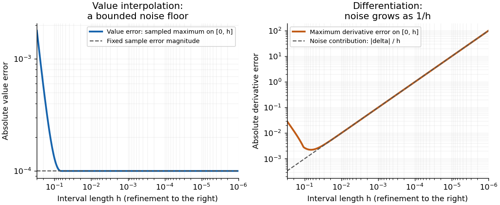

<h1 id="2/c/iii/solution">Solution</h1>

↑ **Parent:** [Iii](../iii.md)

Write $\widetilde p_1$ and $\widetilde q$ for the quantities computed from the perturbed second sample. The endpoint [linear interpolation](../../../../../linear-interpolation.md) and its [derivative](../../../../../derivative.md) are

$$
\widetilde p_1(x)=\frac{x}{h}\bigl(\sin(ah)+a\epsilon\bigr),\qquad
\widetilde q(x)=\frac{\sin(ah)}h+\frac{a\epsilon}{h}.
$$

Compare them on their interpolation [interval](../../../../../interval-mathematics.md) $0\leq x\leq h$, with fixed $a>0$. Put $x=th$, $0\leq t\leq1$. The [Taylor series](../../../../../taylor-series.md) of the [sine](../../../../../sine.md) gives, uniformly in $t$,

$$
\begin{aligned}
\widetilde p_1(th)-\sin(ath)
&=at\epsilon+\frac{a^3h^3}{6}(t^3-t)+O(h^5),\\
\widetilde q-f'(0)
&=\widetilde q-a=\frac{a\epsilon}{h}-\frac{a^3h^2}{6}+O(h^4).
\end{aligned}
$$

Here the second equality compares with $f'(0)=a$. More generally, the exact [derivative](../../../../../derivative.md) is $f'(th)=a\cos(ath)$ and

$$
\widetilde q-f'(th)=\frac{a\epsilon}{h}+a^3h^2\left(\frac{t^2}{2}-\frac16\right)+O(h^4).
$$

The input perturbation itself changes the value [interpolant](../../../../../interpolant.md) by exactly $a\epsilon x/h$, and changes its [derivative](../../../../../derivative.md) by exactly $a\epsilon/h$. Thus

$$
\boxed{\|\widetilde p_1-p_1\|_{\infty,[0,h]}=a|\epsilon|,\qquad
|\widetilde q-q|=\frac{a|\epsilon|}{h}.}
$$

For fixed nonzero $\epsilon$, the value approximation has a bounded noise floor: its maximum error approaches $a|\epsilon|$, and at $x=h$ that error is exactly $a|\epsilon|$. It **does not converge uniformly to the exact values** as $h\to0$. However, it does not amplify the absolute sample perturbation on $[0,h]$. The [derivative](../../../../../derivative.md) error instead grows without bound like $a|\epsilon|/h$.

With exact samples, $\epsilon=0$, both approximations do converge on the shrinking [interval](../../../../../interval-mathematics.md): the value error is $O(h^3)$ for this particular [sine](../../../../../sine.md), and the [derivative](../../../../../derivative.md) error is $O(h^2)$. With step-dependent noise, value convergence requires $\epsilon(h)\to0$, whereas [derivative](../../../../../derivative.md) convergence requires the stronger $\epsilon(h)=o(h)$, where $o$ denotes [little o notation](../../../../../little-o-notation.md).

This is [noise amplification by differentiation of a linear interpolant](../../../../../noise-amplification-by-differentiation-of-a-linear-interpolant.md). Value [interpolation](../../../../../interpolation-split.md) has an absolute perturbation bound independent of $h$ on the sampled [interval](../../../../../interval-mathematics.md). Numerical [differentiation](../../../../../differentiation.md) has a perturbation factor $1/h$, expressing the [ill-posedness of numerical differentiation](../../../../../ill-posedness-of-numerical-differentiation.md) from values with fixed absolute uncertainty. The amplification follows from the mathematical data map even in exact arithmetic; it is distinct from additional [roundoff error](../../../../../round-off-error.md) in a particular implementation. For fixed $x$ outside $[0,h]$, the operation becomes [extrapolation](../../../../../extrapolation.md), and the value perturbation $a\epsilon x/h$ can also diverge.

**[Figure 1](#2/c/iii/image-fixed-sample-noise-gives-a-bounded-value-error-floor-while-differentiation-amplifies-it-as-1-h). Fixed sample noise gives a bounded value-error floor while differentiation amplifies it as $1/h$**.

## ↑ Ancestors (13)

1. [Iii](../iii.md)
2. [C](../../c.md)
3. [2](../../../2.md)
4. [2015](../../../../2015-split.md)
5. [Past exam of the numerical analysis course of the University of Oxford](../../../../split.md)
6. [Numerical analysis course of the University of Oxford](../../../../../numerical-analysis-course-of-the-university-of-oxford.md)
7. [Year 2 of the mathematics course of the University of Oxford](../../../../../year-2-of-the-mathematics-course-of-the-university-of-oxford.md)
8. [Mathematics course of the University of Oxford](../../../../../mathematics-course-of-the-university-of-oxford.md)
9. [Undergraduate course of the University of Oxford](../../../../../undergraduate-course-of-the-university-of-oxford.md)
10. [Course of the University of Oxford](../../../../../course-of-the-university-of-oxford.md)
11. [University of Oxford](../../../../../university-of-oxford-split.md)
12. [List of universities](../../../../../list-of-universities.md)
13. [Codex Wiki](../../../../../split.md)
