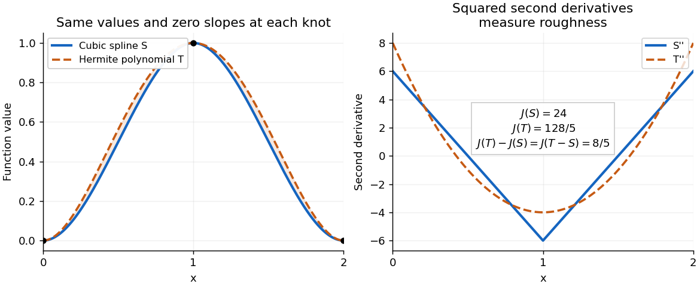

# 2017

↑ **Parent:** [Past exam of the numerical analysis course of the University of Oxford](../past-exam-of-the-numerical-analysis-course-of-the-university-of-oxford.md)

Source release: [Oxford examination archive](https://www.whatdotheyknow.com/request/maths_papers_2/response/1850333/attach/3/FOI%2020210708%201%20Data.zip?cookie_passthrough=1), member `FOI-20210708-1 - Data/a13759w1 (2).pdf`. The cover dates this examination to 12 June 2017.

Answer availability checked on 28 October 2026: Oxford advertises solutions for even examination years and an exceptional release for 2019; its stated policy excludes other odd years. No advertisement covering this exact paper or selected parts was found in a bounded search of official sources.[Mathematical Institute, “Past papers and model solutions”: odd-year solutions are not released, with an exception for 2019](https://www.maths.ox.ac.uk/members/students/undergraduate-courses/examinations-assessments/overview-examinations)

**Table of contents**

- [1](#1)
  - [a](#1/a)
    - [Solution](#1/a/solution)
  - [b](#1/b)
    - [Solution](#1/b/solution)
  - [c](#1/c)
    - [Solution](#1/c/solution)
  - [d](#1/d)
    - [i](#1/d/i)
      - [Solution](#1/d/i/solution)
    - [ii](#1/d/ii)
      - [Solution](#1/d/ii/solution)
    - [iii](#1/d/iii)
      - [Solution](#1/d/iii/solution)
- [2](#2)
  - [a](#2/a)
    - [Solution](#2/a/solution)
  - [b](#2/b)
    - [Solution](#2/b/solution)
  - [c](#2/c)
    - [Solution](#2/c/solution)
- [3](#3)
  - [a](#3/a)
    - [Solution](#3/a/solution)
  - [b](#3/b)
    - [i](#3/b/i)
      - [Solution](#3/b/i/solution)
    - [ii](#3/b/ii)
      - [Solution](#3/b/ii/solution)
    - [iii](#3/b/iii)
      - [Solution](#3/b/iii/solution)

## 1

↑ **Parent:** [2017](2017.md)

<h3 id="1/a">a</h3>

↑ **Parent:** [1](#1)

<h4 id="1/a/solution">Solution</h4>

↑ **Parent:** [A](#1/a)

For each [interpolation node](../interpolation.md#interpolation-node) define the [Lagrange cardinal polynomial](../interpolation.md#lagrange-cardinal-polynomial)

$$
\ell_j(x)=\prod_{\substack{0\leq k\leq n\\k\ne j}}\frac{x-x_k}{x_j-x_k},\qquad 0\leq j\leq n.
$$

All denominators are nonzero because the [interpolation nodes](../interpolation.md#interpolation-node) are distinct. Each [polynomial](../polynomial.md) has [polynomial degree](../polynomial.md#degree-of-a-polynomial) at most $n$, and $\ell_j(x_i)=\delta_{ij}$, where $\delta_{ij}$ is the [Kronecker delta](../multilinear-algebra.md#kronecker-delta). Consequently the [linear combination](../vector-space.md#linear-combination)

$$
p_n(x)=\sum_{j=0}^n f_j\ell_j(x)
$$

belongs to the [vector space of univariate polynomials](../polynomial.md#vector-space-of-univariate-polynomials) $\Pi_n$ and has the required values. This proves existence of the [Lagrange interpolation polynomial](../interpolation.md#lagrange-polynomial).

For uniqueness, suppose $p_n$ and $r_n$ both work. Their difference is a [polynomial](../polynomial.md) of [polynomial degree](../polynomial.md#degree-of-a-polynomial) at most $n$ with $n+1$ distinct [roots of a polynomial](../polynomial.md#root-of-a-polynomial). The [root bound for a polynomial](../polynomial.md#lagrange-root-bound-over-a-field) forces $p_n-r_n$ to be the [zero polynomial](../polynomial.md#zero-polynomial).

The seven supplied values follow $f_i=i^2+1$. The [quadratic polynomial](../polynomial.md#quadratic-polynomial) $x^2+1$ belongs to $\Pi_6$ and takes all seven values, so uniqueness gives

$$
\boxed{p_6(x)=x^2+1.}
$$

The subscript bounds the [polynomial degree](../polynomial.md#degree-of-a-polynomial); it does not require [polynomial degree](../polynomial.md#degree-of-a-polynomial) exactly six.

<h3 id="1/b">b</h3>

↑ **Parent:** [1](#1)

<h4 id="1/b/solution">Solution</h4>

↑ **Parent:** [B](#1/b)

The [product rule](../calculus.md#product-rule) applied at the [interpolation node](../interpolation.md#interpolation-node) $x_k$ gives

$$
w'(x_k)=\prod_{j\ne k}(x_k-x_j)\ne0,\qquad
\ell_k(x)=\frac{w(x)}{(x-x_k)w'(x_k)}=w(x)\frac{w_k}{x-x_k}.
$$

Thus [Lagrange interpolation](../interpolation.md#lagrange-polynomial) gives, away from the [interpolation nodes](../interpolation.md#interpolation-node),

$$
p_n(x)=w(x)\sum_{k=0}^n\frac{w_k f_k}{x-x_k}.
$$

Apply the same [Lagrange interpolation](../interpolation.md#lagrange-polynomial) formula to the [constant polynomial](../polynomial.md#constant-polynomial) one. Since its [interpolant](../interpolation.md#interpolant) is itself,

$$
1=\sum_{k=0}^n\ell_k(x)=w(x)\sum_{k=0}^n\frac{w_k}{x-x_k}.
$$

Dividing the preceding two identities proves the [barycentric interpolation formula](../interpolation.md#barycentric-interpolation-formula)

$$
\boxed{p_n(x)=\frac{\displaystyle\sum_{k=0}^n w_k f_k/(x-x_k)}{\displaystyle\sum_{k=0}^n w_k/(x-x_k)}.}
$$

The denominator is exactly $1/w(x)$, so is nonzero away from the [interpolation nodes](../interpolation.md#interpolation-node). At $x=x_j$, multiply numerator and denominator by $x-x_j$ and take the [limit](../calculus.md#limit-of-a-function): their values tend to $w_jf_j$ and $w_j$, respectively. The [removable singularity](../isolated-singularity.md#removable-singularity) therefore has value $f_j$; in numerical evaluation return the stored value directly at an [interpolation node](../interpolation.md#interpolation-node).

<h3 id="1/c">c</h3>

↑ **Parent:** [1](#1)

<h4 id="1/c/solution">Solution</h4>

↑ **Parent:** [C](#1/c)

A [Newton-Cotes quadrature](../numerical-integration.md#newton-cotes-quadrature) integrates a [Lagrange interpolation polynomial](../interpolation.md#lagrange-polynomial) at equally spaced [quadrature nodes](../numerical-integration.md#quadrature-node). For the [Newton-Cotes closed quadrature](../numerical-integration.md#newton-cotes-closed-quadrature), the endpoints are included: write $x_j=a+jh$, $h=(b-a)/n$, and use

$$
\int_a^bf(x)\,dx\ \approx\ \int_a^bp_n(x)\,dx
=\sum_{j=0}^n W_jf(x_j),\qquad W_j=\int_a^b\ell_j(x)\,dx.
$$

These [quadrature weights](../numerical-integration.md#quadrature-weight) depend on the [quadrature nodes](../numerical-integration.md#quadrature-node), not on the sampled [function](../function.md). Open [Newton-Cotes quadrature](../numerical-integration.md#newton-cotes-quadrature) uses equally spaced interior [quadrature nodes](../numerical-integration.md#quadrature-node) instead.

For [Simpson's rule](../numerical-integration.md#simpson-s-rule), use $n=2$ and set $x=a+ht$, so $0\leq t\leq2$. The [Lagrange cardinal polynomials](../interpolation.md#lagrange-cardinal-polynomial) become

$$
L_0(t)=\frac{(t-1)(t-2)}2,\qquad L_1(t)=t(2-t),\qquad L_2(t)=\frac{t(t-1)}2.
$$

Integrating these [quadratic polynomials](../polynomial.md#quadratic-polynomial) gives $1/3$, $4/3$, $1/3$, respectively. The change of variable contributes $h$, so

$$
\boxed{\int_a^bf(x)\,dx\ \approx\ \frac h3\bigl[f(a)+4f(a+h)+f(b)\bigr]
=\frac{b-a}{6}\left[f(a)+4f\!\left(\frac{a+b}{2}\right)+f(b)\right].}
$$

Its [degree of precision of a quadrature rule](../numerical-integration.md#degree-of-precision-of-a-quadrature-rule) is three: it integrates every [quadratic polynomial](../polynomial.md#quadratic-polynomial) by construction, and also the cubic nodal [polynomial](../polynomial.md) $(x-a)(x-a-h)(x-b)$, whose [integral](../integral.md) vanishes by odd symmetry about $a+h$. Any [cubic polynomial](../polynomial.md#cubic-polynomial) differs from its [quadratic polynomial](../polynomial.md#quadratic-polynomial) [interpolant](../interpolation.md#interpolant) by a constant multiple of this nodal [polynomial](../polynomial.md).

<h3 id="1/d">d</h3>

↑ **Parent:** [1](#1)

Read the differential order $dx\,dy$ literally: take [quadrature nodes](../numerical-integration.md#quadrature-node) $X=(c,(c+d)/2,d)$ in $x$ and $Y=(a,(a+b)/2,b)$ in $y$. Applying [Simpson's rule](../numerical-integration.md#simpson-s-rule) first in $x$ and then in $y$ multiplies the one-dimensional [quadrature weights](../numerical-integration.md#quadrature-weight). With $s=(1,4,1)$, this [tensor-product quadrature](../numerical-integration.md#tensor-product-quadrature) is

$$
Q(g)=\frac{(b-a)(d-c)}{36}\sum_{i=0}^2\sum_{j=0}^2s_i s_jg(X_i,Y_j).
$$

Equivalently, the nine sampled [function](../function.md) values have the [quadrature weight](../numerical-integration.md#quadrature-weight) array

$$
\frac{(b-a)(d-c)}{36}
\begin{pmatrix}1&4&1\\4&16&4\\1&4&1\end{pmatrix},
$$

with rows indexed by the $x$ [quadrature nodes](../numerical-integration.md#quadrature-node) and columns by the $y$ [quadrature nodes](../numerical-integration.md#quadrature-node). The [quadrature weights](../numerical-integration.md#quadrature-weight) sum to the [rectangle](../euclidean-geometry.md#rectangle)'s area. If the intended coordinate assignment is instead $x\in[a,b]$, $y\in[c,d]$, exchange $X$ and $Y$ in the formula. Both conventions give the same calculation on the unit square used below.

For the [separable integrand](../numerical-integration.md#separable-integrand), [tensor-product quadrature](../numerical-integration.md#tensor-product-quadrature) factors into two one-dimensional applications of [Simpson's rule](../numerical-integration.md#simpson-s-rule):

$$
Q_x\bigl(x(1-x)\bigr)=\frac16\left[0+4\cdot\frac14+0\right]=\frac16,
\qquad
Q_y(y^q)=\frac{1+4\,2^{-q}}6,
$$

so

$$
\boxed{Q(g)=\frac{1+2^{2-q}}{36}.}
$$

The exact [double integral](../integral.md#double-integral), evaluated by [Fubini's theorem](../measure-theory.md#fubini-s-theorem) and the [power rule for integration](../integral.md#power-rule-for-integration), is

$$
I(g)=\left(\int_0^1x(1-x)\,dx\right)\left(\int_0^1y^q\,dy\right)
=\frac{1}{6(q+1)}.
$$

The $x$ factor is always integrated exactly. All [quadrature error](../real-analysis.md#quadrature-error) therefore comes from applying [Simpson's rule](../numerical-integration.md#simpson-s-rule) to the $y$ factor.

<h4 id="1/d/i">i</h4>

↑ **Parent:** [D](#1/d)

<h5 id="1/d/i/solution">Solution</h5>

↑ **Parent:** [I](#1/d/i)

At $q=2$, the preceding [tensor-product quadrature](../numerical-integration.md#tensor-product-quadrature) gives

$$
\boxed{Q(g)=\frac{1+1}{36}=\frac1{18}=I(g).}
$$

Both factors of the [separable integrand](../numerical-integration.md#separable-integrand) are [quadratic polynomials](../polynomial.md#quadratic-polynomial), so exactness follows directly from the construction of [Simpson's rule](../numerical-integration.md#simpson-s-rule).

<h4 id="1/d/ii">ii</h4>

↑ **Parent:** [D](#1/d)

<h5 id="1/d/ii/solution">Solution</h5>

↑ **Parent:** [Ii](#1/d/ii)

At $q=3$,

$$
\boxed{Q(g)=\frac{1+1/2}{36}=\frac1{24}=I(g).}
$$

The $y$ factor is now a [cubic polynomial](../polynomial.md#cubic-polynomial). [Simpson's rule](../numerical-integration.md#simpson-s-rule) still integrates it exactly because its [degree of precision of a quadrature rule](../numerical-integration.md#degree-of-precision-of-a-quadrature-rule) is three. Exactness of [tensor-product quadrature](../numerical-integration.md#tensor-product-quadrature) depends on the [polynomial degree](../polynomial.md#degree-of-a-polynomial) in each variable, rather than their sum.

<h4 id="1/d/iii">iii</h4>

↑ **Parent:** [D](#1/d)

<h5 id="1/d/iii/solution">Solution</h5>

↑ **Parent:** [Iii](#1/d/iii)

At $q=4$,

$$
\boxed{Q(g)=\frac{1+1/4}{36}=\frac5{144},\qquad I(g)=\frac1{30}.}
$$

This is an overestimate, with signed [quadrature error](../real-analysis.md#quadrature-error)

$$
Q(g)-I(g)=\frac{25-24}{720}=\frac1{720}.
$$

The [relative error](../numerical-analysis.md#relative-error) is $(1/720)/(1/30)=1/24$, approximately $4.17\%$. The [quartic polynomial](../polynomial.md#quartic-polynomial) $y^4$ lies beyond the [degree of precision of a quadrature rule](../numerical-integration.md#degree-of-precision-of-a-quadrature-rule) of [Simpson's rule](../numerical-integration.md#simpson-s-rule), so the exactness of the previous cases no longer applies.

## 2

↑ **Parent:** [2017](2017.md)

<h3 id="2/a">a</h3>

↑ **Parent:** [2](#2)

<h4 id="2/a/solution">Solution</h4>

↑ **Parent:** [A](#2/a)

[Gaussian elimination](../numerical-linear-algebra.md#gaussian-elimination) uses [elementary row operations](../numerical-linear-algebra.md#elementary-row-operation) to remove entries below successive [pivot elements](../numerical-linear-algebra.md#pivot-element), reducing a [linear system](../linear-algebra.md#system-of-linear-equations) to one with an [upper triangular matrix](../linear-algebra.md#upper-triangular-matrix). [Back substitution](../linear-algebra.md#back-substitution) then solves that system. It also computes a reusable [matrix factorization](../vector-space.md#matrix-decomposition), so additional right-hand sides can be handled by [forward substitution](../numerical-linear-algebra.md#forward-substitution) and [back substitution](../linear-algebra.md#back-substitution) without repeating the elimination.

For elimination without row exchanges, let $A^{(1)}=A$. At step $k$, provided the [pivot element](../numerical-linear-algebra.md#pivot-element) $a_{kk}^{(k)}$ is nonzero, form the [elimination multipliers](../numerical-linear-algebra.md#elimination-multiplier)

$$
m_{ik}=\frac{a_{ik}^{(k)}}{a_{kk}^{(k)}},\qquad i=k+1,\ldots,n,
$$

and perform $\text{row}_i\leftarrow\text{row}_i-m_{ik}\text{row}_k$, applying the same operation to the right-hand side. More explicitly the resulting entries satisfy $a_{ij}^{(k+1)}=a_{ij}^{(k)}-m_{ik}a_{kj}^{(k)}$ for $i>k$, $j\geq k$.

Let $E_k=I-\sum_{i>k}m_{ik}e_i e_k^T$, where $e_i$ are the [standard basis](../vector-space.md#standard-basis) [vectors](../vector-space.md#vector). Then

$$
U=E_{n-1}\cdots E_1A,\qquad
A=LU,\qquad L=E_1^{-1}\cdots E_{n-1}^{-1}.
$$

The [matrix](../vector-space.md#matrix) $L$ is a [unit lower triangular matrix](../linear-algebra.md#unit-lower-triangular-matrix) storing the [elimination multipliers](../numerical-linear-algebra.md#elimination-multiplier), while $U$ is an [upper triangular matrix](../linear-algebra.md#upper-triangular-matrix):

$$
L=\begin{pmatrix}
1&0&\cdots&0\\
m_{21}&1&\cdots&0\\
\vdots&\vdots&\ddots&\vdots\\
m_{n1}&m_{n2}&\cdots&1
\end{pmatrix},\qquad
U=\begin{pmatrix}
u_{11}&u_{12}&\cdots&u_{1n}\\
0&u_{22}&\cdots&u_{2n}\\
\vdots&\vdots&\ddots&\vdots\\
0&0&\cdots&u_{nn}
\end{pmatrix}.
$$

Solving $Ax=b$ becomes $Ly=b$ followed by $Ux=y$. If a required [pivot element](../numerical-linear-algebra.md#pivot-element) vanishes, an unpermuted [LU decomposition](../numerical-linear-algebra.md#lu-decomposition) can fail even for an [invertible matrix](../linear-algebra.md#invertible-matrix). Row exchanges, typically selected by [partial pivoting](../numerical-linear-algebra.md#columnwise-partial-pivoting), instead produce $PA=LU$ with a [permutation matrix](../vector-space.md#permutation-matrix) $P$; then solve $Ly=Pb$, $Ux=y$.

<h3 id="2/b">b</h3>

↑ **Parent:** [2](#2)

<h4 id="2/b/solution">Solution</h4>

↑ **Parent:** [B](#2/b)

Since every $u_{jj}>0$, the [diagonal matrix](../linear-algebra.md#diagonal-matrix) $D$ is invertible. Set

$$
\widehat U=D^{-1}U,\qquad
\widehat u_{ij}=\frac{u_{ij}}{u_{ii}}.
$$

The division is by the diagonal entry of row $i$. Thus $\widehat U$ is an [upper triangular matrix](../linear-algebra.md#upper-triangular-matrix) with diagonal entries one and $A=LD\widehat U$.

To use symmetry without assuming the conclusion, multiply by the [matrix inverse](../matrix-inverse.md) of $L$ and its [transpose](../vector-space.md#transpose):

$$
M=L^{-1}AL^{-T}=D\widehat U L^{-T}.
$$

The [matrix](../vector-space.md#matrix) $M$ is symmetric because $A$ is a [symmetric matrix](../linear-algebra.md#symmetric-matrix). It is also an [upper triangular matrix](../linear-algebra.md#upper-triangular-matrix), since every factor on the right is an [upper triangular matrix](../linear-algebra.md#upper-triangular-matrix). A symmetric [upper triangular matrix](../linear-algebra.md#upper-triangular-matrix) is diagonal. Its diagonal is exactly $D$, because $\widehat U$ and $L^{-T}$ have diagonal entries one. Hence $M=D$, giving

$$
\boxed{A=LDL^T,\qquad \widehat U=L^T.}
$$

This is the [LDL decomposition](../numerical-linear-algebra.md#ldl-decomposition).

Take the positive [square roots](../algebra.md#square-root) of the diagonal entries:

$$
D^{1/2}=\operatorname{diag}(\sqrt{u_{11}},\ldots,\sqrt{u_{nn}}),\qquad
\widehat L=LD^{1/2}.
$$

The [matrix](../vector-space.md#matrix) $\widehat L$ is a [lower triangular matrix](../linear-algebra.md#lower-triangular-matrix) with positive diagonal, and

$$
\boxed{A=\widehat L\widehat L^T.}
$$

This is a [Cholesky decomposition](../quadratic-form.md#cholesky-decomposition). For a nonzero [vector](../vector-space.md#vector) $x$, the [vector](../vector-space.md#vector) $\widehat L^Tx$ is nonzero because $\widehat L^T$ is invertible. Therefore

$$
\boxed{x^TAx=(\widehat L^Tx)^T(\widehat L^Tx)=\|\widehat L^Tx\|_2^2>0.}
$$

Here $\|\cdot\|_2$ is the [Euclidean norm](../normed-vector-space.md#euclidean-norm). Thus $A$ is a [positive-definite matrix](../quadratic-form.md#positive-definite-matrix).

<h3 id="2/c">c</h3>

↑ **Parent:** [2](#2)

<h4 id="2/c/solution">Solution</h4>

↑ **Parent:** [C](#2/c)

For a real square [matrix](../vector-space.md#matrix), a [QR factorization](../inner-product.md#qr-decomposition) writes $B=QR$ with $Q$ an [orthogonal matrix](../linear-algebra.md#orthogonal-matrix), $Q^TQ=I$, and $R$ an [upper triangular matrix](../linear-algebra.md#upper-triangular-matrix). If $B$ is invertible, so is $R$, and

$$
Bx=b\quad\Longleftrightarrow\quad Rx=Q^Tb.
$$

Compute $Q^Tb$ and use [back substitution](../linear-algebra.md#back-substitution); no [matrix inverse](../matrix-inverse.md) needs to be formed.

Apply the [Gram-Schmidt process](../inner-product.md#gram-schmidt-process) to the columns $b_1,b_2,b_3$. The first column has [Euclidean norm](../normed-vector-space.md#euclidean-norm) two, giving $q_1=(1,0,0)^T$ and $r_{11}=2$. For the second column,

$$
r_{12}=q_1^Tb_2=1,\qquad b_2-r_{12}q_1=(0,4,3)^T,
\qquad r_{22}=5,\qquad q_2=(0,4/5,3/5)^T.
$$

For the third column,

$$
r_{13}=q_1^Tb_3=0,\qquad r_{23}=q_2^Tb_3=7,
\qquad b_3-7q_2=(0,-3/5,4/5)^T.
$$

This residual already has [Euclidean norm](../normed-vector-space.md#euclidean-norm) one. Set $q_3=(0,-3/5,4/5)^T$ and $r_{33}=1$. Thus

$$
\boxed{Q=\begin{pmatrix}1&0&0\\0&4/5&-3/5\\0&3/5&4/5\end{pmatrix},\qquad
R=\begin{pmatrix}2&1&0\\0&5&7\\0&0&1\end{pmatrix}.}
$$

The columns of $Q$ are [orthonormal](../inner-product.md#orthonormal-set), and [matrix multiplication](../vector-space.md#matrix-multiplication) verifies $QR=B$.

Using precisely this [QR factorization](../inner-product.md#qr-decomposition), transform the right-hand side:

$$
Q^T\begin{pmatrix}-3\\1\\2\end{pmatrix}
=\begin{pmatrix}-3\\(4+6)/5\\(-3+8)/5\end{pmatrix}
=\begin{pmatrix}-3\\2\\1\end{pmatrix}.
$$

[Back substitution](../linear-algebra.md#back-substitution) in $Rx=Q^Tb$ gives

$$
x_3=1,\qquad 5x_2+7=2\ \Longrightarrow\ x_2=-1,
\qquad 2x_1-1=-3\ \Longrightarrow\ x_1=-1.
$$

Therefore

$$
\boxed{x=(-1,-1,1)^T.}
$$

## 3

↑ **Parent:** [2017](2017.md)

<h3 id="3/a">a</h3>

↑ **Parent:** [3](#3)

<h4 id="3/a/solution">Solution</h4>

↑ **Parent:** [A](#3/a)

A [linear spline](../uniform-approximation.md#linear-spline) is a [continuous function](../calculus.md#continuous-function) whose restriction to every [interval](../real-analysis.md#interval-mathematics) $[x_{i-1},x_i]$ is a [polynomial](../polynomial.md) of [polynomial degree](../polynomial.md#degree-of-a-polynomial) at most one. With $h_i=x_i-x_{i-1}$ and $\ell_i=\ell(x_i)$, [linear interpolation](../function.md#linear-interpolation) gives

$$
\ell(x)=\frac{x_i-x}{h_i}\ell_{i-1}+\frac{x-x_{i-1}}{h_i}\ell_i,
\qquad x_{i-1}\leq x\leq x_i.
$$

Integrating the two [linear polynomials](../polynomial.md#linear-polynomial) and adding the contributions gives

$$
\boxed{\int_{x_0}^{x_n}\ell(x)\,dx=\sum_{i=1}^n\frac{h_i}{2}\bigl(\ell_{i-1}+\ell_i\bigr).}
$$

This is the [composite trapezoidal rule](../runge-kutta-method.md#composite-trapezoidal-rule) applied to the nodal values, and it is exact for the [linear spline](../uniform-approximation.md#linear-spline) itself, including nonuniform [spline knots](../uniform-approximation.md#spline-knot).

A [cubic spline](../uniform-approximation.md#cubic-spline) on this [partition of an interval](../real-analysis.md#partition-of-an-interval) is a [function](../function.md) $S\in C^2[x_0,x_n]$ that restricts to a [polynomial](../polynomial.md) of [polynomial degree](../polynomial.md#degree-of-a-polynomial) at most three on every [interval](../real-analysis.md#interval-mathematics) $[x_{i-1},x_i]$. Thus its [second derivative](../calculus.md#second-derivative) is continuous and piecewise of [polynomial degree](../polynomial.md#degree-of-a-polynomial) at most one: **$S''$ is a [linear spline](../uniform-approximation.md#linear-spline) on the same [spline knots](../uniform-approximation.md#spline-knot)**. Its [third derivative](../calculus.md#third-derivative) is constant on each open [interval](../real-analysis.md#interval-mathematics) and can jump across the [spline knots](../uniform-approximation.md#spline-knot); its [fourth derivative](../calculus.md#fourth-derivative) vanishes inside each open [interval](../real-analysis.md#interval-mathematics).

<h3 id="3/b">b</h3>

↑ **Parent:** [3](#3)

<h4 id="3/b/i">i</h4>

↑ **Parent:** [B](#3/b)

<h5 id="3/b/i/solution">Solution</h5>

↑ **Parent:** [I](#3/b/i)

Put $E=T-S$. Matching [interpolation](../interpolation.md) data and endpoint [derivatives](../calculus.md#derivative) gives

$$
E(x_i)=0\quad(0\leq i\leq n),\qquad E'(x_0)=E'(x_n)=0.
$$

The endpoint slope constraints make $S$ a [clamped cubic spline](../uniform-approximation.md#clamped-cubic-spline). The decisive step in its [minimum roughness property of a clamped cubic spline](../uniform-approximation.md#minimum-roughness-property-of-a-clamped-cubic-spline) is the [orthogonality](../inner-product.md#orthogonal-vectors) identity

$$
\int_{x_0}^{x_n}S''(x)E''(x)\,dx=0.
$$

Prove it separately on each [interval](../real-analysis.md#interval-mathematics). Two applications of [integration by parts](../calculus.md#integration-by-parts), using the vanishing [fourth derivative](../calculus.md#fourth-derivative) of the cubic piece, give

$$
\int_{x_{i-1}}^{x_i}S''E''\,dx
=[S''E']_{x_{i-1}}^{x_i}-[S'''E]_{x_{i-1}}^{x_i}
=[S''E']_{x_{i-1}}^{x_i}.
$$

The second boundary term is zero because $E$ vanishes at both endpoints of this [interval](../real-analysis.md#interval-mathematics). Sum over $i$. At each interior [spline knot](../uniform-approximation.md#spline-knot), the two values of $S''E'$ agree because both factors are continuous, so the contributions cancel. The remaining outer boundary terms vanish because $E'$ is zero at both outer endpoints. This proves the identity.

Expanding the square now gives the stronger exact equality

$$
\boxed{\int_{x_0}^{x_n}(T'')^2\,dx
=\int_{x_0}^{x_n}(S'')^2\,dx
+\int_{x_0}^{x_n}(T''-S'')^2\,dx.}
$$

The last [integral](../integral.md) is nonnegative, proving the required inequality. It measures the excess [second derivative roughness penalty](../uniform-approximation.md#second-derivative-roughness-penalty) of $T$ over $S$.

The argument applies directly to twice continuously differentiable competitors. More generally it holds when $T'$ is an [absolutely continuous function](../sobolev-space.md#absolutely-continuous-function) and $T''$ is [square-integrable](../measure-theory.md#square-integrable-function), the usual finite-energy class for this [second derivative roughness penalty](../uniform-approximation.md#second-derivative-roughness-penalty). Mere existence of pointwise [second derivatives](../calculus.md#second-derivative) does not by itself guarantee that all displayed [integrals](../integral.md) exist; the variational statement is understood for admissible competitors with this regularity.

<h4 id="3/b/ii">ii</h4>

↑ **Parent:** [B](#3/b)

<h5 id="3/b/ii/solution">Solution</h5>

↑ **Parent:** [Ii](#3/b/ii)

Let $R$ be a second [cubic spline](../uniform-approximation.md#cubic-spline) matching the same values and endpoint [derivatives](../calculus.md#derivative). The [minimum roughness property of a clamped cubic spline](../uniform-approximation.md#minimum-roughness-property-of-a-clamped-cubic-spline) applied with $S$ as the minimizing [cubic spline](../uniform-approximation.md#cubic-spline) gives $J(R)\geq J(S)$, where $J(u)=\int_{x_0}^{x_n}(u'')^2\,dx$. Applying the same argument with their roles exchanged gives $J(S)\geq J(R)$. Hence equality holds, and the exact identity from part (i) yields

$$
\int_{x_0}^{x_n}(R''-S'')^2\,dx=0.
$$

The [integrand](../integral.md#integrand) is continuous and nonnegative. If it were positive somewhere, it would have a positive [integral](../integral.md) over a small [interval](../real-analysis.md#interval-mathematics). It follows that $R''=S''$ everywhere. Consequently $R-S$ is an [affine function](../vector-space.md#affine-function). Its value and [derivative](../calculus.md#derivative) vanish at $x_0$, so it is identically zero. Thus $R=S$, proving uniqueness of the [clamped cubic spline](../uniform-approximation.md#clamped-cubic-spline) with the prescribed data. Existence was assumed in the question; this argument establishes the remaining uniqueness claim.

<h4 id="3/b/iii">iii</h4>

↑ **Parent:** [B](#3/b)

<h5 id="3/b/iii/solution">Solution</h5>

↑ **Parent:** [Iii](#3/b/iii)

Fix $i$, write $\alpha=x_{i-1}$, $\beta=x_i$, and let $E=T-S$ on this [interval](../real-analysis.md#interval-mathematics). The [Hermite interpolation](../algebra.md#hermite-interpolation) conditions give both

$$
E(\alpha)=E(\beta)=0,\qquad E'(\alpha)=E'(\beta)=0.
$$

Two applications of [integration by parts](../calculus.md#integration-by-parts) therefore give

$$
\int_\alpha^\beta E T^{(4)}\,dx
=[ET'''-E'T'']_\alpha^\beta+\int_\alpha^\beta E''T''\,dx
=\int_\alpha^\beta E''T''\,dx.
$$

On this single cubic piece, the same calculation also gives

$$
\int_\alpha^\beta E''S''\,dx
=[E'S''-ES''']_\alpha^\beta+\int_\alpha^\beta ES^{(4)}\,dx=0.
$$

Here $S^{(4)}=0$ inside the [interval](../real-analysis.md#interval-mathematics), and all four endpoint values of $E,E'$ are zero. Since $T''=E''+S''$, we obtain the exact identity

$$
\boxed{\int_{x_{i-1}}^{x_i}(T-S)T^{(4)}\,dx
=\int_{x_{i-1}}^{x_i}(T''-S'')^2\,dx\geq0.}
$$

This is an [integral](../integral.md) inequality, with no assertion that the [integrand](../integral.md#integrand) on the left has one sign pointwise. The stronger nodal [derivative](../calculus.md#derivative) conditions make the boundary terms vanish on each [interval](../real-analysis.md#interval-mathematics) separately; part (i) only needed their cancellation after summing.

The stated [Hermite interpolating polynomial](../algebra.md#hermite-interpolating-polynomial) exists uniquely in $\Pi_{2n+1}$. Indeed, a [polynomial](../polynomial.md) in the [kernel of a linear map](../kernel-of-a-linear-map.md) of the value-and-[derivative](../calculus.md#derivative) data map has a double [root of a polynomial](../polynomial.md#root-of-a-polynomial) at each of $n+1$ distinct [interpolation nodes](../interpolation.md#interpolation-node). A nonzero such [polynomial](../polynomial.md) would have [polynomial degree](../polynomial.md#degree-of-a-polynomial) at least $2n+2$, which is impossible. The map is therefore an [injective function](../algebra.md#injective-function) and a [linear map](../vector-space.md#linear-map) between [vector spaces](../vector-space.md) of the same finite [dimension of a vector space](../vector-space.md#dimension-vector-space), $2n+2$, and hence is a [linear isomorphism](../vector-space.md#linear-isomorphism). No higher smoothness of the original [function](../function.md) $f$ is required to construct it.

An explicit illustration uses [interpolation nodes](../interpolation.md#interpolation-node) $0,1,2$, values $0,1,0$, and zero [derivatives](../calculus.md#derivative) at every [interpolation node](../interpolation.md#interpolation-node). The [clamped cubic spline](../uniform-approximation.md#clamped-cubic-spline) is $S(x)=3x^2-2x^3$ on $[0,1]$ and its reflection on $[1,2]$. Its [Hermite interpolating polynomial](../algebra.md#hermite-interpolating-polynomial) is the [quartic polynomial](../polynomial.md#quartic-polynomial) $T(x)=x^2(2-x)^2$. On $[0,1]$, $T-S=x^2(1-x)^2$, and the corresponding reflected formula holds on $[1,2]$. Direct [integration](../integral.md) gives $J(S)=24$, $J(T)=128/5$, and $J(T-S)=8/5$, exactly as the energy identity predicts.

**[Figure 1](#3/b/iii/image-a-clamped-cubic-spline-and-a-hermite-interpolating-polynomial-with-the-same-nodal-values-and-derivatives-the-excess-second-derivative-roughness-penalty-is-8-5). A clamped cubic spline and a Hermite interpolating polynomial with the same nodal values and derivatives: the excess second derivative roughness penalty is $8/5$**.

## ↑ Ancestors (9)

1. [Past exam of the numerical analysis course of the University of Oxford](../past-exam-of-the-numerical-analysis-course-of-the-university-of-oxford.md)
2. [Numerical analysis course of the University of Oxford](../university-of-oxford.md#numerical-analysis-course-of-the-university-of-oxford)
3. [Year 2 of the mathematics course of the University of Oxford](../university-of-oxford.md#year-2-of-the-mathematics-course-of-the-university-of-oxford)
4. [Mathematics course of the University of Oxford](../university-of-oxford.md#mathematics-course-of-the-university-of-oxford)
5. [Undergraduate course of the University of Oxford](../university-of-oxford.md#undergraduate-course-of-the-university-of-oxford)
6. [Course of the University of Oxford](../university-of-oxford.md#course-of-the-university-of-oxford)
7. [University of Oxford](../university-of-oxford.md)
8. [List of universities](../README.md#list-of-universities)
9. [Codex Wiki](../README.md)
