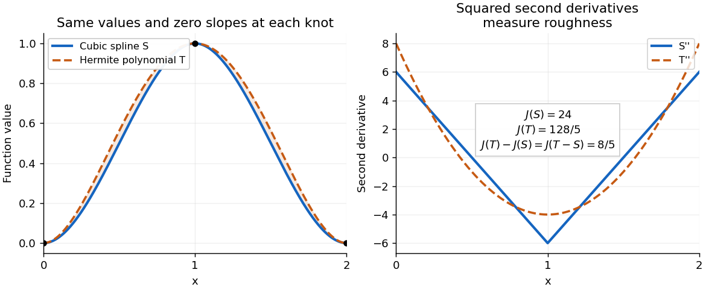

<h1 id="3/b/iii/solution">Solution</h1>

↑ **Parent:** [Iii](../iii.md)

Fix $i$, write $\alpha=x_{i-1}$, $\beta=x_i$, and let $E=T-S$ on this [interval](../../../../../interval-mathematics.md). The [Hermite interpolation](../../../../../hermite-interpolation.md) conditions give both

$$
E(\alpha)=E(\beta)=0,\qquad E'(\alpha)=E'(\beta)=0.
$$

Two applications of [integration by parts](../../../../../integration-by-parts.md) therefore give

$$
\int_\alpha^\beta E T^{(4)}\,dx
=[ET'''-E'T'']_\alpha^\beta+\int_\alpha^\beta E''T''\,dx
=\int_\alpha^\beta E''T''\,dx.
$$

On this single cubic piece, the same calculation also gives

$$
\int_\alpha^\beta E''S''\,dx
=[E'S''-ES''']_\alpha^\beta+\int_\alpha^\beta ES^{(4)}\,dx=0.
$$

Here $S^{(4)}=0$ inside the [interval](../../../../../interval-mathematics.md), and all four endpoint values of $E,E'$ are zero. Since $T''=E''+S''$, we obtain the exact identity

$$
\boxed{\int_{x_{i-1}}^{x_i}(T-S)T^{(4)}\,dx
=\int_{x_{i-1}}^{x_i}(T''-S'')^2\,dx\geq0.}
$$

This is an [integral](../../../../../integral-split.md) inequality, with no assertion that the [integrand](../../../../../integrand.md) on the left has one sign pointwise. The stronger nodal [derivative](../../../../../derivative.md) conditions make the boundary terms vanish on each [interval](../../../../../interval-mathematics.md) separately; part (i) only needed their cancellation after summing.

The stated [Hermite interpolating polynomial](../../../../../hermite-interpolating-polynomial.md) exists uniquely in $\Pi_{2n+1}$. Indeed, a [polynomial](../../../../../polynomial-split.md) in the [kernel of a linear map](../../../../../kernel-of-a-linear-map-split.md) of the value-and-[derivative](../../../../../derivative.md) data map has a double [root of a polynomial](../../../../../root-of-a-polynomial.md) at each of $n+1$ distinct [interpolation nodes](../../../../../interpolation-node.md). A nonzero such [polynomial](../../../../../polynomial-split.md) would have [polynomial degree](../../../../../degree-of-a-polynomial.md) at least $2n+2$, which is impossible. The map is therefore an [injective function](../../../../../injective-function.md) and a [linear map](../../../../../linear-map.md) between [vector spaces](../../../../../vector-space-split.md) of the same finite [dimension of a vector space](../../../../../dimension-vector-space.md), $2n+2$, and hence is a [linear isomorphism](../../../../../linear-isomorphism.md). No higher smoothness of the original [function](../../../../../function-split.md) $f$ is required to construct it.

An explicit illustration uses [interpolation nodes](../../../../../interpolation-node.md) $0,1,2$, values $0,1,0$, and zero [derivatives](../../../../../derivative.md) at every [interpolation node](../../../../../interpolation-node.md). The [clamped cubic spline](../../../../../clamped-cubic-spline.md) is $S(x)=3x^2-2x^3$ on $[0,1]$ and its reflection on $[1,2]$. Its [Hermite interpolating polynomial](../../../../../hermite-interpolating-polynomial.md) is the [quartic polynomial](../../../../../quartic-polynomial.md) $T(x)=x^2(2-x)^2$. On $[0,1]$, $T-S=x^2(1-x)^2$, and the corresponding reflected formula holds on $[1,2]$. Direct [integration](../../../../../integral-split.md) gives $J(S)=24$, $J(T)=128/5$, and $J(T-S)=8/5$, exactly as the energy identity predicts.

**[Figure 1](#3/b/iii/image-a-clamped-cubic-spline-and-a-hermite-interpolating-polynomial-with-the-same-nodal-values-and-derivatives-the-excess-second-derivative-roughness-penalty-is-8-5). A clamped cubic spline and a Hermite interpolating polynomial with the same nodal values and derivatives: the excess second derivative roughness penalty is $8/5$**.

## ↑ Ancestors (13)

1. [Iii](../iii.md)
2. [B](../../b.md)
3. [3](../../../3.md)
4. [2017](../../../../2017-split.md)
5. [Past exam of the numerical analysis course of the University of Oxford](../../../../split.md)
6. [Numerical analysis course of the University of Oxford](../../../../../numerical-analysis-course-of-the-university-of-oxford.md)
7. [Year 2 of the mathematics course of the University of Oxford](../../../../../year-2-of-the-mathematics-course-of-the-university-of-oxford.md)
8. [Mathematics course of the University of Oxford](../../../../../mathematics-course-of-the-university-of-oxford.md)
9. [Undergraduate course of the University of Oxford](../../../../../undergraduate-course-of-the-university-of-oxford.md)
10. [Course of the University of Oxford](../../../../../course-of-the-university-of-oxford.md)
11. [University of Oxford](../../../../../university-of-oxford-split.md)
12. [List of universities](../../../../../list-of-universities.md)
13. [Codex Wiki](../../../../../split.md)
