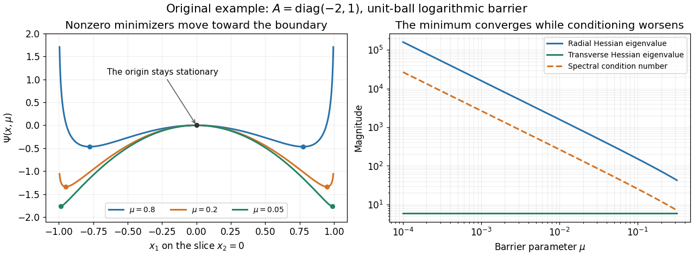

<h1 id="b/8/v/solution">Solution</h1>

↑ **Parent:** [V](../v.md)

Along a fixed nonzero branch, $\|x(\mu)\|_2^2=1+\mu/\lambda_1\to1$ and the radial Hessian eigenvalue grows like $4\lambda_1^2/\mu$. The nonzero transverse eigenvalues $2(\lambda_i-\lambda_1)$ stay fixed. If $\lambda_1$ is simple, the ratio of the largest to smallest absolute eigenvalue therefore tends to infinity. If it repeats, the Hessian is already singular because of the zero transverse directions; there is no finite spectral condition number to begin with. These conclusions concern the nonzero branches: at the stationary origin $H=2(A+\mu I)$, and the same blowup is not implied.

Ill-conditioning does **not** invalidate barrier minimizers as approximations to the constrained solution. Let $\lambda_{\min}<0$. At radius $r$, the smallest possible quadratic value is $\lambda_{\min}r^2$, so global barrier minimization reduces to minimizing $\lambda_{\min}t-\mu\log(1-t)$ for $0\leq t<1$. For $0<\mu<-\lambda_{\min}$ its unique minimizing radius satisfies

$$
\boxed{r^2=1+\mu/\lambda_{\min},\qquad x(\mu)=r v_{\min},\quad\|v_{\min}\|_2=1.}
$$

Thus every limiting unit vector in that eigenspace solves the original problem, with objective $\lambda_{\min}$. For $\mu\geq-\lambda_{\min}$ the barrier minimizer is the origin instead. The increasing condition number concerns the numerical difficulty of small-parameter subproblems, which can call for scaling or a [primal-dual interior-point method](../../../../../primal-dual-interior-point-method.md); it does not prevent the mathematical convergence just established. This is the [quadratic-ball barrier eigenvalue branch](../../../../../quadratic-ball-barrier-eigenvalue-branch.md).

**[Figure 1](#b/8/v/image-the-nonzero-barrier-minimizers-approach-the-unit-sphere-while-their-hessian-condition-number-grows-the-origin-remains-stationary). The nonzero barrier minimizers approach the unit sphere while their Hessian condition number grows; the origin remains stationary**.

## ↑ Ancestors (13)

1. [V](../v.md)
2. [8](../../8.md)
3. [B](../../../b.md)
4. [2007](../../../../2007-split.md)
5. [Past exam of the numerical linear algebra and continuous optimisation course of the University of Oxford](../../../../split.md)
6. [Numerical linear algebra and continuous optimisation course of the University of Oxford](../../../../../numerical-linear-algebra-and-continuous-optimisation-course-of-the-university-of-oxford.md)
7. [Year 4 of the mathematics course of the University of Oxford](../../../../../year-4-of-the-mathematics-course-of-the-university-of-oxford.md)
8. [Mathematics course of the University of Oxford](../../../../../mathematics-course-of-the-university-of-oxford.md)
9. [Undergraduate course of the University of Oxford](../../../../../undergraduate-course-of-the-university-of-oxford.md)
10. [Course of the University of Oxford](../../../../../course-of-the-university-of-oxford.md)
11. [University of Oxford](../../../../../university-of-oxford-split.md)
12. [List of universities](../../../../../list-of-universities.md)
13. [Codex Wiki](../../../../../split.md)
