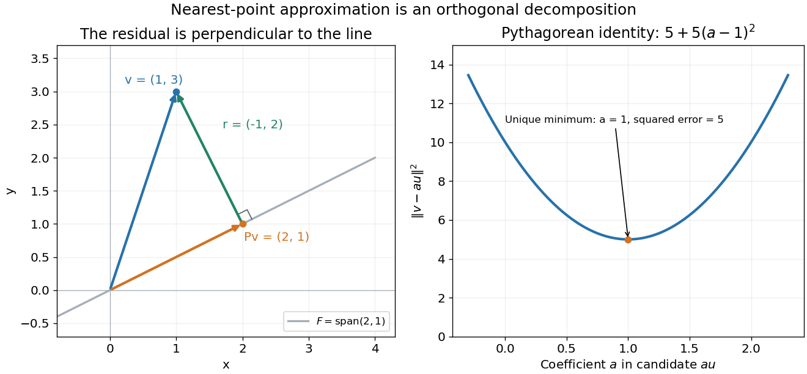

# 2010

↑ **Parent:** [Past exam of the numerical linear algebra and continuous optimisation course of the University of Oxford](../past-exam-of-the-numerical-linear-algebra-and-continuous-optimisation-course-of-the-university-of-oxford.md)

Original solutions to both sections, all six questions and all twenty-nine terminal parts of the Numerical Linear Algebra and Continuous Optimisation paper sat on 8 June 2010. Source: [released Mathematics papers](https://www.whatdotheyknow.com/request/maths_past_papers_3), `Part C 2007 11.pdf`. Statements are not reproduced.

**Table of contents**

- [A](#a)
  - [1](#a/1)
    - [a](#a/1/a)
      - [Solution](#a/1/a/solution)
    - [b](#a/1/b)
      - [Solution](#a/1/b/solution)
    - [c](#a/1/c)
      - [Solution](#a/1/c/solution)
    - [d](#a/1/d)
      - [Solution](#a/1/d/solution)
    - [e](#a/1/e)
      - [Solution](#a/1/e/solution)
  - [2](#a/2)
    - [a](#a/2/a)
      - [Solution](#a/2/a/solution)
    - [b](#a/2/b)
      - [Solution](#a/2/b/solution)
    - [c](#a/2/c)
      - [Solution](#a/2/c/solution)
  - [3](#a/3)
    - [a](#a/3/a)
      - [Solution](#a/3/a/solution)
    - [b](#a/3/b)
      - [Solution](#a/3/b/solution)
    - [c](#a/3/c)
      - [Solution](#a/3/c/solution)
    - [d](#a/3/d)
      - [Solution](#a/3/d/solution)
    - [e](#a/3/e)
      - [Solution](#a/3/e/solution)
    - [f](#a/3/f)
      - [Solution](#a/3/f/solution)
- [B](#b)
  - [4](#b/4)
    - [i](#b/4/i)
      - [Solution](#b/4/i/solution)
    - [ii](#b/4/ii)
      - [Solution](#b/4/ii/solution)
    - [iii](#b/4/iii)
      - [Solution](#b/4/iii/solution)
    - [iv](#b/4/iv)
      - [Solution](#b/4/iv/solution)
    - [v](#b/4/v)
      - [Solution](#b/4/v/solution)
  - [5](#b/5)
    - [i](#b/5/i)
      - [Solution](#b/5/i/solution)
    - [ii](#b/5/ii)
      - [Solution](#b/5/ii/solution)
    - [iii](#b/5/iii)
      - [Solution](#b/5/iii/solution)
    - [iv](#b/5/iv)
      - [Solution](#b/5/iv/solution)
    - [v](#b/5/v)
      - [Solution](#b/5/v/solution)
  - [6](#b/6)
    - [i](#b/6/i)
      - [Solution](#b/6/i/solution)
    - [ii](#b/6/ii)
      - [Solution](#b/6/ii/solution)
    - [iii](#b/6/iii)
      - [Solution](#b/6/iii/solution)
    - [iv](#b/6/iv)
      - [Solution](#b/6/iv/solution)
    - [v](#b/6/v)
      - [Solution](#b/6/v/solution)

## A

↑ **Parent:** [2010](2010.md)

<h3 id="a/1">1</h3>

↑ **Parent:** [A](#a)

<h4 id="a/1/a">a</h4>

↑ **Parent:** [1](#a/1)

<h5 id="a/1/a/solution">Solution</h5>

↑ **Parent:** [A](#a/1/a)

An [orthogonal projector](../hilbert-space.md#orthogonal-projection) sends $x$ to the foot $Px$ of its perpendicular onto the [image of a linear map](../vector-space.md#image-of-a-linear-map) $\operatorname{range}P$. The residual $r=x-Px$ is orthogonal to the entire range, not just to the single vector $Px$. Indeed, for any range vector $Pv$,

$$
(Pv)^Tr=v^TP^T(I-P)x=v^T(P-P^2)x=0.
$$

In particular $\boxed{(Px)^T(x-Px)=0}$. The [orthogonal projection](../hilbert-space.md#orthogonal-projection) diagram illustrates the resulting right triangle.

**[Figure 1](#a/1/a/image-an-orthogonal-projector-maps-a-vector-to-its-perpendicular-foot-on-the-range-the-residual-is-orthogonal-to-that-range). An orthogonal projector maps a vector to its perpendicular foot on the range; the residual is orthogonal to that range**.

<h4 id="a/1/b">b</h4>

↑ **Parent:** [1](#a/1)

<h5 id="a/1/b/solution">Solution</h5>

↑ **Parent:** [B](#a/1/b)

The vector [Euclidean norm](../normed-vector-space.md#euclidean-norm) is $\boxed{\|x\|_2=(x^Tx)^{1/2}=(\sum_i x_i^2)^{1/2}}$, the ordinary length from the origin. The [induced matrix norm](../vector-space.md#induced-matrix-norm) is

$$
\boxed{\|A\|_2=\sup_{x\ne0}\frac{\|Ax\|_2}{\|x\|_2}=\max_{\|x\|_2=1}\|Ax\|_2.}
$$

Geometrically this is the largest stretch of a unit vector. A linear map sends the unit sphere to an ellipsoid, possibly degenerate; its largest semiaxis has length $\|A\|_2$. Equivalently the [matrix 2-norm](../continuous-dual-space.md#matrix-2-norm) is the largest [singular value](../linear-algebra.md#singular-value).

<h4 id="a/1/c">c</h4>

↑ **Parent:** [1](#a/1)

<h5 id="a/1/c/solution">Solution</h5>

↑ **Parent:** [C](#a/1/c)

The perpendicular decomposition in part (a) gives, by the [Pythagorean theorem](../euclidean-geometry.md#pythagorean-theorem),

$$
\|x\|_2^2=\|Px\|_2^2+\|(I-P)x\|_2^2\geq\|Px\|_2^2.
$$

Thus an [orthogonal projection](../hilbert-space.md#orthogonal-projection) cannot lengthen a vector and $\boxed{\|P\|_2\leq1}$. Algebraically the cross term vanishes because $P^T(I-P)=P-P^2=0$, giving the same identity directly from the hypotheses. If $P\ne0$, take a nonzero $x$ in its range; then $Px=x$ and $\|P\|_2=1$. For $P=0$ the norm is zero.

<h4 id="a/1/d">d</h4>

↑ **Parent:** [1](#a/1)

<h5 id="a/1/d/solution">Solution</h5>

↑ **Parent:** [D](#a/1/d)

The [nullspace](../kernel-of-a-linear-map.md) is the vector subspace $\boxed{\ker A=\{x\in\mathbb R^n:Ax=0\}}$. A full real [singular value decomposition](../linear-algebra.md#singular-value-decomposition) is

$$
\boxed{A=U\Sigma V^T,\quad U\in\mathbb R^{m\times m},\quad \Sigma\in\mathbb R^{m\times n},\quad V\in\mathbb R^{n\times n},}
$$

where $U,V$ are [orthogonal matrices](../linear-algebra.md#orthogonal-matrix) and $\Sigma_{ij}=0$ for $i\ne j$, with $\Sigma_{jj}=\sigma_j\geq0$ for $1\leq j\leq n$. We may order $\sigma_1\geq\cdots\geq\sigma_n\geq0$. The columns of $V$ form an [orthonormal basis](../inner-product.md#orthonormal-basis) of the input space $\mathbb R^n$, and the columns of $U$ form one of the output space $\mathbb R^m$. The positive [singular values](../linear-algebra.md#singular-value) number exactly the [matrix rank](../vector-space.md#matrix-rank).

<h4 id="a/1/e">e</h4>

↑ **Parent:** [1](#a/1)

<h5 id="a/1/e/solution">Solution</h5>

↑ **Parent:** [E](#a/1/e)

Let $r$ be the [matrix rank](../vector-space.md#matrix-rank), and partition the right singular vectors as $V=(V_r\ V_0)$, with $V_0\in\mathbb R^{n\times(n-r)}$ consisting of the columns associated with zero [singular values](../linear-algebra.md#singular-value). From $Ax=0\iff\Sigma V^Tx=0$, these columns form an [orthonormal basis](../inner-product.md#orthonormal-basis) of the [nullspace](../kernel-of-a-linear-map.md). Therefore its [orthogonal projector](../hilbert-space.md#orthogonal-projection) is

$$
\boxed{P_{\ker A}=V_0V_0^T=I_n-V_rV_r^T.}
$$

It acts on the input space $\mathbb R^n$. Symmetry and idempotence follow from $V_0^TV_0=I_{n-r}$. At full column rank it is zero, and at rank zero it is the identity.

<h3 id="a/2">2</h3>

↑ **Parent:** [A](#a)

<h4 id="a/2/a">a</h4>

↑ **Parent:** [2](#a/2)

<h5 id="a/2/a/solution">Solution</h5>

↑ **Parent:** [A](#a/2/a)

At elimination column $k$, let $r=m-k$ be the size of the remaining trailing block. Computing its multipliers costs $r$ divisions; updating all $r^2$ entries costs $2r^2$ [floating-point operations](../floating-point-arithmetic.md#floating-point-operation), one multiplication and one subtraction per entry. Thus the dominant count is

$$
\sum_{r=1}^{m-1}(2r^2+r)=\frac{m(m-1)(2m-1)}3+\frac{m(m-1)}2
=\boxed{\frac23m^3+O(m^2)}.
$$

Updating the right side and [back substitution](../linear-algebra.md#back-substitution) add only $O(m^2)$ [floating-point operations](../floating-point-arithmetic.md#floating-point-operation). Pivot searches involve comparisons and row exchanges, without changing the leading arithmetic count. Hence [Gaussian elimination](../numerical-linear-algebra.md#gaussian-elimination) with pivoting has the requested asymptotic cost.

<h4 id="a/2/b">b</h4>

↑ **Parent:** [2](#a/2)

<h5 id="a/2/b/solution">Solution</h5>

↑ **Parent:** [B](#a/2/b)

An [orthogonal similarity transformation](../linear-algebra.md#orthogonal-similarity) is $H=Q^TAQ$ with $Q^TQ=I$. An [upper Hessenberg matrix](../vector-space.md#upper-hessenberg-matrix) has $H_{ij}=0$ whenever $i>j+1$; its first subdiagonal may be nonzero.

At step $k=1,\ldots,m-2$, choose a [Householder reflector](../linear-algebra.md#householder-transformation) $Q_k=\operatorname{diag}(I_k,\widehat Q_k)$ whose trailing block sends the current column segment in rows $k+1,\ldots,m$ to a multiple of its first coordinate. The left multiplication zeros positions $(k+2,k),\ldots,(m,k)$. Apply the matching right multiplication to retain similarity: $A\leftarrow Q_k^TAQ_k$. Since $Q_k$ acts only on rows and columns $k+1,\ldots,m$, earlier Hessenberg zeros are preserved. Finally $Q=Q_1\cdots Q_{m-2}$ gives $H=Q^TAQ$.

Each reflector is applied through a rank-one update, costing $O(m^2)$ rather than a full matrix multiplication. Across $m-2$ steps, the [Hessenberg reduction](../vector-space.md#hessenberg-reduction) costs $O(m^3)$.

<h4 id="a/2/c">c</h4>

↑ **Parent:** [2](#a/2)

<h5 id="a/2/c/solution">Solution</h5>

↑ **Parent:** [C](#a/2/c)

Solving the $m$ unrelated shifted systems by separate [Gaussian elimination](../numerical-linear-algebra.md#gaussian-elimination) costs $\boxed{\tfrac23m^4+O(m^3)}$ [floating-point operations](../floating-point-arithmetic.md#floating-point-operation).

Instead compute $H=Q^TAQ$ once in $O(m^3)$ work. For each shift, solve

$$
(H-\lambda_jI)z_j=Q^Tb_j,\qquad x_j=Qz_j.
$$

The shift changes only the diagonal, so $H-\lambda_jI$ remains an [upper Hessenberg matrix](../vector-space.md#upper-hessenberg-matrix). In each elimination column only the entry immediately below the pivot needs removal. With partial pivoting the only possible nonzero candidate rows are the current row and the next, and each update touches $O(m)$ entries. Factorization therefore costs $O(m^2)$ per shift; the triangular solve and both orthogonal-vector transformations also cost $O(m^2)$ each.

Thus $m$ shifted solves plus the initial [Hessenberg reduction](../vector-space.md#hessenberg-reduction) cost $\boxed{O(m^3)}$ in total. Pivoting is still needed in general: nonsingularity excludes a singular system but does not by itself guarantee that every unpivoted elimination pivot is nonzero.

<h3 id="a/3">3</h3>

↑ **Parent:** [A](#a)

<h4 id="a/3/a">a</h4>

↑ **Parent:** [3](#a/3)

<h5 id="a/3/a/solution">Solution</h5>

↑ **Parent:** [A](#a/3/a)

The off-diagonal [Toeplitz matrix](../quadratic-form.md#toeplitz-matrix) $T=A-I$ is symmetric and has row and column absolute sums bounded by

$$
r=2\sum_{j=2}^m|t_j|\leq\frac23.
$$

For an elementary Euclidean bound, apply the weighted [Cauchy-Schwarz inequality](../probability-and-statistics.md#cauchy-schwarz-inequality) in each row:

$$
|(Tx)_i|^2\leq\left(\sum_j|T_{ij}|\right)\left(\sum_j|T_{ij}|\,|x_j|^2\right).
$$

Sum over $i$ and use both absolute-sum bounds to get $\|Tx\|_2^2\leq r^2\|x\|_2^2$. Therefore

$$
\boxed{\|T\|_2\leq2\sum_{j=2}^m|t_j|\leq\frac23.}
$$

The entry $t_1$ is unused because the diagonal of $A$ is fixed to one; including it only weakens the bound. This is the [row-column bound for the matrix 2-norm](../vector-space.md#row-column-bound-for-the-matrix-2-norm).

<h4 id="a/3/b">b</h4>

↑ **Parent:** [3](#a/3)

<h5 id="a/3/b/solution">Solution</h5>

↑ **Parent:** [B](#a/3/b)

A real symmetric matrix is [positive-definite](../bilinear-form.md#positive-definite-bilinear-form) when $x^TAx>0$ for every nonzero real vector $x$. The preceding [matrix 2-norm](../continuous-dual-space.md#matrix-2-norm) bound gives

$$
x^TAx=\|x\|_2^2+x^TTx\geq\|x\|_2^2-\|x\|_2\|Tx\|_2
\geq\boxed{\frac13\|x\|_2^2>0}.
$$

Thus $A$ is a [symmetric positive-definite matrix](../linear-algebra.md#symmetric-positive-definite-matrix), independently of the detailed positions of the nonzero entries of $t$.

<h4 id="a/3/c">c</h4>

↑ **Parent:** [3](#a/3)

<h5 id="a/3/c/solution">Solution</h5>

↑ **Parent:** [C](#a/3/c)

An [eigenvalue](../linear-operator-theory.md#eigenvalue) of $A$ is a scalar $\lambda$ for which $Az=\lambda z$ has a nonzero [eigenvector](../linear-operator-theory.md#eigenvector). Allowing initially $z\in\mathbb C^m$, symmetry of the real matrix gives $A^*=A$, so $z^*Az$ is real. Since $z^*z>0$,

$$
\boxed{\lambda=\frac{z^*Az}{z^*z}\in\mathbb R.}
$$

This proves reality without presuming it when choosing the [eigenvector](../linear-operator-theory.md#eigenvector). Once $\lambda$ is real, the real or imaginary part of $z$ supplies a nonzero real [eigenvector](../linear-operator-theory.md#eigenvector).

<h4 id="a/3/d">d</h4>

↑ **Parent:** [3](#a/3)

<h5 id="a/3/d/solution">Solution</h5>

↑ **Parent:** [D](#a/3/d)

For a unit [eigenvector](../linear-operator-theory.md#eigenvector) of $A$, $(A-I)x=(\lambda-1)x$. The [matrix 2-norm](../continuous-dual-space.md#matrix-2-norm) bound from part (a) gives $|\lambda-1|\leq2/3$. Hence every [eigenvalue](../linear-operator-theory.md#eigenvalue) lies in

$$
\boxed{[\alpha,\beta]=[1/3,5/3].}
$$

In particular the [condition number](../quadratic-form.md#condition-number) in the Euclidean [operator norm](../continuous-dual-space.md#operator-norm) satisfies $\kappa_2(A)=\lambda_{\max}/\lambda_{\min}\leq5$.

<h4 id="a/3/e">e</h4>

↑ **Parent:** [3](#a/3)

<h5 id="a/3/e/solution">Solution</h5>

↑ **Parent:** [E](#a/3/e)

The [energy norm](../finite-element-method.md#energy-norm) associated with this [symmetric positive-definite matrix](../linear-algebra.md#symmetric-positive-definite-matrix) is

$$
\boxed{\|e\|_A=(e^TAe)^{1/2}.}
$$

It is the norm induced by the inner product $\langle u,v\rangle_A=u^TAv$. The [conjugate gradient method](../gradient-descent.md#conjugate-gradient-method) minimizes this error norm over its successive affine [Krylov subspaces](../gradient-descent.md#krylov-subspace).

<h4 id="a/3/f">f</h4>

↑ **Parent:** [3](#a/3)

<h5 id="a/3/f/solution">Solution</h5>

↑ **Parent:** [F](#a/3/f)

The standard [conjugate gradient convergence bound](../gradient-descent.md#conjugate-gradient-convergence-bound) is

$$
\|e_k\|_A\leq2\left(\frac{\sqrt\kappa-1}{\sqrt\kappa+1}\right)^k\|e_0\|_A.
$$

Here $\kappa\leq5$, so the factor in parentheses is at most $q=(3-\sqrt5)/2\simeq0.381966$. Since $2q^{25}<10^{-10}$, **25 iterations suffice to reduce the energy-norm error by a factor exceeding $10^{10}$**.

There are at most $m/20$ nonzero entries of $t$, and each contributes to at most two off-diagonals. Thus $A-I$ has at most $m^2/10$ nonzero entries. Initialize a matrix-vector product with the diagonal contribution $p$, which costs no arithmetic because the diagonal is one. Each off-diagonal term needs one multiplication and one addition, giving at most $m^2/5$ [floating-point operations](../floating-point-arithmetic.md#floating-point-operation) per product.

A standard [conjugate gradient](../gradient-descent.md#conjugate-gradient-method) step adds two inner products, three vector updates and two scalar divisions, at most $10m$ further operations. Starting from $x_0=0$ makes $r_0=b$ and avoids an initial matrix-vector product; its squared norm needs $2m-1$ operations. The total for 25 steps is at most

$$
\boxed{25(m^2/5+10m)+2m-1=5m^2+252m-1<8m^2\quad(m\geq84).}
$$

This supplies an explicit meaning of the paper's large-$m$ qualification. The quoted [conjugate gradient convergence bound](../gradient-descent.md#conjugate-gradient-convergence-bound) is the usual exact-arithmetic result.

<h2 id="b">B</h2>

↑ **Parent:** [2010](2010.md)

<h3 id="b/4">4</h3>

↑ **Parent:** [B](#b)

<h4 id="b/4/i">i</h4>

↑ **Parent:** [4](#b/4)

<h5 id="b/4/i/solution">Solution</h5>

↑ **Parent:** [I](#b/4/i)

At an unconstrained local minimizer of a twice continuously differentiable [objective function](../mathematical-optimization.md#objective-function), the [first-order optimality condition](../mathematical-optimization.md#first-order-optimality-condition) is $\boxed{\nabla f(x_*)=0}$. The second-order necessary condition is $d^T\nabla^2f(x_*)d\geq0$ for every direction $d$, so the [Hessian matrix](../multivariable-calculus.md#hessian-matrix) is positive semidefinite.

For the Euclidean norm, the unit [steepest descent direction](../mathematical-optimization.md#steepest-descent-direction) is $-g/\|g\|_2$ when $g=\nabla f(x)\ne0$; the algorithm usually uses the unnormalized direction $p=-g$. It is a [descent direction](../mathematical-optimization.md#descent-direction) because $\boxed{g^Tp=-\|g\|_2^2<0}$.

Two limitations of unpreconditioned [steepest descent method](../gradient-descent.md) in high-accuracy smooth optimization are its slow zigzagging on ill-conditioned valleys and its sensitivity to scaling of the coordinates. It uses no curvature information to correct those directions, so it can require many function and gradient evaluations compared with a suitable Newton or quasi-Newton method. These are reasons to prefer curvature-aware methods in that setting, rather than a claim that gradient-based methods are never useful.

<h4 id="b/4/ii">ii</h4>

↑ **Parent:** [4](#b/4)

<h5 id="b/4/ii/solution">Solution</h5>

↑ **Parent:** [Ii](#b/4/ii)

The [descent lemma](../gradient-descent.md#descent-lemma) follows by integrating the [gradient](../multivariable-calculus.md#gradient) along the line and using its [Lipschitz continuity](../real-analysis.md#lipschitz-continuity):

$$
f(x+\alpha p)\leq f(x)+\alpha g(x)^Tp+\frac\gamma2\alpha^2\|p\|_2^2,\qquad\alpha\geq0.
$$

This upper bound is at most the right side of the [Armijo condition](../mathematical-optimization.md#armijo-condition) when $\alpha[(1-\beta)g^Tp+\gamma\alpha\|p\|_2^2/2]\leq0$. Since $g^Tp<0$, it holds for

$$
\boxed{0\leq\alpha\leq\alpha_{\max}=\frac{2(1-\beta)(-g^Tp)}{\gamma\|p\|_2^2}=\frac{2(\beta-1)g^Tp}{\gamma\|p\|_2^2}.}
$$

The zero step gives equality; every positive step in this interval satisfies the prescribed sufficient-decrease test.

<h4 id="b/4/iii">iii</h4>

↑ **Parent:** [4](#b/4)

<h5 id="b/4/iii/solution">Solution</h5>

↑ **Parent:** [Iii](#b/4/iii)

The quadratic model has gradient $g(x_k)+B_kp$ and positive-definite [Hessian matrix](../multivariable-calculus.md#hessian-matrix) $B_k$. Its unique minimizer is therefore

$$
\boxed{p_k=-B_k^{-1}g(x_k).}
$$

If $g(x_k)\ne0$, then $p_k\ne0$ and $g(x_k)^Tp_k=-p_k^TB_kp_k<0$, proving that it is a [descent direction](../mathematical-optimization.md#descent-direction).

[Backtracking line search](../mathematical-optimization.md#backtracking-line-search) starts with a trial step and repeatedly reduces it until the [Armijo condition](../mathematical-optimization.md#armijo-condition) holds. Part (ii) guarantees finite termination because sufficiently small steps are acceptable. The test guarantees a specified positive fraction of the decrease predicted by the linear model, namely $f(x_k+\alpha p_k)\leq f(x_k)+\alpha\beta g(x_k)^Tp_k<f(x_k)$ for an accepted positive step. It does not require solving the line-minimization problem exactly.

<h4 id="b/4/iv">iv</h4>

↑ **Parent:** [4](#b/4)

<h5 id="b/4/iv/solution">Solution</h5>

↑ **Parent:** [Iv](#b/4/iv)

If the first trial is accepted, $\alpha_k=\alpha_{\mathrm{init}}$. Otherwise the preceding trial was rejected and so exceeded $\alpha_{\max}$, since part (ii) guarantees acceptance below that threshold. The accepted step, reduced by the factor $\tau$, consequently exceeds $\tau\alpha_{\max}$. In either case,

$$
\alpha_k\geq\min(\alpha_{\mathrm{init}},\tau\alpha_{\max}).
$$

The angle condition $-g_k^Tp_k\geq\varepsilon\|g_k\|_2\|p_k\|_2$ gives $\alpha_{\max}\geq2\varepsilon(1-\beta)\|g_k\|_2/(\gamma\|p_k\|_2)$. Hence the [backtracking line search](../mathematical-optimization.md#backtracking-line-search) has the lower bound

$$
\boxed{\alpha_k\geq\min\left(\alpha_{\mathrm{init}},\frac{2\tau\varepsilon(1-\beta)\|g_k\|_2}{\gamma\|p_k\|_2}\right).}
$$

<h4 id="b/4/v">v</h4>

↑ **Parent:** [4](#b/4)

<h5 id="b/4/v/solution">Solution</h5>

↑ **Parent:** [V](#b/4/v)

From $B_kp_k=-g_k$ and the [matrix 2-norm](../continuous-dual-space.md#matrix-2-norm) bound, $\|g_k\|_2\leq\kappa_b\|p_k\|_2$, so $\|p_k\|_2\geq\|g_k\|_2/\kappa_b$. Let $C=2\tau\varepsilon(1-\beta)/\gamma>0$. The summand in the supplied decrease bound satisfies

$$
\min\left(\alpha_{\mathrm{init}},C\frac{\|g_k\|_2}{\|p_k\|_2}\right)\|g_k\|_2\|p_k\|_2
=\min\left(\alpha_{\mathrm{init}}\|g_k\|_2\|p_k\|_2,C\|g_k\|_2^2\right)
\geq\min(\alpha_{\mathrm{init}}/\kappa_b,C)\|g_k\|_2^2.
$$

Thus, with the fixed positive constant $c=\beta\varepsilon\min(\alpha_{\mathrm{init}}/\kappa_b,C)$,

$$
c\sum_{k=0}^j\|g_k\|_2^2\leq f(x_0)-f(x_{j+1})\leq f(x_0)-\inf f<\infty.
$$

The nonnegative series therefore converges, forcing its terms to zero:

$$
\boxed{\lim_{k\to\infty}g(x_k)=0.}
$$

The argument uses the given angle condition and upper bound on $\|B_k\|_2$; it does not need an additional uniform lower eigenvalue bound on $B_k$.

<h3 id="b/5">5</h3>

↑ **Parent:** [B](#b)

<h4 id="b/5/i">i</h4>

↑ **Parent:** [5](#b/5)

<h5 id="b/5/i/solution">Solution</h5>

↑ **Parent:** [I](#b/5/i)

Use the [optimization Lagrangian](../mathematical-optimization.md#optimization-lagrangian) $\mathcal L(x,y)=f(x)-y^Tc(x)$, with $A(x)=Dc(x)$ and $H(x,y)=\nabla_{xx}^2\mathcal L(x,y)$. Under the usual [linear independence constraint qualification](../mathematical-optimization.md#linear-independence-constraint-qualification), a local minimizer has multipliers $y_*$ satisfying the equality-constrained [Karush-Kuhn-Tucker conditions](../mathematical-optimization.md#karush-kuhn-tucker-conditions)

$$
\boxed{c(x_*)=0,\qquad g(x_*)-A(x_*)^Ty_*=0.}
$$

The second-order necessary condition is

$$
\boxed{d^TH(x_*,y_*)d\geq0\quad\text{for every }d\in\ker A(x_*).}
$$

Only feasible tangent directions enter this last test; the [Hessian matrix](../multivariable-calculus.md#hessian-matrix) need not be positive semidefinite on the entire ambient space.

<h4 id="b/5/ii">ii</h4>

↑ **Parent:** [5](#b/5)

<h5 id="b/5/ii/solution">Solution</h5>

↑ **Parent:** [Ii](#b/5/ii)

With $y=-c/\mu$, [differentiation](../calculus.md#differentiation) of the [quadratic penalty method](../mathematical-optimization.md#quadratic-penalty-method) objective gives

$$
\boxed{\nabla P_\mu=g-A^Ty,\qquad \nabla^2P_\mu=H(x,y)+\mu^{-1}A^TA.}
$$

The primal [Newton system](../mathematical-optimization.md#newton-system) is therefore

$$
\boxed{(H+\mu^{-1}A^TA)p=-g+A^Ty.}
$$

For bounded multipliers and regular derivatives, $H$ remains of ordinary size while $\mu^{-1}A^TA$ becomes large in directions normal to the constraints. If the feasible tangent space is nontrivial and retains ordinary-size curvature, this produces a large [condition number](../quadratic-form.md#condition-number) as $\mu\downarrow0$.

Introduce $w=Ap/\mu$. The same step is obtained from the symmetric augmented system

$$
\boxed{\begin{pmatrix}H&A^T\\A&-\mu I\end{pmatrix}\begin{pmatrix}p\\w\end{pmatrix}=\begin{pmatrix}-g+A^Ty\\0\end{pmatrix}.}
$$

Eliminating $w$ recovers the primal system exactly. This matrix contains no explicit $\mu^{-1}$ entries and tends to a [saddle-point matrix](../vector-space.md#saddle-point-matrix). Under full row rank of the limiting constraint [Jacobian matrix](../multivariable-calculus.md#jacobian-matrix) and nonsingularity of the limiting [reduced Hessian](../mathematical-optimization.md#reduced-hessian), that limiting matrix is nonsingular, so this formulation avoids the artificial penalty-induced separation of scales.

These conditioning statements require regularity beyond bounded $y$ alone. A rank-deficient constraint [Jacobian matrix](../multivariable-calculus.md#jacobian-matrix) or singular [reduced Hessian](../mathematical-optimization.md#reduced-hessian) can still make the augmented system ill-conditioned. If $m=n$ and $A$ is nonsingular, all directions may scale together in the primal system, so a large condition number is not automatic there either.

<h4 id="b/5/iii">iii</h4>

↑ **Parent:** [5](#b/5)

<h5 id="b/5/iii/solution">Solution</h5>

↑ **Parent:** [Iii](#b/5/iii)

Complete the square in the [augmented Lagrangian method](../mathematical-optimization.md#augmented-lagrangian-method) objective:

$$
\boxed{\mathcal L_\mu(x,u)=f(x)+\frac1{2\mu}\|c(x)-\mu u\|_2^2-\frac\mu2\|u\|_2^2.}
$$

For fixed $u,\mu$, the last term is constant in $x$. Thus its minimization is the [quadratic penalty method](../mathematical-optimization.md#quadratic-penalty-method) applied to the shifted constraint $c(x)=\mu u$.

Its practical advantage is that multiplier updates, typically $u^+=u-c(x)/\mu$, can drive the original constraint residual to zero while $\mu$ stays moderately sized. The plain [quadratic penalty method](../mathematical-optimization.md#quadratic-penalty-method) generally needs $\mu$ very small to produce the same feasibility accuracy, exposing the conditioning problem in part (ii).

<h4 id="b/5/iv">iv</h4>

↑ **Parent:** [5](#b/5)

<h5 id="b/5/iv/solution">Solution</h5>

↑ **Parent:** [Iv](#b/5/iv)

The linearized constraints may be inconsistent, for example when $-c(x_k)$ is not in the [image of a linear map](../vector-space.md#image-of-a-linear-map) defined by $A(x_k)$. Even if feasible, the quadratic objective may have negative curvature along its feasible tangent space, making it unbounded below and leaving no local minimizer.

Fletcher's [Sℓ1QP](../numerical-analysis.md#sl1qp) replaces the hard linearized constraints by an [L1 exact penalty](../numerical-analysis.md#l1-exact-penalty) and bounds the step inside a [trust region](../mathematical-optimization.md#trust-region). One usual form is

$$
\boxed{\min_{\|s\|_\infty\leq\Delta_k}\ g_k^Ts+\frac12s^TH_ks+\rho_k\|c_k+A_ks\|_1,\qquad\rho_k>0.}
$$

The zero step is always admissible. The trust region is compact, so a minimum exists even when the model [Hessian matrix](../multivariable-calculus.md#hessian-matrix) is indefinite; the constraint penalty measures infeasibility rather than making the subproblem impossible to solve. Adjusting its weight promotes feasibility, while the radius keeps the local model within a controlled neighbourhood. Introducing nonnegative positive- and negative-part slack variables converts the absolute values to an equivalent smooth [quadratic program](../mathematical-optimization.md#quadratic-program) with box constraints.[§3.3, equations (3.25)–(3.26): Fletcher's Sℓ1-QP model and its elastic quadratic-program formulation](../mathematics-bibliography.md#sequential-quadratic-programming-methods-by-philip-e-gill-and-elizabeth-wong)

<h4 id="b/5/v">v</h4>

↑ **Parent:** [5](#b/5)

<h5 id="b/5/v/solution">Solution</h5>

↑ **Parent:** [V](#b/5/v)

Stationarity of the equality-constrained quadratic model gives $g_k+H_ks_k-A_k^Ty_{k+1}=0$, while feasibility gives $A_ks_k=-c_k$. A symmetric system linking the step and new multiplier is

$$
\boxed{\begin{pmatrix}H_k&-A_k^T\\-A_k&0\end{pmatrix}\begin{pmatrix}s_k\\y_{k+1}\end{pmatrix}=\begin{pmatrix}-g_k\\c_k\end{pmatrix}.}
$$

Let $Z$ have columns forming a [basis](../vector-space.md#basis) of $\ker A_k$. The [saddle-point matrix](../vector-space.md#saddle-point-matrix) is nonsingular exactly when **$A_k$ has full row rank and $Z^TH_kZ$ is nonsingular**. Full row rank is necessary because a nonzero vector in $\ker A_k^T$ would give a null vector of the block matrix. Under full row rank, solving a homogeneous system forces $s=Zq$ and then $Z^TH_kZq=0$; this proves sufficiency and the converse. Positive definiteness of the [reduced Hessian](../mathematical-optimization.md#reduced-hessian) is sufficient for a constrained minimum but is stronger than the nonsingularity condition asked here.

A null-space method first finds $s_p$ with $A_ks_p=-c_k$, then solves

$$
Z^TH_kZq=-Z^T(g_k+H_ks_p),\qquad s_k=s_p+Zq,
$$

and recovers $y_{k+1}$ from $A_k^Ty_{k+1}=g_k+H_ks_k$. It needs the stated full row rank and nonsingular reduced matrix; [Cholesky decomposition](../quadratic-form.md#cholesky-decomposition) is available when the latter is positive definite.

A range-space method additionally assumes $H_k$ is invertible. It solves the [Schur complement](../linear-algebra.md#schur-complement) equations

$$
A_kH_k^{-1}A_k^Ty_{k+1}=A_kH_k^{-1}g_k-c_k,
\qquad s_k=-H_k^{-1}g_k+H_k^{-1}A_k^Ty_{k+1}.
$$

If $H_k$ is positive definite and $A_k$ has full row rank, the Schur matrix is positive definite and both solves can use [Cholesky decomposition](../quadratic-form.md#cholesky-decomposition). An indefinite but invertible $H_k$ instead requires a suitable indefinite factorization; the Schur matrix must remain nonsingular.

<h3 id="b/6">6</h3>

↑ **Parent:** [B](#b)

<h4 id="b/6/i">i</h4>

↑ **Parent:** [6](#b/6)

<h5 id="b/6/i/solution">Solution</h5>

↑ **Parent:** [I](#b/6/i)

For $\mathcal L=f-y^Tc$, the inequality-constrained [Karush-Kuhn-Tucker conditions](../mathematical-optimization.md#karush-kuhn-tucker-conditions) are

$$
\boxed{c(x_*)\geq0,\quad y_*\geq0,\quad C(x_*)y_*=0,\quad g(x_*)-A(x_*)^Ty_*=0.}
$$

Under an appropriate [constraint qualification](../mathematical-optimization.md#constraint-qualification), the second-order necessary condition is $d^TH(x_*,y_*)d\geq0$ on the [critical cone](../numerical-analysis.md#critical-cone)

$$
\mathcal C=\{d:A_i(x_*)d\geq0\text{ for active }i,\quad g(x_*)^Td=0\}.
$$

Equivalently active constraints with positive multiplier require $A_id=0$, while active zero-multiplier constraints retain $A_id\geq0$. Inactive constraints impose no first-order tangent restriction. This distinction is why the relevant cone need not be the nullspace of every active row.

<h4 id="b/6/ii">ii</h4>

↑ **Parent:** [6](#b/6)

<h5 id="b/6/ii/solution">Solution</h5>

↑ **Parent:** [Ii](#b/6/ii)

On the strictly feasible region $c_i(x)>0$, the [logarithmic barrier](../convex-optimization.md#logarithmic-barrier) objective is

$$
\boxed{B_\mu(x)=f(x)-\mu\sum_{i=1}^m\log c_i(x).}
$$

With $y_i(x)=\mu/c_i(x)$, its [gradient](../multivariable-calculus.md#gradient) is

$$
\boxed{\nabla B_\mu(x)=g(x)-A(x)^Ty(x).}
$$

The positive coefficients $y_i$ are the barrier's multiplier estimates.

<h4 id="b/6/iii">iii</h4>

↑ **Parent:** [6](#b/6)

<h5 id="b/6/iii/solution">Solution</h5>

↑ **Parent:** [Iii](#b/6/iii)

The equation $F_\mu(x,y)=0$, together with $c(x)>0$ and $y>0$, is the perturbed [Karush-Kuhn-Tucker conditions](../mathematical-optimization.md#karush-kuhn-tucker-conditions): stationarity is unchanged, while exact [complementary slackness](../linear-programming.md#complementary-slackness) becomes $c_i(x)y_i=\mu$ for each $i$. A finite limit of such points as $\mu\downarrow0$ satisfies the original conditions by continuity.

For a strictly feasible $x$, the second block uniquely specifies $y_i=\mu/c_i(x)$. Substitution into the first block gives precisely $\nabla B_\mu(x)=0$. Thus

$$
\boxed{F_\mu(x,y)=0\iff x\text{ is a critical point of }B_\mu\text{ and }y_i=\mu/c_i(x),}
$$

within the stated strictly positive domain. These are stationary barrier points; they need not all be local minimizers in a nonconvex problem.

<h4 id="b/6/iv">iv</h4>

↑ **Parent:** [6](#b/6)

<h5 id="b/6/iv/solution">Solution</h5>

↑ **Parent:** [Iv](#b/6/iv)

The [Jacobian matrix](../multivariable-calculus.md#jacobian-matrix) of $F_\mu$ in $(x,y)$ is

$$
J(v)=\begin{pmatrix}H(x,y)&-A(x)^T\\Y A(x)&C(x)\end{pmatrix}.
$$

The top-left block is the [Hessian matrix](../multivariable-calculus.md#hessian-matrix) of $f-y^Tc$ with $y$ held fixed. In the second block, differentiating $C(x)y$ in $x$ gives $YA$ and in $y$ gives $C$. The explicit derivative with respect to $\mu$ is $(0,-e)^T$. Differentiate $F_\mu(v(\mu))=0$ by the [chain rule](../calculus.md#chain-rule):

$$
\boxed{\begin{pmatrix}H&-A^T\\YA&C\end{pmatrix}\begin{pmatrix}x'(\mu)\\y'(\mu)\end{pmatrix}=\begin{pmatrix}0\\e\end{pmatrix}.}
$$

All blocks are evaluated on the current [central path](../convex-optimization.md#central-path) point.

<h4 id="b/6/v">v</h4>

↑ **Parent:** [6](#b/6)

<h5 id="b/6/v/solution">Solution</h5>

↑ **Parent:** [V](#b/6/v)

At the current exact path point $v(\mu)$, stationarity is already zero and $Cy=\mu e$. Therefore $F_{\bar\mu}(v(\mu))=(0,(\mu-\bar\mu)e)^T$. Its [Newton correction](../mathematical-optimization.md#newton-correction) solves

$$
\boxed{J(v(\mu))\Delta v_N=\begin{pmatrix}0\\(\bar\mu-\mu)e\end{pmatrix}.}
$$

The matrix has no explicit dependence on the barrier parameter, so comparison with part (iv) gives

$$
\boxed{\Delta v_N=(\bar\mu-\mu)v'(\mu)}
$$

when $J$ is nonsingular. If it is singular, the displayed vector is still a solution of the correction equations, but uniqueness of the correction cannot be inferred from differentiability of the path alone.

This step is exactly the tangent predictor in the stated first-order [Taylor expansion](../calculus.md#taylor-expansion). For nearby positive $\bar\mu$, it approximates the new path point with error $o(|\bar\mu-\mu|)$; a bounded second path derivative improves this to $O((\bar\mu-\mu)^2)$. Continuity also preserves strict positivity for sufficiently small parameter changes. Larger changes may require damping to keep both the constraint values and multiplier estimates positive.

## ↑ Ancestors (9)

1. [Past exam of the numerical linear algebra and continuous optimisation course of the University of Oxford](../past-exam-of-the-numerical-linear-algebra-and-continuous-optimisation-course-of-the-university-of-oxford.md)
2. [Numerical linear algebra and continuous optimisation course of the University of Oxford](../university-of-oxford.md#numerical-linear-algebra-and-continuous-optimisation-course-of-the-university-of-oxford)
3. [Year 4 of the mathematics course of the University of Oxford](../university-of-oxford.md#year-4-of-the-mathematics-course-of-the-university-of-oxford)
4. [Mathematics course of the University of Oxford](../university-of-oxford.md#mathematics-course-of-the-university-of-oxford)
5. [Undergraduate course of the University of Oxford](../university-of-oxford.md#undergraduate-course-of-the-university-of-oxford)
6. [Course of the University of Oxford](../university-of-oxford.md#course-of-the-university-of-oxford)
7. [University of Oxford](../university-of-oxford.md)
8. [List of universities](../README.md#list-of-universities)
9. [Codex Wiki](../README.md)
