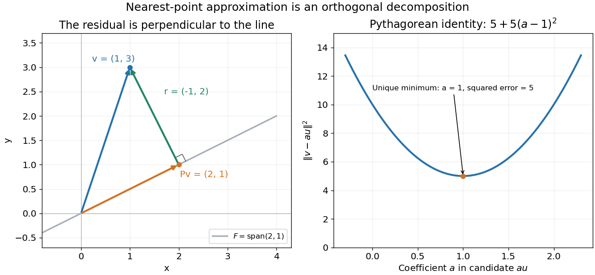

<h1 id="a/1/a/solution">Solution</h1>

↑ **Parent:** [A](../a.md)

An [orthogonal projector](../../../../../orthogonal-projection.md) sends $x$ to the foot $Px$ of its perpendicular onto the [image of a linear map](../../../../../image-of-a-linear-map.md) $\operatorname{range}P$. The residual $r=x-Px$ is orthogonal to the entire range, not just to the single vector $Px$. Indeed, for any range vector $Pv$,

$$
(Pv)^Tr=v^TP^T(I-P)x=v^T(P-P^2)x=0.
$$

In particular $\boxed{(Px)^T(x-Px)=0}$. The [orthogonal projection](../../../../../orthogonal-projection.md) diagram illustrates the resulting right triangle.

**[Figure 1](#a/1/a/image-an-orthogonal-projector-maps-a-vector-to-its-perpendicular-foot-on-the-range-the-residual-is-orthogonal-to-that-range). An orthogonal projector maps a vector to its perpendicular foot on the range; the residual is orthogonal to that range**.

## ↑ Ancestors (13)

1. [A](../a.md)
2. [1](../../1.md)
3. [A](../../../a.md)
4. [2010](../../../../2010-split.md)
5. [Past exam of the numerical linear algebra and continuous optimisation course of the University of Oxford](../../../../split.md)
6. [Numerical linear algebra and continuous optimisation course of the University of Oxford](../../../../../numerical-linear-algebra-and-continuous-optimisation-course-of-the-university-of-oxford.md)
7. [Year 4 of the mathematics course of the University of Oxford](../../../../../year-4-of-the-mathematics-course-of-the-university-of-oxford.md)
8. [Mathematics course of the University of Oxford](../../../../../mathematics-course-of-the-university-of-oxford.md)
9. [Undergraduate course of the University of Oxford](../../../../../undergraduate-course-of-the-university-of-oxford.md)
10. [Course of the University of Oxford](../../../../../course-of-the-university-of-oxford.md)
11. [University of Oxford](../../../../../university-of-oxford-split.md)
12. [List of universities](../../../../../list-of-universities.md)
13. [Codex Wiki](../../../../../split.md)
