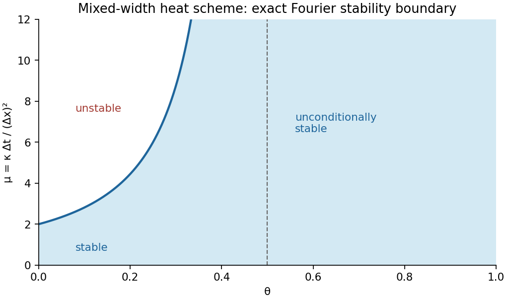

# 2010

↑ **Parent:** [Past exam of the numerical solution of differential equations course of the University of Oxford](../past-exam-of-the-numerical-solution-of-differential-equations-course-of-the-university-of-oxford.md)

Source: [released examination bundle](https://www.whatdotheyknow.com/request/maths_past_papers_3), `Part B 2007 11.pdf`, pages 248–255. All six questions in both halves are covered. No mark allocations are printed.

**Table of contents**

- [A](#a)
  - [1](#a/1)
    - [a](#a/1/a)
      - [Solution](#a/1/a/solution)
    - [b](#a/1/b)
      - [Solution](#a/1/b/solution)
    - [c](#a/1/c)
      - [Solution](#a/1/c/solution)
  - [2](#a/2)
    - [a](#a/2/a)
      - [Solution](#a/2/a/solution)
    - [b](#a/2/b)
      - [Solution](#a/2/b/solution)
  - [3](#a/3)
    - [a](#a/3/a)
      - [Solution](#a/3/a/solution)
    - [b](#a/3/b)
      - [i](#a/3/b/i)
        - [Solution](#a/3/b/i/solution)
      - [ii](#a/3/b/ii)
        - [Solution](#a/3/b/ii/solution)
- [B](#b)
  - [4](#b/4)
    - [a](#b/4/a)
      - [Solution](#b/4/a/solution)
    - [b](#b/4/b)
      - [Solution](#b/4/b/solution)
    - [c](#b/4/c)
      - [Solution](#b/4/c/solution)
  - [5](#b/5)
    - [a](#b/5/a)
      - [Solution](#b/5/a/solution)
    - [b](#b/5/b)
      - [Solution](#b/5/b/solution)
    - [c](#b/5/c)
      - [Solution](#b/5/c/solution)
    - [d](#b/5/d)
      - [Solution](#b/5/d/solution)
  - [6](#b/6)
    - [a](#b/6/a)
      - [Solution](#b/6/a/solution)
    - [b](#b/6/b)
      - [Solution](#b/6/b/solution)

## A

↑ **Parent:** [2010](2010.md)

<h3 id="a/1">1</h3>

↑ **Parent:** [A](#a)

<h4 id="a/1/a">a</h4>

↑ **Parent:** [1](#a/1)

<h5 id="a/1/a/solution">Solution</h5>

↑ **Parent:** [A](#a/1/a)

Substitute a smooth exact solution into the [linear multistep method](../linear-multistep-method.md) and expand about $x_n$. Its residual is

$$
(1+a+b)y+h(3+a-1)y'+h^2(9/2+a/2-2)y''+O(h^3).
$$

[Consistency of a numerical method](../numerical-analysis.md#consistency-of-a-numerical-method) requires the coefficients of $y$ and $hy'$ to vanish. Therefore $1+a+b=0$ and $3+a=1$, giving the unique choice

$$
\boxed{a=-2,\qquad b=1.}
$$

For this choice the next coefficient is $9/2-1-2=3/2\ne0$, so the residual is $\tfrac32h^2y''+O(h^3)$. The normalized [local truncation error](../numerical-analysis.md#local-truncation-error), obtained by dividing the residual by $h$, is $O(h)$. Hence **the method has order one**.

<h4 id="a/1/b">b</h4>

↑ **Parent:** [1](#a/1)

<h5 id="a/1/b/solution">Solution</h5>

↑ **Parent:** [B](#a/1/b)

A [zero-stable](../linear-multistep-method.md#zero-stability) has a uniformly bounded response to small perturbations of its starting values and accumulated residuals on a fixed time interval as $h\to0$. Equivalently, its first characteristic [polynomial](../polynomial.md) satisfies the [root condition for a multistep method](../linear-multistep-method.md#root-condition-for-a-multistep-method): every [root](../semisimple-lie-algebra.md#root-of-a-root-system) has modulus at most one, and each [root](../semisimple-lie-algebra.md#root-of-a-root-system) on the unit circle is simple.

For the consistent parameters, the recurrence for $y'=0$ is $y_{n+3}-2y_{n+1}+y_n=0$, with characteristic [polynomial](../polynomial.md)

$$
\rho(z)=z^3-2z+1=(z-1)(z^2+z-1).
$$

Let $r=(-1-\sqrt5)/2$. Choose $y_1=r$ and $y_2=r^2$; together with $y_0=1$ these generate exactly $y_n=r^n$. Since $|r|=(1+\sqrt5)/2>3/2$,

$$
\boxed{|y_n|=\left(\frac{1+\sqrt5}{2}\right)^n\geq(3/2)^n.}
$$

This parasitic mode violates the [root](../semisimple-lie-algebra.md#root-of-a-root-system) condition and grows without a bound independent of the number of steps. Scaling its starting amplitudes gives the same unbounded amplification for arbitrarily small initial perturbations. Thus **the only consistent method in the family is not zero-stable**.

<h4 id="a/1/c">c</h4>

↑ **Parent:** [1](#a/1)

<h5 id="a/1/c/solution">Solution</h5>

↑ **Parent:** [C](#a/1/c)

A method has [numerical convergence](../numerical-analysis.md#convergence-of-a-numerical-method) if it approximates the exact solution uniformly at mesh points on every fixed finite interval as $h\to0$, whenever its starting approximations converge to the corresponding exact starting values, for sufficiently smooth solutions of a well-posed initial-value problem.

The [Dahlquist equivalence theorem](../linear-multistep-method.md#dahlquist-equivalence-theorem) states that a fixed-coefficient [linear multistep method](../linear-multistep-method.md) is convergent if and only if it is consistent and zero-stable, under the usual [Lipschitz condition](../real-analysis.md#lipschitz-continuity) on the differential equation and convergent starting data. In this family [numerical consistency](../numerical-analysis.md#consistency-of-a-numerical-method) forces the parameters found in part (a), and part (b) proves that choice is not zero-stable. All other parameter choices are inconsistent. Therefore **no member of the family is convergent**.

<h3 id="a/2">2</h3>

↑ **Parent:** [A](#a)

<h4 id="a/2/a">a</h4>

↑ **Parent:** [2](#a/2)

<h5 id="a/2/a/solution">Solution</h5>

↑ **Parent:** [A](#a/2/a)

With $d=\Delta x$, define the [semidiscrete Fourier transform](../fourier-analysis.md#semidiscrete-fourier-transform) by

$$
\widehat U(k)=d\sum_{j\in\mathbb Z}U_j e^{-ikjd},\qquad -\pi/d\leq k\leq\pi/d.
$$

For finite-support sequences, expand the squared modulus and use [orthogonality](../inner-product.md#orthogonal-vectors):

$$
\int_{-\pi/d}^{\pi/d}e^{-ik(j-\ell)d}dk=\frac{2\pi}d\mathbf1_{\{j=\ell\}}.
$$

Consequently

$$
\int_{-\pi/d}^{\pi/d}|\widehat U(k)|^2dk
=2\pi d\sum_j|U_j|^2.
$$

For a general square-summable sequence, truncate it to $|j|\leq N$. The identity makes the transformed truncations Cauchy in $L^2$, and [completeness](../topological-analysis.md#completeness) defines the transform as their $L^2$ limit. Passing to the limit proves the [Parseval identity](../fourier-analysis.md#parseval-identity)

$$
\boxed{\|U\|_{\ell^2}^2=(2\pi)^{-1}\|\widehat U\|_{L^2}^2.}
$$

The infinite series need not converge absolutely pointwise; the $L^2$ interpretation is sufficient for the stability analysis.

<h4 id="a/2/b">b</h4>

↑ **Parent:** [2](#a/2)

<h5 id="a/2/b/solution">Solution</h5>

↑ **Parent:** [B](#a/2/b)

Transforming the spatial shifts and putting $\xi=k\Delta x$ gives the real [amplification factor](../finite-difference.md#amplification-factor)

$$
\widehat U^{m+1}=G(\xi)\widehat U^m,\qquad
G(\xi)=\frac{1-\mu(1-\theta)\sin^2\xi}{1+4\mu\theta\sin^2(\xi/2)}.
$$

For $0\leq\theta\leq1$ the denominator is at least one, so the implicit step is a bounded [Fourier multiplier](../fourier-transform.md#fourier-multiplier) on $\ell^2$. Set $v=\sin^2(\xi/2)\in[0,1]$ and use $\sin^2\xi=4v(1-v)$. The numerator is no greater than the denominator, so $G\leq1$. The other inequality is

$$
G\geq-1\iff
4\mu v\bigl[(1-2\theta)-(1-\theta)v\bigr]\leq2.
$$

If $\theta\geq1/2$, the bracket is nonpositive and this always holds. If $0\leq\theta<1/2$, the concave quadratic has its maximum at $v=(1-2\theta)/[2(1-\theta)]$, with value $(1-2\theta)^2/[4(1-\theta)]$. Therefore $|G|\leq1$ precisely under the stated condition

$$
\boxed{\mu(1-2\theta)^2\leq2(1-\theta)\quad(0\leq\theta<1/2),}
$$

and without a mesh-ratio restriction when $1/2\leq\theta\leq1$. The [Parseval identity](../fourier-analysis.md#parseval-identity) now gives

$$
\|U^{m+1}\|_{\ell^2}^2=\frac1{2\pi}\int|G|^2|\widehat U^m|^2dk
\leq\|U^m\|_{\ell^2}^2.
$$

Iteration proves stability with constant one. It is **conditional for $\theta<1/2$ and unconditional for $\theta\geq1/2$**. The sampled initial data have finite support, hence belong to $\ell^2$. This is the [Fourier stability threshold for a mixed-width heat scheme](../fourier-analysis.md#fourier-stability-threshold-for-a-mixed-width-heat-scheme).

**[Figure 1](#a/2/b/image-the-exact-stable-mesh-ratio-region-for-the-mixed-width-heat-scheme). The exact stable mesh-ratio region for the mixed-width heat scheme**.

<h3 id="a/3">3</h3>

↑ **Parent:** [A](#a)

<h4 id="a/3/a">a</h4>

↑ **Parent:** [3](#a/3)

<h5 id="a/3/a/solution">Solution</h5>

↑ **Parent:** [A](#a/3/a)

On nonnegative states the characteristic speed is $f'(u)=1+pu^{p-1}>0$, so [upwind finite difference scheme](../finite-difference.md#upwind-finite-difference-scheme) uses the left spatial difference. With $\lambda=\Delta t/\Delta x$, the conservative [upwind finite difference scheme](../finite-difference.md#upwind-finite-difference-scheme) is

$$
\boxed{U_j^{m+1}=U_j^m-\lambda\bigl[f(U_j^m)-f(U_{j-1}^m)\bigr],\qquad U_j^0=u_0(j\Delta x).}
$$

Explicitly the flux difference is $(U_j^m-U_{j-1}^m)+[(U_j^m)^p-(U_{j-1}^m)^p]$. Preservation of nonnegativity under the given Courant restriction, proved next, justifies the same left-upwind direction at every step.

<h4 id="a/3/b">b</h4>

↑ **Parent:** [3](#a/3)

<h5 id="a/3/b/i">i</h5>

↑ **Parent:** [B](#a/3/b)

<h6 id="a/3/b/i/solution">Solution</h6>

↑ **Parent:** [I](#a/3/b/i)

Write $M_0=\sup_xu_0(x)<\infty$ and assume $\lambda(1+pM_0^{p-1})\leq1$. Suprema are understood where the printed maxima on the infinite domain are not attained. We prove the invariant interval $0\leq U_j^m\leq M_0$ simultaneously with the stated speed bound.

Suppose the interval property holds at time $m$. By the [mean value theorem](../calculus.md#mean-value-theorem), the divided difference

$$
a_j^m=\frac{f(U_j^m)-f(U_{j-1}^m)}{U_j^m-U_{j-1}^m}
$$

is between $1$ and $1+pM_0^{p-1}$; when the two states coincide define it as $f'(U_j^m)$. The update is the [convex combination](../convex-set.md#convex-combination)

$$
U_j^{m+1}=(1-\lambda a_j^m)U_j^m+\lambda a_j^mU_{j-1}^m.
$$

Both coefficients are nonnegative and sum to one, so the same interval property holds at time $m+1$. It is true initially and hence for all times by induction. Therefore

$$
\boxed{\lambda\sup_j|1+p(U_j^m)^{p-1}|\leq\lambda(1+pM_0^{p-1})\leq1\quad\text{for every }m.}
$$

The propagated nonnegativity is essential; it keeps the flux increasing on the entire range of the numerical solution.

<h5 id="a/3/b/ii">ii</h5>

↑ **Parent:** [B](#a/3/b)

<h6 id="a/3/b/ii/solution">Solution</h6>

↑ **Parent:** [Ii](#a/3/b/ii)

The convex-combination formula proved in part (i) gives $0\leq U_j^{m+1}\leq\sup_\ell U_\ell^m$ for every $j$. Taking the supremum and using nonnegativity gives

$$
\boxed{\|U^{m+1}\|_{\ell^\infty}\leq\|U^m\|_{\ell^\infty}\leq\|U^0\|_{\ell^\infty}.}
$$

This is the [discrete maximum principle](../finite-difference.md#discrete-maximum-principle) for the nonlinear upwind step and proves the requested conditional $\ell^\infty$ stability under the propagated [Courant–Friedrichs–Lewy condition](../finite-difference.md#courant-friedrichs-lewy-condition).

<h2 id="b">B</h2>

↑ **Parent:** [2010](2010.md)

<h3 id="b/4">4</h3>

↑ **Parent:** [B](#b)

<h4 id="b/4/a">a</h4>

↑ **Parent:** [4](#b/4)

<h5 id="b/4/a/solution">Solution</h5>

↑ **Parent:** [A](#b/4/a)

Introduce $v=u'$ and solve the initial-value system

$$
u'=v,\qquad v'=p(x)v+q(x)u-f(x,u),\qquad u(0)=\alpha,\quad v(0)=s.
$$

The unknown initial slope $s$ is the [shooting method](../numerical-analysis.md#shooting-method) parameter. Integrate to one and solve the scalar residual equation $R(s)=u(1;s)-\beta=0$, using a secant iteration or a bracketed [root](../semisimple-lie-algebra.md#root-of-a-root-system) finder when suitable data are available.

For a Newton update, integrate the sensitivity equations along the current shot:

$$
w'=z,\qquad z'=p(x)z+[q(x)-f_u(x,u)]w,\qquad w(0)=0,\quad z(0)=1.
$$

Then $R'(s)=w(1)$ and the update is $s\leftarrow s-R(s)/w(1)$ when this derivative is nonzero. After a [root](../semisimple-lie-algebra.md#root-of-a-root-system) has been found, the corresponding shot satisfies both endpoint conditions. This formulation does not presume that a nonlinear boundary-value problem necessarily has a unique solution.

<h4 id="b/4/b">b</h4>

↑ **Parent:** [4](#b/4)

<h5 id="b/4/b/solution">Solution</h5>

↑ **Parent:** [B](#b/4/b)

At $x_r=rh$, the [central finite difference](../finite-difference.md#central-finite-difference) equations are

$$
-\frac{U_{r+1}-2U_r+U_{r-1}}{h^2}
+p_r\frac{U_{r+1}-U_{r-1}}{2h}+q_rU_r=f(x_r,U_r),\quad1\leq r\leq m-1,
$$

with $U_0=\alpha$, $U_m=\beta$. For $f=f(x)$ this is a [linear system](../linear-algebra.md#system-of-linear-equations) $A_hU_h=b_h$, with row coefficients

$$
a_r=-h^{-2}-p_r/(2h),\quad d_r=2h^{-2}+q_r,\quad c_r=-h^{-2}+p_r/(2h).
$$

The right-hand side starts from $f(x_r)$ and includes $-a_1\alpha$ in its first entry and $-c_{m-1}\beta$ in its last entry. Under $h\max p<2$, both off-diagonal coefficients are negative, so $|a_r|+|c_r|=2h^{-2}<d_r$. Omitting nonexistent endpoint columns can only reduce this sum. Therefore **$A_h$ is strictly diagonally dominant**. In particular the linear discrete system is nonsingular.

<h4 id="b/4/c">c</h4>

↑ **Parent:** [4](#b/4)

<h5 id="b/4/c/solution">Solution</h5>

↑ **Parent:** [C](#b/4/c)

Use the fine [matrix](../vector-space.md#matrix) $A_h$ and right-hand side from part (b), with diagonal $D_h$. Starting from an iterate $v$, take $\nu$ [weighted Jacobi](../numerical-linear-algebra.md#weighted-jacobi-method) smoothing steps

$$
v\leftarrow v+\omega D_h^{-1}(b_h-A_hv),\qquad0<\omega<1.
$$

Form the residual $r_h=b_h-A_hv$. For coarse interior indices $j=1,\ldots,m/2-1$, use [full-weighting restriction](../multigrid-method.md#full-weighting-restriction)

$$
(Rr_h)_j=\tfrac14(r_{2j-1}+2r_{2j}+r_{2j+1}).
$$

The [prolongation operator](../multigrid-method.md#prolongation-operator) [matrix](../vector-space.md#matrix) $P$ is linear interpolation of a coarse correction: $(Pe)_{2j}=e_j$ and $(Pe)_{2j+1}=(e_j+e_{j+1})/2$, with zero endpoint corrections. Thus $R=P^T/2$. Choose the [Galerkin coarse-grid operator](../multigrid-method.md#galerkin-coarse-grid-operator) $A_c=RA_hP$, solve $A_ce_c=Rr_h$ exactly, and correct $v\leftarrow v+Pe_c$. The entries of $A_h$, $R$ and $P$ above specify every [matrix](../vector-space.md#matrix) in the cycle. A rediscretized coarse operator is another standard choice if used consistently.

For a nonsingular coarse operator, the fine-grid [iteration matrix](../numerical-linear-algebra.md#iteration-matrix) of this pre-smoothed two-grid cycle is

$$
\boxed{E_{\rm TG}=(I-PA_c^{-1}RA_h)(I-\omega D_h^{-1}A_h)^\nu.}
$$

The purpose of under-relaxation is to damp fine-grid oscillations, leaving smoother error for coarse-grid correction. For the diffusion-dominated one-dimensional operator, $\omega=2/3$ is the usual effective choice; the high-frequency symbol $1-\omega(1-\cos\xi)$ then has modulus at most $1/3$ for $\pi/2\leq|\xi|\leq\pi$. Coefficients and convection can change the best parameter, so this is a motivated choice rather than a universal optimum. Under the diagonal-dominance condition, the unweighted Jacobi [matrix](../vector-space.md#matrix) already has [norm](../normed-vector-space.md#norm) less than one in the [maximum norm](../normed-vector-space.md#supremum-norm), and its [convex combination](../convex-set.md#convex-combination) with the identity remains convergent for $0<\omega<1$.

<h3 id="b/5">5</h3>

↑ **Parent:** [B](#b)

<h4 id="b/5/a">a</h4>

↑ **Parent:** [5](#b/5)

<h5 id="b/5/a/solution">Solution</h5>

↑ **Parent:** [A](#b/5/a)

The coefficient signs alone do not imply the assertion as printed. Two interior nodes can have rows $L_h\psi_1=\psi_2-\psi_1$ and $L_h\psi_2=\psi_1-\psi_2$, with a separate boundary node. Taking interior values one and boundary value zero satisfies every stated coefficient inequality and $L_h\psi=0$, but its maximum is not on the boundary. Connectedness of the geometric domain does not ensure connectedness of this stencil graph.

The usual extra assumption is that every interior node has a path of positive stencil coefficients to a prescribed boundary node. Under this assumption let $M\geq0$ be the global maximum and suppose an interior node $p$ attains it. Then

$$
0\leq L_h\psi_p
=\sum_{r\ne p}c_{p,r}(\psi_r-M)
+\left(\sum_{r\ne p}c_{p,r}-c_{p,p}\right)M\leq0.
$$

All summands are nonpositive, so equality forces $\psi_r=M$ at every neighbor with $c_{p,r}>0$. Propagate along a path to the boundary to find a boundary node with value $M$. This proves **the [discrete maximum principle](../finite-difference.md#discrete-maximum-principle) under [boundary-reaching stencil connectivity](../finite-difference.md#boundary-reaching-stencil-connectivity)**, and exhibits why the literal hypotheses need that qualification.

<h4 id="b/5/b">b</h4>

↑ **Parent:** [5](#b/5)

<h5 id="b/5/b/solution">Solution</h5>

↑ **Parent:** [B](#b/5/b)

A diameter-only bound also needs the normalization of a [Laplacian](../multivariable-calculus.md#laplacian) stencil, beyond its coefficient signs. For example, a single interior row $L_he_p=\varepsilon(e_a-e_p)$ with $e_a=0$ allows $|L_he_p|=1$ and $|e_p|=1/\varepsilon$ on a domain of fixed diameter. Thus arbitrary rescaling of the printed coefficients rules out a universal diameter-only estimate.

For the intended normalized [Laplacian](../multivariable-calculus.md#laplacian) stencil, assume $L_h1=0$ and $L_h\phi=4$ for $\phi_p=|x_p-x_0|^2$, with $x_0\in\Omega$, as holds for the standard two-dimensional central stencil. Let $D=\operatorname{diam}\Omega$. Then $0\leq\phi_p\leq D^2$. Use the [truncation error](../numerical-analysis.md#truncation-error) convention $T_p=L_hu_p-f_p$, so $L_he_p=T_p$; reversing the convention does not change the absolute-value argument.

The two functions $\psi_p^\pm=\pm e_p+(T/4)\phi_p$ satisfy $L_h\psi^\pm\geq-T+T=0$. On the prescribed boundary $e_a=0$, so their maximum boundary values are at most $TD^2/4$. Apply the [discrete maximum principle](../finite-difference.md#discrete-maximum-principle) from part (a), with its boundary-connectivity assumption. Since $\phi\geq0$,

$$
\boxed{E\leq\frac{D^2}{4}T.}
$$

This is the standard [quadratic-barrier error estimate for a discrete Laplacian](../finite-difference.md#quadratic-barrier-error-estimate-for-a-discrete-laplacian). The calculation identifies exactly the additional normalization needed for the bound intended by the question.

<h4 id="b/5/c">c</h4>

↑ **Parent:** [5](#b/5)

<h5 id="b/5/c/solution">Solution</h5>

↑ **Parent:** [C](#b/5/c)

The displayed estimate requires a nonnegative barrier. As printed, a counterexample is obtained with two interior nodes, each having row $L_hv_p=v_a-v_p$ to one boundary node. Set $e_a=0$, $e_p=1$, and $\phi_a=-1$, $\phi_p=-2$. Both interior rows have $|T_p|=1$ and $L_h\phi_p=1$. Put one node in each of $J_1,J_2$ and take $T=S=d_1=d_2=1$. Then the proposed right-hand side is $-1$ while $E=1$.

For the intended use, suppose $\phi_p\geq0$ and the stencil has the maximum principle established in part (a). Set $C=\max\{T/d_1,S/d_2\}$. On either subregion,

$$
L_h(\pm e+C\phi)\geq-|T_p|+Cd_i\geq0.
$$

At boundary nodes these functions equal $C\phi_a$. Hence

$$
\pm e_p\leq C\left(\max_a\phi_a-\phi_p\right)\leq C\max_a\phi_a,
$$

which proves the intended [discrete elliptic barrier](../finite-difference.md#discrete-elliptic-barrier) estimate

$$
\boxed{E\leq\max_{a\in J_{\partial\Omega}}\phi_a\max\{T/d_1,S/d_2\}.}
$$

For a normalized stencil with $L_h1=0$ and a sign-changing barrier, shifting it by its minimum gives the valid general replacement $E\leq C(\max_a\phi_a-\min_p\phi_p)$. The supplied barrier in part (d) is positive, so the printed estimate applies there without a sign problem.

<h4 id="b/5/d">d</h4>

↑ **Parent:** [5](#b/5)

<h5 id="b/5/d/solution">Solution</h5>

↑ **Parent:** [D](#b/5/d)

The given stencil has nonnegative neighbor weights, zero row sums and a path from every unknown node to the Dirichlet boundary. Thus the [discrete maximum principle](../finite-difference.md#discrete-maximum-principle) applies, including at the reflected Neumann edge. The barrier is positive throughout the square.

At an ordinary interior node, central differences differentiate this quadratic exactly, giving $L_h\phi=2+2=4$. At $x=1$, the reflected horizontal part is

$$
\frac{2[\phi(1-h,y)-\phi(1,y)]}{h^2}=\frac4h+2,
$$

and the vertical part is two. Thus $L_h\phi=4+4/h$ there. Part (c) therefore permits

$$
C=\max\left\{\frac{K_1h^2}4,\frac{K_2h}{4+4/h}\right\}
=\frac{h^2}4\max\left\{K_1,\frac{K_2}{1+h}\right\}
\leq\frac{h^2}4\max\{K_1,K_2\}.
$$

On the Dirichlet boundary, the largest barrier value is $4+1/4=17/4$. Consequently

$$
\boxed{E\leq\frac{17}{16}\max\{K_1,K_2\}h^2,\qquad K_3=\frac{17}{16}\max\{K_1,K_2\}.}
$$

The $O(h)$ [truncation error](../numerical-analysis.md#truncation-error) at the Neumann edge is divided by the barrier response $O(h^{-1})$, producing a contribution of order $h^2$. Thus its lower local order does not reduce this global maximum-[norm](../normed-vector-space.md#norm) error bound.

<h3 id="b/6">6</h3>

↑ **Parent:** [B](#b)

<h4 id="b/6/a">a</h4>

↑ **Parent:** [6](#b/6)

<h5 id="b/6/a/solution">Solution</h5>

↑ **Parent:** [A](#b/6/a)

With zero boundary values eliminated, the diagonal of $L_h$ is $-4I/h^2$. The [Jacobi method](../numerical-linear-algebra.md#jacobi-method) is therefore

$$
J=I+\tfrac14h^2L_h,
$$

which averages the four neighboring components. The [sine](../geometry-and-topology.md#sine) addition identity shows that the supplied product vectors are [eigenvectors](../linear-operator-theory.md#eigenvector), with

$$
\boxed{\lambda_{pq}(J)=\tfrac12[\cos(p\pi h)+\cos(q\pi h)].}
$$

The discrete [sine](../geometry-and-topology.md#sine) vectors form a basis, so these are all [eigenvalues](../linear-operator-theory.md#eigenvalue). Their largest modulus is

$$
\boxed{\rho(J)=\cos(\pi h),}
$$

attained at the lowest and highest [sine](../geometry-and-topology.md#sine) frequencies. Thus the asymptotic error reduction factor per iteration is $\cos(\pi h)$. If the convergence rate is expressed logarithmically, $R=-\log\rho(J)\sim\pi^2h^2/2$ as $h\to0$. A fixed error reduction therefore takes $O(h^{-2})$ Jacobi sweeps. For the special grid $m=2$, $J=0$ and one sweep solves its single interior equation.

<h4 id="b/6/b">b</h4>

↑ **Parent:** [6](#b/6)

<h5 id="b/6/b/solution">Solution</h5>

↑ **Parent:** [B](#b/6/b)

The endpoint $\alpha=0$ in the printed nonnegative-parameter hypothesis must be excluded. We first establish the intended result for $\alpha>0$, then describe that endpoint exactly.

Write $X,Y$ for the two directional matrices; they commute because they act on separate tensor-product coordinates. At a limit $V$, the intermediate vector also has a limit $\widetilde V$. Subtract the two limiting equations in the form that cancels $X\widetilde V$ and $YV$; this gives $2\alpha(\widetilde V-V)=0$. Hence $\widetilde V=V$ for $\alpha>0$. Substitution then gives $(X+Y)V=h^2f$, precisely the required discrete equation.

Eliminating the intermediate vector gives the [alternating direction implicit iteration](../finite-difference.md#alternating-direction-implicit-iteration) [matrix](../vector-space.md#matrix)

$$
G=(\alpha I-Y)^{-1}(\alpha I+X)(\alpha I-X)^{-1}(\alpha I+Y).
$$

The [sine](../geometry-and-topology.md#sine)-product basis simultaneously diagonalizes $X,Y$, with [eigenvalues](../linear-operator-theory.md#eigenvalue) $-\xi_p$ and $-\eta_q$, where

$$
\xi_p=4\sin^2(p\pi h/2)>0,\qquad
\eta_q=4\sin^2(q\pi h/2)>0.
$$

Thus

$$
\boxed{\lambda_{pq}(G)=\frac{\alpha-\xi_p}{\alpha+\xi_p}\,
\frac{\alpha-\eta_q}{\alpha+\eta_q}.}
$$

For $\alpha>0$, each factor has modulus strictly less than one. Hence $\rho(G)<1$, proving convergence from every starting vector to the unique discrete solution.

At $\alpha=0$ the two factors are both $-1$, so $G=I$. The forcing terms cancel in the composed iteration as well, and **$V^{k+1}=V^k$ for every starting vector**. An incorrect initial vector therefore remains incorrect forever, even though the sequence is constant and has a limit. This disproves both the literal fixed-point implication and the claimed general convergence-to-solution assertion at zero; strict positivity of $\alpha$ is the necessary repair.

## ↑ Ancestors (9)

1. [Past exam of the numerical solution of differential equations course of the University of Oxford](../past-exam-of-the-numerical-solution-of-differential-equations-course-of-the-university-of-oxford.md)
2. [Numerical solution of differential equations course of the University of Oxford](../university-of-oxford.md#numerical-solution-of-differential-equations-course-of-the-university-of-oxford)
3. [Year 3 of the mathematics course of the University of Oxford](../university-of-oxford.md#year-3-of-the-mathematics-course-of-the-university-of-oxford)
4. [Mathematics course of the University of Oxford](../university-of-oxford.md#mathematics-course-of-the-university-of-oxford)
5. [Undergraduate course of the University of Oxford](../university-of-oxford.md#undergraduate-course-of-the-university-of-oxford)
6. [Course of the University of Oxford](../university-of-oxford.md#course-of-the-university-of-oxford)
7. [University of Oxford](../university-of-oxford.md)
8. [List of universities](../README.md#list-of-universities)
9. [Codex Wiki](../README.md)
