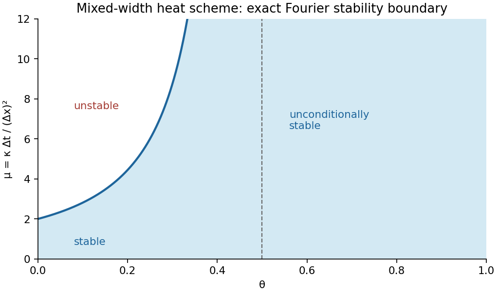

<h1 id="a/2/b/solution">Solution</h1>

↑ **Parent:** [B](../b.md)

Transforming the spatial shifts and putting $\xi=k\Delta x$ gives the real [amplification factor](../../../../../amplification-factor.md)

$$
\widehat U^{m+1}=G(\xi)\widehat U^m,\qquad
G(\xi)=\frac{1-\mu(1-\theta)\sin^2\xi}{1+4\mu\theta\sin^2(\xi/2)}.
$$

For $0\leq\theta\leq1$ the denominator is at least one, so the implicit step is a bounded [Fourier multiplier](../../../../../fourier-multiplier.md) on $\ell^2$. Set $v=\sin^2(\xi/2)\in[0,1]$ and use $\sin^2\xi=4v(1-v)$. The numerator is no greater than the denominator, so $G\leq1$. The other inequality is

$$
G\geq-1\iff
4\mu v\bigl[(1-2\theta)-(1-\theta)v\bigr]\leq2.
$$

If $\theta\geq1/2$, the bracket is nonpositive and this always holds. If $0\leq\theta<1/2$, the concave quadratic has its maximum at $v=(1-2\theta)/[2(1-\theta)]$, with value $(1-2\theta)^2/[4(1-\theta)]$. Therefore $|G|\leq1$ precisely under the stated condition

$$
\boxed{\mu(1-2\theta)^2\leq2(1-\theta)\quad(0\leq\theta<1/2),}
$$

and without a mesh-ratio restriction when $1/2\leq\theta\leq1$. The [Parseval identity](../../../../../parseval-identity.md) now gives

$$
\|U^{m+1}\|_{\ell^2}^2=\frac1{2\pi}\int|G|^2|\widehat U^m|^2dk
\leq\|U^m\|_{\ell^2}^2.
$$

Iteration proves stability with constant one. It is **conditional for $\theta<1/2$ and unconditional for $\theta\geq1/2$**. The sampled initial data have finite support, hence belong to $\ell^2$. This is the [Fourier stability threshold for a mixed-width heat scheme](../../../../../fourier-stability-threshold-for-a-mixed-width-heat-scheme.md).

**[Figure 1](#a/2/b/image-the-exact-stable-mesh-ratio-region-for-the-mixed-width-heat-scheme). The exact stable mesh-ratio region for the mixed-width heat scheme**.

## ↑ Ancestors (13)

1. [B](../b.md)
2. [2](../../2.md)
3. [A](../../../a.md)
4. [2010](../../../../2010-split.md)
5. [Past exam of the numerical solution of differential equations course of the University of Oxford](../../../../split.md)
6. [Numerical solution of differential equations course of the University of Oxford](../../../../../numerical-solution-of-differential-equations-course-of-the-university-of-oxford.md)
7. [Year 3 of the mathematics course of the University of Oxford](../../../../../year-3-of-the-mathematics-course-of-the-university-of-oxford.md)
8. [Mathematics course of the University of Oxford](../../../../../mathematics-course-of-the-university-of-oxford.md)
9. [Undergraduate course of the University of Oxford](../../../../../undergraduate-course-of-the-university-of-oxford.md)
10. [Course of the University of Oxford](../../../../../course-of-the-university-of-oxford.md)
11. [University of Oxford](../../../../../university-of-oxford-split.md)
12. [List of universities](../../../../../list-of-universities.md)
13. [Codex Wiki](../../../../../split.md)
