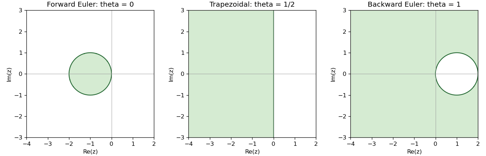

<h1 id="a/1/c/solution">Solution</h1>

↑ **Parent:** [C](../c.md)

On the [Dahlquist test equation](../../../../../dahlquist-test-equation.md), set $z=h\lambda$. The [theta method](../../../../../theta-method.md) has [stability function](../../../../../stability-function.md)

$$
R(z)=\frac{1+(1-\theta)z}{1-\theta z},\qquad y_n=R(z)^n.
$$

With the decaying-solution convention, its region of [absolute stability](../../../../../linear-stability-domain.md) is $|R(z)|<1$. Writing $z=x+iy$, squaring numerator and denominator gives

$$
\boxed{\mathcal S_\theta=\{z:2x+(1-2\theta)|z|^2<0\}.}
$$

For $0\leq\theta<1/2$ this is the open disk with centre $-1/(1-2\theta)$ and radius $1/(1-2\theta)$. At $\theta=1/2$ it is the open left half-plane. For $\theta>1/2$ it is the exterior of the closed disk with centre $1/(2\theta-1)$ and radius $1/(2\theta-1)$. The pole $z=1/\theta$, when present, lies outside the stability region.

Every $z$ with $\operatorname{Re}z<0$ satisfies the inequality exactly for $\theta\geq1/2$. If $\theta<1/2$, sufficiently large negative real $z$ fails it. Therefore

$$
\boxed{\text{The method is A-stable exactly when }1/2\leq\theta\leq1.}
$$

If [absolute stability](../../../../../linear-stability-domain.md) is instead defined by bounded amplification, the boundary $|R|=1$ is included; this convention does not change the [A-stability](../../../../../a-stability.md) conclusion for the open left half-plane.

**[Figure 1](#a/1/c/image-absolute-stability-regions-of-the-theta-method-at-zero-one-half-and-one-green-regions-damp-the-scalar-test-solution). Absolute stability regions of the theta method at zero, one half and one; green regions damp the scalar test solution**.

## ↑ Ancestors (13)

1. [C](../c.md)
2. [1](../../1.md)
3. [A](../../../a.md)
4. [2011](../../../../2011-split.md)
5. [Past exam of the numerical solution of differential equations course of the University of Oxford](../../../../split.md)
6. [Numerical solution of differential equations course of the University of Oxford](../../../../../numerical-solution-of-differential-equations-course-of-the-university-of-oxford.md)
7. [Year 3 of the mathematics course of the University of Oxford](../../../../../year-3-of-the-mathematics-course-of-the-university-of-oxford.md)
8. [Mathematics course of the University of Oxford](../../../../../mathematics-course-of-the-university-of-oxford.md)
9. [Undergraduate course of the University of Oxford](../../../../../undergraduate-course-of-the-university-of-oxford.md)
10. [Course of the University of Oxford](../../../../../course-of-the-university-of-oxford.md)
11. [University of Oxford](../../../../../university-of-oxford-split.md)
12. [List of universities](../../../../../list-of-universities.md)
13. [Codex Wiki](../../../../../split.md)
