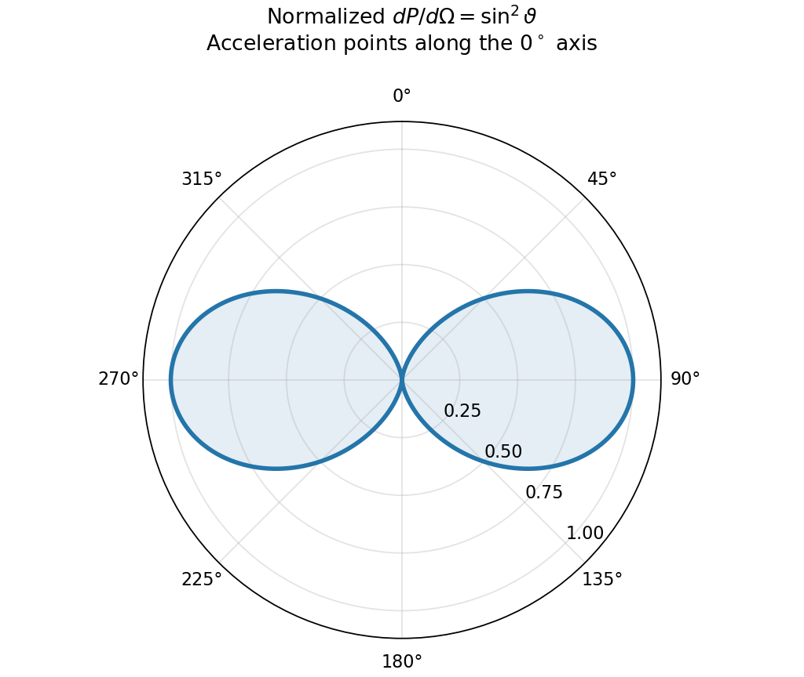

<h1 id="2/a/solution">Solution</h1>

↑ **Parent:** [A](../a.md)

An accelerating [point charge](../../../../../point-charge.md) has a transverse [radiation field](../../../../../radiation-field.md) in addition to its near field. At nonrelativistic [speed](../../../../../speed.md) and large distance $R$,

$$
\mathbf E_{\rm rad}(\mathbf r,t)=\frac{q}{4\pi\epsilon_0c^2R}
\widehat{\mathbf n}\times[\widehat{\mathbf n}\times\mathbf a(t-R/c)],\qquad
\mathbf B_{\rm rad}=\frac1c\widehat{\mathbf n}\times\mathbf E_{\rm rad}.
$$

The [acceleration](../../../../../acceleration.md) is evaluated at [retarded time](../../../../../retarded-time.md). [Radiation fields](../../../../../radiation-field.md) decay as $1/R$, so their outward [energy](../../../../../energy-split.md) [flux](../../../../../flux.md) integrated over a [sphere](../../../../../sphere.md) is independent of [radius](../../../../../radius.md); the near [electric field](../../../../../electric-field-split.md) instead decays as $1/R^2$. The radiation vanishes along the [acceleration](../../../../../acceleration.md) and is strongest perpendicular to it.[§28–2, Eqs. (28.5)–(28.6): transverse acceleration field and inverse-distance radiation](../../../../../the-feynman-lectures-on-physics-volume-i-by-richard-feynman-and-others.md)

Using the [Poynting vector](../../../../../poynting-vector.md) gives

$$
\frac{dP}{d\Omega}=\frac{q^2a^2\sin^2\vartheta}{16\pi^2\epsilon_0c^3},\qquad
\boxed{P=\frac{q^2a^2}{6\pi\epsilon_0c^3}.}
$$

The integral uses $\int\sin^2\vartheta\,d\Omega=8\pi/3$. This is the [Larmor formula](../../../../../larmor-formula.md). A harmonically accelerated charge with peak [acceleration](../../../../../acceleration.md) $a_0$ has mean [power](../../../../../power.md) $q^2a_0^2/(12\pi\epsilon_0c^3)$; external work supplies this radiated [energy](../../../../../energy-split.md) in steady operation. Uniform inertial motion does not radiate.

**[Figure 1](#2/a/image-original-nonrelativistic-radiation-pattern-with-zero-power-along-the-acceleration-and-maximum-power-transverse-to-it). Original nonrelativistic radiation pattern, with zero power along the acceleration and maximum power transverse to it**.

At relativistic [speed](../../../../../speed.md) the angular pattern becomes directionally concentrated and retarded-source factors matter. The total instantaneous radiated [power](../../../../../power.md) generalizes to $q^2\gamma^6[a^2-|\boldsymbol\beta\times\mathbf a|^2]/(6\pi\epsilon_0c^3)$, with $\boldsymbol\beta=\mathbf v/c$. The displayed simple $\sin^2\vartheta$ pattern is restricted to the [nonrelativistic limit](../../../../../nonrelativistic-limit.md).

## ↑ Ancestors (14)

1. [A](../a.md)
2. [2](../../2.md)
3. [Paper 1](../../../paper-1-split.md)
4. [2012](../../../split.md)
5. [Past exam of the optics and electrodynamics course of the University of Cambridge](../../../../split.md)
6. [Optics and Electrodynamics course of the University of Cambridge](../../../../../optics-and-electrodynamics-course-of-the-university-of-cambridge.md)
7. [Physics course of the year 3 of the natural sciences course of the University of Cambridge](../../../../../physics-course-of-the-year-3-of-the-natural-sciences-course-of-the-university-of-cambridge.md)
8. [Year 3 of the natural sciences course of the University of Cambridge](../../../../../year-3-of-the-natural-sciences-course-of-the-university-of-cambridge.md)
9. [Year of the natural sciences course of the University of Cambridge](../../../../../year-of-the-natural-sciences-course-of-the-university-of-cambridge.md)
10. [Natural sciences course of the University of Cambridge](../../../../../natural-sciences-course-of-the-university-of-cambridge.md)
11. [Course of the University of Cambridge](../../../../../course-of-the-university-of-cambridge.md)
12. [University of Cambridge](../../../../../university-of-cambridge-split.md)
13. [List of universities](../../../../../list-of-universities.md)
14. [Codex Wiki](../../../../../split.md)
