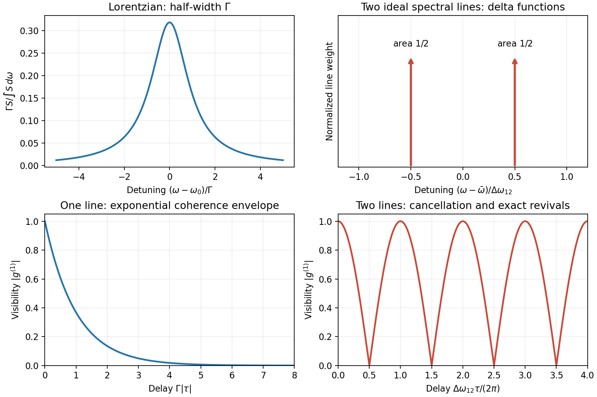

<h1 id="2/b/solution">Solution</h1>

↑ **Parent:** [B](../b.md)

[Temporal coherence](../../../../../temporal-optical-coherence.md) measures [correlation](../../../../../pearson-correlation-coefficient.md) between an optical field and a delayed copy. For a stationary scalar complex field with carrier convention $e^{-i\omega t}$,

$$
\Gamma(\tau)=\langle E^*(t)E(t+\tau)\rangle,\qquad
g^{(1)}(\tau)=\frac{\Gamma(\tau)}{\Gamma(0)}.
$$

The [power spectrum](../../../../../power-spectrum.md) $S(\omega)\ge0$ and the field [autocorrelation](../../../../../autocorrelation.md) form a [Fourier transform](../../../../../fourier-transform-split.md) pair, the [Wiener-Khinchin theorem](../../../../../wiener-khinchin-theorem.md):

$$
g^{(1)}(\tau)=\frac{\int S(\omega)e^{-i\omega\tau}\,d\omega}{\int S(\omega)\,d\omega}.
$$

A [Michelson interferometer](../../../../../michelson-interferometer.md) supplies delay $\tau=\Delta L/c$. With equal arm [intensities](../../../../../intensity-physics.md) and matched [polarization](../../../../../polarization-waves.md), its [interferometric visibility](../../../../../interferometric-visibility.md) is $|g^{(1)}(\tau)|$; unequal [intensities](../../../../../intensity-physics.md) or mode mismatch lower visibility independently of [temporal coherence](../../../../../temporal-optical-coherence.md). The relevant spectrum is the optical field spectrum, not the low-frequency spectrum of detector [intensity](../../../../../intensity-physics.md) fluctuations.

For a single Lorentzian optical line of angular-frequency [full width at half maximum](../../../../../full-width-at-half-maximum.md) $\Delta\omega$, use the narrow-line detuning model

$$
\frac{S(\omega)}{\int S\,d\omega}=\frac{\Delta\omega/(2\pi)}{(\omega-\omega_0)^2+(\Delta\omega/2)^2},\qquad
\boxed{g^{(1)}(\tau)=e^{-i\omega_0\tau}e^{-\Delta\omega|\tau|/2}.}
$$

Such a model describes a phase-diffusing monochromatic source. An $e^{-1}$ [correlation](../../../../../pearson-correlation-coefficient.md) time is $2/\Delta\omega$, and its [coherence length](../../../../../optical-coherence-length.md) is $2c/\Delta\omega$. The Lorentzian extension over all detunings approximates a narrow optical line with $\Delta\omega\ll\omega_0$.

For two equal, mutually incoherent ideal monochromatic spectral lines,

$$
S\propto\delta(\omega-\omega_1)+\delta(\omega-\omega_2),\qquad
\boxed{g^{(1)}(\tau)=e^{-i\bar\omega\tau}\cos(\Delta\omega_{12}\tau/2).}
$$

Here $\bar\omega=(\omega_1+\omega_2)/2$ and $\Delta\omega_{12}=\omega_2-\omega_1$. Visibility has zeros and revivals, so the overall spectral span alone does not determine a unique decay time. Giving each line a common finite Lorentzian linewidth multiplies this beating [correlation](../../../../../pearson-correlation-coefficient.md) by the corresponding exponential envelope.

**[Figure 2](#2/b/image-original-spectrum-coherence-examples-a-lorentzian-line-and-a-doublet-with-visibility-revivals). Original spectrum–coherence examples: a Lorentzian line and a doublet with visibility revivals**.

These two examples distinguish irreversible envelope decay from cancellation and revival of discrete spectral components. The line profiles are explicit models, not claimed measurements of a particular source.

## ↑ Ancestors (14)

1. [B](../b.md)
2. [2](../../2.md)
3. [Paper 1](../../../paper-1-split.md)
4. [2012](../../../split.md)
5. [Past exam of the optics and electrodynamics course of the University of Cambridge](../../../../split.md)
6. [Optics and Electrodynamics course of the University of Cambridge](../../../../../optics-and-electrodynamics-course-of-the-university-of-cambridge.md)
7. [Physics course of the year 3 of the natural sciences course of the University of Cambridge](../../../../../physics-course-of-the-year-3-of-the-natural-sciences-course-of-the-university-of-cambridge.md)
8. [Year 3 of the natural sciences course of the University of Cambridge](../../../../../year-3-of-the-natural-sciences-course-of-the-university-of-cambridge.md)
9. [Year of the natural sciences course of the University of Cambridge](../../../../../year-of-the-natural-sciences-course-of-the-university-of-cambridge.md)
10. [Natural sciences course of the University of Cambridge](../../../../../natural-sciences-course-of-the-university-of-cambridge.md)
11. [Course of the University of Cambridge](../../../../../course-of-the-university-of-cambridge.md)
12. [University of Cambridge](../../../../../university-of-cambridge-split.md)
13. [List of universities](../../../../../list-of-universities.md)
14. [Codex Wiki](../../../../../split.md)
