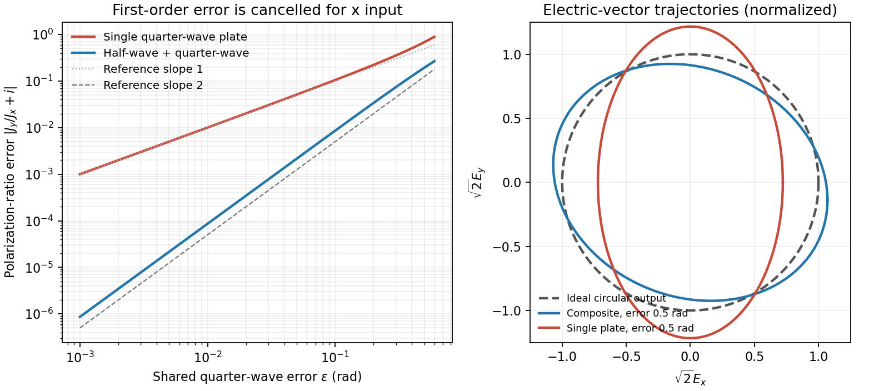

<h1 id="3/solution">Solution</h1>

↑ **Parent:** [3](../3.md)

Use $\mathbf E(z,t)=\operatorname{Re}[\mathbf J e^{i(kz-\omega t)}]$. A [Jones vector](../../../../jones-vector.md) $\mathbf J=(J_x,J_y)^{\mathsf T}$ records the two transverse [complex amplitudes](../../../../complex-amplitude.md). The [amplitude](../../../../wave-amplitude.md) ratio and relative [phase](../../../../phase-waves.md) determine the [polarization ellipse](../../../../polarization-ellipse.md); a common nonzero scalar does not change the [polarization](../../../../polarization-waves.md). A fixed [Jones vector](../../../../jones-vector.md) describes fully polarized monochromatic light, not an unpolarized statistical mixture.

[Linear birefringence](../../../../linear-birefringence.md) gives [orthogonal](../../../../orthogonal-vectors.md) principal [polarizations](../../../../polarization-waves.md) different [refractive indices](../../../../refractive-index.md). Put $n_y-n_x=\Delta n>0$, so $x$ is the fast axis. A plate of thickness $d$ gives slow-minus-fast [phase retardation](../../../../phase-retardation.md)

$$
\delta(\omega)=\frac{\omega d\Delta n(\omega)}c.
$$

The thinnest [quarter-wave plate](../../../../quarter-wave-plate.md) has

$$
\boxed{d=\frac{\pi c}{2\omega_0\Delta n(\omega_0)}=\frac{\lambda_0}{4\Delta n(\omega_0)}.}
$$

Here $\lambda_0=2\pi c/\omega_0$ is the [vacuum](../../../../vacuum.md) [wavelength](../../../../wavelength.md). For linear input at angle $\theta$ to the fast axis, the output at design [frequency](../../../../frequency.md) is $(\cos\theta,i\sin\theta)^{\mathsf T}$ up to common [phase](../../../../phase-waves.md). Axis-aligned input remains linear; equal nonzero components at $45^\circ$ modulo $90^\circ$ give [circular polarization](../../../../circular-polarization.md); other input angles give [elliptical polarization](../../../../elliptical-polarization.md). There is no need to spatially separate the two components.[§33–3: phase accumulation between orthogonal principal polarizations and quarter-wave conversion](../../../../the-feynman-lectures-on-physics-volume-i-by-richard-feynman-and-others.md)

For [waveplate retardance detuning](../../../../waveplate-retardance-detuning.md), define

$$
\epsilon=\frac{\omega d\Delta n(\omega)}c-\frac\pi2
\simeq\frac dc[\Delta n_0+\omega_0\Delta n'_0](\omega-\omega_0).
$$

Neglecting material dispersion reduces this to $\epsilon=(\pi/2)(\omega-\omega_0)/\omega_0$. Remove the common fast-axis [phase](../../../../phase-waves.md). Then $Q=\operatorname{diag}(1,ie^{i\epsilon})$. A similar [half-wave plate](../../../../half-wave-plate.md) of twice the thickness has twice the retardation, giving $H=\operatorname{diag}(1,-e^{2i\epsilon})$. The shared error parameter presumes the same material and matched thickness ratio.

For the [half-wave and quarter-wave achromatic circularizer](../../../../half-wave-and-quarter-wave-achromatic-circularizer.md), the first fast-axis angle is $\alpha=15^\circ$ and the second is $\gamma=\alpha+\beta=75^\circ$. With the stated passive rotation convention,

$$
\mathbf J_{\rm out}=R(-\gamma)Q R(\gamma)R(-\alpha)H R(\alpha)
\begin{pmatrix}1\\0\end{pmatrix}.
$$

An explicit expression valid for the given shared error is obtained by putting $z=e^{i\epsilon}$ and defining

$$
v_x=\cos^2\alpha-z^2\sin^2\alpha,\qquad
v_y=\sin\alpha\cos\alpha(1+z^2),
$$

$$
\mathbf J_{\rm out}=\begin{pmatrix}
(\cos^2\gamma+iz\sin^2\gamma)v_x+(1-iz)\sin\gamma\cos\gamma\,v_y\\
(1-iz)\sin\gamma\cos\gamma\,v_x+(\sin^2\gamma+iz\cos^2\gamma)v_y
\end{pmatrix}.
$$

At $\epsilon=0$, the [half-wave plate](../../../../half-wave-plate.md) rotates the linear input to $30^\circ$, which is $-45^\circ$ relative to the second fast axis. Thus

$$
\boxed{\mathbf J_0=\frac{e^{i75^\circ}}{\sqrt2}\begin{pmatrix}1\\-i\end{pmatrix}.}
$$

This is [circular polarization](../../../../circular-polarization.md). With our time convention its fixed-point electric vector is proportional, after a time-origin shift, to $(\cos\omega t,-\sin\omega t)$; this specifies the rotation without relying on conflicting handedness conventions.

Expanding the exact product to first order gives

$$
\mathbf J_{\rm out}=\begin{pmatrix}0.183+0.683i\\0.683-0.183i\end{pmatrix}
+\epsilon\begin{pmatrix}-0.433+0.116i\\0.116+0.433i\end{pmatrix}+O(\epsilon^2).
$$

These coefficients are rounded to three significant figures. Before rounding, the derivative is exactly $\mathbf J'_0=i\kappa\mathbf J_0$, with $\kappa=(3-\sqrt3)/2$. The [Jones-component ratio sensitivity](../../../../jones-component-ratio-sensitivity.md) therefore vanishes:

$$
\boxed{\frac{J_y}{J_x}=\frac{J_{0y}(1+i\kappa\epsilon)}{J_{0x}(1+i\kappa\epsilon)}+O(\epsilon^2)=-i+O(\epsilon^2).}
$$

Only common [phase](../../../../phase-waves.md) changes at first order. This proves compensation for the prescribed input near the design [frequency](../../../../frequency.md), not exact achromatic performance throughout the visible spectrum for arbitrary input [polarization](../../../../polarization-waves.md).

**[Figure 3](#3/image-original-comparison-of-single-plate-and-composite-polarization-errors-and-the-composite-electric-vector-trajectory). Original comparison of single-plate and composite polarization errors and the composite electric-vector trajectory**.

## ↑ Ancestors (13)

1. [3](../3.md)
2. [Paper 1](../../paper-1-split.md)
3. [2012](../../split.md)
4. [Past exam of the optics and electrodynamics course of the University of Cambridge](../../../split.md)
5. [Optics and Electrodynamics course of the University of Cambridge](../../../../optics-and-electrodynamics-course-of-the-university-of-cambridge.md)
6. [Physics course of the year 3 of the natural sciences course of the University of Cambridge](../../../../physics-course-of-the-year-3-of-the-natural-sciences-course-of-the-university-of-cambridge.md)
7. [Year 3 of the natural sciences course of the University of Cambridge](../../../../year-3-of-the-natural-sciences-course-of-the-university-of-cambridge.md)
8. [Year of the natural sciences course of the University of Cambridge](../../../../year-of-the-natural-sciences-course-of-the-university-of-cambridge.md)
9. [Natural sciences course of the University of Cambridge](../../../../natural-sciences-course-of-the-university-of-cambridge.md)
10. [Course of the University of Cambridge](../../../../course-of-the-university-of-cambridge.md)
11. [University of Cambridge](../../../../university-of-cambridge-split.md)
12. [List of universities](../../../../list-of-universities.md)
13. [Codex Wiki](../../../../split.md)
