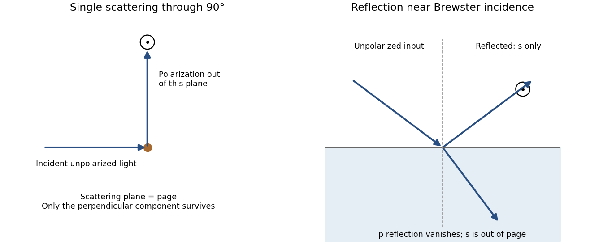

# Paper 1

↑ **Parent:** [2013](../2013.md)

Original paper: [Public original PDF, physical pages 254–257; cover on page 254 and questions on pages 255–257](https://www.whatdotheyknow.com/request/natural_science_tripos_physics_e_2/response/2340776/attach/2/FOI%202023%20399%20Zahid%20materials.pdf?cookie_passthrough=1#page=254).

**Table of contents**

- [1](#1)
  - [a](#1/a)
    - [Solution](#1/a/solution)
  - [b](#1/b)
    - [Solution](#1/b/solution)
  - [c](#1/c)
    - [i](#1/c/i)
      - [Solution](#1/c/i/solution)
    - [ii](#1/c/ii)
      - [Solution](#1/c/ii/solution)
- [2](#2)
  - [a](#2/a)
    - [Solution](#2/a/solution)
  - [b](#2/b)
    - [Solution](#2/b/solution)
  - [c](#2/c)
    - [Solution](#2/c/solution)
- [3](#3)
  - [Solution](#3/solution)
  - [a](#3/a)
    - [Solution](#3/a/solution)
  - [b](#3/b)
    - [Solution](#3/b/solution)
- [4](#4)
  - [Solution](#4/solution)

## 1

↑ **Parent:** [Paper 1](paper-1.md)

<h3 id="1/a">a</h3>

↑ **Parent:** [1](#1)

<h4 id="1/a/solution">Solution</h4>

↑ **Parent:** [A](#1/a)

The [wavelength](../../wave-equation.md#wavelength) is $\lambda=c/f\simeq0.50\,\mathrm m$, and the aperture diameter is $D=1.0\,\mathrm m$. A uniformly illuminated circular aperture has normalized [power](../../energy.md#power) pattern $[2J_1(x)/x]^2$, where $x=\pi D\sin\theta/\lambda$. Its first null is at $\sin\theta\simeq1.22\lambda/D$, while its half-power point has $\sin\theta\simeq0.514\lambda/D$. Thus

$$
\boxed{\text{Point to within roughly }0.25\,\mathrm{rad}\ (15^\circ)\text{ for modest loss}.}
$$

The first-null small-angle estimate is $0.61\,\mathrm{rad}$, or roughly $35^\circ$; using the sine gives about $38^\circ$. This is a broad beam because the diameter is only about two [wavelengths](../../wave-equation.md#wavelength). Real illumination and aperture efficiency alter the exact beam shape; a required allowable gain loss would specify the pointing tolerance more precisely.

For a matched, correctly polarized half-wave dipole, $A_{e,d}=G_d\lambda^2/(4\pi)$ with $G_d\simeq1.64$. For an efficient dish, $A_{e,s}\simeq\eta\pi(D/2)^2$. Received available [powers](../../energy.md#power) are proportional to these areas. With both [voltages](../../random-walk.md#voltage) referred to the same matched receiver resistance,

$$
\boxed{\frac{V_{\rm dipole}}{V_{\rm dish}}\simeq
\sqrt{\frac{G_d\lambda^2}{\eta\pi^2D^2}}
=\frac{0.204}{\sqrt\eta}.}
$$

For ideal aperture efficiency this is **about one fifth**, or five times greater [voltage](../../random-walk.md#voltage) from the dish. Terminal [voltages](../../random-walk.md#voltage) without a common impedance or matching convention are not fixed by aperture alone: $V_{\rm rms}^2=P_{\rm available}R_L$ for the respective [matched loads](../../electrical-circuit.md#matched-load). A short-dipole rather than half-wave convention changes the order-one gain factor, not the main estimate.

<h3 id="1/b">b</h3>

↑ **Parent:** [1](#1)

<h4 id="1/b/solution">Solution</h4>

↑ **Parent:** [B](#1/b)

[Spatial coherence](../../physical-optics.md#spatial-optical-coherence) compares the [electric fields](../../electric-field.md) at different positions at a common time; [temporal coherence](../../physical-optics.md#temporal-optical-coherence) compares the field with itself at a delay. Experimentally, they control whether separated apertures or unequal optical paths can form stable [interference](../../physical-optics.md#interference-wave-propagation) fringes. They are correlation properties, not a requirement that every emitted wave have a deterministic [phase](../../wave.md#phase-waves).

The source diameter is $\alpha=40/206265=1.94\times10^{-4}\,\mathrm{rad}$. At a representative visible [wavelength](../../wave-equation.md#wavelength) $\lambda=550\,\mathrm{nm}$,

$$
\boxed{\ell_\perp\sim\frac{\lambda}{\alpha}=2.8\,\mathrm{mm}.}
$$

For a uniformly bright circular disc, the first visibility zero is at $1.22\lambda/\alpha=3.5\,\mathrm{mm}$; the coefficient depends on the chosen coherence criterion and brightness distribution. Atmospheric [phase](../../wave.md#phase-waves) fluctuations can further spoil measured coherence.

For an explicitly assumed broad visible band from $400$ to $700\,\mathrm{nm}$, the [frequency](../../wave.md#frequency) span is $\Delta\nu=c(1/\lambda_{\min}-1/\lambda_{\max})=3.21\times10^{14}\,\mathrm{Hz}$. Consequently

$$
\boxed{\ell_\parallel\sim\frac c{\Delta\nu}\simeq0.93\,\mathrm{\mu m},\qquad
\tau_c\sim\frac1{\Delta\nu}\simeq3.1\,\mathrm{fs}.}
$$

Thus broadband planetary [light](../../optics.md#light) has millimetre-scale transverse and micrometre-scale longitudinal coherence. The receiver band is not supplied: a narrow filter would increase the [temporal coherence](../../physical-optics.md#temporal-optical-coherence) length, so this is a stated broadband estimate, not a unique source-only constant.

<h3 id="1/c">c</h3>

↑ **Parent:** [1](#1)

<h4 id="1/c/i">i</h4>

↑ **Parent:** [C](#1/c)

<h5 id="1/c/i/solution">Solution</h5>

↑ **Parent:** [I](#1/c/i)

Use ideal large plates and neglect edge effects. A Lorentz boost normal to the plates does not contract either transverse plate dimension. Charge is invariant, so charge per plate area remains $\sigma'=\sigma$. [Gauss's law](../../maxwell-equations.md#gauss-s-law) then gives

$$
\boxed{E_\parallel'=\frac{\sigma'}{\epsilon_0}=\frac\sigma{\epsilon_0}=E_\parallel.}
$$

The plate separation contracts, but the infinite-plate field is [independent](../../random-variable.md#independent-random-variables) of separation. It is therefore incorrect to infer a stronger field merely from the shorter gap. The ideal field is parallel to the boost, so there is no induced transverse [magnetic field](../../magnetic-field.md) from this boost.

<h4 id="1/c/ii">ii</h4>

↑ **Parent:** [C](#1/c)

<h5 id="1/c/ii/solution">Solution</h5>

↑ **Parent:** [Ii](#1/c/ii)

For a long [solenoid](../../magnetic-field.md#solenoid) at rest, $B=\mu_0nI$, where n is turns per unit axial length and I is the current around a turn. Under a boost along its axis, longitudinal contraction gives $n'=\gamma n$. The circumference of a turn is transverse to the boost and does not contract; [time dilation](../../special-relativity.md#time-dilation) reduces its charge-circulation rate, measured relative to the moving material of that turn, to $I'=I/\gamma$. Hence

$$
\boxed{B_\parallel'=\mu_0n'I'=\mu_0(\gamma n)(I/\gamma)=B_\parallel.}
$$

Equivalently, the transverse volume-current [density](../../fluid-mechanics.md#density) of an ideal continuous current sheet is unchanged by an axial boost. The increase in turn [density](../../fluid-mechanics.md#density) must not be included while leaving the per-turn current unchanged. End effects and the microscopic winding geometry are outside this ideal-solenoid argument.

## 2

↑ **Parent:** [Paper 1](paper-1.md)

<h3 id="2/a">a</h3>

↑ **Parent:** [2](#2)

<h4 id="2/a/solution">Solution</h4>

↑ **Parent:** [A](#2/a)

Let $\mathbf R$ run from the charge's present position to the observation point, and let $\boldsymbol\beta=\mathbf v/c$ be constant. Lorentz-transforming the Coulomb field gives

$$
\boxed{\mathbf E(\mathbf R,t)=\frac{q}{4\pi\epsilon_0}
\frac{(1-\beta^2)\mathbf R}{[R^2-|\boldsymbol\beta\times\mathbf R|^2]^{3/2}},\qquad
\mathbf B=\frac{\mathbf v\times\mathbf E}{c^2}.}
$$

At fixed R, the radial magnitude is proportional to $(1-\beta^2)/(1-\beta^2\sin^2\theta)^{3/2}$. It is reduced by $\gamma^{-2}$ along the motion and enhanced by $\gamma$ perpendicular to it. The field is therefore concentrated around the transverse plane at high [speed](../../classical-mechanics.md#speed). For negative charge all electric-field arrows reverse.

**[Figure 1](#2/a/image-original-angular-field-strength-comparison-for-a-uniformly-moving-charge-measured-from-its-instantaneous-position-with-the-direction-of-motion-marked). Original angular field-strength comparison for a uniformly moving charge, measured from its instantaneous position, with the direction of motion marked**.

Although the fields depend causally on retarded motion, for constant [velocity](../../classical-mechanics.md#velocity) the electric-field direction points along the separation from the present position. This does not imply instantaneous action: the velocity-dependent part of the retarded field removes a naive directional lag. Both fields fall as $R^{-2}$; **uniform straight-line motion produces no acceleration-radiation term proportional to $R^{-1}$**.

<h3 id="2/b">b</h3>

↑ **Parent:** [2](#2)

<h4 id="2/b/solution">Solution</h4>

↑ **Parent:** [B](#2/b)

Sunlight is approximately unpolarized before its interaction with the environment. For [Rayleigh scattering](../../electromagnetic-radiation.md#rayleigh-scattering) by small isotropic scatterers, the induced [electric dipoles](../../electrostatics.md#electric-dipole) radiate only their components transverse to the viewing direction. For unpolarized incident [light](../../optics.md#light) scattered through angle $\chi$, the perpendicular and parallel [intensities](../../wave.md#intensity-physics) are proportional to 1 and $\cos^2\chi$. The degree of [linear polarization](../../electromagnetic-wave.md#linear-polarization) is therefore

$$
\boxed{\mathcal P=\frac{\sin^2\chi}{1+\cos^2\chi}.}
$$

At $90^\circ$ single scattering is fully linearly polarized perpendicular to the [scattering plane](../../quantum-scattering.md#scattering-plane). This explains the polarized sky away from the [Sun](../../stellar-astrophysics.md#sun); multiple scattering and aerosols reduce the ideal contrast.

[Reflection](../../linear-algebra.md#reflection-mathematics) at a [dielectric](../../permittivity.md#dielectric) surface treats the two [linear polarizations](../../electromagnetic-wave.md#linear-polarization) differently. At Brewster incidence, $\tan\theta_B=n_2/n_1$, the reflected p component vanishes for ideal transparent nonmagnetic media. The remaining reflected glare is s polarized, perpendicular to the incidence plane, approximately horizontal for a horizontal water surface. Away from this angle the [reflection](../../linear-algebra.md#reflection-mathematics) is generally partially polarized. The transmitted beam also has unequal s/p transmission.

**[Figure 2](#2/b/image-original-diagrams-of-polarization-perpendicular-to-a-single-scattering-plane-and-of-s-polarized-reflection-near-brewster-incidence-at-a-dielectric-surface). Original diagrams of polarization perpendicular to a single-scattering plane and of s-polarized reflection near Brewster incidence at a dielectric surface**.

Refraction and internal [reflection](../../linear-algebra.md#reflection-mathematics) in water droplets likewise have polarization-dependent Fresnel coefficients, producing strong [linear polarization](../../electromagnetic-wave.md#linear-polarization) in rainbow [light](../../optics.md#light). These are generic scattering and boundary-condition mechanisms; no biological detection mechanism is required.

<h3 id="2/c">c</h3>

↑ **Parent:** [2](#2)

<h4 id="2/c/solution">Solution</h4>

↑ **Parent:** [C](#2/c)

An accelerated charge radiates. For ultrarelativistic circular motion, the emitted radiation is concentrated into a cone of angular width of order $\gamma^{-1}$ about the instantaneous [velocity](../../classical-mechanics.md#velocity). As the cone sweeps past a distant observer, propagation-time compression produces a short pulse of width of order $\rho/(\gamma^3c)$, where $\rho$ is orbit curvature radius. Its Fourier spectrum extends to high harmonics, with conventional critical [angular frequency](../../lagrangian-mechanics.md#angular-frequency)

$$
\boxed{\omega_c=\frac{3\gamma^3c}{2\rho}.}
$$

This is a spectral scale, not a sharp upper cutoff. For transverse [acceleration](../../classical-mechanics.md#acceleration) and $v\simeq c$, the classical radiated [power](../../energy.md#power) is

$$
P=\frac{q^2\gamma^4a^2}{6\pi\epsilon_0c^3}
\simeq\frac{q^2c\gamma^4}{6\pi\epsilon_0\rho^2}.
$$

The radiation is linearly polarized for an observer in the orbit plane, with [elliptical polarization](../../wave.md#elliptical-polarization) away from it. The two sides of the orbit plane have opposite handedness. The strong forward preference and high-frequency spectrum follow from the relativistic radiation calculation.[1949, abstract: angular distribution, forward preference and high-frequency radiation](../../physics-bibliography.md#on-the-classical-radiation-of-accelerated-electrons-by-julian-schwinger)

**[Figure 3](#2/c/image-original-tangent-beaming-geometry-and-normalized-illustrative-pulse-showing-the-origin-of-a-broad-synchrotron-spectrum-the-pulse-curve-is-schematic-rather-than-measured). Original tangent-beaming geometry and normalized illustrative pulse showing the origin of a broad synchrotron spectrum; the pulse curve is schematic rather than measured**.

Magnetic bending fields steer the charge but do no work, so maintaining a storage-ring beam requires [energy](../../energy.md) replacement by accelerating fields. Bright [electron](../../physics.md#electron) beams provide useful radiation from [infrared](../../optics.md#infrared) to [X-rays](../../electromagnetic-radiation.md#x-ray); stronger curvature or higher [electron](../../physics.md#electron) [energy](../../energy.md) shifts the spectral scale. The classical formulas assume negligible quantum recoil.

## 3

↑ **Parent:** [Paper 1](paper-1.md)

<h3 id="3/solution">Solution</h3>

↑ **Parent:** [3](#3)

For propagation along z, write $\mathbf E=\operatorname{Re}\{(E_x\widehat{\mathbf x}+E_y\widehat{\mathbf y})e^{i(kz-\omega t)}\}$. A [Jones vector](../../wave.md#jones-vector) contains the complex transverse components. Equal [phase](../../wave.md#phase-waves) modulo $\pi$ gives [linear polarization](../../electromagnetic-wave.md#linear-polarization); equal magnitudes with [phase difference](../../wave.md#phase-difference) $\pm\pi/2$ give [circular polarization](../../electromagnetic-wave.md#circular-polarization). A common overall [phase](../../wave.md#phase-waves) has no effect on the [polarization ellipse](../../wave.md#polarization-ellipse). A deterministic optical element acts by a [Jones matrix](../../wave.md#jones-matrix), with successive matrices ordered from right to left along the [light](../../optics.md#light) path.

A [circular polarizer](../../electromagnetic-wave.md#circular-polarizer) uses a linear [polarizer](../../electromagnetic-wave.md#polarizer) transmitting x and a [quarter-wave plate](../../maxwell-equations.md#quarter-wave-plate) whose principal axes are at $\pm45^\circ$. Up to an overall [phase](../../wave.md#phase-waves), convenient matrices in fixed physical x/y axes are

$$
P=\begin{pmatrix}1&0\\0&0\end{pmatrix},\qquad
Q=\frac1{\sqrt2}\begin{pmatrix}1&i\\ i&1\end{pmatrix}.
$$

The plate is lossless, $QQ^\dagger=I_2$, and $Q(1,0)^T=(1,i)^T/\sqrt2$ is circular in the supplied convention. **Put P on side A and Q on side B**: forward passage is $J_{A\to B}=QP$.

[Unpolarized light](../../wave.md#unpolarized-light) has no single [Jones vector](../../wave.md#jones-vector). Represent its [intensity](../../wave.md#intensity-physics) by the [coherency matrix](../../wave.md#coherency-matrix) $C_{\rm in}=(I_0/2)I_2$ and propagate it as $C_{\rm out}=JC_{\rm in}J^\dagger$. Forward transmission gives

$$
C_{A\to B}=\frac{I_0}{2}\,\mathbf e_+\mathbf e_+^\dagger,
\qquad\mathbf e_+=\frac1{\sqrt2}\begin{pmatrix}1\\i\end{pmatrix}.
$$

Thus **the transmitted [light](../../optics.md#light) is circular with [intensity](../../wave.md#intensity-physics) $I_0/2$**. The initial [polarizer](../../electromagnetic-wave.md#polarizer) removes one incoherent linear component; the plate changes [phase](../../wave.md#phase-waves) without restoring the lost [intensity](../../wave.md#intensity-physics).

Reverse passage encounters Q before P and has $J_{B\to A}=PQ$ in the same fixed transverse axes. It gives

$$
\boxed{C_{B\to A}=\frac{I_0}{2}P.}
$$

The output is linearly polarized along x and again has [intensity](../../wave.md#intensity-physics) $I_0/2$. A retarder alone leaves an unpolarized [coherency matrix](../../wave.md#coherency-matrix) unchanged. Consequently an unpolarized scene appears darker from either side, although the transmitted polarization differs. No polarization-dependent response of the observer is needed to explain this reduction.

For the mirror calculations below, use an ideal near-normal isotropic reflector, $M=-I_2$ up to a common [phase](../../wave.md#phase-waves). In fixed physical transverse axes [reflection](../../linear-algebra.md#reflection-mathematics) leaves the [polarization ellipse](../../wave.md#polarization-ellipse) unchanged; it reverses circular [helicity](../../special-relativity.md#helicity) because the propagation direction reverses. A reciprocal plate has the same relative [phase](../../wave.md#phase-waves) delay on the return traversal in this fixed-axis convention. In particular $Q^2=i\begin{pmatrix}0&1\\1&0\end{pmatrix}$: two passes exchange x and y linear states.

**[Figure 4](#3/image-original-outward-and-return-polarization-state-diagrams-for-the-two-orientations-of-a-polarizer-plus-quarter-wave-plate-filter-in-front-of-a-mirror). Original outward and return polarization-state diagrams for the two orientations of a polarizer-plus-quarter-wave-plate filter in front of a mirror**.

<h3 id="3/a">a</h3>

↑ **Parent:** [3](#3)

<h4 id="3/a/solution">Solution</h4>

↑ **Parent:** [A](#3/a)

With B nearest the observer, [light](../../optics.md#light) from the reflecting target near the observer first crosses Q and then P on its way to the mirror. [Unpolarized light](../../wave.md#unpolarized-light) remains unpolarized through Q, then becomes x linear after P. Mirror [reflection](../../linear-algebra.md#reflection-mathematics) preserves that linear orientation. On return it passes the same P without further ideal rejection and then Q, becoming circular toward the observer. Thus **the reflected target remains visible**.

Algebraically, with input and output at the observer side,

$$
J_{\rm return}=QPM P Q=-QPQ,\qquad
\operatorname{tr}(J_{\rm return}C_{\rm in}J_{\rm return}^\dagger)=\frac{I_0}{2}.
$$

The target here is used only as a source/reflector of ordinary [unpolarized light](../../wave.md#unpolarized-light); no physiological model is involved.

<h3 id="3/b">b</h3>

↑ **Parent:** [3](#3)

<h4 id="3/b/solution">Solution</h4>

↑ **Parent:** [B](#3/b)

With A nearest the observer, the outward order is P then Q. The initially [unpolarized light](../../wave.md#unpolarized-light) becomes x linear, then circular, before reaching the mirror. [Reflection](../../linear-algebra.md#reflection-mathematics) reverses its [helicity](../../special-relativity.md#helicity). Its return through Q gives y linear, which is blocked by P:

$$
\boxed{J_{\rm return}=PQM QP=-PQ^2P=0.}
$$

Hence **the ideal reflected filter is dark and the target cannot be seen through it**. This is a double-pass polarization rejection effect, not unequal one-pass transmission from its two sides. Real mirrors at oblique incidence, imperfect retardance, finite [bandwidth](../../electrical-engineering.md#bandwidth-signal-processing) and depolarization can leave leakage.

## 4

↑ **Parent:** [Paper 1](paper-1.md)

<h3 id="4/solution">Solution</h3>

↑ **Parent:** [4](#4)

A [Hertzian dipole](../../electrical-engineering.md#hertzian-dipole) is an ideal localized oscillating source much smaller than its radiation [wavelength](../../wave-equation.md#wavelength). Its electric version is an infinitesimal current element; its magnetic version is a small current loop with moment $\mathbf m=IA\mathbf n$. Such elements model the far-field radiation and [radiation resistance](../../electrical-engineering.md#radiation-resistance) of electrically small antennas. The approximation requires source dimensions much smaller than $c/\omega$.

The supplied [magnetic field](../../magnetic-field.md) has a quasistatic $[m]/r^3$ term, an [induction](../../foundations-of-mathematics.md#mathematical-induction) $[\dot m]/(cr^2)$ term and a transverse radiation $[\ddot m]/(c^2r)$ term. The [electric field](../../electric-field.md) has [induction](../../foundations-of-mathematics.md#mathematical-induction) and radiation terms. Brackets mean evaluation at the [retarded time](../../relativistic-electromagnetism.md#retarded-time) $t_r=t-r/c$, not a time average. Near terms mainly exchange stored [energy](../../energy.md); only the $r^{-1}$ fields give a nonvanishing outgoing [power](../../energy.md#power) integral as $r\to\infty$.

For a fixed dipole axis the radiation fields satisfy $E_\phi=-cB_\theta$. The radial Poynting [flux](../../mathematical-physics.md#flux) is therefore

$$
S_r=\frac{cB_\theta^2}{\mu_0}
=\frac{\mu_0[\ddot m]^2}{16\pi^2c^3r^2}\sin^2\theta.
$$

Using $\int\sin^2\theta\,d\Omega=8\pi/3$ yields

$$
\boxed{P(t)=\frac{\mu_0[\ddot m]^2}{6\pi c^3}
=\frac{[\ddot m]^2}{6\pi\epsilon_0c^5}.}
$$

For a general changing dipole direction, replace the squared scalar [acceleration](../../classical-mechanics.md#acceleration) by $|\ddot{\mathbf m}|^2$.

[Radiation resistance](../../electrical-engineering.md#radiation-resistance) is the equivalent input resistance whose mean [power](../../energy.md#power) equals radiated [power](../../energy.md#power), not ohmic heating. For a fixed small loop carrying $I(t)=I_0\cos\omega t$, $m=AI$, so

$$
\overline P=\frac{A^2I_0^2\omega^4}{12\pi\epsilon_0c^5}
=\frac12I_0^2R_{\rm rad},\qquad
\boxed{R_{\rm rad}(\omega)=\frac{A^2\omega^4}{6\pi\epsilon_0c^5}.}
$$

This uses peak current $I_0$; with rms current the [power](../../energy.md#power) is $I_{\rm rms}^2R_{\rm rad}$.

The satellite loop needs its changing orientation as well as its induced current. Put the spin axis along z, the external field along x, and let $\mathbf n(t)=(\cos\omega t,\sin\omega t,0)$. With $A=\pi b^2$ and resistance $R=10^{-4}\,\Omega$, the resistance-only approximation gives

$$
\Phi=BA\cos\omega t,\quad\mathcal E=BA\omega\sin\omega t,\quad
I(t)=\frac{BA\omega}{R}\sin\omega t.
$$

Write $m_0=BA^2\omega/R$. The full magnetic moment is

$$
\mathbf m(t)=m_0\sin\omega t\,\mathbf n(t)
=\frac{m_0}{2}\left[\sin(2\omega t)\widehat{\mathbf x}
+(1-\cos(2\omega t))\widehat{\mathbf y}\right].
$$

It has a static component and a rotating component at $2\omega$. Consequently $|\ddot{\mathbf m}|^2=4m_0^2\omega^4$, and

$$
\boxed{\overline P_{\rm loop}
=\frac{2B^2A^4\omega^6}{3\pi\epsilon_0c^5R^2}
=\frac{2\pi^3B^2b^8\omega^6}{3\epsilon_0c^5R^2}.}
$$

Holding the dipole axis fixed while inserting the sinusoidal current would instead give $B^2A^4\omega^6/(12\pi\epsilon_0c^5R^2)$, eight times smaller. That is the fixed-axis-loop result; it does not describe the stated rotating loop. This is [frequency doubling of an induction-driven rotating loop](../../electromagnetic-wave.md#frequency-doubling-of-an-induction-driven-rotating-loop); the changing vector direction is essential.

**[Figure 5](#4/image-original-calculated-rotation-induced-current-and-vector-magnetic-moment-components-illustrating-the-static-plus-twice-spin-frequency-decomposition). Original calculated rotation-induced current and vector magnetic-moment components, illustrating the static plus twice-spin-frequency decomposition**.

The resistance-only model is conditional: loop [inductance](../../electromagnetism.md#inductance) is not supplied. If [self-inductance](../../electromagnetism.md#self-inductance) L matters, solve $L\dot I+RI=BA\omega\sin\omega t$. In the [steady state](../../dynamical-systems.md#steady-state) $I_0=BA\omega/\sqrt{R^2+\omega^2L^2}$. Its [phase](../../wave.md#phase-waves) changes the static moment direction but not the twice-frequency component's magnitude, so the [power](../../energy.md#power) becomes

$$
\boxed{\overline P_{\rm loop}(L)=
\frac{2B^2A^4\omega^6}{3\pi\epsilon_0c^5(R^2+\omega^2L^2)}.}
$$

The first expression is the requested resistive idealization and an upper estimate within this passive RL correction. Radiation reaction is negligible compared with the stipulated ohmic resistance. The radiated [energy](../../energy.md) comes from [rotational kinetic energy](../../energy.md#rotational-kinetic-energy): the induced magnetic [torque](../../momentum.md#torque) brakes the loop. Most lost rotational [energy](../../energy.md) is [Joule heating](../../electric-charge.md#joule-heating); a small part escapes as radiation. Maintaining a constant spin would require external mechanical [power](../../energy.md#power).

For scale only, take $B=50\,\mathrm{\mu T}$, a representative near-Earth field rather than a supplied orbital measurement. The terrestrial surface range reported by NOAA is roughly $25$–$65\,\mathrm{\mu T}$; the actual orbital value depends on position.[What are the magnetic elements? Total field intensity range](../../physics-bibliography.md#geomagnetism-frequently-asked-questions-by-national-oceanic-and-atmospheric-administration) With $b=1\,\mathrm m$ and $\omega=2\pi(500\,\mathrm{s^{-1}})$, the resistance-only model gives

$$
\boxed{\overline P\simeq2.3\times10^{-10}\,\mathrm W
\left(\frac{B}{50\,\mathrm{\mu T}}\right)^2,
\qquad f_{\rm rad}=1000\,\mathrm{Hz},\qquad\lambda_{\rm rad}\simeq300\,\mathrm{km}.}
$$

[Inductance](../../electromagnetism.md#inductance) would reduce this [power](../../energy.md#power). The kilohertz signal is exceptionally weak and a metre-scale receiving antenna is electrically tiny. Ionospheric absorption/[reflection](../../linear-algebra.md#reflection-mathematics) and strong natural or instrumental low-frequency backgrounds make ordinary ground reception impractical. This is not a theorem that the [ionosphere](../../geophysics.md#ionosphere) blocks every low-frequency [mode](../../probability-and-statistics.md#mode-statistics): field-guided propagation and condition-dependent leakage are real, as the VIPER mission's measurements were designed to test.[VIPER description: absorption/reflection layers and condition-dependent trans-ionospheric propagation](../../physics-bibliography.md#nasa-rocket-mission-studying-escaping-radio-waves-by-national-aeronautics-and-space-administration)

At a separation $r=100\,\mathrm{km}$, $k_{\rm rad}r\simeq2.1$, so the observer is not securely in the far field. The radiation term alone has at most the characteristic magnetic [amplitude](../../wave.md#wave-amplitude)

$$
B_{\rm rad}\sim\frac{\mu_0(2m_0\omega^2)}{4\pi c^2r}
\simeq3.4\times10^{-18}\,\mathrm T
\left(\frac{B}{50\,\mathrm{\mu T}}\right)
$$

in this optimistic resistance-only vacuum model. Near and [induction](../../foundations-of-mathematics.md#mathematical-induction) fields must be retained for a full prediction; a simple far-field inverse-square [power](../../energy.md#power) estimate is not an exact received signal here. Another satellite avoids the whole ground ionospheric path, but [plasma](../../physics.md#plasma-physics) propagation, receiving sensitivity, [bandwidth](../../electrical-engineering.md#bandwidth-signal-processing), orientation, integration time and spacecraft [noise](../../electrical-engineering.md#noise-signal-processing) remain unspecified. **Detection is not forbidden in principle, but routine practical detection is implausible at this scale; a definitive instrument-level yes/no does not follow from the supplied data.**

## ↑ Ancestors (11)

1. [2013](../2013.md)
2. [Past exam of the optics and electrodynamics course of the University of Cambridge](../../past-exam-of-the-optics-and-electrodynamics-course-of-the-university-of-cambridge.md)
3. [Optics and Electrodynamics course of the University of Cambridge](../../university-of-cambridge.md#optics-and-electrodynamics-course-of-the-university-of-cambridge)
4. [Physics course of the year 3 of the natural sciences course of the University of Cambridge](../../university-of-cambridge.md#physics-course-of-the-year-3-of-the-natural-sciences-course-of-the-university-of-cambridge)
5. [Year 3 of the natural sciences course of the University of Cambridge](../../university-of-cambridge.md#year-3-of-the-natural-sciences-course-of-the-university-of-cambridge)
6. [Year of the natural sciences course of the University of Cambridge](../../university-of-cambridge.md#year-of-the-natural-sciences-course-of-the-university-of-cambridge)
7. [Natural sciences course of the University of Cambridge](../../university-of-cambridge.md#natural-sciences-course-of-the-university-of-cambridge)
8. [Course of the University of Cambridge](../../university-of-cambridge.md#course-of-the-university-of-cambridge)
9. [University of Cambridge](../../university-of-cambridge.md)
10. [List of universities](../../README.md#list-of-universities)
11. [Codex Wiki](../../README.md)
