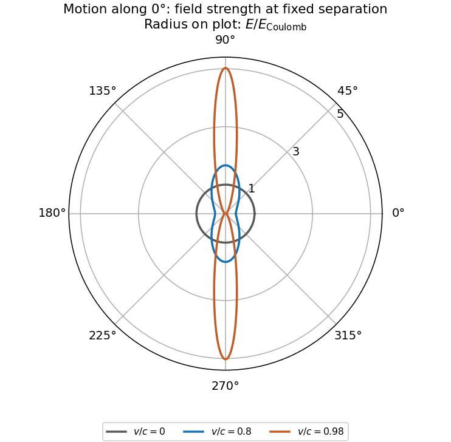

<h1 id="2/a/solution">Solution</h1>

↑ **Parent:** [A](../a.md)

Let $\mathbf R$ run from the charge's present position to the observation point, and let $\boldsymbol\beta=\mathbf v/c$ be constant. Lorentz-transforming the Coulomb field gives

$$
\boxed{\mathbf E(\mathbf R,t)=\frac{q}{4\pi\epsilon_0}
\frac{(1-\beta^2)\mathbf R}{[R^2-|\boldsymbol\beta\times\mathbf R|^2]^{3/2}},\qquad
\mathbf B=\frac{\mathbf v\times\mathbf E}{c^2}.}
$$

At fixed R, the radial magnitude is proportional to $(1-\beta^2)/(1-\beta^2\sin^2\theta)^{3/2}$. It is reduced by $\gamma^{-2}$ along the motion and enhanced by $\gamma$ perpendicular to it. The field is therefore concentrated around the transverse plane at high [speed](../../../../../speed.md). For negative charge all electric-field arrows reverse.

**[Figure 1](#2/a/image-original-angular-field-strength-comparison-for-a-uniformly-moving-charge-measured-from-its-instantaneous-position-with-the-direction-of-motion-marked). Original angular field-strength comparison for a uniformly moving charge, measured from its instantaneous position, with the direction of motion marked**.

Although the fields depend causally on retarded motion, for constant [velocity](../../../../../velocity.md) the electric-field direction points along the separation from the present position. This does not imply instantaneous action: the velocity-dependent part of the retarded field removes a naive directional lag. Both fields fall as $R^{-2}$; **uniform straight-line motion produces no acceleration-radiation term proportional to $R^{-1}$**.

## ↑ Ancestors (14)

1. [A](../a.md)
2. [2](../../2.md)
3. [Paper 1](../../../paper-1-split.md)
4. [2013](../../../split.md)
5. [Past exam of the optics and electrodynamics course of the University of Cambridge](../../../../split.md)
6. [Optics and Electrodynamics course of the University of Cambridge](../../../../../optics-and-electrodynamics-course-of-the-university-of-cambridge.md)
7. [Physics course of the year 3 of the natural sciences course of the University of Cambridge](../../../../../physics-course-of-the-year-3-of-the-natural-sciences-course-of-the-university-of-cambridge.md)
8. [Year 3 of the natural sciences course of the University of Cambridge](../../../../../year-3-of-the-natural-sciences-course-of-the-university-of-cambridge.md)
9. [Year of the natural sciences course of the University of Cambridge](../../../../../year-of-the-natural-sciences-course-of-the-university-of-cambridge.md)
10. [Natural sciences course of the University of Cambridge](../../../../../natural-sciences-course-of-the-university-of-cambridge.md)
11. [Course of the University of Cambridge](../../../../../course-of-the-university-of-cambridge.md)
12. [University of Cambridge](../../../../../university-of-cambridge-split.md)
13. [List of universities](../../../../../list-of-universities.md)
14. [Codex Wiki](../../../../../split.md)
