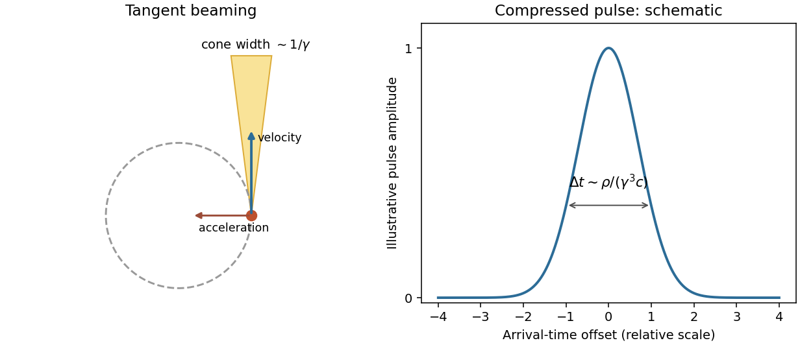

<h1 id="2/c/solution">Solution</h1>

↑ **Parent:** [C](../c.md)

An accelerated charge radiates. For ultrarelativistic circular motion, the emitted radiation is concentrated into a cone of angular width of order $\gamma^{-1}$ about the instantaneous [velocity](../../../../../velocity.md). As the cone sweeps past a distant observer, propagation-time compression produces a short pulse of width of order $\rho/(\gamma^3c)$, where $\rho$ is orbit curvature radius. Its Fourier spectrum extends to high harmonics, with conventional critical [angular frequency](../../../../../angular-frequency.md)

$$
\boxed{\omega_c=\frac{3\gamma^3c}{2\rho}.}
$$

This is a spectral scale, not a sharp upper cutoff. For transverse [acceleration](../../../../../acceleration.md) and $v\simeq c$, the classical radiated [power](../../../../../power.md) is

$$
P=\frac{q^2\gamma^4a^2}{6\pi\epsilon_0c^3}
\simeq\frac{q^2c\gamma^4}{6\pi\epsilon_0\rho^2}.
$$

The radiation is linearly polarized for an observer in the orbit plane, with [elliptical polarization](../../../../../elliptical-polarization.md) away from it. The two sides of the orbit plane have opposite handedness. The strong forward preference and high-frequency spectrum follow from the relativistic radiation calculation.[1949, abstract: angular distribution, forward preference and high-frequency radiation](../../../../../on-the-classical-radiation-of-accelerated-electrons-by-julian-schwinger.md)

**[Figure 3](#2/c/image-original-tangent-beaming-geometry-and-normalized-illustrative-pulse-showing-the-origin-of-a-broad-synchrotron-spectrum-the-pulse-curve-is-schematic-rather-than-measured). Original tangent-beaming geometry and normalized illustrative pulse showing the origin of a broad synchrotron spectrum; the pulse curve is schematic rather than measured**.

Magnetic bending fields steer the charge but do no work, so maintaining a storage-ring beam requires [energy](../../../../../energy-split.md) replacement by accelerating fields. Bright [electron](../../../../../electron.md) beams provide useful radiation from [infrared](../../../../../infrared.md) to [X-rays](../../../../../x-ray.md); stronger curvature or higher [electron](../../../../../electron.md) [energy](../../../../../energy-split.md) shifts the spectral scale. The classical formulas assume negligible quantum recoil.

## ↑ Ancestors (14)

1. [C](../c.md)
2. [2](../../2.md)
3. [Paper 1](../../../paper-1-split.md)
4. [2013](../../../split.md)
5. [Past exam of the optics and electrodynamics course of the University of Cambridge](../../../../split.md)
6. [Optics and Electrodynamics course of the University of Cambridge](../../../../../optics-and-electrodynamics-course-of-the-university-of-cambridge.md)
7. [Physics course of the year 3 of the natural sciences course of the University of Cambridge](../../../../../physics-course-of-the-year-3-of-the-natural-sciences-course-of-the-university-of-cambridge.md)
8. [Year 3 of the natural sciences course of the University of Cambridge](../../../../../year-3-of-the-natural-sciences-course-of-the-university-of-cambridge.md)
9. [Year of the natural sciences course of the University of Cambridge](../../../../../year-of-the-natural-sciences-course-of-the-university-of-cambridge.md)
10. [Natural sciences course of the University of Cambridge](../../../../../natural-sciences-course-of-the-university-of-cambridge.md)
11. [Course of the University of Cambridge](../../../../../course-of-the-university-of-cambridge.md)
12. [University of Cambridge](../../../../../university-of-cambridge-split.md)
13. [List of universities](../../../../../list-of-universities.md)
14. [Codex Wiki](../../../../../split.md)
