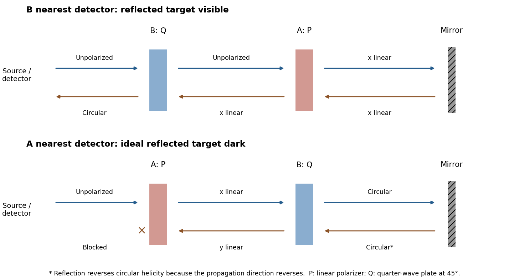

<h1 id="3/solution">Solution</h1>

↑ **Parent:** [3](../3.md)

For propagation along z, write $\mathbf E=\operatorname{Re}\{(E_x\widehat{\mathbf x}+E_y\widehat{\mathbf y})e^{i(kz-\omega t)}\}$. A [Jones vector](../../../../jones-vector.md) contains the complex transverse components. Equal [phase](../../../../phase-waves.md) modulo $\pi$ gives [linear polarization](../../../../linear-polarization.md); equal magnitudes with [phase difference](../../../../phase-difference.md) $\pm\pi/2$ give [circular polarization](../../../../circular-polarization.md). A common overall [phase](../../../../phase-waves.md) has no effect on the [polarization ellipse](../../../../polarization-ellipse.md). A deterministic optical element acts by a [Jones matrix](../../../../jones-matrix.md), with successive matrices ordered from right to left along the [light](../../../../light.md) path.

A [circular polarizer](../../../../circular-polarizer.md) uses a linear [polarizer](../../../../polarizer.md) transmitting x and a [quarter-wave plate](../../../../quarter-wave-plate.md) whose principal axes are at $\pm45^\circ$. Up to an overall [phase](../../../../phase-waves.md), convenient matrices in fixed physical x/y axes are

$$
P=\begin{pmatrix}1&0\\0&0\end{pmatrix},\qquad
Q=\frac1{\sqrt2}\begin{pmatrix}1&i\\ i&1\end{pmatrix}.
$$

The plate is lossless, $QQ^\dagger=I_2$, and $Q(1,0)^T=(1,i)^T/\sqrt2$ is circular in the supplied convention. **Put P on side A and Q on side B**: forward passage is $J_{A\to B}=QP$.

[Unpolarized light](../../../../unpolarized-light.md) has no single [Jones vector](../../../../jones-vector.md). Represent its [intensity](../../../../intensity-physics.md) by the [coherency matrix](../../../../coherency-matrix.md) $C_{\rm in}=(I_0/2)I_2$ and propagate it as $C_{\rm out}=JC_{\rm in}J^\dagger$. Forward transmission gives

$$
C_{A\to B}=\frac{I_0}{2}\,\mathbf e_+\mathbf e_+^\dagger,
\qquad\mathbf e_+=\frac1{\sqrt2}\begin{pmatrix}1\\i\end{pmatrix}.
$$

Thus **the transmitted [light](../../../../light.md) is circular with [intensity](../../../../intensity-physics.md) $I_0/2$**. The initial [polarizer](../../../../polarizer.md) removes one incoherent linear component; the plate changes [phase](../../../../phase-waves.md) without restoring the lost [intensity](../../../../intensity-physics.md).

Reverse passage encounters Q before P and has $J_{B\to A}=PQ$ in the same fixed transverse axes. It gives

$$
\boxed{C_{B\to A}=\frac{I_0}{2}P.}
$$

The output is linearly polarized along x and again has [intensity](../../../../intensity-physics.md) $I_0/2$. A retarder alone leaves an unpolarized [coherency matrix](../../../../coherency-matrix.md) unchanged. Consequently an unpolarized scene appears darker from either side, although the transmitted polarization differs. No polarization-dependent response of the observer is needed to explain this reduction.

For the mirror calculations below, use an ideal near-normal isotropic reflector, $M=-I_2$ up to a common [phase](../../../../phase-waves.md). In fixed physical transverse axes [reflection](../../../../reflection-mathematics.md) leaves the [polarization ellipse](../../../../polarization-ellipse.md) unchanged; it reverses circular [helicity](../../../../helicity.md) because the propagation direction reverses. A reciprocal plate has the same relative [phase](../../../../phase-waves.md) delay on the return traversal in this fixed-axis convention. In particular $Q^2=i\begin{pmatrix}0&1\\1&0\end{pmatrix}$: two passes exchange x and y linear states.

**[Figure 4](#3/image-original-outward-and-return-polarization-state-diagrams-for-the-two-orientations-of-a-polarizer-plus-quarter-wave-plate-filter-in-front-of-a-mirror). Original outward and return polarization-state diagrams for the two orientations of a polarizer-plus-quarter-wave-plate filter in front of a mirror**.

## ↑ Ancestors (13)

1. [3](../3.md)
2. [Paper 1](../../paper-1-split.md)
3. [2013](../../split.md)
4. [Past exam of the optics and electrodynamics course of the University of Cambridge](../../../split.md)
5. [Optics and Electrodynamics course of the University of Cambridge](../../../../optics-and-electrodynamics-course-of-the-university-of-cambridge.md)
6. [Physics course of the year 3 of the natural sciences course of the University of Cambridge](../../../../physics-course-of-the-year-3-of-the-natural-sciences-course-of-the-university-of-cambridge.md)
7. [Year 3 of the natural sciences course of the University of Cambridge](../../../../year-3-of-the-natural-sciences-course-of-the-university-of-cambridge.md)
8. [Year of the natural sciences course of the University of Cambridge](../../../../year-of-the-natural-sciences-course-of-the-university-of-cambridge.md)
9. [Natural sciences course of the University of Cambridge](../../../../natural-sciences-course-of-the-university-of-cambridge.md)
10. [Course of the University of Cambridge](../../../../course-of-the-university-of-cambridge.md)
11. [University of Cambridge](../../../../university-of-cambridge-split.md)
12. [List of universities](../../../../list-of-universities.md)
13. [Codex Wiki](../../../../split.md)
