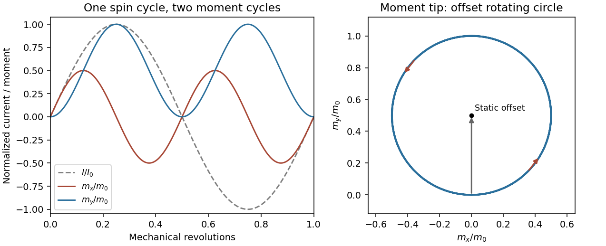

<h1 id="4/solution">Solution</h1>

↑ **Parent:** [4](../4.md)

A [Hertzian dipole](../../../../hertzian-dipole.md) is an ideal localized oscillating source much smaller than its radiation [wavelength](../../../../wavelength.md). Its electric version is an infinitesimal current element; its magnetic version is a small current loop with moment $\mathbf m=IA\mathbf n$. Such elements model the far-field radiation and [radiation resistance](../../../../radiation-resistance.md) of electrically small antennas. The approximation requires source dimensions much smaller than $c/\omega$.

The supplied [magnetic field](../../../../magnetic-field-split.md) has a quasistatic $[m]/r^3$ term, an [induction](../../../../mathematical-induction.md) $[\dot m]/(cr^2)$ term and a transverse radiation $[\ddot m]/(c^2r)$ term. The [electric field](../../../../electric-field-split.md) has [induction](../../../../mathematical-induction.md) and radiation terms. Brackets mean evaluation at the [retarded time](../../../../retarded-time.md) $t_r=t-r/c$, not a time average. Near terms mainly exchange stored [energy](../../../../energy-split.md); only the $r^{-1}$ fields give a nonvanishing outgoing [power](../../../../power.md) integral as $r\to\infty$.

For a fixed dipole axis the radiation fields satisfy $E_\phi=-cB_\theta$. The radial Poynting [flux](../../../../flux.md) is therefore

$$
S_r=\frac{cB_\theta^2}{\mu_0}
=\frac{\mu_0[\ddot m]^2}{16\pi^2c^3r^2}\sin^2\theta.
$$

Using $\int\sin^2\theta\,d\Omega=8\pi/3$ yields

$$
\boxed{P(t)=\frac{\mu_0[\ddot m]^2}{6\pi c^3}
=\frac{[\ddot m]^2}{6\pi\epsilon_0c^5}.}
$$

For a general changing dipole direction, replace the squared scalar [acceleration](../../../../acceleration.md) by $|\ddot{\mathbf m}|^2$.

[Radiation resistance](../../../../radiation-resistance.md) is the equivalent input resistance whose mean [power](../../../../power.md) equals radiated [power](../../../../power.md), not ohmic heating. For a fixed small loop carrying $I(t)=I_0\cos\omega t$, $m=AI$, so

$$
\overline P=\frac{A^2I_0^2\omega^4}{12\pi\epsilon_0c^5}
=\frac12I_0^2R_{\rm rad},\qquad
\boxed{R_{\rm rad}(\omega)=\frac{A^2\omega^4}{6\pi\epsilon_0c^5}.}
$$

This uses peak current $I_0$; with rms current the [power](../../../../power.md) is $I_{\rm rms}^2R_{\rm rad}$.

The satellite loop needs its changing orientation as well as its induced current. Put the spin axis along z, the external field along x, and let $\mathbf n(t)=(\cos\omega t,\sin\omega t,0)$. With $A=\pi b^2$ and resistance $R=10^{-4}\,\Omega$, the resistance-only approximation gives

$$
\Phi=BA\cos\omega t,\quad\mathcal E=BA\omega\sin\omega t,\quad
I(t)=\frac{BA\omega}{R}\sin\omega t.
$$

Write $m_0=BA^2\omega/R$. The full magnetic moment is

$$
\mathbf m(t)=m_0\sin\omega t\,\mathbf n(t)
=\frac{m_0}{2}\left[\sin(2\omega t)\widehat{\mathbf x}
+(1-\cos(2\omega t))\widehat{\mathbf y}\right].
$$

It has a static component and a rotating component at $2\omega$. Consequently $|\ddot{\mathbf m}|^2=4m_0^2\omega^4$, and

$$
\boxed{\overline P_{\rm loop}
=\frac{2B^2A^4\omega^6}{3\pi\epsilon_0c^5R^2}
=\frac{2\pi^3B^2b^8\omega^6}{3\epsilon_0c^5R^2}.}
$$

Holding the dipole axis fixed while inserting the sinusoidal current would instead give $B^2A^4\omega^6/(12\pi\epsilon_0c^5R^2)$, eight times smaller. That is the fixed-axis-loop result; it does not describe the stated rotating loop. This is [frequency doubling of an induction-driven rotating loop](../../../../frequency-doubling-of-an-induction-driven-rotating-loop.md); the changing vector direction is essential.

**[Figure 5](#4/image-original-calculated-rotation-induced-current-and-vector-magnetic-moment-components-illustrating-the-static-plus-twice-spin-frequency-decomposition). Original calculated rotation-induced current and vector magnetic-moment components, illustrating the static plus twice-spin-frequency decomposition**.

The resistance-only model is conditional: loop [inductance](../../../../inductance.md) is not supplied. If [self-inductance](../../../../self-inductance.md) L matters, solve $L\dot I+RI=BA\omega\sin\omega t$. In the [steady state](../../../../steady-state.md) $I_0=BA\omega/\sqrt{R^2+\omega^2L^2}$. Its [phase](../../../../phase-waves.md) changes the static moment direction but not the twice-frequency component's magnitude, so the [power](../../../../power.md) becomes

$$
\boxed{\overline P_{\rm loop}(L)=
\frac{2B^2A^4\omega^6}{3\pi\epsilon_0c^5(R^2+\omega^2L^2)}.}
$$

The first expression is the requested resistive idealization and an upper estimate within this passive RL correction. Radiation reaction is negligible compared with the stipulated ohmic resistance. The radiated [energy](../../../../energy-split.md) comes from [rotational kinetic energy](../../../../rotational-kinetic-energy.md): the induced magnetic [torque](../../../../torque.md) brakes the loop. Most lost rotational [energy](../../../../energy-split.md) is [Joule heating](../../../../joule-heating.md); a small part escapes as radiation. Maintaining a constant spin would require external mechanical [power](../../../../power.md).

For scale only, take $B=50\,\mathrm{\mu T}$, a representative near-Earth field rather than a supplied orbital measurement. The terrestrial surface range reported by NOAA is roughly $25$–$65\,\mathrm{\mu T}$; the actual orbital value depends on position.[What are the magnetic elements? Total field intensity range](../../../../geomagnetism-frequently-asked-questions-by-national-oceanic-and-atmospheric-administration.md) With $b=1\,\mathrm m$ and $\omega=2\pi(500\,\mathrm{s^{-1}})$, the resistance-only model gives

$$
\boxed{\overline P\simeq2.3\times10^{-10}\,\mathrm W
\left(\frac{B}{50\,\mathrm{\mu T}}\right)^2,
\qquad f_{\rm rad}=1000\,\mathrm{Hz},\qquad\lambda_{\rm rad}\simeq300\,\mathrm{km}.}
$$

[Inductance](../../../../inductance.md) would reduce this [power](../../../../power.md). The kilohertz signal is exceptionally weak and a metre-scale receiving antenna is electrically tiny. Ionospheric absorption/[reflection](../../../../reflection-mathematics.md) and strong natural or instrumental low-frequency backgrounds make ordinary ground reception impractical. This is not a theorem that the [ionosphere](../../../../ionosphere.md) blocks every low-frequency [mode](../../../../mode-statistics.md): field-guided propagation and condition-dependent leakage are real, as the VIPER mission's measurements were designed to test.[VIPER description: absorption/reflection layers and condition-dependent trans-ionospheric propagation](../../../../nasa-rocket-mission-studying-escaping-radio-waves-by-national-aeronautics-and-space-administration.md)

At a separation $r=100\,\mathrm{km}$, $k_{\rm rad}r\simeq2.1$, so the observer is not securely in the far field. The radiation term alone has at most the characteristic magnetic [amplitude](../../../../wave-amplitude.md)

$$
B_{\rm rad}\sim\frac{\mu_0(2m_0\omega^2)}{4\pi c^2r}
\simeq3.4\times10^{-18}\,\mathrm T
\left(\frac{B}{50\,\mathrm{\mu T}}\right)
$$

in this optimistic resistance-only vacuum model. Near and [induction](../../../../mathematical-induction.md) fields must be retained for a full prediction; a simple far-field inverse-square [power](../../../../power.md) estimate is not an exact received signal here. Another satellite avoids the whole ground ionospheric path, but [plasma](../../../../plasma-physics.md) propagation, receiving sensitivity, [bandwidth](../../../../bandwidth-signal-processing.md), orientation, integration time and spacecraft [noise](../../../../noise-signal-processing.md) remain unspecified. **Detection is not forbidden in principle, but routine practical detection is implausible at this scale; a definitive instrument-level yes/no does not follow from the supplied data.**

## ↑ Ancestors (13)

1. [4](../4.md)
2. [Paper 1](../../paper-1-split.md)
3. [2013](../../split.md)
4. [Past exam of the optics and electrodynamics course of the University of Cambridge](../../../split.md)
5. [Optics and Electrodynamics course of the University of Cambridge](../../../../optics-and-electrodynamics-course-of-the-university-of-cambridge.md)
6. [Physics course of the year 3 of the natural sciences course of the University of Cambridge](../../../../physics-course-of-the-year-3-of-the-natural-sciences-course-of-the-university-of-cambridge.md)
7. [Year 3 of the natural sciences course of the University of Cambridge](../../../../year-3-of-the-natural-sciences-course-of-the-university-of-cambridge.md)
8. [Year of the natural sciences course of the University of Cambridge](../../../../year-of-the-natural-sciences-course-of-the-university-of-cambridge.md)
9. [Natural sciences course of the University of Cambridge](../../../../natural-sciences-course-of-the-university-of-cambridge.md)
10. [Course of the University of Cambridge](../../../../course-of-the-university-of-cambridge.md)
11. [University of Cambridge](../../../../university-of-cambridge-split.md)
12. [List of universities](../../../../list-of-universities.md)
13. [Codex Wiki](../../../../split.md)
