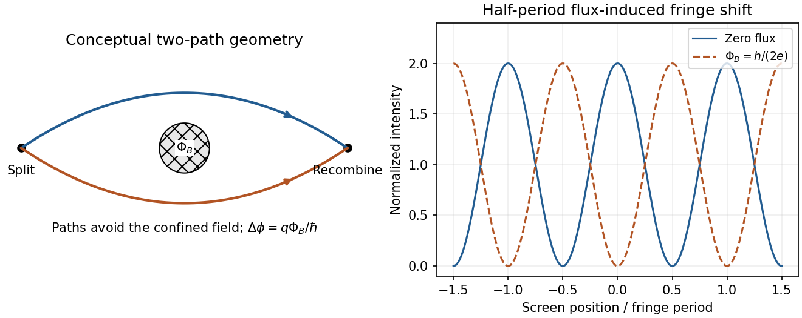

# Paper 1

↑ **Parent:** [2014](../2014.md)

Original paper: [Public original PDF, physical pages 299–302; cover on page 299 and questions on pages 300–302](https://www.whatdotheyknow.com/request/natural_science_tripos_physics_e_2/response/2340776/attach/2/FOI%202023%20399%20Zahid%20materials.pdf?cookie_passthrough=1#page=299).

**Table of contents**

- [1](#1)
  - [a](#1/a)
    - [Solution](#1/a/solution)
  - [b](#1/b)
    - [Solution](#1/b/solution)
  - [c](#1/c)
    - [Solution](#1/c/solution)
- [2](#2)
  - [a](#2/a)
    - [Solution](#2/a/solution)
  - [b](#2/b)
    - [Solution](#2/b/solution)
  - [c](#2/c)
    - [Solution](#2/c/solution)
- [3](#3)
  - [Solution](#3/solution)
- [4](#4)
  - [Solution](#4/solution)

## 1

↑ **Parent:** [Paper 1](paper-1.md)

<h3 id="1/a">a</h3>

↑ **Parent:** [1](#1)

<h4 id="1/a/solution">Solution</h4>

↑ **Parent:** [A](#1/a)

For [two-element polarization identification](../../maxwell-equations.md#two-element-polarization-identification), assume ideal elements and use an [intensity](../../wave.md#intensity-physics) detector. For each source, test both element orders while rotating their relative axes. **The circular source followed by the [quarter-wave plate](../../maxwell-equations.md#quarter-wave-plate) and then the [polarizer](../../electromagnetic-wave.md#polarizer) is the combination that gives full [intensity](../../wave.md#intensity-physics) modulation.** The plate converts circular [light](../../optics.md#light) to linear [light](../../optics.md#light), and the downstream [polarizer](../../electromagnetic-wave.md#polarizer) then obeys [Malus's law](../../wave.md#malus-s-law).

If the [polarizer](../../electromagnetic-wave.md#polarizer) comes first, it transmits half the circular source's [intensity](../../wave.md#intensity-physics) and the downstream lossless plate cannot change that [intensity](../../wave.md#intensity-physics). [Unpolarized light](../../wave.md#unpolarized-light) also gives constant half-intensity in either order: a wave plate leaves it unpolarized, while a [polarizer](../../electromagnetic-wave.md#polarizer) followed by a wave plate has no final analyzer. Thus the modulating source is circular, its first element is the [quarter-wave plate](../../maxwell-equations.md#quarter-wave-plate), and its second is the [polarizer](../../electromagnetic-wave.md#polarizer); the remaining source is unpolarized. Testing both orders avoids needing to know either source's original brightness.

<h3 id="1/b">b</h3>

↑ **Parent:** [1](#1)

<h4 id="1/b/solution">Solution</h4>

↑ **Parent:** [B](#1/b)

For the [oblique coupling of parallel Hertzian dipoles](../../electrical-engineering.md#oblique-coupling-of-parallel-hertzian-dipoles), a lossless [Hertzian dipole](../../electrical-engineering.md#hertzian-dipole) has directional gain $G(\theta)=\tfrac32\sin^2\theta$. The separation is $r=\sqrt2d$, and both transmitting and receiving patterns have $\sin^2\theta=1/2$, so $G_t=G_r=3/4$. [Reciprocity](../../electromagnetism.md#reciprocity-electromagnetism) gives matched receiving effective area $A_e=\lambda^2G_r/(4\pi)$. The emitted polarization matches the transverse projection of the receiving dipole axis, so there is no additional polarization mismatch. Consequently

$$
\boxed{P_L=\frac{PG_t}{4\pi r^2}\frac{\lambda^2G_r}{4\pi}
=\frac{9P\lambda^2}{512\pi^2d^2}.}
$$

Both the off-axis transmitting pattern and the off-axis receiving aperture matter. This assumes the stated far field, conjugate matching and negligible dissipative antenna losses.

<h3 id="1/c">c</h3>

↑ **Parent:** [1](#1)

<h4 id="1/c/solution">Solution</h4>

↑ **Parent:** [C](#1/c)

Interpret the motion as **uniform rectilinear motion**: the charge is stationary in an inertial [rest frame](../../mathematical-physics.md#rest-frame) and has no radiation field. Constant [speed](../../classical-mechanics.md#speed) alone is insufficient; a curved trajectory has [acceleration](../../classical-mechanics.md#acceleration) and can radiate even in vacuum.

In a transparent medium, a charge can move faster than the [light](../../optics.md#light) [phase velocity](../../dispersion-relation.md#phase-velocity) $c/n$ without exceeding $c$. The induced polarization disturbance then adds coherently on a Cherenkov cone, with $\cos\theta_C=1/(n\beta)$. Thus

$$
\beta_{\rm th}=\frac1n,\qquad
\boxed{K_{\rm th}=m_pc^2\left[\frac1{\sqrt{1-n^{-2}}}-1\right]
\simeq321\,\mathrm{MeV}\quad(n=1.5).}
$$

This is the kinematic threshold limit for the specified [refractive index](../../electromagnetic-wave.md#refractive-index); appreciable emission requires exceeding it, and dispersion selects which [frequencies](../../wave.md#frequency) satisfy the condition.

## 2

↑ **Parent:** [Paper 1](paper-1.md)

<h3 id="2/a">a</h3>

↑ **Parent:** [2](#2)

<h4 id="2/a/solution">Solution</h4>

↑ **Parent:** [A](#2/a)

In the magnetic [Aharonov-Bohm effect](../../topological-quantum-matter.md#aharonov-bohm-effect), coherent electron paths enclose inaccessible [magnetic flux](../../magnetic-field.md#magnetic-flux) even though the field vanishes along the paths. The [magnetic vector potential](../../electromagnetism.md#magnetic-vector-potential) contributes relative [phase](../../wave.md#phase-waves)

$$
\boxed{\Delta\phi=\frac q\hbar\oint\mathbf A\cdot d\boldsymbol\ell
=\frac{q\Phi_B}{\hbar}\pmod{2\pi}.}
$$

Recombination turns this [phase](../../wave.md#phase-waves) into a fringe displacement. For an electron $q=-e$, changing [flux](../../mathematical-physics.md#flux) by $h/e$ gives one full fringe period. Reversing the loop orientation reverses the [phase](../../wave.md#phase-waves) sign. A gauge change modifies each path's [phase](../../wave.md#phase-waves) convention but leaves the closed-loop [phase](../../wave.md#phase-waves) and observed [interference](../../physical-optics.md#interference-wave-propagation) unchanged. The accessible region surrounds excluded [flux](../../mathematical-physics.md#flux), so a globally trivial gauge cannot remove that [phase](../../wave.md#phase-waves).

**[Figure 1](#2/a/image-original-two-path-aharonov-bohm-schematic-and-the-half-period-fringe-shift-from-half-an-electron-flux-period-paths-avoid-the-flux-region). Original two-path Aharonov-Bohm schematic and the half-period fringe shift from half an electron flux period; paths avoid the flux region**.

A shielded toroidal magnet provides a concrete test: [electron holography](../../physical-optics.md#electron-holography) compared waves passing through its hole and outside it. Superconducting and copper coatings confined the field and excluded electrons from the magnet; the measured relative [phase](../../wave.md#phase-waves) tested enclosed [flux](../../mathematical-physics.md#flux) rather than a classical Lorentz deflection along the paths.[Physical Review Letters 56, 792 (1986), primary abstract: shielded toroid and electron-holographic relative phase](../../physics-bibliography.md#evidence-for-aharonov-bohm-effect-with-magnetic-field-completely-shielded-from-electron-wave-by-akira-tonomura-and-others)

<h3 id="2/b">b</h3>

↑ **Parent:** [2](#2)

<h4 id="2/b/solution">Solution</h4>

↑ **Parent:** [B](#2/b)

[Photonic structures](../../optics.md#photonic-structure) control [light](../../optics.md#light) through the spatial arrangement of [dielectric](../../permittivity.md#dielectric) material. [Waveguides](../../wave.md#waveguide) confine transverse [modes](../../probability-and-statistics.md#mode-statistics); periodic [photonic crystals](../../optics.md#photonic-crystal) combine [interference](../../physical-optics.md#interference-wave-propagation) and scattering to produce a [photonic band structure](../../optics.md#photonic-band-structure) $\omega_n(\mathbf k)$. A [photonic band gap](../../optics.md#photonic-band-gap) excludes propagating [modes](../../probability-and-statistics.md#mode-statistics) in specified directions and polarizations. **A one-dimensional stop band is not automatically a complete three-dimensional gap.**

A simple example is a [distributed Bragg reflector](../../optics.md#distributed-bragg-reflector) with alternating high- and low-index layers. At normal incidence, the quarter-wave choice

$$
\boxed{n_Hd_H=n_Ld_L=\lambda_0/4}
$$

lets successive interface reflections reinforce near the design [wavelength](../../wave-equation.md#wavelength). A departure from periodicity can create a localized defect [mode](../../probability-and-statistics.md#mode-statistics) inside the stop band. An isolated defect forms a cavity; a line defect can guide [light](../../optics.md#light) through otherwise forbidden bulk propagation. Finite structures leak and real materials absorb, so ideal band arguments do not ensure infinite confinement.

**[Figure 2](#2/b/image-original-transfer-matrix-calculation-for-lossless-quarter-wave-dielectric-stacks-showing-a-stop-band-and-a-transmission-resonance-from-a-central-defect). Original transfer-matrix calculation for lossless quarter-wave dielectric stacks, showing a stop band and a transmission resonance from a central defect**.

Changing the photonic [density](../../fluid-mechanics.md#density) of states can suppress or enhance [spontaneous emission](../../atomic-physics.md#spontaneous-emission) and control how emitters couple to selected [modes](../../probability-and-statistics.md#mode-statistics). This is distinct from electronic band-gap engineering: it is the electromagnetic [modes](../../probability-and-statistics.md#mode-statistics) that are being structured. A complete electromagnetic gap overlapping an emitter's transition is the ideal mechanism proposed for suppressing otherwise allowed [spontaneous emission](../../atomic-physics.md#spontaneous-emission).[Physical Review Letters 58, 2059 (1987), primary abstract: three-dimensional periodic dielectric and overlapping electromagnetic gap](../../physics-bibliography.md#inhibited-spontaneous-emission-in-solid-state-physics-and-electronics-by-eli-yablonovitch)

<h3 id="2/c">c</h3>

↑ **Parent:** [2](#2)

<h4 id="2/c/solution">Solution</h4>

↑ **Parent:** [C](#2/c)

[Synchrotron radiation](../../electromagnetic-radiation.md#synchrotron-radiation) is emitted by relativistic charges accelerated along curved paths. A [magnetic field](../../magnetic-field.md) can supply the transverse [acceleration](../../classical-mechanics.md#acceleration) while doing no work on the charge; the radiated [energy](../../energy.md) must ultimately be replenished if the orbit [energy](../../energy.md) is to remain constant. [Relativistic beaming](../../special-relativity.md#relativistic-beaming) confines much of the radiation to angles of order $1/\gamma$ about the instantaneous [velocity](../../classical-mechanics.md#velocity).

For circular motion of curvature radius $\rho$ and $\gamma\gg1$,

$$
\boxed{\omega_c\simeq\frac{3\gamma^3c}{2\rho},\qquad
P\simeq\frac{q^2c\gamma^4}{6\pi\epsilon_0\rho^2}.}
$$

The exact classical circular-orbit [power](../../energy.md#power) contains an additional factor $\beta^4$. A distant observer sees short pulses as the beamed direction sweeps past, producing a broad high-frequency spectrum. Radiation is predominantly linearly polarized in the orbital plane and becomes elliptically polarized off it. The critical [frequency](../../wave.md#frequency) is a spectral scale, not a monochromatic emission [frequency](../../wave.md#frequency) or a hard cutoff.

**[Figure 3](#2/c/image-original-geometric-synchrotron-beaming-schematic-radiation-near-the-velocity-tangent-cone-angle-of-order-inverse-lorentz-factor-and-curved-electron-trajectory). Original geometric synchrotron-beaming schematic: radiation near the velocity tangent, cone angle of order inverse Lorentz factor and curved electron trajectory**.

Storage rings provide intense radiation for [spectroscopy](../../physics.md#spectroscopy) and [diffraction](../../quantum-scattering.md#diffraction), while relativistic electrons in astrophysical [magnetic fields](../../magnetic-field.md) also produce synchrotron emission. The classical theory relates total [power](../../energy.md#power), angular beaming and spectrum to the particle's trajectory; sufficiently strong quantum recoil requires corrections.[Physical Review 75, 1912 (1949), primary abstract: total radiation, angular preference and high-frequency spectrum of accelerated energetic electrons](../../physics-bibliography.md#on-the-classical-radiation-of-accelerated-electrons-by-julian-schwinger)

## 3

↑ **Parent:** [Paper 1](paper-1.md)

<h3 id="3/solution">Solution</h3>

↑ **Parent:** [3](#3)

Use metric $\eta=\operatorname{diag}(1,-1,-1,-1)$ and common spacetime origins. A [four-vector](../../special-relativity.md#four-vector) transforms as $A'=\Lambda A$ under a [Lorentz transformation](../../special-relativity.md#lorentz-transformation). A [Lorentz invariant](../../special-relativity.md#lorentz-invariance) is a scalar unchanged by that transformation. Since $\Lambda^T\eta\Lambda=\eta$,

$$
\boxed{A'\cdot B'=A^T\Lambda^T\eta\Lambda B=A^T\eta B=A\cdot B.}
$$

The [wave phase](../../wave.md#phase-waves) labels the same stage of a physical [oscillation](../../wave.md#oscillation) at a [spacetime event](../../special-relativity.md#event-relativity), independently of the observer's coordinates. Equal-phase wavefronts and [interference](../../physical-optics.md#interference-wave-propagation) [phase differences](../../wave.md#phase-difference) are physical; fixing a common [phase](../../wave.md#phase-waves) origin makes the continuous [phase](../../wave.md#phase-waves) a [Lorentz scalar](../../special-relativity.md#lorentz-scalar). For a plane wave,

$$
\phi=\omega t-\mathbf k\cdot\mathbf r=K_\mu X^\mu,
\qquad K_\mu=\partial_\mu\phi.
$$

The [gradient](../../multivariable-calculus.md#gradient) of a scalar is a [covector](../../dual-space.md#covector); raising its index gives the [four-wavevector](../../special-relativity.md#four-wavevector) $K^\mu=(\omega/c,\mathbf k)$. Under an $x$ boost,

$$
\boxed{\omega'=\gamma(\omega-vk_x),\quad
k'_x=\gamma(k_x-v\omega/c^2),\quad k'_y=k_y,\quad k'_z=k_z.}
$$

For vacuum [light](../../optics.md#light), $k_x=(\omega/c)\cos\theta$, giving

$$
\boxed{\omega'=\gamma\omega(1-\beta\cos\theta).}
$$

A [photon](../../quantum-mechanics.md#photon) has [four-momentum](../../special-relativity.md#four-momentum) $p^\mu=\hbar K^\mu$, with $K^2=0$. For two [photons](../../quantum-mechanics.md#photon) separated by angle $\alpha$,

$$
(p_1+p_2)^2=2\hbar^2K_1\cdot K_2
=\frac{2\hbar^2\omega_1\omega_2}{c^2}(1-\cos\alpha).
$$

In the [centre-of-momentum frame](../../special-relativity.md#center-of-momentum-frame) the least possible pair [energy](../../energy.md) is $2m_ec^2$, when both final particles are at rest. Thus the threshold has $(p_1+p_2)^2=4m_e^2c^2$; above it, excess [energy](../../energy.md) supplies their [kinetic energy](../../energy.md#kinetic-energy). Therefore

$$
\boxed{\omega_{2,\rm th}=
\frac{2m_e^2c^4}{\hbar^2\omega_1(1-\cos\alpha)}.}
$$

The kinematic equality is a limiting threshold; nonzero production [phase](../../wave.md#phase-waves) space requires energies above it. For parallel [photons](../../quantum-mechanics.md#photon) no finite threshold is available, whereas head-on incidence minimizes the required [energy](../../energy.md):

$$
\boxed{E_{2,\min}=\frac{(m_ec^2)^2}{E_1}\quad(\alpha=\pi).}
$$

The [blackbody-peak photon pair-production estimate](../../perturbative-quantum-field-theory.md#blackbody-peak-photon-pair-production-estimate), using the frequency-spectrum blackbody peak, $E_1=2.82144k_BT=7.29\times10^{-4}\,\mathrm{eV}$ at $3\,\mathrm K$, gives **$E_{2,\min}\simeq3.58\times10^{14}\,\mathrm{eV}$**, or $358\,\mathrm{TeV}$. If “peak” means the wavelength-spectrum peak, $E_1=4.96511k_BT$ instead gives $2.03\times10^{14}\,\mathrm{eV}$. The spectral convention changes the prefactor, not the conclusion that [photons](../../quantum-mechanics.md#photon) of order a few $10^{14}\,\mathrm{eV}$ are needed for this idealized peak-photon threshold.

## 4

↑ **Parent:** [Paper 1](paper-1.md)

<h3 id="4/solution">Solution</h3>

↑ **Parent:** [4](#4)

[Temporal coherence](../../physical-optics.md#temporal-optical-coherence) compares the field at different times at one location: a narrow spectrum maintains a predictable [phase](../../wave.md#phase-waves) relation over a longer delay. [Spatial coherence](../../physical-optics.md#spatial-optical-coherence) compares the field at different locations at the same time: different angular source components illuminate a baseline with different [phase differences](../../wave.md#phase-difference), which wash out [interference](../../physical-optics.md#interference-wave-propagation) when averaged. These are properties of correlations, not claims that all thermal source points have a common [phase](../../wave.md#phase-waves).

Assume a distant spatially incoherent, quasimonochromatic source, small angles, identical slit transmission, matched polarizations and equal mean [intensity](../../wave.md#intensity-physics) at the two slits. For an angular component $\theta$, the relative input [phase](../../wave.md#phase-waves) is $-kd\theta$. Let $\varphi$ be the additional observation-plane [phase](../../wave.md#phase-waves). Incoherent angular components add [intensities](../../wave.md#intensity-physics), giving

$$
I_{\rm obs}(\varphi)=2F(0)+2\operatorname{Re}[e^{i\varphi}F(d)],
\qquad F(d)=\int I(\theta)e^{-ikd\theta}\,d\theta.
$$

Its extrema are $2F(0)\pm2|F(d)|$, hence

$$
\boxed{V(d)=\frac{I_{\max}-I_{\min}}{I_{\max}+I_{\min}}
=\frac{|F(d)|}{F(0)}.}
$$

For symmetric $I(\theta)$, $F(d)$ is a real cosine transform. **Physical visibility is its normalized absolute value**; the printed proportionality omits that qualification. A negative signed coherence reverses fringe [phase](../../wave.md#phase-waves) rather than giving negative contrast. This is the small-angle [Van Cittert-Zernike theorem](../../physical-optics.md#van-cittert-zernike-theorem). [Temporal coherence](../../physical-optics.md#temporal-optical-coherence) analogously depends on the [Fourier transform](../../fourier-transform.md) of the spectrum.

A [Michelson stellar interferometer](../../physical-optics.md#michelson-stellar-interferometer) uses separated collecting mirrors to obtain a large adjustable projected baseline without requiring a monolithic objective of that diameter. Each collector supplies [light](../../optics.md#light) to a common combiner. Optical path compensation keeps the delay within the [temporal coherence](../../physical-optics.md#temporal-optical-coherence) range; varying mirror separation samples [spatial coherence](../../physical-optics.md#spatial-optical-coherence) and resolves stellar angular structure finer than a small collector alone.

Let $g_\star(Y)$ be the normalized signed coherence of one star, and take the baseline along the projected binary separation. The [equal-brightness binary-star visibility](../../physical-optics.md#equal-brightness-binary-star-visibility) for identical profiles centred at $\pm\beta/2$ give

$$
\boxed{g(Y)=g_\star(Y)\cos\!\left(\frac{\pi\beta Y}{\lambda}\right),\qquad
V(Y)=|g(Y)|.}
$$

For **uniform circular discs of [angular diameter](../../geometry-and-topology.md#angular-diameter) $\alpha$**,

$$
\boxed{g_\star(Y)=\frac{2J_1(x)}x,\qquad
x=\frac{\pi\alpha Y}{\lambda},\qquad g_\star(0)=1.}
$$

For [binary separation from visibility-zero spacing](../../physical-optics.md#binary-separation-from-visibility-zero-spacing), the rapid binary visibility zeros satisfy $Y_j=(j+\tfrac12)\lambda/\beta$, so their repeated spacing is $\lambda/\beta$. The slower single-star envelope first vanishes at $Y=1.21967\lambda/\alpha$. The [stellar angular diameter from a visibility envelope](../../quantum-optics.md#stellar-angular-diameter-from-a-visibility-envelope) and the binary separation follow by fitting both scales; multiple baselines distinguish envelope zeros from binary zeros.

**[Figure 4](#4/image-original-normalized-binary-star-visibility-sketch-for-two-uniform-circular-discs-with-projected-separation-eight-times-their-diameter-binary-zeros-and-the-stellar-diameter-envelope-are-labelled). Original normalized binary-star visibility sketch for two uniform circular discs, with projected separation eight times their diameter; binary zeros and the stellar-diameter envelope are labelled**.

Angular width alone does not specify a unique brightness profile. If the intended one-dimensional model is a uniform angular strip of full width $\alpha$, replace the disc factor by $\operatorname{sinc}(\pi\alpha Y/\lambda)$ with $\operatorname{sinc}u=\sin u/u$; its first envelope zero is $\lambda/\alpha$. [Limb darkening](../../radiometry.md#limb-darkening) changes the disc envelope too. Rotating the baseline is necessary to recover an unknown separation direction; a single orientation measures only its projection.

## ↑ Ancestors (11)

1. [2014](../2014.md)
2. [Past exam of the optics and electrodynamics course of the University of Cambridge](../../past-exam-of-the-optics-and-electrodynamics-course-of-the-university-of-cambridge.md)
3. [Optics and Electrodynamics course of the University of Cambridge](../../university-of-cambridge.md#optics-and-electrodynamics-course-of-the-university-of-cambridge)
4. [Physics course of the year 3 of the natural sciences course of the University of Cambridge](../../university-of-cambridge.md#physics-course-of-the-year-3-of-the-natural-sciences-course-of-the-university-of-cambridge)
5. [Year 3 of the natural sciences course of the University of Cambridge](../../university-of-cambridge.md#year-3-of-the-natural-sciences-course-of-the-university-of-cambridge)
6. [Year of the natural sciences course of the University of Cambridge](../../university-of-cambridge.md#year-of-the-natural-sciences-course-of-the-university-of-cambridge)
7. [Natural sciences course of the University of Cambridge](../../university-of-cambridge.md#natural-sciences-course-of-the-university-of-cambridge)
8. [Course of the University of Cambridge](../../university-of-cambridge.md#course-of-the-university-of-cambridge)
9. [University of Cambridge](../../university-of-cambridge.md)
10. [List of universities](../../README.md#list-of-universities)
11. [Codex Wiki](../../README.md)
