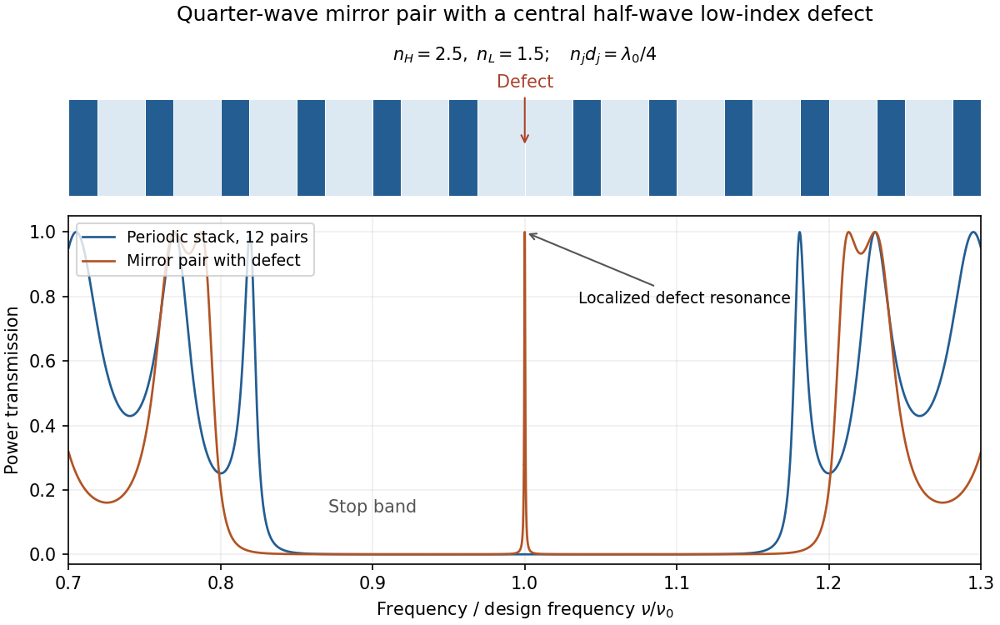

<h1 id="2/b/solution">Solution</h1>

↑ **Parent:** [B](../b.md)

[Photonic structures](../../../../../photonic-structure.md) control [light](../../../../../light.md) through the spatial arrangement of [dielectric](../../../../../dielectric.md) material. [Waveguides](../../../../../waveguide.md) confine transverse [modes](../../../../../mode-statistics.md); periodic [photonic crystals](../../../../../photonic-crystal.md) combine [interference](../../../../../interference-wave-propagation.md) and scattering to produce a [photonic band structure](../../../../../photonic-band-structure.md) $\omega_n(\mathbf k)$. A [photonic band gap](../../../../../photonic-band-gap.md) excludes propagating [modes](../../../../../mode-statistics.md) in specified directions and polarizations. **A one-dimensional stop band is not automatically a complete three-dimensional gap.**

A simple example is a [distributed Bragg reflector](../../../../../distributed-bragg-reflector.md) with alternating high- and low-index layers. At normal incidence, the quarter-wave choice

$$
\boxed{n_Hd_H=n_Ld_L=\lambda_0/4}
$$

lets successive interface reflections reinforce near the design [wavelength](../../../../../wavelength.md). A departure from periodicity can create a localized defect [mode](../../../../../mode-statistics.md) inside the stop band. An isolated defect forms a cavity; a line defect can guide [light](../../../../../light.md) through otherwise forbidden bulk propagation. Finite structures leak and real materials absorb, so ideal band arguments do not ensure infinite confinement.

**[Figure 2](#2/b/image-original-transfer-matrix-calculation-for-lossless-quarter-wave-dielectric-stacks-showing-a-stop-band-and-a-transmission-resonance-from-a-central-defect). Original transfer-matrix calculation for lossless quarter-wave dielectric stacks, showing a stop band and a transmission resonance from a central defect**.

Changing the photonic [density](../../../../../density.md) of states can suppress or enhance [spontaneous emission](../../../../../spontaneous-emission.md) and control how emitters couple to selected [modes](../../../../../mode-statistics.md). This is distinct from electronic band-gap engineering: it is the electromagnetic [modes](../../../../../mode-statistics.md) that are being structured. A complete electromagnetic gap overlapping an emitter's transition is the ideal mechanism proposed for suppressing otherwise allowed [spontaneous emission](../../../../../spontaneous-emission.md).[Physical Review Letters 58, 2059 (1987), primary abstract: three-dimensional periodic dielectric and overlapping electromagnetic gap](../../../../../inhibited-spontaneous-emission-in-solid-state-physics-and-electronics-by-eli-yablonovitch.md)

## ↑ Ancestors (14)

1. [B](../b.md)
2. [2](../../2.md)
3. [Paper 1](../../../paper-1-split.md)
4. [2014](../../../split.md)
5. [Past exam of the optics and electrodynamics course of the University of Cambridge](../../../../split.md)
6. [Optics and Electrodynamics course of the University of Cambridge](../../../../../optics-and-electrodynamics-course-of-the-university-of-cambridge.md)
7. [Physics course of the year 3 of the natural sciences course of the University of Cambridge](../../../../../physics-course-of-the-year-3-of-the-natural-sciences-course-of-the-university-of-cambridge.md)
8. [Year 3 of the natural sciences course of the University of Cambridge](../../../../../year-3-of-the-natural-sciences-course-of-the-university-of-cambridge.md)
9. [Year of the natural sciences course of the University of Cambridge](../../../../../year-of-the-natural-sciences-course-of-the-university-of-cambridge.md)
10. [Natural sciences course of the University of Cambridge](../../../../../natural-sciences-course-of-the-university-of-cambridge.md)
11. [Course of the University of Cambridge](../../../../../course-of-the-university-of-cambridge.md)
12. [University of Cambridge](../../../../../university-of-cambridge-split.md)
13. [List of universities](../../../../../list-of-universities.md)
14. [Codex Wiki](../../../../../split.md)
