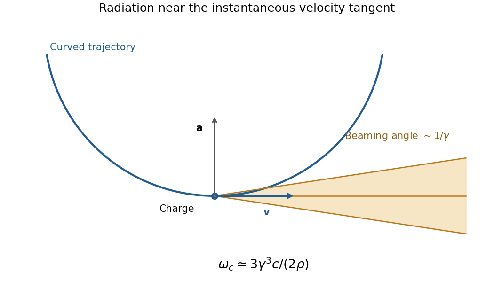

<h1 id="2/c/solution">Solution</h1>

↑ **Parent:** [C](../c.md)

[Synchrotron radiation](../../../../../synchrotron-radiation.md) is emitted by relativistic charges accelerated along curved paths. A [magnetic field](../../../../../magnetic-field-split.md) can supply the transverse [acceleration](../../../../../acceleration.md) while doing no work on the charge; the radiated [energy](../../../../../energy-split.md) must ultimately be replenished if the orbit [energy](../../../../../energy-split.md) is to remain constant. [Relativistic beaming](../../../../../relativistic-beaming.md) confines much of the radiation to angles of order $1/\gamma$ about the instantaneous [velocity](../../../../../velocity.md).

For circular motion of curvature radius $\rho$ and $\gamma\gg1$,

$$
\boxed{\omega_c\simeq\frac{3\gamma^3c}{2\rho},\qquad
P\simeq\frac{q^2c\gamma^4}{6\pi\epsilon_0\rho^2}.}
$$

The exact classical circular-orbit [power](../../../../../power.md) contains an additional factor $\beta^4$. A distant observer sees short pulses as the beamed direction sweeps past, producing a broad high-frequency spectrum. Radiation is predominantly linearly polarized in the orbital plane and becomes elliptically polarized off it. The critical [frequency](../../../../../frequency.md) is a spectral scale, not a monochromatic emission [frequency](../../../../../frequency.md) or a hard cutoff.

**[Figure 3](#2/c/image-original-geometric-synchrotron-beaming-schematic-radiation-near-the-velocity-tangent-cone-angle-of-order-inverse-lorentz-factor-and-curved-electron-trajectory). Original geometric synchrotron-beaming schematic: radiation near the velocity tangent, cone angle of order inverse Lorentz factor and curved electron trajectory**.

Storage rings provide intense radiation for [spectroscopy](../../../../../spectroscopy.md) and [diffraction](../../../../../diffraction.md), while relativistic electrons in astrophysical [magnetic fields](../../../../../magnetic-field-split.md) also produce synchrotron emission. The classical theory relates total [power](../../../../../power.md), angular beaming and spectrum to the particle's trajectory; sufficiently strong quantum recoil requires corrections.[Physical Review 75, 1912 (1949), primary abstract: total radiation, angular preference and high-frequency spectrum of accelerated energetic electrons](../../../../../on-the-classical-radiation-of-accelerated-electrons-by-julian-schwinger.md)

## ↑ Ancestors (14)

1. [C](../c.md)
2. [2](../../2.md)
3. [Paper 1](../../../paper-1-split.md)
4. [2014](../../../split.md)
5. [Past exam of the optics and electrodynamics course of the University of Cambridge](../../../../split.md)
6. [Optics and Electrodynamics course of the University of Cambridge](../../../../../optics-and-electrodynamics-course-of-the-university-of-cambridge.md)
7. [Physics course of the year 3 of the natural sciences course of the University of Cambridge](../../../../../physics-course-of-the-year-3-of-the-natural-sciences-course-of-the-university-of-cambridge.md)
8. [Year 3 of the natural sciences course of the University of Cambridge](../../../../../year-3-of-the-natural-sciences-course-of-the-university-of-cambridge.md)
9. [Year of the natural sciences course of the University of Cambridge](../../../../../year-of-the-natural-sciences-course-of-the-university-of-cambridge.md)
10. [Natural sciences course of the University of Cambridge](../../../../../natural-sciences-course-of-the-university-of-cambridge.md)
11. [Course of the University of Cambridge](../../../../../course-of-the-university-of-cambridge.md)
12. [University of Cambridge](../../../../../university-of-cambridge-split.md)
13. [List of universities](../../../../../list-of-universities.md)
14. [Codex Wiki](../../../../../split.md)
