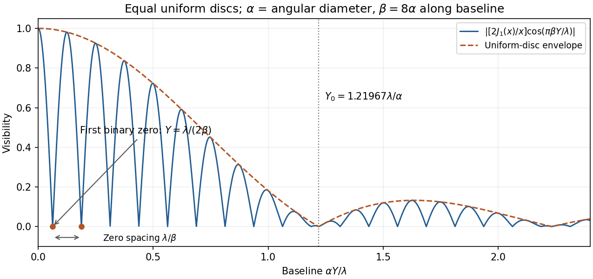

<h1 id="4/solution">Solution</h1>

↑ **Parent:** [4](../4.md)

[Temporal coherence](../../../../temporal-optical-coherence.md) compares the field at different times at one location: a narrow spectrum maintains a predictable [phase](../../../../phase-waves.md) relation over a longer delay. [Spatial coherence](../../../../spatial-optical-coherence.md) compares the field at different locations at the same time: different angular source components illuminate a baseline with different [phase differences](../../../../phase-difference.md), which wash out [interference](../../../../interference-wave-propagation.md) when averaged. These are properties of correlations, not claims that all thermal source points have a common [phase](../../../../phase-waves.md).

Assume a distant spatially incoherent, quasimonochromatic source, small angles, identical slit transmission, matched polarizations and equal mean [intensity](../../../../intensity-physics.md) at the two slits. For an angular component $\theta$, the relative input [phase](../../../../phase-waves.md) is $-kd\theta$. Let $\varphi$ be the additional observation-plane [phase](../../../../phase-waves.md). Incoherent angular components add [intensities](../../../../intensity-physics.md), giving

$$
I_{\rm obs}(\varphi)=2F(0)+2\operatorname{Re}[e^{i\varphi}F(d)],
\qquad F(d)=\int I(\theta)e^{-ikd\theta}\,d\theta.
$$

Its extrema are $2F(0)\pm2|F(d)|$, hence

$$
\boxed{V(d)=\frac{I_{\max}-I_{\min}}{I_{\max}+I_{\min}}
=\frac{|F(d)|}{F(0)}.}
$$

For symmetric $I(\theta)$, $F(d)$ is a real cosine transform. **Physical visibility is its normalized absolute value**; the printed proportionality omits that qualification. A negative signed coherence reverses fringe [phase](../../../../phase-waves.md) rather than giving negative contrast. This is the small-angle [Van Cittert-Zernike theorem](../../../../van-cittert-zernike-theorem.md). [Temporal coherence](../../../../temporal-optical-coherence.md) analogously depends on the [Fourier transform](../../../../fourier-transform-split.md) of the spectrum.

A [Michelson stellar interferometer](../../../../michelson-stellar-interferometer.md) uses separated collecting mirrors to obtain a large adjustable projected baseline without requiring a monolithic objective of that diameter. Each collector supplies [light](../../../../light.md) to a common combiner. Optical path compensation keeps the delay within the [temporal coherence](../../../../temporal-optical-coherence.md) range; varying mirror separation samples [spatial coherence](../../../../spatial-optical-coherence.md) and resolves stellar angular structure finer than a small collector alone.

Let $g_\star(Y)$ be the normalized signed coherence of one star, and take the baseline along the projected binary separation. The [equal-brightness binary-star visibility](../../../../equal-brightness-binary-star-visibility.md) for identical profiles centred at $\pm\beta/2$ give

$$
\boxed{g(Y)=g_\star(Y)\cos\!\left(\frac{\pi\beta Y}{\lambda}\right),\qquad
V(Y)=|g(Y)|.}
$$

For **uniform circular discs of [angular diameter](../../../../angular-diameter.md) $\alpha$**,

$$
\boxed{g_\star(Y)=\frac{2J_1(x)}x,\qquad
x=\frac{\pi\alpha Y}{\lambda},\qquad g_\star(0)=1.}
$$

For [binary separation from visibility-zero spacing](../../../../binary-separation-from-visibility-zero-spacing.md), the rapid binary visibility zeros satisfy $Y_j=(j+\tfrac12)\lambda/\beta$, so their repeated spacing is $\lambda/\beta$. The slower single-star envelope first vanishes at $Y=1.21967\lambda/\alpha$. The [stellar angular diameter from a visibility envelope](../../../../stellar-angular-diameter-from-a-visibility-envelope.md) and the binary separation follow by fitting both scales; multiple baselines distinguish envelope zeros from binary zeros.

**[Figure 4](#4/image-original-normalized-binary-star-visibility-sketch-for-two-uniform-circular-discs-with-projected-separation-eight-times-their-diameter-binary-zeros-and-the-stellar-diameter-envelope-are-labelled). Original normalized binary-star visibility sketch for two uniform circular discs, with projected separation eight times their diameter; binary zeros and the stellar-diameter envelope are labelled**.

Angular width alone does not specify a unique brightness profile. If the intended one-dimensional model is a uniform angular strip of full width $\alpha$, replace the disc factor by $\operatorname{sinc}(\pi\alpha Y/\lambda)$ with $\operatorname{sinc}u=\sin u/u$; its first envelope zero is $\lambda/\alpha$. [Limb darkening](../../../../limb-darkening.md) changes the disc envelope too. Rotating the baseline is necessary to recover an unknown separation direction; a single orientation measures only its projection.

## ↑ Ancestors (13)

1. [4](../4.md)
2. [Paper 1](../../paper-1-split.md)
3. [2014](../../split.md)
4. [Past exam of the optics and electrodynamics course of the University of Cambridge](../../../split.md)
5. [Optics and Electrodynamics course of the University of Cambridge](../../../../optics-and-electrodynamics-course-of-the-university-of-cambridge.md)
6. [Physics course of the year 3 of the natural sciences course of the University of Cambridge](../../../../physics-course-of-the-year-3-of-the-natural-sciences-course-of-the-university-of-cambridge.md)
7. [Year 3 of the natural sciences course of the University of Cambridge](../../../../year-3-of-the-natural-sciences-course-of-the-university-of-cambridge.md)
8. [Year of the natural sciences course of the University of Cambridge](../../../../year-of-the-natural-sciences-course-of-the-university-of-cambridge.md)
9. [Natural sciences course of the University of Cambridge](../../../../natural-sciences-course-of-the-university-of-cambridge.md)
10. [Course of the University of Cambridge](../../../../course-of-the-university-of-cambridge.md)
11. [University of Cambridge](../../../../university-of-cambridge-split.md)
12. [List of universities](../../../../list-of-universities.md)
13. [Codex Wiki](../../../../split.md)
