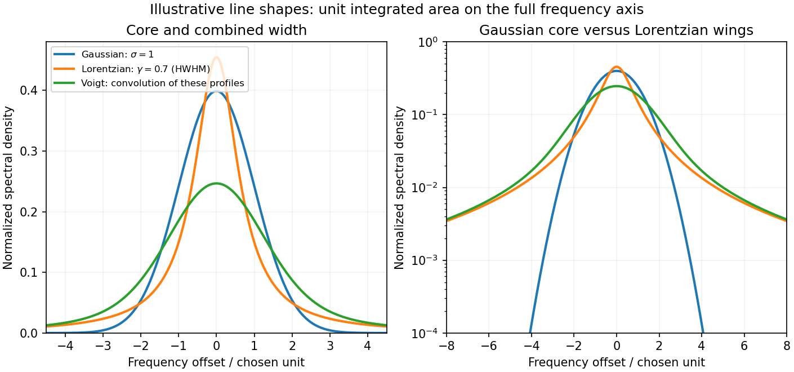
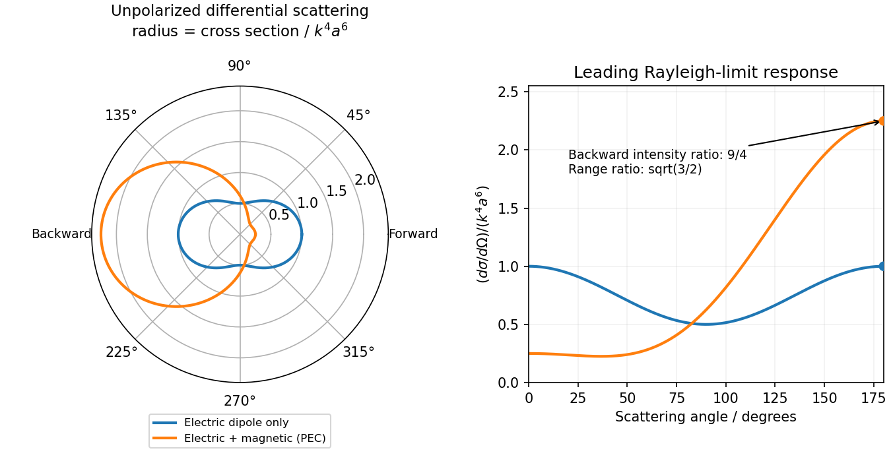

# Paper 1

↑ **Parent:** [2015](../2015.md)

Original source: [Released examination PDF, physical pages 347–350](https://www.whatdotheyknow.com/request/natural_science_tripos_physics_e_2/response/2340776/attach/2/FOI%202023%20399%20Zahid%20materials.pdf?cookie_passthrough=1#page=347). All three note alternatives and both longer questions are treated.

**Table of contents**

- [1](#1)
  - [a](#1/a)
    - [Solution](#1/a/solution)
  - [b](#1/b)
    - [Solution](#1/b/solution)
  - [c](#1/c)
    - [Solution](#1/c/solution)
- [2](#2)
  - [a](#2/a)
    - [Solution](#2/a/solution)
  - [b](#2/b)
    - [Solution](#2/b/solution)
  - [c](#2/c)
    - [Solution](#2/c/solution)
- [3](#3)
  - [Solution](#3/solution)
- [4](#4)
  - [Solution](#4/solution)

## 1

↑ **Parent:** [Paper 1](paper-1.md)

<h3 id="1/a">a</h3>

↑ **Parent:** [1](#1)

<h4 id="1/a/solution">Solution</h4>

↑ **Parent:** [A](#1/a)

Let $\mathbf u_\theta=(\cos\theta,\sin\theta)^{\mathsf T}$ be the transmission direction. An ideal linear [polarizer](../../electromagnetic-wave.md#polarizer) projects the incident [electric field](../../electric-field.md) onto this direction, so its [Jones matrix](../../wave.md#jones-matrix) is

$$
\boxed{P(\theta)=\mathbf u_\theta\mathbf u_\theta^{\mathsf T}
=\begin{pmatrix}\cos^2\theta&\cos\theta\sin\theta\\
\cos\theta\sin\theta&\sin^2\theta\end{pmatrix}}.
$$

Since $\mathbf u_\beta^{\mathsf T}\mathbf u_\alpha=\cos(\alpha-\beta)$, the [amplitude](../../wave.md#wave-amplitude) transmitted by a sequence of [polarizers](../../electromagnetic-wave.md#polarizer) is the product of the projections between successive axes. Here the four directions are $0,\omega t,-2\omega t,0$. After the first [polarizer](../../electromagnetic-wave.md#polarizer) the [unpolarized light](../../wave.md#unpolarized-light) input has intensity $I/2$ and is in [linear polarization](../../electromagnetic-wave.md#linear-polarization) along $x$. The [transmission through a sequence of linear polarizers](../../wave.md#transmission-through-a-sequence-of-linear-polarizers) therefore follows from successive applications of [Malus's law](../../wave.md#malus-s-law)

$$
\boxed{I_{\rm out}(t)=\frac I2\cos^2(\omega t)\cos^2(3\omega t)\cos^2(2\omega t)}.
$$

The relative angle between the rotating [polarizers](../../electromagnetic-wave.md#polarizer) is $3\omega t$, not $\omega t$. The first factor $1/2$ is an [ensemble average](../../expected-value.md) over incident polarization: [unpolarized light](../../wave.md#unpolarized-light) cannot be represented by a single deterministic [Jones vector](../../wave.md#jones-vector). Equivalently, its [coherency matrix](../../wave.md#coherency-matrix) is $(I/2)I_2$; the total [matrix](../../vector-space.md#matrix) $P(0)P(-2\omega t)P(\omega t)P(0)$ gives the same output intensity by the [trace](../../linear-algebra.md#matrix-trace) rule. The quasistatic optical-element approximation assumes the mechanical rotation is slow compared with the optical oscillation.

<h3 id="1/b">b</h3>

↑ **Parent:** [1](#1)

<h4 id="1/b/solution">Solution</h4>

↑ **Parent:** [B](#1/b)

To first order in the applied fields, the carrier acceleration gives $m\dot{\mathbf v}=q\mathbf E$. The [current density](../../electric-charge.md#current-density) $\mathbf j=nq\mathbf v$ consequently obeys the first [London equation](../../magnetic-field.md#london-equations)

$$
\dot{\mathbf j}=\frac{nq^2}{m}\mathbf E=\epsilon_0\omega_p^2\mathbf E.
$$

Taking its curl and using [Faraday's law](../../maxwell-equations.md#faraday-s-law-of-induction) yields

$$
\frac{\partial}{\partial t}\left(\nabla\times\mathbf j+\epsilon_0\omega_p^2\mathbf B\right)=0.
$$

For an initially field-free, current-free preparation, the integration constant is zero. Equivalently, impose the second [London equation](../../magnetic-field.md#london-equations) appropriate to the [Meissner state](../../magnetic-field.md#meissner-state), $\nabla\times\mathbf j=-\epsilon_0\omega_p^2\mathbf B$. In the final static state, [Ampère's law](../../maxwell-equations.md#ampere-s-circuital-law) and $\nabla\cdot\mathbf B=0$ then give

$$
-\nabla^2\mathbf B=\mu_0\nabla\times\mathbf j
=-\frac{\omega_p^2}{c^2}\mathbf B,\qquad
\boxed{\lambda_L=\frac c{\omega_p}=\sqrt{\frac{m}{\mu_0nq^2}}}.
$$

For a planar half-space $z>0$ with a tangential surface field, the bounded solution is

$$
\boxed{\mathbf B(z)=\mathbf B(0)e^{-z/\lambda_L}}.
$$

The [plasma-frequency form of London penetration depth](../../magnetic-field.md#plasma-frequency-form-of-london-penetration-depth) therefore shows that an applied field is exponentially small several penetration depths inside the material.

The [magnetic-history constant in an undamped plasma](../../electromagnetic-wave.md#magnetic-history-constant-in-an-undamped-plasma) explains the required qualification. Undamped carrier motion alone fixes a time-independent value of $\nabla\times\mathbf j+\epsilon_0\omega_p^2\mathbf B$; it does not force that value to vanish. A [perfect conductor](../../electromagnetic-wave.md#perfect-conductor) can retain a pre-existing field. The additional [London equation](../../magnetic-field.md#london-equations) describes [London screening](../../magnetic-field.md#london-screening) independently of that arbitrary ideal-conductor history. The original London paper explicitly distinguishes its description from acceleration theory.[pp. 71–74: acceleration equation, its integration freedom and the additional superconducting relation](../../physics-bibliography.md#the-electromagnetic-equations-of-the-supraconductor-by-fritz-london-and-heinz-london)

<h3 id="1/c">c</h3>

↑ **Parent:** [1](#1)

<h4 id="1/c/solution">Solution</h4>

↑ **Parent:** [C](#1/c)

[wave phase](../../wave.md#phase-waves) labels the stage of a physical oscillation at a [spacetime event](../../special-relativity.md#event-relativity). Two observers comparing the same event must identify the same crest, trough or intermediate stage: a change of coordinates cannot change the number of completed cycles between physically specified wavefronts. The continuous [wave phase](../../wave.md#phase-waves) can therefore be treated as a [Lorentz scalar](../../special-relativity.md#lorentz-scalar), up to a common choice of [wave phase](../../wave.md#phase-waves) origin. This does not assert invariance of the measured [angular frequency](../../lagrangian-mechanics.md#angular-frequency), which is the rate of change of that [wave phase](../../wave.md#phase-waves) along the observer's trajectory.

For [Lorentz invariance of plane-wave phase](../../special-relativity.md#lorentz-invariance-of-plane-wave-phase), write

$$
\Phi=\omega t-\mathbf k\cdot\mathbf r+\Phi_0
=K_\mu x^\mu+\Phi_0,\qquad
x^\mu=(ct,\mathbf r),\quad K^\mu=(\omega/c,\mathbf k),
$$

using the metric with signature $(+,-,-,-)$. The [gradient](../../multivariable-calculus.md#gradient) $K_\mu=\partial_\mu\Phi$ transforms as a [covector](../../dual-space.md#covector) because $\Phi$ is a scalar. Raising its index therefore gives the [four-wavevector](../../special-relativity.md#four-wavevector). Explicitly, substituting the inverse boost $t=\gamma(t'+vx'/c^2)$, $x=\gamma(x'+vt')$ gives

$$
\boxed{\omega'=\gamma(\omega-vk_x),\quad
k_x'=\gamma(k_x-v\omega/c^2),\quad k_y'=k_y,\quad k_z'=k_z}.
$$

These are exactly the [Lorentz transformation](../../special-relativity.md#lorentz-transformation) laws for $(\omega/c,\mathbf k)$. In [vacuum](../../physics.md#vacuum), $K_\mu K^\mu=0$; the [Doppler effect](../../wave.md#doppler-effect) and [aberration of light](../../mathematical-physics.md#relativistic-aberration) are two consequences of transforming the same [four-vector](../../special-relativity.md#four-vector).

## 2

↑ **Parent:** [Paper 1](paper-1.md)

<h3 id="2/a">a</h3>

↑ **Parent:** [2](#2)

<h4 id="2/a/solution">Solution</h4>

↑ **Parent:** [A](#2/a)

The [Faraday effect](../../electromagnetic-wave.md#faraday-effect) rotates the plane of [linear polarization](../../electromagnetic-wave.md#linear-polarization) when light propagates through a material with a [magnetic field](../../magnetic-field.md) component along the ray. In the weak-field transparent regime,

$$
\boxed{\theta=V(\lambda,T)\int\mathbf B\cdot d\mathbf l},
$$

with a stated propagation and transverse-basis convention; $V$ is the [Verdet constant](../../electromagnetic-wave.md#verdet-constant). For a uniform longitudinal field and sample length $L$, the magnitude is $|VBL|$. A scalar intensity change without a corresponding polarization analysis would not establish this effect.

The microscopic field breaks the equivalence of the two [circular polarization](../../electromagnetic-wave.md#circular-polarization) modes: the [Lorentz force](../../relativistic-electromagnetism.md#lorentz-force) and the Zeeman shifts of optical transitions produce different susceptibilities for their opposite senses of rotation. A linearly polarized wave is an equal-amplitude superposition of these two modes. If their real refractive [refractive indices](../../electromagnetic-wave.md#refractive-index) are $n_+,n_-$, their relative [wave phase](../../wave.md#phase-waves) after the sample is $\Delta\phi=(\omega L/c)(n_+-n_-)$. Recombination rotates the line by

$$
\boxed{\theta=\frac{\Delta\phi}{2}}.
$$

Equal transmitted circular [amplitudes](../../wave.md#wave-amplitude) preserve [linear polarization](../../electromagnetic-wave.md#linear-polarization). Unequal [absorption](../../radiometry.md#absorption-electromagnetic-radiation) produces [circular dichroism](../../stereochemistry.md#circular-dichroism) and generally [elliptical polarization](../../wave.md#elliptical-polarization) as well, so pure rotation is an approximation appropriate away from strong [absorption](../../radiometry.md#absorption-electromagnetic-radiation).

A modern motivating experiment sends polarized [laser](../../laser.md) light through a [glass](../../chemical-substance.md#glass) rod inside a [solenoid](../../magnetic-field.md#solenoid), then through a rotatable analyzer onto a [photodiode](../../optical-instrument.md#photodiode). Scan the analyzer first to calibrate its angular response. Driving the [solenoid](../../magnetic-field.md#solenoid) sinusoidally and recording the detector synchronously separates a small rotation signal from unsynchronized noise; the conversion to angle still requires the analyzer slope and the magnetic-field integral through the rod. A first-party William & Mary laboratory manual specifies this apparatus and measurement procedure.[Faraday Rotation laboratory chapter, pp. 2–7: solenoid, glass rod, analyzer calibration and synchronized readout](../../physics-bibliography.md#physics-251-experimental-atomic-physics-fall-2019)

Additional controls are equal-magnitude field reversals, zero-field readings before and after each pair, and a blocked-beam pickup test. The odd-in-field rotation is $[\theta_{\rm obs}(B)-\theta_{\rm obs}(-B)]/2$; a fixed analyzer offset cancels. Heating, stressed-glass [birefringence](../../maxwell-equations.md#birefringence), source drift and field-dependent transmission need separate checks. A single reading near crossed extinction loses the sign because its leading response is quadratic; an analyzer near $45^\circ$ gives a linear small-rotation response.

[Faraday rotation](../../electromagnetic-wave.md#faraday-effect) is nonreciprocal. With the magnetic bias held fixed, retracing the path adds rotation in the same laboratory sense rather than undoing it, unlike reciprocal natural [optical activity](../../stereochemistry.md#optical-activity). This permits an [optical isolator](../../optical-instrument.md#optical-isolator) with a $45^\circ$ Faraday rotator between appropriately oriented [polarizers](../../electromagnetic-wave.md#polarizer). One must compare the returned polarization in a consistently defined laboratory basis; merely reversing the sign of $\mathbf B\cdot\widehat{\mathbf k}$ while retaining the old ray-basis convention gives an incorrect cancellation.

<h3 id="2/b">b</h3>

↑ **Parent:** [2](#2)

<h4 id="2/b/solution">Solution</h4>

↑ **Parent:** [B](#2/b)

A [spectral line](../../stellar-astrophysics.md#spectral-line) has finite width when the emitted or absorbed field loses coherence, or when different emitters have different transition frequencies. It is useful to distinguish [homogeneous spectral broadening](../../stellar-astrophysics.md#homogeneous-spectral-broadening) of each emitter from [inhomogeneous spectral broadening](../../stellar-astrophysics.md#inhomogeneous-spectral-broadening) across the ensemble.

**Finite lifetime and [dephasing](../../quantum-information-theory.md#dephasing-channel).** For an upper-state population lifetime $\tau$ and a stable lower state, the radiating [amplitude](../../wave.md#wave-amplitude) decays as $e^{-t/(2\tau)}$. Its Fourier spectrum is Lorentzian, with [full width at half maximum](../../analysis.md#full-width-at-half-maximum)

$$
\Delta\omega_{\rm nat}=\frac1\tau,\qquad
\Delta\nu_{\rm nat}=\frac1{2\pi\tau}.
$$

More generally, an [optical coherence time](../../physical-optics.md#optical-coherence-time) $T_2$ gives $\Delta\omega_{\rm hom}=2/T_2$. Both level lifetimes and pure [dephasing](../../quantum-information-theory.md#dephasing-channel) can contribute to $1/T_2$. Distinguishing population lifetime from [amplitude](../../wave.md#wave-amplitude) coherence time prevents the usual factor-of-two error.

**Thermal motion.** To first order in velocity, $\delta\nu=\nu_0v_\parallel/c$. A [Maxwell-Boltzmann velocity distribution](../../quantum-ideal-gas-statistics.md#maxwell-boltzmann-velocity-distribution) therefore produces a Gaussian profile, with

$$
\sigma_\nu=\frac{\nu_0}{c}\sqrt{\frac{k_BT}{M}},\qquad
\boxed{\Delta\nu_D=\frac{\nu_0}{c}\sqrt{\frac{8k_BT\ln2}{M}}}.
$$

This is inhomogeneous [doppler broadening](../../quantum-ideal-gas-statistics.md#doppler-broadening): different velocity classes have different [resonance](../../dynamical-systems.md#resonance) frequencies. A distribution of bulk velocities can add further broadening, while a common bulk velocity shifts the line.

**Interactions with the surroundings.** Collisions can interrupt the dipole [wave phase](../../wave.md#phase-waves) and perturb the [energy](../../energy.md) levels, producing [pressure broadening](../../stellar-astrophysics.md#pressure-broadening) and shifts. In the impact approximation, approximately exponential [wave phase](../../wave.md#phase-waves) relaxation produces a Lorentzian contribution; its rate increases with perturber density times an appropriate velocity-averaged collision cross section. Slowly varying electric microfields can instead produce non-Lorentzian Stark profiles. Neutral perturbers, charged perturbers and [resonance](../../dynamical-systems.md#resonance) interactions need not produce the same line shape. These mechanisms and the Gaussian thermal limit are distinguished in NIST's atomic-spectroscopy compendium.[section 20, Spectral Line Shapes, Widths, and Shifts: Doppler and pressure broadening](../../physics-bibliography.md#atomic-spectroscopy-a-compendium-of-basic-ideas-notation-data-and-formulas-by-william-c-martin-and-wolfgang-wiese)

Finite observation time limits coherence; [transit-time broadening](../../stellar-astrophysics.md#transit-time-broadening) also occurs for particles crossing a narrow optical beam. Strong resonant excitation causes [power broadening](../../atomic-physics.md#power-broadening): for an ideal lifetime-limited two-level transition, $\Delta\omega=\Gamma\sqrt{1+s}$ with population decay rate $\Gamma$ and [saturation parameter](../../canonical-ensemble.md#saturation-parameter) $s$. Unresolved [fine structure](../../atomic-physics.md#fine-structure), [hyperfine structure](../../quantum-mechanics.md#hyperfine-structure), isotope components, or spatially varying Zeeman and Stark shifts may look like a single broadened feature even though several frequencies are present.

The observed spectrum is additionally convolved with the instrument response. A Gaussian Doppler contribution convolved with Lorentzian homogeneous broadening gives a [Voigt profile](../../stellar-astrophysics.md#voigt-profile); their full widths do not generally add in quadrature. An informative experiment varies temperature, perturber pressure and excitation intensity separately, calibrates the spectrometer response with a narrower reference, and checks optical thickness or self-absorption. Extrapolation to weak excitation and low pressure helps isolate the lifetime contribution, while a Doppler-free technique is needed if velocity spread still dominates.

**[Figure 1](#2/b/image-original-normalized-gaussian-lorentzian-and-voigt-line-shape-comparison). Original normalized Gaussian, Lorentzian and Voigt line-shape comparison**.

<h3 id="2/c">c</h3>

↑ **Parent:** [2](#2)

<h4 id="2/c/solution">Solution</h4>

↑ **Parent:** [C](#2/c)

Both [Thomson scattering](../../cosmic-microwave-background-anisotropy.md#thomson-scattering) and [Rayleigh scattering](../../electromagnetic-radiation.md#rayleigh-scattering) can be understood as radiation from a dipole driven by the incident [electric field](../../electric-field.md). Their different [frequency](../../wave.md#frequency) dependences come from the response of a free charge compared with a [bound charge](../../electromagnetism.md#bound-charge).

For a free particle of charge $q$ and [mass](../../classical-mechanics.md#mass) $m$, a harmonic field gives $m\ddot{\mathbf x}=q\mathbf E$, hence $\mathbf p=q\mathbf x=-q^2\mathbf E/(m\omega^2)$. The radiated field contains two time derivatives of $\mathbf p$, cancelling the response's $\omega^{-2}$. The Thomson cross section is consequently independent of [frequency](../../wave.md#frequency) in the classical low-recoil regime:

$$
r_q=\frac{q^2}{4\pi\epsilon_0mc^2},\qquad
\boxed{\sigma_T=\frac{8\pi}{3}r_q^2}.
$$

For incident [linear polarization](../../electromagnetic-wave.md#linear-polarization) with unit polarization $\boldsymbol\epsilon$, summing over outgoing polarizations gives $d\sigma/d\Omega=r_q^2[1-|\widehat{\mathbf n}\cdot\boldsymbol\epsilon|^2]$. Radiation vanishes along the acceleration and is strongest perpendicular to it. Averaging an incident [unpolarized light](../../wave.md#unpolarized-light) beam gives

$$
\frac{d\sigma_T}{d\Omega}=\frac{r_q^2}{2}(1+\cos^2\Theta),
$$

where $\Theta$ is the [scattering angle](../../quantum-scattering.md#scattering-angle). Scattering through $90^\circ$ is fully linearly polarized perpendicular to the [scattering plane](../../quantum-scattering.md#scattering-plane) for this ideal isotropic dipole model. The [electron](../../physics.md#electron) case dominates over equally charged heavier particles because the cross section scales as $m^{-2}$. [recoil](../../momentum.md#recoil) corrections become necessary when [photon energy](../../quantum-mechanics.md#photon-energy) is no longer small compared with $mc^2$.

For a [bound charge](../../electromagnetism.md#bound-charge) with [natural frequency](../../classical-mechanics.md#natural-frequency) $\omega_0$ and damping rate $\gamma_d$,

$$
\mathbf p=\alpha_{\rm e}(\omega)\mathbf E,\qquad
\alpha_{\rm e}=\frac{q^2/m}{\omega_0^2-\omega^2-i\gamma_d\omega}.
$$

Far below [resonance](../../dynamical-systems.md#resonance), $\alpha_{\rm e}$ is approximately constant, so

$$
\boxed{\sigma_R=\frac{k^4|\alpha_{\rm e}|^2}{6\pi\epsilon_0^2}
\ \propto\omega^4\propto\lambda^{-4}}.
$$

This is [Rayleigh scattering](../../electromagnetic-radiation.md#rayleigh-scattering). It requires a scatterer small compared with the [wavelength](../../wave-equation.md#wavelength) and, for the simple expression, an isotropic linear dipole response. Atoms, molecules and small [dielectric](../../permittivity.md#dielectric) particles provide examples. The stronger scattering of shorter visible [wavelengths](../../wave-equation.md#wavelength) explains blue skylight; [absorption](../../radiometry.md#absorption-electromagnetic-radiation) and the nonuniform solar spectrum prevent treating that simple scaling as a complete color calculation.[section 9.6, bound-charge response and low-frequency limit](../../physics-bibliography.md#rayleigh-scattering-by-richard-fitzpatrick)

For isotropic electric scatterers the normalized angular and polarization patterns are the same as in [Thomson scattering](../../cosmic-microwave-background-anisotropy.md#thomson-scattering). The [frequency](../../wave.md#frequency) scaling distinguishes their limits: a free charge has a displacement proportional to $\omega^{-2}$, whereas a tightly [bound charge](../../electromagnetism.md#bound-charge) has an approximately frequency-independent displacement. Near [resonance](../../dynamical-systems.md#resonance), far outside the small-particle limit, or with anisotropic [polarizability](../../electrostatics.md#electric-polarizability), the simple Rayleigh formula must be modified. In particular, the electric-only pattern must not silently be applied to a perfectly conducting sphere whose magnetic dipole response is also retained.

A scattering measurement should subtract stray-light and detector backgrounds, control scatterer density and optical thickness, and calibrate detector response and incident [power](../../energy.md#power) when comparing [wavelengths](../../wave-equation.md#wavelength). A polarization analyzer at $90^\circ$ tests the dipole pattern; multiple scattering or unresolved nonisotropic contributions can reduce its polarization.

## 3

↑ **Parent:** [Paper 1](paper-1.md)

<h3 id="3/solution">Solution</h3>

↑ **Parent:** [3](#3)

**[antenna](../../electrical-engineering.md#antenna-radio) quantities.** [radiation resistance](../../electrical-engineering.md#radiation-resistance) represents emitted [power](../../energy.md#power) by $P_{\rm rad}=I_{\rm rms}^2R_{\rm rad}$ at the feed. It is not [Joule heating](../../electric-charge.md#joule-heating) in the [antenna](../../electrical-engineering.md#antenna-radio); a separate loss resistance accounts for that. [antenna gain](../../electrical-engineering.md#antenna-gain) is the directional far-field intensity relative to an isotropic radiator supplied with the same input [power](../../energy.md#power):

$$
G(\theta,\phi)=\frac{4\pi r^2S_r(\theta,\phi)}{P_{\rm in}}.
$$

It includes [radiation efficiency](../../electrical-engineering.md#radiation-efficiency) and equals [antenna directivity](../../electrical-engineering.md#antenna-directivity) only for a lossless [antenna](../../electrical-engineering.md#antenna-radio). [antenna effective area](../../electrical-engineering.md#antenna-effective-area) is defined by the [power](../../energy.md#power) available to a matched load, $P_{\rm av}=A_{\rm eff}S_{\rm inc}$, for incidence from a specified direction and matched polarization. It need not equal a literal geometric collecting area.

**Gain–area relation.** To derive the [antenna gain-effective-area relation](../../electrical-engineering.md#antenna-gain-effective-area-relation), take a passive reciprocal [antenna](../../electrical-engineering.md#antenna-radio). Its [electromagnetic reciprocity](../../electromagnetism.md#reciprocity-electromagnetism) makes the receive pattern proportional to the transmit pattern; write $A_{\rm eff}(\Omega)=K G(\Omega)$. The normalization follows from [thermal equilibrium](../../thermal-equilibrium.md). In the [Rayleigh-Jeans law](../../astrophysics.md#rayleigh-jeans-law) limit, [blackbody radiation](../../statistical-physics.md#black-body-radiation) radiance per unit [frequency](../../wave.md#frequency) per unit [solid angle](../../euclidean-geometry.md#solid-angle) is $2k_BT/\lambda^2$ for two polarizations. A single [antenna](../../electrical-engineering.md#antenna-radio) polarization couples to one half, so the available incident noise [power](../../energy.md#power) is

$$
dP_{\rm inc}=\frac{k_BT}{\lambda^2}\int A_{\rm eff}(\Omega)\,d\Omega\,d\nu.
$$

The open-circuit Johnson voltage spectrum of the [antenna](../../electrical-engineering.md#antenna-radio) resistance is $4k_BTR_{\rm rad}\,d\nu$. A [matched load](../../electrical-circuit.md#matched-load) receives half the open-circuit voltage, giving available [power](../../energy.md#power) $k_BT\,d\nu$. In a lossless [antenna](../../electrical-engineering.md#antenna-radio) at [thermal equilibrium](../../thermal-equilibrium.md) these [powers](../../energy.md#power) agree; hence $\int A_{\rm eff}\,d\Omega=\lambda^2$. Since $\int G\,d\Omega=4\pi$,

$$
\boxed{A_{\rm eff}(\theta,\phi)=\frac{\lambda^2}{4\pi}G(\theta,\phi)}.
$$

The same efficiency factor multiplies receiving area and gain if reciprocal dissipative losses are included consistently. Impedance mismatch or polarization mismatch reduces delivered [power](../../energy.md#power) further. The factor of two for thermal polarization modes and the factor of four between open-circuit voltage variance and matched-load [power](../../energy.md#power) are separate effects.

**Normalize the [radar](../../electrical-engineering.md#radar) beam.** Interpret the azimuth as signed about the beam centre at $\phi=0$, so both sides of the narrow lobe are included. Put $u=\theta-\pi/2$. To leading order in the small angular width, $\sin\theta\simeq1$ and the angular integrals can be extended over the real line:

$$
P=\int N\,d\Omega\simeq C\int e^{-u^2/(2\alpha^2)}du
\int e^{-\phi^2/(2\alpha^2)}d\phi=2\pi\alpha^2C.
$$

The [Gaussian antenna beam solid angle](../../electrical-engineering.md#gaussian-antenna-beam-solid-angle) gives the peak on the positive $x$-axis consequently has

$$
C\simeq\frac{P}{2\pi\alpha^2},\qquad
G_0\simeq\frac2{\alpha^2},\qquad
A_0\simeq\frac{\lambda^2}{2\pi\alpha^2},\qquad \lambda=\frac c\nu.
$$

Here $N$ is [power](../../energy.md#power) per [solid angle](../../euclidean-geometry.md#solid-angle), equal to $r^2S_r$ in the far field. The leading neglected solid-angle correction is relative order $\alpha^2$.

**Return using the supplied electric-dipole response.** The [electric-dipole radar cross section of a small conducting sphere](../../electrical-engineering.md#electric-dipole-radar-cross-section-of-a-small-conducting-sphere) determines this return. At target range $D$, the incident intensity is $S_t=C/D^2$. Write its [root mean square](../../analysis.md#root-mean-square) [electric field](../../electric-field.md) as $E_t$, with $S_t=\epsilon_0cE_t^2$. The induced [electric dipole](../../electrostatics.md#electric-dipole) is $p_{\rm rms}=4\pi\epsilon_0a^3E_t$. A dipole's angular radiation pattern, normalized by $\int\sin^2\chi\,d\Omega=8\pi/3$, gives $dP_{\rm sc}/d\Omega=(3P_{\rm sc}/8\pi)\sin^2\chi$. The backward direction is perpendicular to the induced dipole, so the supplied total dipole [power](../../energy.md#power) gives

$$
\left.\frac{dP_{\rm sc}}{d\Omega}\right|_{\rm back}
=\frac{3}{8\pi}\frac{8\pi^3\nu^4p_{\rm rms}^2}{3\epsilon_0c^3}
=k^4a^6S_t,\qquad k=\frac{2\pi\nu}{c}.
$$

The received intensity is this angular [power](../../energy.md#power) divided by $D^2$. Using the [monostatic radar equation](../../electrical-engineering.md#monostatic-radar-equation), or directly multiplying by the receive area, gives

$$
P_R=\frac{A_0}{D^2}k^4a^6\frac{C}{D^2}
=\frac{4\pi^2Pa^6}{\lambda^2\alpha^4D^4}.
$$

The receiver threshold is a voltage across the [matched load](../../electrical-circuit.md#matched-load), so the detectable [power](../../energy.md#power) is $V_m^2/R$, without another matching factor:

$$
\boxed{D_{\rm electric}=
\left(\frac{4\pi^2PR\nu^2a^6}{c^2\alpha^4V_m^2}\right)^{1/4}}.
$$

This is the electric-dipole result following from the response data provided. It assumes $ka\ll1$, far-field propagation on each leg, alignment at the beam maximum and no attenuation or additional receiver losses.

**Perfect-conductor qualification.** [perfect-conductor sphere dipole interference](../../electromagnetic-radiation.md#perfect-conductor-sphere-dipole-interference) arises because the sphere also excludes the oscillating [magnetic field](../../magnetic-field.md). Solving the magnetic boundary problem gives $\mathbf m=-2\pi a^3\mathbf H_t$ in addition to the [electric dipole](../../electrostatics.md#electric-dipole). The [magnetic polarizability of a perfectly conducting sphere](../../electromagnetism.md#magnetic-polarizability-of-a-perfectly-conducting-sphere) follows from its induced surface currents.[section 8.4, Example 8.4.3: magnetic dipole induced in a perfectly conducting sphere](../../physics-bibliography.md#electromagnetic-fields-and-energy-by-hermann-a-haus-and-james-r-melcher) In the backward direction the magnetic contribution has half the electric scattering [amplitude](../../wave.md#wave-amplitude) and the same sign, so the returned intensity is $9/4$ of the electric-only value. Equivalently, the monostatic [radar cross section](../../electrical-engineering.md#radar-cross-section) is $\sigma_{\rm back}=9\pi k^4a^6$, rather than $4\pi k^4a^6$. Including both leading dipoles therefore gives

$$
\boxed{D_{\rm PEC}=
\left(\frac{9\pi^2PR\nu^2a^6}{c^2\alpha^4V_m^2}\right)^{1/4}
=\sqrt{\frac32}\,D_{\rm electric}}.
$$

Both results have been distinguished because the supplied auxiliary data describe only the [electric dipole](../../electrostatics.md#electric-dipole), while the literal perfect-conductor boundary conditions also generate the magnetic one. The backward interference is a leading-order effect, not a higher-order correction in $ka$.[section Scattering by a Small Perfectly Conducting Sphere: electric and magnetic dipoles and backward interference](../../physics-bibliography.md#scattering-of-em-waves-by-michael-fowler)

**[Figure 2](#3/image-original-electric-only-and-electric-plus-magnetic-small-sphere-scattering-comparison). Original electric-only and electric-plus-magnetic small-sphere scattering comparison**.

## 4

↑ **Parent:** [Paper 1](paper-1.md)

<h3 id="4/solution">Solution</h3>

↑ **Parent:** [4](#4)

**Polarization under a boost.** [Lorentz invariance of normalized plane-wave polarization](../../electromagnetic-wave.md#lorentz-invariance-of-normalized-plane-wave-polarization) preserves the [polarization ellipse](../../wave.md#polarization-ellipse)'s shape, handedness and [degree of polarization](../../wave.md#degree-of-polarization) when its transverse basis is carried to the aberrated ray. The propagation direction changes; equality of a fixed laboratory Cartesian pair of field components is not the appropriate comparison.

Rotate the $yz$ axes so that a general incident [vacuum](../../physics.md#vacuum) plane wave has unit direction $\widehat{\mathbf n}=(\cos\vartheta,\sin\vartheta,0)$. Choose the transverse basis $\mathbf e_p=(-\sin\vartheta,\cos\vartheta,0)$, $\mathbf e_s=(0,0,1)$, and arbitrary [complex amplitudes](../../wave.md#complex-amplitude) $E_p,E_s$. Then

$$
\mathbf E=E_p\mathbf e_p+E_s\mathbf e_s,\qquad
c\mathbf B=\widehat{\mathbf n}\times\mathbf E
=(E_s\sin\vartheta,-E_s\cos\vartheta,E_p).
$$

Putting $\beta=v/c$, the given transformation gives

$$
\mathbf E'=\left(-E_p\sin\vartheta,\,
\gamma E_p(\cos\vartheta-\beta),\,
\gamma E_s(1-\beta\cos\vartheta)\right).
$$

The [four-wavevector](../../special-relativity.md#four-wavevector) transforms with [Doppler factor](../../special-relativity.md#doppler-factor) $\mathcal D=\gamma(1-\beta\cos\vartheta)>0$, giving

$$
\cos\vartheta'=\frac{\cos\vartheta-\beta}{1-\beta\cos\vartheta},\qquad
\sin\vartheta'=\frac{\sin\vartheta}{\gamma(1-\beta\cos\vartheta)}.
$$

In the corresponding basis $\mathbf e_p'=(-\sin\vartheta',\cos\vartheta',0)$, $\mathbf e_s'=\mathbf e_s$, the transformed field is

$$
\boxed{\mathbf E'=\mathcal D(E_p\mathbf e_p'+E_s\mathbf e_s')}.
$$

Both components of the [Jones vector](../../wave.md#jones-vector) acquire the same positive real multiplier. Their [amplitude](../../wave.md#wave-amplitude) ratio and relative [wave phase](../../wave.md#phase-waves) are unchanged, proving preservation of arbitrary linear, circular or [elliptical polarization](../../wave.md#elliptical-polarization). All [Stokes parameters](../../electromagnetic-wave.md#stokes-parameters) scale by $\mathcal D^2$, so their normalized values and the [degree of polarization](../../wave.md#degree-of-polarization) are unchanged. An [unpolarized light](../../wave.md#unpolarized-light) ensemble remains unpolarized under this single-ray boost. A mixture of different ray directions requires separate transformations and is outside this statement.

**Reflection from the moving slab.** Take the upper interface as $z=0$, the material below it, and the incident ray along $-\widehat{\mathbf z}$. This fixes the sign left implicit by “along the $z$-axis”; choosing the opposite surface convention changes no result below. Treat $n$ as the real [refractive index](../../electromagnetic-wave.md#refractive-index) in the slab's rest frame, with unit relative [magnetic permeability](../../maxwell-equations.md#permeability-electromagnetism). In the laboratory,

$$
K_i^\mu=\frac{\omega}{c}(1,0,0,-1).
$$

Transform to the slab rest frame:

$$
K_i'{}^\mu=\frac{\omega}{c}(\gamma,-\gamma\beta,0,-1).
$$

The incidence is now oblique, in the $xz$ plane, at angle $i$ to the surface normal:

$$
\boxed{\sin i=|\beta|,\qquad\cos i=\gamma^{-1},\qquad\tan i=\gamma|\beta|}.
$$

The incoming ensemble remains [unpolarized light](../../wave.md#unpolarized-light). In this frame the ordinary stationary-interface [Fresnel equations](../../electromagnetic-wave.md#fresnel-equations) give the amplitude coefficients:

$$
r_s=\frac{\cos i-n\cos t}{\cos i+n\cos t},\qquad
r_p=\frac{n\cos i-\cos t}{n\cos i+\cos t},\qquad
\sin i=n\sin t.
$$

For generic oblique incidence, $R_s=|r_s|^2$ and $R_p=|r_p|^2$ differ. Equal incident $s$ and $p$ intensities therefore produce unequal reflected intensities: the reflection is partially polarized. Its degree of [linear polarization](../../electromagnetic-wave.md#linear-polarization) is

$$
\boxed{\mathcal P=\frac{|R_s-R_p|}{R_s+R_p}}.
$$

The inverse boost preserves this degree, so the same conclusion holds in the laboratory even though the laboratory incident ray is normal to the surface. The moving material cannot be treated as an isotropic stationary [dielectric](../../permittivity.md#dielectric) in that frame.

The reflected rest-frame [wavevector](../../elasticity-physics.md#wavevector) is $(\omega/c)(\gamma,-\gamma\beta,0,+1)$. Boosting back gives $(\omega/c)(1,0,0,+1)$: the reflected laboratory ray is normal to the surface and has the incident [frequency](../../wave.md#frequency). There is no contradiction with the oblique rest-frame geometry. Translation tangential to a uniform interface does not itself introduce a moving normal mirror.

**Complete [linear polarization](../../electromagnetic-wave.md#linear-polarization).** For [Brewster reflection from a tangentially moving dielectric](../../electromagnetic-wave.md#brewster-reflection-from-a-tangentially-moving-dielectric), at [Brewster's angle](../../electromagnetic-wave.md#brewster-s-angle), $r_p=0$ and $\tan i_B=n$. Combining this with the aberration relation gives

$$
\gamma|\beta|=n,\qquad
\boxed{|v|=\frac{cn}{\sqrt{1+n^2}}}.
$$

Only the $s$ component is reflected. The [plane of incidence](../../electromagnetic-wave.md#plane-of-incidence) in the slab frame is $xz$, so **the reflected [electric field](../../electric-field.md) is along $y$, perpendicular to the slab velocity**. Boosting this $s$ field back keeps its electric direction along $y$. For example, the reflected rest-frame $s$ field has $B_z'=-\beta E_y'/c$; hence $E_y=\gamma(E_y'+vB_z')=E_y'/\gamma$ and $E_x=E_z=0$.

This exact extinction assumes a transparent nonmagnetic [dielectric](../../permittivity.md#dielectric) with $n\ne1$. At $v=0$ the reflected intensities are equal and the reflected beam is unpolarized. If $n=1$, both reflection coefficients vanish and there is no reflected beam whose polarization can be assigned. With [dispersion](../../dispersion-relation.md#wave-dispersion), evaluate $n$ at the shifted [frequency](../../wave.md#frequency) $\omega'=\gamma\omega$; the Brewster-speed equation is then implicit. [absorption](../../radiometry.md#absorption-electromagnetic-radiation) generally prevents a real incidence angle from making the complex $r_p$ exactly zero.

**[Figure 3](#4/image-original-rest-frame-ray-geometry-and-calculated-polarization-from-a-tangentially-moving-dielectric). Original rest-frame ray geometry and calculated polarization from a tangentially moving dielectric**.

## ↑ Ancestors (11)

1. [2015](../2015.md)
2. [Past exam of the optics and electrodynamics course of the University of Cambridge](../../past-exam-of-the-optics-and-electrodynamics-course-of-the-university-of-cambridge.md)
3. [Optics and Electrodynamics course of the University of Cambridge](../../university-of-cambridge.md#optics-and-electrodynamics-course-of-the-university-of-cambridge)
4. [Physics course of the year 3 of the natural sciences course of the University of Cambridge](../../university-of-cambridge.md#physics-course-of-the-year-3-of-the-natural-sciences-course-of-the-university-of-cambridge)
5. [Year 3 of the natural sciences course of the University of Cambridge](../../university-of-cambridge.md#year-3-of-the-natural-sciences-course-of-the-university-of-cambridge)
6. [Year of the natural sciences course of the University of Cambridge](../../university-of-cambridge.md#year-of-the-natural-sciences-course-of-the-university-of-cambridge)
7. [Natural sciences course of the University of Cambridge](../../university-of-cambridge.md#natural-sciences-course-of-the-university-of-cambridge)
8. [Course of the University of Cambridge](../../university-of-cambridge.md#course-of-the-university-of-cambridge)
9. [University of Cambridge](../../university-of-cambridge.md)
10. [List of universities](../../README.md#list-of-universities)
11. [Codex Wiki](../../README.md)
