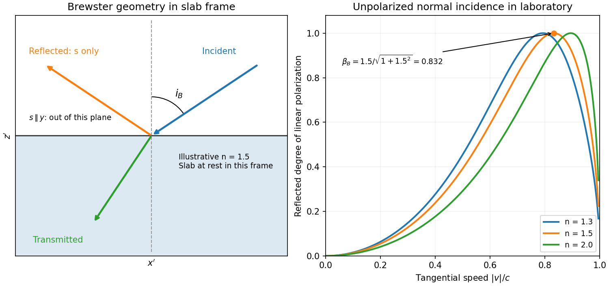

<h1 id="4/solution">Solution</h1>

↑ **Parent:** [4](../4.md)

**Polarization under a boost.** [Lorentz invariance of normalized plane-wave polarization](../../../../lorentz-invariance-of-normalized-plane-wave-polarization.md) preserves the [polarization ellipse](../../../../polarization-ellipse.md)'s shape, handedness and [degree of polarization](../../../../degree-of-polarization.md) when its transverse basis is carried to the aberrated ray. The propagation direction changes; equality of a fixed laboratory Cartesian pair of field components is not the appropriate comparison.

Rotate the $yz$ axes so that a general incident [vacuum](../../../../vacuum.md) plane wave has unit direction $\widehat{\mathbf n}=(\cos\vartheta,\sin\vartheta,0)$. Choose the transverse basis $\mathbf e_p=(-\sin\vartheta,\cos\vartheta,0)$, $\mathbf e_s=(0,0,1)$, and arbitrary [complex amplitudes](../../../../complex-amplitude.md) $E_p,E_s$. Then

$$
\mathbf E=E_p\mathbf e_p+E_s\mathbf e_s,\qquad
c\mathbf B=\widehat{\mathbf n}\times\mathbf E
=(E_s\sin\vartheta,-E_s\cos\vartheta,E_p).
$$

Putting $\beta=v/c$, the given transformation gives

$$
\mathbf E'=\left(-E_p\sin\vartheta,\,
\gamma E_p(\cos\vartheta-\beta),\,
\gamma E_s(1-\beta\cos\vartheta)\right).
$$

The [four-wavevector](../../../../four-wavevector.md) transforms with [Doppler factor](../../../../doppler-factor.md) $\mathcal D=\gamma(1-\beta\cos\vartheta)>0$, giving

$$
\cos\vartheta'=\frac{\cos\vartheta-\beta}{1-\beta\cos\vartheta},\qquad
\sin\vartheta'=\frac{\sin\vartheta}{\gamma(1-\beta\cos\vartheta)}.
$$

In the corresponding basis $\mathbf e_p'=(-\sin\vartheta',\cos\vartheta',0)$, $\mathbf e_s'=\mathbf e_s$, the transformed field is

$$
\boxed{\mathbf E'=\mathcal D(E_p\mathbf e_p'+E_s\mathbf e_s')}.
$$

Both components of the [Jones vector](../../../../jones-vector.md) acquire the same positive real multiplier. Their [amplitude](../../../../wave-amplitude.md) ratio and relative [wave phase](../../../../phase-waves.md) are unchanged, proving preservation of arbitrary linear, circular or [elliptical polarization](../../../../elliptical-polarization.md). All [Stokes parameters](../../../../stokes-parameters.md) scale by $\mathcal D^2$, so their normalized values and the [degree of polarization](../../../../degree-of-polarization.md) are unchanged. An [unpolarized light](../../../../unpolarized-light.md) ensemble remains unpolarized under this single-ray boost. A mixture of different ray directions requires separate transformations and is outside this statement.

**Reflection from the moving slab.** Take the upper interface as $z=0$, the material below it, and the incident ray along $-\widehat{\mathbf z}$. This fixes the sign left implicit by “along the $z$-axis”; choosing the opposite surface convention changes no result below. Treat $n$ as the real [refractive index](../../../../refractive-index.md) in the slab's rest frame, with unit relative [magnetic permeability](../../../../permeability-electromagnetism.md). In the laboratory,

$$
K_i^\mu=\frac{\omega}{c}(1,0,0,-1).
$$

Transform to the slab rest frame:

$$
K_i'{}^\mu=\frac{\omega}{c}(\gamma,-\gamma\beta,0,-1).
$$

The incidence is now oblique, in the $xz$ plane, at angle $i$ to the surface normal:

$$
\boxed{\sin i=|\beta|,\qquad\cos i=\gamma^{-1},\qquad\tan i=\gamma|\beta|}.
$$

The incoming ensemble remains [unpolarized light](../../../../unpolarized-light.md). In this frame the ordinary stationary-interface [Fresnel equations](../../../../fresnel-equations.md) give the amplitude coefficients:

$$
r_s=\frac{\cos i-n\cos t}{\cos i+n\cos t},\qquad
r_p=\frac{n\cos i-\cos t}{n\cos i+\cos t},\qquad
\sin i=n\sin t.
$$

For generic oblique incidence, $R_s=|r_s|^2$ and $R_p=|r_p|^2$ differ. Equal incident $s$ and $p$ intensities therefore produce unequal reflected intensities: the reflection is partially polarized. Its degree of [linear polarization](../../../../linear-polarization.md) is

$$
\boxed{\mathcal P=\frac{|R_s-R_p|}{R_s+R_p}}.
$$

The inverse boost preserves this degree, so the same conclusion holds in the laboratory even though the laboratory incident ray is normal to the surface. The moving material cannot be treated as an isotropic stationary [dielectric](../../../../dielectric.md) in that frame.

The reflected rest-frame [wavevector](../../../../wavevector.md) is $(\omega/c)(\gamma,-\gamma\beta,0,+1)$. Boosting back gives $(\omega/c)(1,0,0,+1)$: the reflected laboratory ray is normal to the surface and has the incident [frequency](../../../../frequency.md). There is no contradiction with the oblique rest-frame geometry. Translation tangential to a uniform interface does not itself introduce a moving normal mirror.

**Complete [linear polarization](../../../../linear-polarization.md).** For [Brewster reflection from a tangentially moving dielectric](../../../../brewster-reflection-from-a-tangentially-moving-dielectric.md), at [Brewster's angle](../../../../brewster-s-angle.md), $r_p=0$ and $\tan i_B=n$. Combining this with the aberration relation gives

$$
\gamma|\beta|=n,\qquad
\boxed{|v|=\frac{cn}{\sqrt{1+n^2}}}.
$$

Only the $s$ component is reflected. The [plane of incidence](../../../../plane-of-incidence.md) in the slab frame is $xz$, so **the reflected [electric field](../../../../electric-field-split.md) is along $y$, perpendicular to the slab velocity**. Boosting this $s$ field back keeps its electric direction along $y$. For example, the reflected rest-frame $s$ field has $B_z'=-\beta E_y'/c$; hence $E_y=\gamma(E_y'+vB_z')=E_y'/\gamma$ and $E_x=E_z=0$.

This exact extinction assumes a transparent nonmagnetic [dielectric](../../../../dielectric.md) with $n\ne1$. At $v=0$ the reflected intensities are equal and the reflected beam is unpolarized. If $n=1$, both reflection coefficients vanish and there is no reflected beam whose polarization can be assigned. With [dispersion](../../../../wave-dispersion.md), evaluate $n$ at the shifted [frequency](../../../../frequency.md) $\omega'=\gamma\omega$; the Brewster-speed equation is then implicit. [absorption](../../../../absorption-electromagnetic-radiation.md) generally prevents a real incidence angle from making the complex $r_p$ exactly zero.

**[Figure 3](#4/image-original-rest-frame-ray-geometry-and-calculated-polarization-from-a-tangentially-moving-dielectric). Original rest-frame ray geometry and calculated polarization from a tangentially moving dielectric**.

## ↑ Ancestors (13)

1. [4](../4.md)
2. [Paper 1](../../paper-1-split.md)
3. [2015](../../split.md)
4. [Past exam of the optics and electrodynamics course of the University of Cambridge](../../../split.md)
5. [Optics and Electrodynamics course of the University of Cambridge](../../../../optics-and-electrodynamics-course-of-the-university-of-cambridge.md)
6. [Physics course of the year 3 of the natural sciences course of the University of Cambridge](../../../../physics-course-of-the-year-3-of-the-natural-sciences-course-of-the-university-of-cambridge.md)
7. [Year 3 of the natural sciences course of the University of Cambridge](../../../../year-3-of-the-natural-sciences-course-of-the-university-of-cambridge.md)
8. [Year of the natural sciences course of the University of Cambridge](../../../../year-of-the-natural-sciences-course-of-the-university-of-cambridge.md)
9. [Natural sciences course of the University of Cambridge](../../../../natural-sciences-course-of-the-university-of-cambridge.md)
10. [Course of the University of Cambridge](../../../../course-of-the-university-of-cambridge.md)
11. [University of Cambridge](../../../../university-of-cambridge-split.md)
12. [List of universities](../../../../list-of-universities.md)
13. [Codex Wiki](../../../../split.md)
