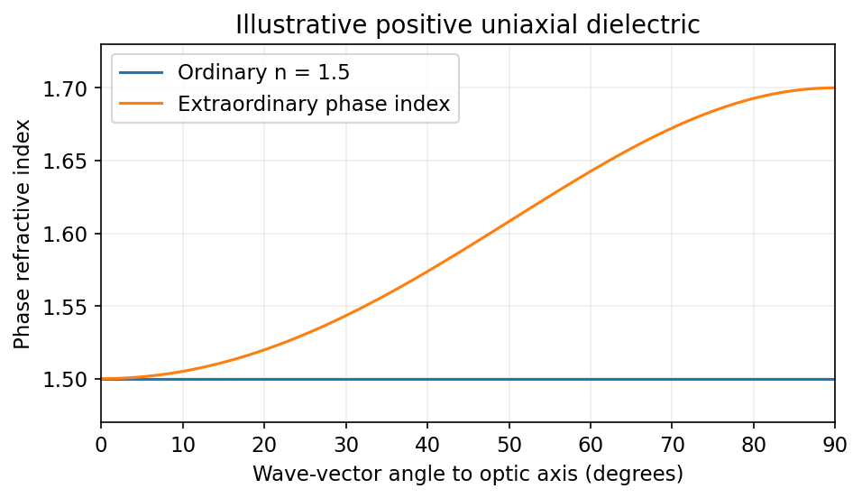
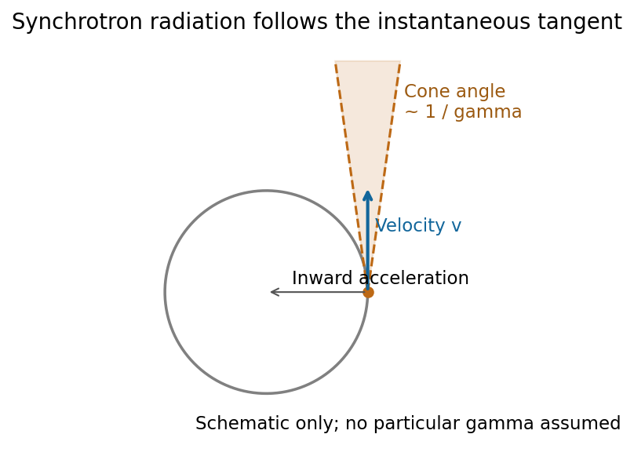
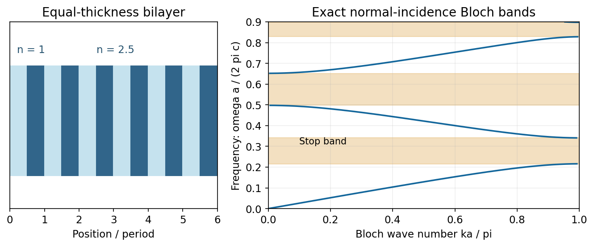
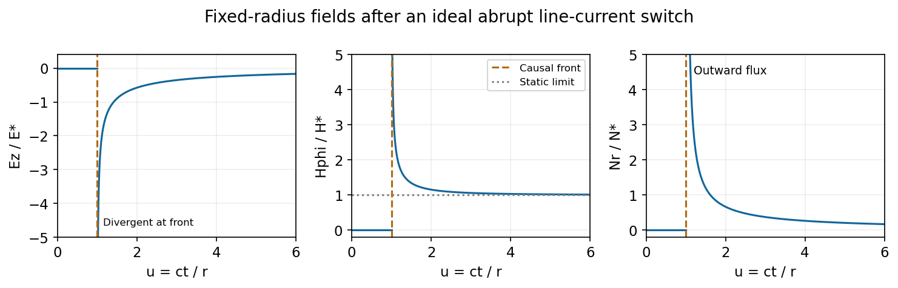
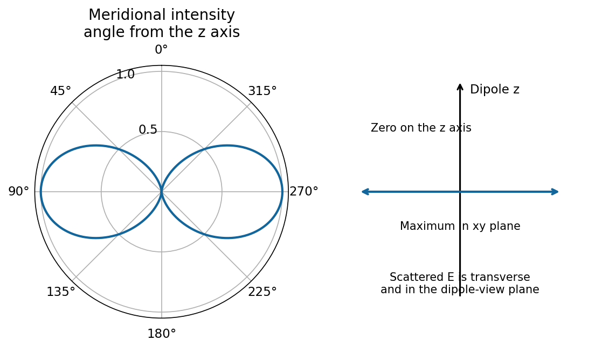
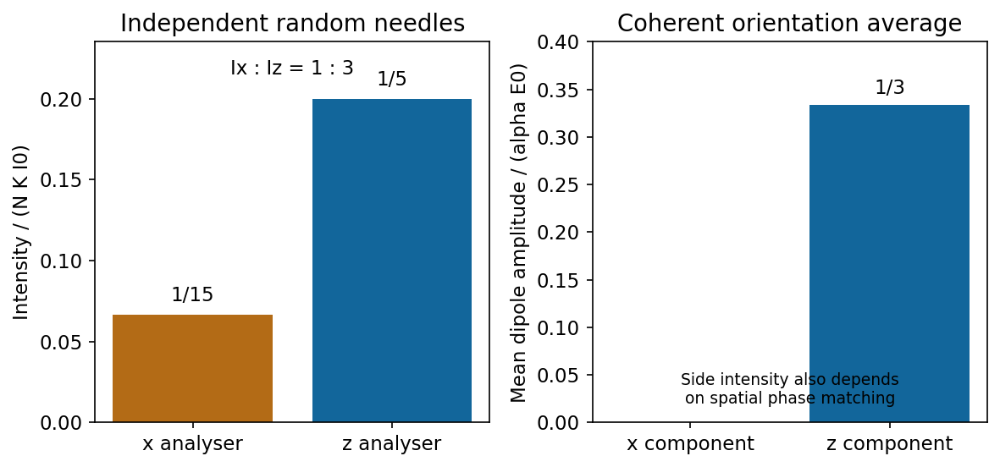

# Paper 1

↑ **Parent:** [2016](../2016.md)

[Original examination PDF, physical pages 394–397](https://www.whatdotheyknow.com/request/natural_science_tripos_physics_e_2/response/2340776/attach/2/FOI%202023%20399%20Zahid%20materials.pdf?cookie_passthrough=1#page=394)

**Table of contents**

- [1](#1)
  - [a](#1/a)
    - [Solution](#1/a/solution)
  - [b](#1/b)
    - [Solution](#1/b/solution)
  - [c](#1/c)
    - [Solution](#1/c/solution)
- [2](#2)
  - [a](#2/a)
    - [Solution](#2/a/solution)
  - [b](#2/b)
    - [Solution](#2/b/solution)
  - [c](#2/c)
    - [Solution](#2/c/solution)
- [3](#3)
  - [Solution](#3/solution)
- [4](#4)
  - [Solution](#4/solution)
  - [a](#4/a)
    - [Solution](#4/a/solution)
  - [b](#4/b)
    - [Solution](#4/b/solution)
  - [c](#4/c)
    - [Solution](#4/c/solution)
  - [d](#4/d)
    - [Solution](#4/d/solution)

## 1

↑ **Parent:** [Paper 1](paper-1.md)

<h3 id="1/a">a</h3>

↑ **Parent:** [1](#1)

<h4 id="1/a/solution">Solution</h4>

↑ **Parent:** [A](#1/a)

Interpreting the cone as **[Cherenkov radiation](../../electromagnetic-wave.md#cherenkov-radiation)**, its angle gives the speed, not directly the [mass](../../classical-mechanics.md#mass):

$$
\cos\theta=\frac{c}{nv}=\frac1{n\beta},\qquad\gamma=\left(1-\frac1{n^2\cos^2\theta}\right)^{-1/2}.
$$

Combining this with the relativistic [kinetic energy](../../energy.md#kinetic-energy) $T=(\gamma-1)mc^2$ gives the [Cherenkov mass inference](../../electromagnetic-wave.md#cherenkov-mass-inference)

$$
\boxed{m=\frac{T}{c^2\left[\left(1-\frac1{n^2\cos^2\theta}\right)^{-1/2}-1\right]}.}
$$

The material must be transparent at the observed [frequency](../../wave.md#frequency), $n$ is its [phase refractive index](../../electromagnetic-wave.md#phase-refractive-index) there, and $n\cos\theta>1$. For $T>0$ this requires $0<\theta<\arccos(1/n)$ for a massive particle above threshold. Radiation of an unspecified other origin would not determine the [mass](../../classical-mechanics.md#mass) from these data alone.

<h3 id="1/b">b</h3>

↑ **Parent:** [1](#1)

<h4 id="1/b/solution">Solution</h4>

↑ **Parent:** [B](#1/b)

**The transverse [spatial coherence](../../physical-optics.md#spatial-optical-coherence) width is much larger than the longitudinal [coherence length](../../physical-optics.md#optical-coherence-length).** The longitudinal scale is controlled by spectral [bandwidth](../../electrical-engineering.md#bandwidth-signal-processing):

$$
\ell_c\sim\frac{c}{\Delta\nu}\sim\frac{\lambda^2}{\Delta\lambda}.
$$

For broad, unfiltered visible sunlight it is of order a [wavelength](../../wave-equation.md#wavelength) to a few wavelengths, roughly $10^{-6}\,\mathrm m$. This is an order-of-magnitude scale, not a uniquely defined solar constant; the precise value depends on spectral response and the coherence-width convention.

The [Sun](../../stellar-astrophysics.md#sun) subtends angular diameter $\delta\simeq1919''\simeq9.3\times10^{-3}\,\mathrm{rad}$ at one astronomical unit.[Sun Observational Parameters: apparent diameter at 1 A.U.](../../physics-bibliography.md#sun-fact-sheet-by-national-aeronautics-and-space-administration) Consequently the [sunlight coherence comparison](../../physical-optics.md#sunlight-coherence-comparison) gives a transverse scale

$$
\boxed{w_c\sim\frac{\lambda}{\delta}\sim 6\times10^{-5}\,\mathrm m\gg\ell_c,}
$$

using $\lambda=550\,\mathrm{nm}$ only as an illustrative visible [wavelength](../../wave-equation.md#wavelength). The [uniform-disk spatial coherence](../../physical-optics.md#uniform-disk-spatial-coherence) model has first coherence zero at $1.22\lambda/\delta$, about $72\,\mathrm{\mu m}$ at that [wavelength](../../wave-equation.md#wavelength). The small angular size permits coherence across tens of micrometres, while the broad spectrum destroys coherence over much shorter path differences. Spectral filtering increases $\ell_c$; spatial filtering changes the transverse scale.[Coherence of Light Sources; More on Spatial Coherence](../../physics-bibliography.md#interference-and-coherence-by-sander-konijnenberg-aurele-j-l-adam-and-h-paul-urbach)

<h3 id="1/c">c</h3>

↑ **Parent:** [1](#1)

<h4 id="1/c/solution">Solution</h4>

↑ **Parent:** [C](#1/c)

Write $C=e^2/(4\pi\epsilon_0)=mc^2r_0$. For a slowly evolving circular [Coulomb orbit](../../classical-mechanics.md#coulomb-orbit), force balance and the mechanical energy give

$$
v^2=\frac{C}{mr}=\frac{c^2r_0}{r},\qquad |\boldsymbol\alpha|=\frac{C}{mr^2},\qquad E=-\frac{C}{2r}.
$$

The supplied [Larmor formula](../../electromagnetic-radiation.md#larmor-formula) therefore yields

$$
P=\frac{e^2|\boldsymbol\alpha|^2}{6\pi\epsilon_0c^3}=\frac{2mc^3r_0^3}{3r^4}.
$$

Set $dE/dt=-P$. Since $dE/dt=C\dot r/(2r^2)$,

$$
\dot r=-\frac{4cr_0^2}{3r^2},\qquad\frac{d(r^3)}{dt}=-4cr_0^2.
$$

Thus the [classical radiation collapse of a Coulomb orbit](../../classical-mechanics.md#classical-radiation-collapse-of-a-coulomb-orbit) obeys

$$
\boxed{r(t)^3=a_0^3-4r_0^2ct.}
$$

The decreasing mechanical energy means a more tightly bound orbit, not a smaller speed. The formal collapse time is $a_0^3/(4r_0^2c)$. The nonrelativistic, small-loss-per-orbit approximation eventually fails; the result demonstrates the classical instability rather than describing an actual [hydrogen atom](../../mathematical-physics.md#hydrogen-atom).

## 2

↑ **Parent:** [Paper 1](paper-1.md)

<h3 id="2/a">a</h3>

↑ **Parent:** [2](#2)

<h4 id="2/a/solution">Solution</h4>

↑ **Parent:** [A](#2/a)

**[Birefringence](../../maxwell-equations.md#birefringence) is polarization-dependent propagation in an optically anisotropic medium.** Its [permittivity tensor](../../permittivity.md#permittivity-tensor) relates $\mathbf D$ to $\mathbf E$. In a lossless uniaxial [dielectric](../../permittivity.md#dielectric), take the [optic axis](../../maxwell-equations.md#optic-axis) along $z$ and the principal relative permittivities as $(n_o^2,n_o^2,n_e^2)$. For a [wave vector](../../elasticity-physics.md#wavevector) making angle $\vartheta$ with that axis, the ordinary mode has index $n_o$, while the [extraordinary phase-index angular dependence](../../maxwell-equations.md#extraordinary-phase-index-angular-dependence) is

$$
\boxed{\frac1{n_{\rm ex}(\vartheta)^2}=\frac{\cos^2\vartheta}{n_o^2}+\frac{\sin^2\vartheta}{n_e^2}.}
$$

The ordinary [electric field](../../electric-field.md) is perpendicular to the plane containing the [wave vector](../../elasticity-physics.md#wavevector) and [optic axis](../../maxwell-equations.md#optic-axis). The extraordinary [electric displacement field](../../electromagnetism.md#electric-displacement-field) lies in that plane and is perpendicular to the [wave vector](../../elasticity-physics.md#wavevector), but its [electric field](../../electric-field.md) need not be. Its energy-flow direction can therefore differ from the wave-normal direction: [birefringent walk-off](../../maxwell-equations.md#birefringent-walk-off). Along the [optic axis](../../maxwell-equations.md#optic-axis) the two indices coincide. [Refraction](../../optics.md#refraction) generally splits an incident beam into two differently polarized rays, producing double images, as in calcite.

**[Figure 1](#2/a/image-illustrative-positive-uniaxial-ordinary-and-extraordinary-phase-indices-coincide-along-the-optic-axis). Illustrative positive-uniaxial ordinary and extraordinary phase indices coincide along the optic axis**. [Source](paper-1-birefringent-indices.py).

A [waveplate](../../maxwell-equations.md#waveplate) instead uses the relative phase of two eigenpolarizations. With the axes chosen for the propagation direction, the [retardance](../../maxwell-equations.md#retardance) is $\Delta=2\pi L(n_2-n_1)/\lambda_0$. A [quarter-wave plate](../../maxwell-equations.md#quarter-wave-plate) gives $|\Delta|=\pi/2$ modulo $2\pi$ and converts equal-amplitude orthogonal components between linear and [circular polarization](../../electromagnetic-wave.md#circular-polarization). A [half-wave plate](../../maxwell-equations.md#half-wave-plate) gives $|\Delta|=\pi$ and rotates a [linear polarization](../../electromagnetic-wave.md#linear-polarization). This is a phase effect; unequal absorption is a separate property.[Creating Different Polarisation States; wave plates and relative phase](../../physics-bibliography.md#polarisation-by-sander-konijnenberg-aurele-j-l-adam-and-h-paul-urbach)

<h3 id="2/b">b</h3>

↑ **Parent:** [2](#2)

<h4 id="2/b/solution">Solution</h4>

↑ **Parent:** [B](#2/b)

**[Synchrotron radiation](../../electromagnetic-radiation.md#synchrotron-radiation) is radiation from relativistic charges undergoing transverse [acceleration](../../classical-mechanics.md#acceleration)**, for example electrons bent by a [magnetic field](../../magnetic-field.md). [Relativistic aberration](../../mathematical-physics.md#relativistic-aberration) concentrates the radiation within an angle of order $1/\gamma$ about the instantaneous velocity. An observer sees short pulses as this cone sweeps past; [synchrotron pulse compression](../../electromagnetic-radiation.md#synchrotron-pulse-compression) produces a broad spectrum extending far above the orbital [frequency](../../wave.md#frequency).

For an ultrarelativistic circular trajectory of curvature radius $\rho$, the characteristic scales are

$$
\boxed{\omega_c\simeq\frac{3\gamma^3c}{2\rho},\qquad\Delta t_{\rm pulse}\sim\frac{\rho}{\gamma^3c}.}
$$

[Critical energy and critical mode number](../../physics-bibliography.md#synchrotron-radiation-in-the-geant4-physics-reference-manual-by-geant4-collaboration) The [synchrotron critical frequency](../../electromagnetic-radiation.md#synchrotron-critical-frequency) sets the spectral turnover; it is not a sharp upper cutoff. The transverse-acceleration [Lienard formula](../../electromagnetic-radiation.md#lienard-radiated-power-formula) gives

$$
P=\frac{q^2\gamma^4v^4}{6\pi\epsilon_0c^3\rho^2}\simeq\frac{q^2c\gamma^4}{6\pi\epsilon_0\rho^2}.
$$

The strong energy dependence is a major loss mechanism in electron storage rings. Radiation observed in the orbital plane is linearly polarized in that plane; away from it the two components generally produce [elliptical polarization](../../wave.md#elliptical-polarization), with opposite handedness on opposite sides. Accelerator light sources exploit its brightness, broad tunable spectrum and pulsed timing. At low speeds the relativistic beaming and high-frequency extension disappear, approaching ordinary cyclotron radiation.[Relativistic radiation cone, pulse compression and synchrotron spectrum](../../physics-bibliography.md#synchrotron-radiation-by-richard-fitzpatrick)

**[Figure 2](#2/b/image-radiation-is-concentrated-around-the-instantaneous-tangent-to-a-relativistic-circular-orbit). Radiation is concentrated around the instantaneous tangent to a relativistic circular orbit**. [Source](paper-1-synchrotron-beaming.py).

<h3 id="2/c">c</h3>

↑ **Parent:** [2](#2)

<h4 id="2/c/solution">Solution</h4>

↑ **Parent:** [C](#2/c)

**A [photonic crystal](../../optics.md#photonic-crystal) has a spatially periodic [dielectric](../../permittivity.md#dielectric) response on the scale of the optical [wavelength](../../wave-equation.md#wavelength).** For a nonmagnetic, lossless, nondispersive [dielectric](../../permittivity.md#dielectric), the source-free [Maxwell equations](../../maxwell-equations.md) can be written as the eigenproblem

$$
\nabla\times\left[\epsilon_r(\mathbf r)^{-1}\nabla\times\mathbf H\right]=\frac{\omega^2}{c^2}\mathbf H.
$$

The [Bloch theorem](../../bloch-s-theorem.md) gives $\mathbf H_{n\mathbf k}=e^{i\mathbf k\cdot\mathbf r}\mathbf u_{n\mathbf k}(\mathbf r)$ with periodic $\mathbf u$. The allowed frequencies form [photonic band structures](../../optics.md#photonic-band-structure). Coupling of counterpropagating waves near a [Brillouin zone](../../bloch-s-theorem.md#brillouin-zone) boundary opens a stop band. A one-dimensional [dielectric](../../permittivity.md#dielectric) multilayer is a simple example; two-dimensional hole arrays and three-dimensional [dielectric](../../permittivity.md#dielectric) networks allow more extensive control.

**[Figure 3](#2/c/image-an-exactly-calculated-one-dimensional-dielectric-bilayer-has-allowed-bands-separated-by-a-stop-band). An exactly calculated one-dimensional dielectric bilayer has allowed bands separated by a stop band**. [Source](paper-1-photonic-bands.py).

A **complete [photonic band gap](../../optics.md#photonic-band-gap)** excludes bulk propagating modes for every direction and [polarization](../../wave.md#polarization-waves) in a [frequency](../../wave.md#frequency) interval. Periodicity alone does not guarantee such a gap: dimensionality, symmetry and refractive-index contrast matter. A missing or altered element can support a localized defect state in the gap, making a cavity; a line defect can guide light. Finite crystals have leakage and wavelength-dependent transmission rather than an infinitely sharp exclusion. Applications include selective mirrors, optical filters, small resonators and integrated waveguides.[Lecture 2: Maxwell eigenproblem; lectures 9–14: Bloch states, one-dimensional gaps and defect localization](../../physics-bibliography.md#mathematical-methods-in-nanophotonics-mit-18-369-spring-2016-by-steven-g-johnson)

## 3

↑ **Parent:** [Paper 1](paper-1.md)

<h3 id="3/solution">Solution</h3>

↑ **Parent:** [3](#3)

The [magnetic vector potential](../../electromagnetism.md#magnetic-vector-potential) is defined by $\mathbf B=\nabla\times\mathbf A$. The [gauge transformation](../../electromagnetism.md#gauge-transformation)

$$
\boxed{\mathbf A\mapsto\mathbf A+\nabla\chi,\qquad\phi\mapsto\phi-\partial_t\chi}
$$

leaves both $\mathbf B$ and $\mathbf E=-\nabla\phi-\partial_t\mathbf A$ unchanged. In [magnetostatics](../../electromagnetism.md#magnetostatics) choose the [Coulomb gauge](../../electromagnetism.md#coulomb-gauge) $\nabla\cdot\mathbf A=0$. Then [Ampère's law](../../maxwell-equations.md#ampere-s-circuital-law) and the curl-of-curl identity give

$$
\mu_0\mathbf J=\nabla\times(\nabla\times\mathbf A)=\nabla(\nabla\cdot\mathbf A)-\nabla^2\mathbf A,\qquad\boxed{\nabla^2\mathbf A=-\mu_0\mathbf J.}
$$

The free-space [Green function](../../green-s-function.md) identity $\nabla^2|\mathbf r-\mathbf r'|^{-1}=-4\pi\delta^{(3)}(\mathbf r-\mathbf r')$ therefore gives

$$
\boxed{\mathbf A(\mathbf r)=\frac{\mu_0}{4\pi}\int\frac{\mathbf J(\mathbf r')}{|\mathbf r-\mathbf r'|}\,d^3r'.}
$$

The [boundary condition](../../differential-equation.md#boundary-condition) selects the homogeneous solution; the usual decay condition assumes suitably localized sources. An infinitely long static wire needs a reference for its logarithmically divergent potential, although its [magnetic field](../../magnetic-field.md) is finite away from the wire.

For time-dependent sources use the **[Lorenz gauge](../../relativistic-electromagnetism.md#lorenz-gauge-condition)**, $\nabla\cdot\mathbf A+c^{-2}\partial_t\phi=0$, and the outgoing [retarded potential](../../relativistic-electromagnetism.md#retarded-potential)

$$
\boxed{\mathbf A(\mathbf r,t)=\frac{\mu_0}{4\pi}\int\frac{\mathbf J(\mathbf r',t-|\mathbf r-\mathbf r'|/c)}{|\mathbf r-\mathbf r'|}\,d^3r'.}
$$

The [scalar potential](../../classical-field-theory.md#scalar-potential) has the analogous retarded charge-density integral. The two gauges should not be conflated for a general time-dependent source.[Equations (73)–(76): Lorenz-gauge retarded scalar and vector potentials](../../physics-bibliography.md#retarded-potentials-by-richard-fitzpatrick)

For the prescribed uncharged wire, $\rho=0$ and $\phi=0$ is consistent. Translation invariance makes $\mathbf A=A_z(r,t)\hat{\mathbf z}$ with $\nabla\cdot\mathbf A=0$, so this particular solution satisfies both gauge conditions. With $s=z'-z$,

$$
A_z=\frac{\mu_0 I}{4\pi}\int_{-\infty}^{\infty}\frac{\Theta(t-\sqrt{r^2+s^2}/c)}{\sqrt{r^2+s^2}}\,ds.
$$

It is zero for $t<r/c$. For $t>r/c$, set $L=\sqrt{c^2t^2-r^2}$. The causal interval is $-L<s<L$, giving the [switched infinite-wire retarded potential](../../relativistic-electromagnetism.md#switched-infinite-wire-retarded-potential)

$$
\boxed{A_z=\frac{\mu_0I}{2\pi}\operatorname{arsinh}\frac Lr=\frac{\mu_0I}{2\pi}\operatorname{arcosh}\frac{ct}{r}=\frac{\mu_0I}{2\pi}\ln\!\left(\frac{ct+\sqrt{c^2t^2-r^2}}r\right).}
$$

Differentiation gives the fields and [Poynting vector](../../electromagnetic-wave.md#poynting-vector), for $r>0$, $t>r/c$:

$$
\boxed{\begin{aligned}
\mathbf E&=-\frac{\mu_0Ic}{2\pi\sqrt{c^2t^2-r^2}}\hat{\mathbf z},\\
\mathbf H&=\frac{Ict}{2\pi r\sqrt{c^2t^2-r^2}}\hat{\boldsymbol\phi},\\
\mathbf N=\mathbf E\times\mathbf H&=\frac{\mu_0I^2c^2t}{4\pi^2r(c^2t^2-r^2)}\hat{\mathbf r}.
\end{aligned}}
$$

Here $\mathbf B=\mu_0\mathbf H$ and $B_\phi=-\partial_rA_z$. All three fields vanish before arrival. For positive $I$, $\mathbf E$ opposes the imposed current and the [radial energy flow after switching a line current](../../relativistic-electromagnetism.md#radial-energy-flow-after-switching-a-line-current) points **radially outward**: $(-\hat{\mathbf z})\times\hat{\boldsymbol\phi}=\hat{\mathbf r}$.

**[Figure 4](#3/image-at-fixed-radius-the-causal-fields-start-at-t-equals-r-over-c-and-relax-toward-the-magnetostatic-limit). At fixed radius the causal fields start at t equals r over c and relax toward the magnetostatic limit**. [Source](paper-1-switched-wire.py).

For the graph, let $u=ct/r$. Normalized to $E_*=\mu_0Ic/(2\pi r)$, $H_*=I/(2\pi r)$ and $N_*=\mu_0I^2c/(4\pi^2r^2)$, the curves are

$$
E_z/E_*=-\frac1{\sqrt{u^2-1}},\qquad H_\phi/H_*=\frac u{\sqrt{u^2-1}},\qquad N_r/N_*=\frac u{u^2-1}\quad(u>1).
$$

At the [wavefront](../../physical-optics.md#wavefront), $|E_z|$ and $H_\phi$ diverge as $(u-1)^{-1/2}$ and $N_r$ as $(u-1)^{-1}$. This [abrupt line-current wavefront singularity](../../relativistic-electromagnetism.md#abrupt-line-current-wavefront-singularity) reflects the ideal instantaneous turn-on of a line current; a finite rise time smooths the front. At late times,

$$
E_z\sim-\frac{\mu_0I}{2\pi t}\to0,\qquad H_\phi\to\frac I{2\pi r},\qquad N_r\sim\frac{\mu_0I^2}{4\pi^2rt}\to0.
$$

The vector potential grows logarithmically with time in this infinite-wire idealization even as the local [magnetic field](../../magnetic-field.md) approaches its static limit. The divergent front should not be interpreted as a finite-energy pulse from a real instantaneous switching experiment.

## 4

↑ **Parent:** [Paper 1](paper-1.md)

<h3 id="4/solution">Solution</h3>

↑ **Parent:** [4](#4)

**Spherical-particle [frequency](../../wave.md#frequency) scaling.** For a [dielectric](../../permittivity.md#dielectric) sphere of radius $a\ll\lambda$, the quasistatic [electric polarizability](../../electrostatics.md#electric-polarizability) is

$$
\alpha_s=4\pi\epsilon_0a^3\frac{\epsilon_r-1}{\epsilon_r+2},\qquad\mathbf p(t)=\operatorname{Re}(\alpha_s\mathbf E_0e^{-i\omega t}).
$$

The [electric dipole radiation](../../electromagnetic-wave.md#electric-dipole-radiation) formula and $I_0=\epsilon_0c|E_0|^2/2$ give

$$
\langle P\rangle=\frac{\omega^4|\alpha_s|^2|E_0|^2}{12\pi\epsilon_0c^3},\qquad\boxed{\sigma=\frac{\langle P\rangle}{I_0}=\frac{8\pi}{3}k^4a^6\left|\frac{\epsilon_r-1}{\epsilon_r+2}\right|^2.}
$$

Thus **[Rayleigh scattering](../../electromagnetic-radiation.md#rayleigh-scattering) scales as $\omega^4$, or $\lambda^{-4}$**, when the polarizability varies slowly with [frequency](../../wave.md#frequency). Material resonances and absorption can change this simple scaling. For the incident $z$ [polarization](../../wave.md#polarization-waves), the dipole is along $z$: intensity is proportional to $\sin^2\chi$, where $\chi$ is the angle from $z$. There is no radiation on the dipole axis and a maximum in the $xy$ plane. In a direction $\hat{\mathbf n}$ the scattered [electric field](../../electric-field.md) is along $\hat{\mathbf z}-(\hat{\mathbf z}\cdot\hat{\mathbf n})\hat{\mathbf n}$, hence linearly polarized wherever nonzero.[Small-particle dipole response and inverse-fourth-power wavelength dependence](../../physics-bibliography.md#rayleigh-scattering-by-richard-fitzpatrick)

**[Figure 5](#4/image-a-z-directed-electric-dipole-radiates-most-strongly-perpendicular-to-its-axis-and-has-axial-zeros). A z-directed electric dipole radiates most strongly perpendicular to its axis and has axial zeros**. [Source](paper-1-rayleigh-pattern.py).

**Needle model used in parts (a)–(d).** Let its axis be $\mathbf u=(u_x,u_y,u_z)=(\sin\theta\cos\phi,\sin\theta\sin\phi,\cos\theta)$. A very slender, high-permittivity needle has dominant longitudinal response, so use the [rank-one needle polarizability](../../electrostatics.md#rank-one-needle-polarizability) $\boldsymbol\alpha\simeq\alpha_\parallel\mathbf u\mathbf u^{\mathsf T}$. Its transverse response is neglected at leading order. For observation along $y$, define $\mathbf v=u_x\hat{\mathbf x}+u_z\hat{\mathbf z}$, $s=|\mathbf v|^2=1-u_y^2$ and

$$
K=\frac{k^4|\alpha_\parallel|^2}{16\pi^2\epsilon_0^2R^2}.
$$

For a unit incident [Jones vector](../../wave.md#jones-vector) $\mathbf e$, the common far-field relation is $\mathbf E_s\propto\mathbf v(\mathbf u\cdot\mathbf e)$, and $I_s=KI_0s|\mathbf u\cdot\mathbf e|^2$. Here $I_s$ is irradiance at distance $R$; multiplying by $R^2$ gives power per solid angle. No absolute value of $\alpha_\parallel$ is given or needed for the requested relative intensities.

**Diffuse random cloud, with the incident [polarization](../../wave.md#polarization-waves) of (a).** The single-particle amplitudes through $x$ and $z$ analysers are proportional to $u_xu_z$ and $u_z^2$. The [isotropic orientation fourth moment](../../multilinear-algebra.md#isotropic-orientation-fourth-moment) gives the [needle-scattering analyzer moments](../../electromagnetic-radiation.md#needle-scattering-analyzer-moments)

$$
\langle u_x^2u_z^2\rangle=\frac1{15},\qquad\langle u_z^4\rangle=\frac15.
$$

For example, $\langle u_z^4\rangle=\tfrac12\int_{-1}^{1}\mu^4d\mu=1/5$; symmetry and $u_x^2+u_y^2+u_z^2=1$ give $2\langle u_x^2u_z^2\rangle=1/3-1/5$. Since the particles scatter mutually incoherently, intensities add. For $N$ illuminated particles,

$$
\boxed{I_x=\frac{NKI_0}{15},\qquad I_z=\frac{NKI_0}{5},\qquad I_x:I_z=1:3.}
$$

The cross correlation vanishes by reflection symmetry. The degree of [linear polarization](../../electromagnetic-wave.md#linear-polarization) is $(I_z-I_x)/(I_z+I_x)=\boxed{1/2}$: random anisotropic scatterers produce partially depolarized light, even though every individual needle produces a single [linear polarization](../../electromagnetic-wave.md#linear-polarization).

**[Figure 6](#4/image-independent-isotropically-oriented-needles-give-the-analyser-ratio-one-to-three-while-coherent-mean-amplitudes-have-no-x-component). Independent isotropically oriented needles give the analyser ratio one to three, while coherent mean amplitudes have no x component**. [Source](paper-1-needle-ensemble.py).

**Continuous homogeneous [dielectric](../../permittivity.md#dielectric).** One must sum amplitudes coherently and include their spatial phases, rather than retain the preceding sum of intensities. Random orientations give $\langle\mathbf u\mathbf u^{\mathsf T}\rangle=\mathbf I/3$, so the averaged response is isotropic and its induced [polarization](../../wave.md#polarization-waves) is along $z$. Its coherent radiation toward $y$, when allowed by the sample geometry, is therefore **purely $z$ polarized, with $I_x=0$**. The independent-needle prefactor is no longer a quantitative dense-medium model; local-field and collective effects determine the effective [permittivity](../../permittivity.md).

There is also [coherent continuum phase matching](../../electromagnetic-radiation.md#coherent-continuum-phase-matching): a uniform bulk driven by a [plane wave](../../wave-function.md#plane-wave) has no arbitrary outgoing $90^\circ$ plane-wave component. In an ideal infinite homogeneous medium there is no diffuse side scattering at all; propagation, [refraction](../../optics.md#refraction) and reflection are determined by the medium and its interfaces. A finite sample's coherent side signal depends on its shape and boundaries. Thus the old $1:3$ diffuse ratio is replaced by a coherent isotropic-medium response, not by a universal nonzero $N^2$ side-scattering intensity.

<h3 id="4/a">a</h3>

↑ **Parent:** [4](#4)

<h4 id="4/a/solution">Solution</h4>

↑ **Parent:** [A](#4/a)

Using the needle definitions in the question-level solution, $\mathbf u\cdot\mathbf e=u_z=\cos\theta$. The scattered field is parallel to $\mathbf v=u_x\hat{\mathbf x}+u_z\hat{\mathbf z}$, and

$$
\boxed{\frac{I_a}{KI_0}=u_z^2(1-u_y^2)=\cos^2\theta\left(1-\sin^2\theta\sin^2\phi\right).}
$$

The light is **linearly polarized** along the needle's projection into the $xz$ observation plane. Its [Jones vector](../../wave.md#jones-vector) in the $(x,z)$ basis is $(u_x,u_z)^{\mathsf T}/\sqrt{1-u_y^2}$ whenever the intensity is nonzero. A needle perpendicular to the incident [electric field](../../electric-field.md), or pointing directly at the observer, has zero leading-order signal.

<h3 id="4/b">b</h3>

↑ **Parent:** [4](#4)

<h4 id="4/b/solution">Solution</h4>

↑ **Parent:** [B](#4/b)

Now $\mathbf u\cdot\mathbf e=u_y=\sin\theta\sin\phi$, so

$$
\boxed{\frac{I_b}{KI_0}=u_y^2(1-u_y^2)=\sin^2\theta\sin^2\phi\left(1-\sin^2\theta\sin^2\phi\right).}
$$

Whenever nonzero, the scattered light has **the same [linear polarization](../../electromagnetic-wave.md#linear-polarization)** along $\mathbf v$ as in (a). Although the incident field points toward the observer, the tilted anisotropic needle can induce a dipole component perpendicular to that direction. An isotropic sphere would instead have an axial radiation zero for this incident [polarization](../../wave.md#polarization-waves).

<h3 id="4/c">c</h3>

↑ **Parent:** [4](#4)

<h4 id="4/c/solution">Solution</h4>

↑ **Parent:** [C](#4/c)

Choose one circular convention as $\mathbf e_R=(\hat{\mathbf z}+i\hat{\mathbf y})/\sqrt2$ with time dependence $e^{-i\omega t}$. Reversing the handedness convention changes the sign of $i$ but not the result here. The scattered complex amplitude is

$$
\mathbf E_{s,R}\propto\frac{u_z+iu_y}{\sqrt2}\mathbf v.
$$

The scalar factor contributes a common phase to both output components. Consequently the scattered wave is **linearly polarized along $\mathbf v$**, rather than circular or elliptical, with

$$
\boxed{I_R=\frac{KI_0}{2}(u_y^2+u_z^2)(1-u_y^2)=\frac{I_a+I_b}{2}.}
$$

The dominant longitudinal needle response has rank one, so both incident circular components emerge in the same real output direction.

<h3 id="4/d">d</h3>

↑ **Parent:** [4](#4)

<h4 id="4/d/solution">Solution</h4>

↑ **Parent:** [D](#4/d)

Unpolarized incident light has equal, mutually incoherent $y$- and $z$-polarized intensities. Both components scatter into the same direction $\mathbf v$, so their [coherency matrices](../../wave.md#coherency-matrix) add to

$$
\mathbf J_s=\frac{KI_0}{2}(u_y^2+u_z^2)\begin{pmatrix}u_x^2&u_xu_z\\u_xu_z&u_z^2\end{pmatrix}.
$$

This matrix has rank one when the signal is nonzero. The light is therefore **fully linearly polarized along $\mathbf v$**, with

$$
\boxed{I_{\rm unpol}=\frac{I_a+I_b}{2}=I_R.}
$$

A fixed highly anisotropic needle can act as a polarizing scatterer even for unpolarized input. The equality of total intensities with (c) does not mean the incident states were identical. These conclusions use the leading longitudinal-polarizability approximation; finite transverse response can change the [polarization](../../wave.md#polarization-waves) purity.

## ↑ Ancestors (11)

1. [2016](../2016.md)
2. [Past exam of the optics and electrodynamics course of the University of Cambridge](../../past-exam-of-the-optics-and-electrodynamics-course-of-the-university-of-cambridge.md)
3. [Optics and Electrodynamics course of the University of Cambridge](../../university-of-cambridge.md#optics-and-electrodynamics-course-of-the-university-of-cambridge)
4. [Physics course of the year 3 of the natural sciences course of the University of Cambridge](../../university-of-cambridge.md#physics-course-of-the-year-3-of-the-natural-sciences-course-of-the-university-of-cambridge)
5. [Year 3 of the natural sciences course of the University of Cambridge](../../university-of-cambridge.md#year-3-of-the-natural-sciences-course-of-the-university-of-cambridge)
6. [Year of the natural sciences course of the University of Cambridge](../../university-of-cambridge.md#year-of-the-natural-sciences-course-of-the-university-of-cambridge)
7. [Natural sciences course of the University of Cambridge](../../university-of-cambridge.md#natural-sciences-course-of-the-university-of-cambridge)
8. [Course of the University of Cambridge](../../university-of-cambridge.md#course-of-the-university-of-cambridge)
9. [University of Cambridge](../../university-of-cambridge.md)
10. [List of universities](../../README.md#list-of-universities)
11. [Codex Wiki](../../README.md)
