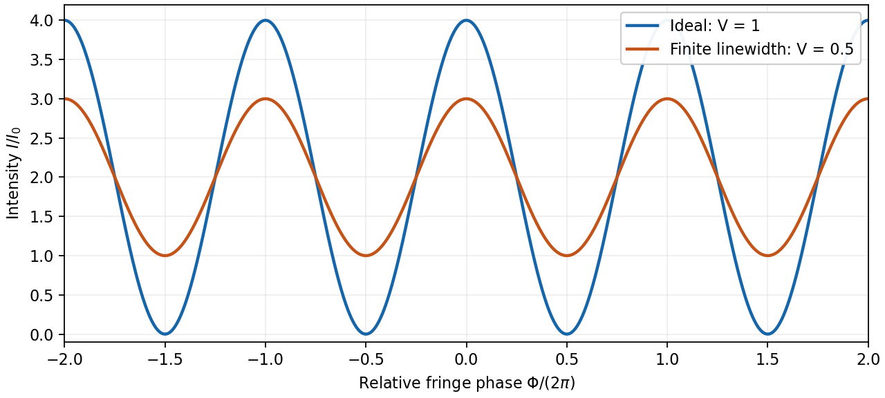

<h1 id="1/b/solution">Solution</h1>

↑ **Parent:** [B](../b.md)

Let $I_0$ be the [intensity](../../../../intensity-physics.md) from either fibre alone at the observation point, assuming equal output [intensities](../../../../intensity-physics.md), matching [polarizations](../../../../polarization-waves.md) and negligible drift. The screen samples the relative [phase](../../../../phase-waves.md) $\Phi(X)$ between the two outputs. For an ideal monochromatic [laser](../../../../laser-split.md), [first-order optical coherence](../../../../first-order-optical-coherence.md) is complete and

$$
\boxed{I_{\rm ideal}(X)=2I_0[1+\cos\Phi(X)]},\qquad I_{\min}=0,\quad I_{\max}=4I_0.
$$

The [interference fringes](../../../../interference-fringe.md) are approximately equally spaced in the small-angle far field, with a slowly varying [diffraction](../../../../diffraction.md) envelope. If the output separation is $a$ and the screen distance is $D$, the [interference fringe spacing](../../../../interference-fringe-spacing.md) is approximately $\lambda_0D/a$. Equal phases at the two _input_ ends do not ensure a central bright fringe: the extra fibre contributes carrier [phase](../../../../phase-waves.md) $2\pi n_{\rm eff}(l_2-l_1)/\lambda_0$ in addition to the free-space [optical path difference](../../../../optical-path-difference.md).

For a finite linewidth, the time-averaged [interference](../../../../interference-wave-propagation.md) signal becomes

$$
I(X)=2I_0\{1+|g^{(1)}(\tau)|\cos[\Phi(X)+\arg g^{(1)}(\tau)]\},\qquad V=\frac{I_{\max}-I_{\min}}{I_{\max}+I_{\min}}=|g^{(1)}(\tau)|.
$$

Here $g^{(1)}$ may be defined for the slowly varying field envelope, with the carrier [phase](../../../../phase-waves.md) already included in $\Phi$. A realistic [laser](../../../../laser-split.md) therefore gives reduced [interferometric visibility](../../../../interferometric-visibility.md); for $V=1/2$, its extrema are $I_0$ and $3I_0$.

**[Figure 1](#1/b/image-ideal-and-finite-linewidth-interference-for-equal-output-intensities). Ideal and finite-linewidth interference for equal output intensities**.

For a [Lorentzian line shape](../../../../lorentzian-line-shape.md) of [frequency](../../../../frequency.md) [full width at half maximum](../../../../full-width-at-half-maximum.md) $\Delta\nu$, [temporal optical coherence](../../../../temporal-optical-coherence.md) gives

$$
|g^{(1)}(\tau)|=e^{-\pi\Delta\nu|\tau|},\qquad \tau=\frac{n_g(l_2-l_1)}c.
$$

The relevant index is the [group index](../../../../group-refractive-index.md). Using the intended nondispersive approximation $n_g\simeq n_{\rm eff}=2$,

$$
\tau=\frac{20\,\mathrm m}{c}=66.71\,\mathrm{ns},\qquad \boxed{\Delta\nu=\frac{\log2}{\pi\tau}=3.31\,\mathrm{MHz}\quad\text{(FWHM)}.}
$$

This [delayed-fibre linewidth measurement](../../../../delayed-fibre-linewidth-measurement.md) assumes the loss of contrast comes from linewidth. Unequal output [intensities](../../../../intensity-physics.md), polarization mismatch or mechanical [phase](../../../../phase-waves.md) fluctuations also lower [interferometric visibility](../../../../interferometric-visibility.md). If [dispersion](../../../../wave-dispersion.md) matters, the stated [phase](../../../../phase-waves.md) index alone does not specify the necessary [group index](../../../../group-refractive-index.md).

## ↑ Ancestors (13)

1. [B](../b.md)
2. [1](../../1.md)
3. [2017](../../../2017-split.md)
4. [Past exam of the optics and electrodynamics course of the University of Cambridge](../../../split.md)
5. [Optics and Electrodynamics course of the University of Cambridge](../../../../optics-and-electrodynamics-course-of-the-university-of-cambridge.md)
6. [Physics course of the year 3 of the natural sciences course of the University of Cambridge](../../../../physics-course-of-the-year-3-of-the-natural-sciences-course-of-the-university-of-cambridge.md)
7. [Year 3 of the natural sciences course of the University of Cambridge](../../../../year-3-of-the-natural-sciences-course-of-the-university-of-cambridge.md)
8. [Year of the natural sciences course of the University of Cambridge](../../../../year-of-the-natural-sciences-course-of-the-university-of-cambridge.md)
9. [Natural sciences course of the University of Cambridge](../../../../natural-sciences-course-of-the-university-of-cambridge.md)
10. [Course of the University of Cambridge](../../../../course-of-the-university-of-cambridge.md)
11. [University of Cambridge](../../../../university-of-cambridge-split.md)
12. [List of universities](../../../../list-of-universities.md)
13. [Codex Wiki](../../../../split.md)
