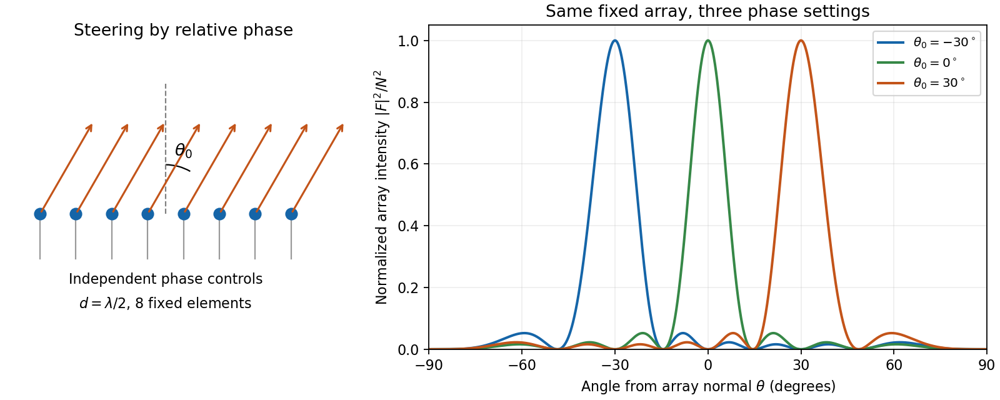

<h1 id="2/b/solution">Solution</h1>

↑ **Parent:** [B](../b.md)

A [phased array](../../../../phased-array.md) uses fixed [antennas](../../../../antenna-radio.md) driven coherently, with adjustable electronic delays or [phases](../../../../phase-waves.md). Changing those relative [phases](../../../../phase-waves.md) changes the direction of [constructive interference](../../../../constructive-interference.md).

For $N$ identical elements at $\mathbf r_j=jd\hat{\mathbf x}$, take time dependence $e^{-i\omega t}$ and feed [phase](../../../../phase-waves.md) $j\psi$. In a far-field direction at angle $\theta$ from the array normal, the [array factor](../../../../array-factor.md) is

$$
F(\theta)=\sum_{j=0}^{N-1}e^{ij(\psi-kd\sin\theta)}=e^{i(N-1)\chi/2}\frac{\sin(N\chi/2)}{\sin(\chi/2)},\qquad \chi=\psi-kd\sin\theta.
$$

Multiply $|F|^2$ by the single-element [antenna beam pattern](../../../../antenna-beam-pattern.md) to obtain the total angular [intensity](../../../../intensity-physics.md). All elements add in [phase](../../../../phase-waves.md) in the selected direction if

$$
\boxed{\psi=kd\sin\theta_0\pmod{2\pi}.}
$$

Thus electronic control of $\psi$ steers the beam to $\theta_0$ without moving an element. [Reciprocity](../../../../reciprocity-electromagnetism.md) gives the corresponding directionality in reception.

**[Figure 2](#2/b/image-an-electronically-steered-linear-array-and-its-normalized-array-factors). An electronically steered linear array and its normalized array factors**.

The aperture $Nd$ controls angular resolution: the nearest nulls obey $|\sin\theta-\sin\theta_0|=\lambda/(Nd)$, giving a main-beam width of order $\lambda/(Nd\cos\theta_0)$ away from endfire. Additional equally strong maxima can occur when $\chi=2\pi m$; these are [grating lobes](../../../../grating-lobe.md). Choosing $d<\lambda/2$ avoids them for all steering directions, with $d=\lambda/2$ the usual limiting spacing. Amplitude tapering reduces side lobes at the cost of a wider main beam. For a broad [frequency](../../../../frequency.md) band, true time delays preserve steering more accurately than frequency-independent [phase](../../../../phase-waves.md) shifts.

## ↑ Ancestors (13)

1. [B](../b.md)
2. [2](../../2.md)
3. [2017](../../../2017-split.md)
4. [Past exam of the optics and electrodynamics course of the University of Cambridge](../../../split.md)
5. [Optics and Electrodynamics course of the University of Cambridge](../../../../optics-and-electrodynamics-course-of-the-university-of-cambridge.md)
6. [Physics course of the year 3 of the natural sciences course of the University of Cambridge](../../../../physics-course-of-the-year-3-of-the-natural-sciences-course-of-the-university-of-cambridge.md)
7. [Year 3 of the natural sciences course of the University of Cambridge](../../../../year-3-of-the-natural-sciences-course-of-the-university-of-cambridge.md)
8. [Year of the natural sciences course of the University of Cambridge](../../../../year-of-the-natural-sciences-course-of-the-university-of-cambridge.md)
9. [Natural sciences course of the University of Cambridge](../../../../natural-sciences-course-of-the-university-of-cambridge.md)
10. [Course of the University of Cambridge](../../../../course-of-the-university-of-cambridge.md)
11. [University of Cambridge](../../../../university-of-cambridge-split.md)
12. [List of universities](../../../../list-of-universities.md)
13. [Codex Wiki](../../../../split.md)
