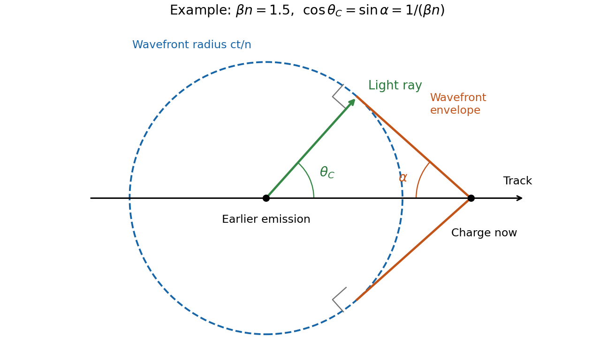

<h1 id="2/c/solution">Solution</h1>

↑ **Parent:** [C](../c.md)

A charge moving uniformly through a transparent dielectric can emit [Cherenkov radiation](../../../../cherenkov-radiation.md) if its speed exceeds the [phase velocity](../../../../phase-velocity.md) of light in that medium:

$$
\boxed{v>\frac{c}{n(\omega)},\qquad \beta n(\omega)>1,\quad\beta=\frac vc.}
$$

It need not exceed the vacuum speed $c$. The passing charge polarizes the medium; the induced response produces radiation that adds coherently along selected directions. Equivalently, [phase](../../../../phase-waves.md) matching along the trajectory requires $\mathbf k\cdot\mathbf v=\omega$. Since $|\mathbf k|=n(\omega)\omega/c$,

$$
\boxed{\cos\theta_C=\frac{1}{\beta n(\omega)}}.
$$

Here $\theta_C$ is the angle of the emitted light rays to the forward particle [velocity](../../../../velocity.md): the rays form a cone around the track. With [dispersion](../../../../wave-dispersion.md), both the threshold and cone angle depend on [frequency](../../../../frequency.md); only transparent [frequency](../../../../frequency.md) bands satisfying the threshold contribute escaping radiation.

**[Figure 3](#2/c/image-wavefront-envelope-and-photon-direction-for-cherenkov-radiation). Wavefront envelope and photon direction for Cherenkov radiation**.

In the wavefront construction, a disturbance emitted a time $t$ earlier has radius $ct/n$, while the particle has moved $vt$. Tangents from the present particle position to these wavefronts make a backward-opening wavefront cone of half-angle $\alpha$, where $\sin\alpha=1/(\beta n)$. The light rays are normal to this cone. Consequently $\alpha+\theta_C=\pi/2$: the [Cherenkov photon-cone and wavefront-cone angles](../../../../cherenkov-photon-cone-and-wavefront-cone-angles.md) are complementary, rather than identical.

## ↑ Ancestors (13)

1. [C](../c.md)
2. [2](../../2.md)
3. [2017](../../../2017-split.md)
4. [Past exam of the optics and electrodynamics course of the University of Cambridge](../../../split.md)
5. [Optics and Electrodynamics course of the University of Cambridge](../../../../optics-and-electrodynamics-course-of-the-university-of-cambridge.md)
6. [Physics course of the year 3 of the natural sciences course of the University of Cambridge](../../../../physics-course-of-the-year-3-of-the-natural-sciences-course-of-the-university-of-cambridge.md)
7. [Year 3 of the natural sciences course of the University of Cambridge](../../../../year-3-of-the-natural-sciences-course-of-the-university-of-cambridge.md)
8. [Year of the natural sciences course of the University of Cambridge](../../../../year-of-the-natural-sciences-course-of-the-university-of-cambridge.md)
9. [Natural sciences course of the University of Cambridge](../../../../natural-sciences-course-of-the-university-of-cambridge.md)
10. [Course of the University of Cambridge](../../../../course-of-the-university-of-cambridge.md)
11. [University of Cambridge](../../../../university-of-cambridge-split.md)
12. [List of universities](../../../../list-of-universities.md)
13. [Codex Wiki](../../../../split.md)
