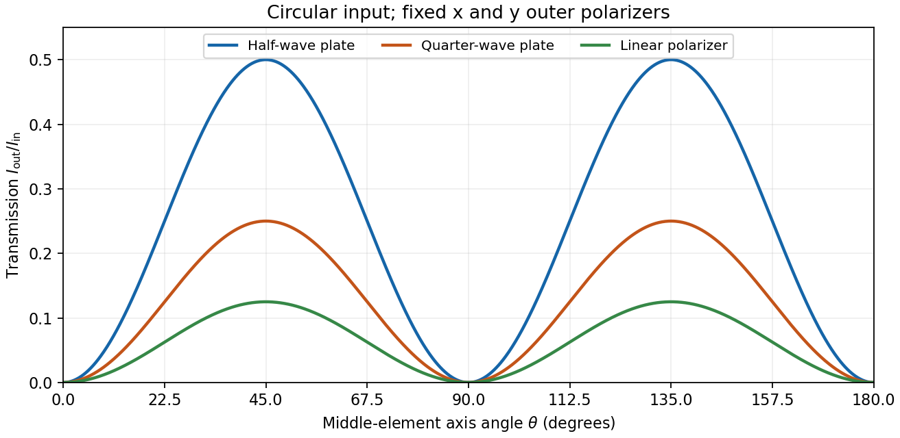

<h1 id="3/solution">Solution</h1>

↑ **Parent:** [3](../3.md)

**General pure state.** Use time dependence $e^{i(kz-\omega t)}$. The most general nonzero [Jones vector](../../../jones-vector.md) can be written

$$
\mathbf J=Ae^{i\chi}\begin{pmatrix}\cos\alpha\\e^{i\delta}\sin\alpha\end{pmatrix},\qquad A>0,\quad0\leq\alpha\leq\frac\pi2,\quad0\leq\delta<2\pi.
$$

There are four real parameters in the full complex field. Removing overall [intensity](../../../intensity-physics.md) $A^2$ and the unobservable common [phase](../../../phase-waves.md) $\chi$ leaves **two real degrees of freedom for [pure polarization](../../../pure-polarization.md)**, $\alpha$ and $\delta$. Their endpoint degeneracies simply reflect the fact that the [phase](../../../phase-waves.md) of a vanishing component is irrelevant. A single [Jones vector](../../../jones-vector.md) cannot represent partially polarized light.

**Three linear [polarizers](../../../polarizer.md).** Define the transmission axis $\mathbf a_\theta=(\cos\theta,\sin\theta)^T$. An ideal linear [polarizer](../../../polarizer.md) has [Jones matrix](../../../jones-matrix.md) $P_\theta=\mathbf a_\theta\mathbf a_\theta^T$. For definiteness label $(1,-i)^T/\sqrt2$ as right-circular in the chosen convention; reversing the handedness convention changes no [intensity](../../../intensity-physics.md) below. The first [polarizer](../../../polarizer.md) produces $(1,0)^T/\sqrt2$. The intermediate [polarizer](../../../polarizer.md) and final $y$ analyzer then give

$$
\mathbf J_{\rm out}=P_{\pi/2}P_\theta P_0\mathbf J_R=\frac{\sin\theta\cos\theta}{\sqrt2}\begin{pmatrix}0\\1\end{pmatrix},
$$

so [Malus's law](../../../malus-s-law.md) gives

$$
\boxed{\frac{I_{\rm out}}{I_{\rm in}}=\frac18\sin^2(2\theta).}
$$

The maximum is $1/8$ at $\theta=\pi/4+m\pi/2$, and the transmission vanishes at $\theta=m\pi/2$. The first [polarizer](../../../polarizer.md) accounts for an initial factor $1/2$; retaining that factor is essential when quoting transmission relative to the incident circularly polarized beam.

**[Waveplate](../../../waveplate.md) and quarter-wave matrix.** A lossless [waveplate](../../../waveplate.md) has [linear birefringence](../../../linear-birefringence.md): its orthogonal fast and slow axes have indices $n_f<n_s$. A thickness $L$ produces slow-minus-fast [phase retardation](../../../phase-retardation.md)

$$
\delta=\frac{2\pi L}{\lambda_0}(n_s-n_f).
$$

Resolving the incident [Jones vector](../../../jones-vector.md) into the plate axes, advancing the two phases and transforming back gives, up to a common [phase](../../../phase-waves.md),

$$
J_\delta(\theta)=R(-\theta)\begin{pmatrix}1&0\\0&e^{i\delta}\end{pmatrix}R(\theta).
$$

A [quarter-wave plate](../../../quarter-wave-plate.md) has $\delta=\pi/2$ modulo $2\pi$. With $c_\theta=\cos\theta$ and $s_\theta=\sin\theta$, its [Jones matrix](../../../jones-matrix.md) is therefore

$$
\boxed{Q(\theta)=\begin{pmatrix}c_\theta^2+i s_\theta^2&(1-i)c_\theta s_\theta\\(1-i)c_\theta s_\theta&s_\theta^2+i c_\theta^2\end{pmatrix}.}
$$

In particular $Q(0)=\operatorname{diag}(1,i)$. Equal incident components along the two axes acquire a relative quarter-cycle [phase](../../../phase-waves.md), converting $45^\circ$ [linear polarization](../../../linear-polarization.md) to [circular polarization](../../../circular-polarization.md); an incident component along either principal axis stays linearly polarized.

**Half-wave replacement.** A [half-wave plate](../../../half-wave-plate.md) has $\delta=\pi$ and hence

$$
H(\theta)=\begin{pmatrix}\cos2\theta&\sin2\theta\\\sin2\theta&-\cos2\theta\end{pmatrix}.
$$

It converts the $x$-polarized output of the first [polarizer](../../../polarizer.md) to a linear state at angle $2\theta$. The final $y$ analyzer gives

$$
\boxed{\frac{I_{\rm out}}{I_{\rm in}}=\frac12\sin^2(2\theta).}
$$

The maximum is $1/2$, because the ideal [half-wave plate](../../../half-wave-plate.md) loses no light after the first [polarizer](../../../polarizer.md).

**Quarter-wave replacement.** The transmitted $y$ amplitude is $(1-i)c_\theta s_\theta/\sqrt2$, giving

$$
\boxed{\frac{I_{\rm out}}{I_{\rm in}}=\frac14\sin^2(2\theta).}
$$

More generally, the retarder gives $I_{\rm out}/I_{\rm in}=\tfrac12\sin^2(\delta/2)\sin^2(2\theta)$. All three requested curves have the same zeros and angular period, but different heights:

**[Figure 4](#3/image-transmission-through-crossed-outer-polarizers-with-three-different-middle-elements). Transmission through crossed outer polarizers with three different middle elements**.

**Preparing an arbitrary ellipse.** Yes: two rotatable [quarter-wave plates](../../../quarter-wave-plate.md) already suffice. Let the input left-circular state be $\mathbf J_L=(1,i)^T/\sqrt2$. Up to an overall [phase](../../../phase-waves.md), any target [pure polarization](../../../pure-polarization.md) can be parameterized by its [polarization ellipse](../../../polarization-ellipse.md):

$$
\mathbf J_{\rm target}=R(-\beta)\begin{pmatrix}\cos\eta\\i\sin\eta\end{pmatrix},\qquad-\frac\pi4\leq\eta\leq\frac\pi4.
$$

Here $\beta$ is the major-axis orientation, and $\eta$ sets the signed minor-to-major semiaxis ratio $\tan\eta$. First note directly from $Q(\theta)$ that

$$
Q(\theta)\mathbf J_L\ \propto\ \begin{pmatrix}\cos(\theta-\pi/4)\\\sin(\theta-\pi/4)\end{pmatrix}.
$$

Choose the two fast-axis angles as

$$
\boxed{\theta_1=\beta+\eta+\frac\pi4,\qquad\theta_2=\beta.}
$$

The first [quarter-wave plate](../../../quarter-wave-plate.md) produces linear light at $\beta+\eta$. In the axes of the second, its components are $(\cos\eta,\sin\eta)$; the second gives precisely $\mathbf J_{\rm target}$. This proves [pure-polarization preparation with two quarter-wave plates](../../../pure-polarization-preparation-with-two-quarter-wave-plates.md), including the linear and circular limiting cases. A [half-wave plate](../../../half-wave-plate.md) can also rotate the axes, but is not required. The phrase about left-handed input is understood as left-circular light in this construction; the explicit vector fixes the convention.

**Switchable retardation.** The [electro-optic Kerr effect](../../../electro-optic-kerr-effect.md) induces [linear birefringence](../../../linear-birefringence.md) quadratic in a static transverse [electric field](../../../electric-field-split.md). Defining the coefficient $K$ by $\Delta n=\lambda_0 K E_{\rm dc}^2$, its [phase retardation](../../../phase-retardation.md) is

$$
\delta_K=\frac{2\pi L\Delta n}{\lambda_0}=2\pi KLE_{\rm dc}^2.
$$

The two eigenpolarizations are linear, parallel and perpendicular to the applied field. Thus an appropriate field produces a switchable [quarter-wave plate](../../../quarter-wave-plate.md):

$$
\boxed{E_{\rm dc}^2=\frac{1}{4|K|L}\quad\text{for the smallest }|\delta_K|=\pi/2.}
$$

The sign of $K$ determines which axis is fast. Switching the field off removes the induced retardation, assuming no residual birefringence.

The [Faraday effect](../../../faraday-effect.md) instead gives [circular birefringence](../../../circular-birefringence.md) for a longitudinal [magnetic field](../../../magnetic-field-split.md). The two circular eigenmodes acquire different phases, rotating a [linear polarization](../../../linear-polarization.md) through

$$
\theta_F=VBL=\frac{\pi L}{\lambda_0}(n_+-n_-),
$$

with sign set by the handedness convention and the [Verdet constant](../../../verdet-constant.md) $V$. Its [Jones matrix](../../../jones-matrix.md) in the linear basis is a real rotation, up to a common [phase](../../../phase-waves.md). It preserves the ellipticity of a pure state, so a linear input remains linear. A $\pi/2$ [phase](../../../phase-waves.md) difference between circular eigenmodes rotates a linear state by $\pi/4$; it does not make it circular. **The Kerr device supplies the switchable [quarter-wave plate](../../../quarter-wave-plate.md); a Faraday rotator alone does not.**

## ↑ Ancestors (12)

1. [3](../3.md)
2. [2017](../../2017-split.md)
3. [Past exam of the optics and electrodynamics course of the University of Cambridge](../../split.md)
4. [Optics and Electrodynamics course of the University of Cambridge](../../../optics-and-electrodynamics-course-of-the-university-of-cambridge.md)
5. [Physics course of the year 3 of the natural sciences course of the University of Cambridge](../../../physics-course-of-the-year-3-of-the-natural-sciences-course-of-the-university-of-cambridge.md)
6. [Year 3 of the natural sciences course of the University of Cambridge](../../../year-3-of-the-natural-sciences-course-of-the-university-of-cambridge.md)
7. [Year of the natural sciences course of the University of Cambridge](../../../year-of-the-natural-sciences-course-of-the-university-of-cambridge.md)
8. [Natural sciences course of the University of Cambridge](../../../natural-sciences-course-of-the-university-of-cambridge.md)
9. [Course of the University of Cambridge](../../../course-of-the-university-of-cambridge.md)
10. [University of Cambridge](../../../university-of-cambridge-split.md)
11. [List of universities](../../../list-of-universities.md)
12. [Codex Wiki](../../../split.md)
