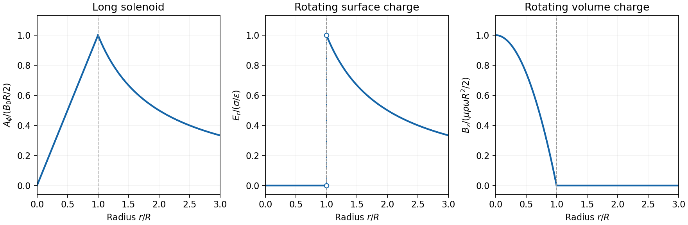

<h1 id="4/solution">Solution</h1>

↑ **Parent:** [4](../4.md)

**Gauge freedom.** The [magnetic vector potential](../../../magnetic-vector-potential.md) satisfies $\mathbf B=\nabla\times\mathbf A$. The transformation

$$
\boxed{\mathbf A\mapsto\mathbf A+\nabla\chi}
$$

leaves $\mathbf B$ unchanged because the [curl](../../../curl.md) of a [gradient](../../../gradient.md) is zero. For time-dependent fields, transform the electric scalar potential as $\phi\mapsto\phi-\partial_t\chi$ as well, so that $\mathbf E=-\nabla\phi-\partial_t\mathbf A$ is unchanged. The scalar $\chi$ must have the regularity and single-valuedness appropriate to the physical region and its boundary conditions. Local values of $\mathbf A$ therefore depend on the [gauge transformation](../../../gauge-transformation.md).

**Gauge and nonzero component.** In the standard axisymmetric [Coulomb gauge](../../../coulomb-gauge.md) representative for the [long-solenoid approximation](../../../long-solenoid-approximation.md),

$$
\boxed{\nabla\cdot\mathbf A=0,\qquad A_r=A_z=0,\qquad\mathbf A=A_\phi(r)\hat{\boldsymbol\phi}.}
$$

The divergence vanishes since $A_\phi$ is independent of the azimuth. Inside, this agrees with the usual [symmetric gauge](../../../symmetric-gauge.md) representative $\mathbf A=\tfrac12\mathbf B\times\mathbf r$. The [Coulomb gauge](../../../coulomb-gauge.md) condition alone does not force the other two components to vanish; the symmetry, regularity and customary boundary choice select this representative from the remaining gauge freedom.

**Radial dependence.** Write the interior [magnetic field](../../../magnetic-field-split.md) as $B_0\hat{\mathbf z}$, where $B_0=\mu_0nI$ for a vacuum [solenoid](../../../solenoid.md) of [solenoid turn density](../../../solenoid-turn-density.md) $n$. Its exterior [magnetic field](../../../magnetic-field-split.md) vanishes in the infinitely long idealization. Applying [Stokes theorem](../../../stokes-theorem.md) to a coaxial circle gives $2\pi rA_\phi(r)=\Phi(r)$. Therefore the [Coulomb-gauge vector potential of a long solenoid](../../../coulomb-gauge-vector-potential-of-a-long-solenoid.md) is

$$
\boxed{A_\phi(r)=\begin{cases}B_0r/2,&r<R,\\B_0R^2/(2r),&r>R.\end{cases}}
$$

It grows linearly inside, is continuous at $R$, and decays as $r^{-1}$ outside. Although its exterior [curl](../../../curl.md) is zero, its circulation is the enclosed [magnetic flux](../../../magnetic-flux.md) $\Phi=B_0\pi R^2$. No regular single-valued gauge function removes it throughout the exterior while preserving this circulation.

**[Electric field](../../../electric-field-split.md) of the rotating charged surface.** For clarity retain absolute [permittivity](../../../permittivity-split.md) $\epsilon$ and permeability $\mu$ in the cylinder formulae; setting them to unity gives the rationalized-unit convention in the question. If the stated unity means relative material constants in SI, use $\epsilon_0,\mu_0$ instead. Assume prescribed charge densities in the laboratory frame and the nonrelativistic, steady-rotation model.

The axisymmetric surface charge is stationary as a distribution even while the material rotates. A Gaussian cylinder of length $L$ has enclosed charge zero for $r<R$ and $2\pi RL\sigma$ for $r>R$. [Gauss's law](../../../gauss-s-law.md) therefore gives

$$
\boxed{\mathbf E(r)=\begin{cases}0,&r<R,\\\dfrac{\sigma R}{\epsilon r}\hat{\mathbf r},&r>R.\end{cases}}
$$

The radial [electric field](../../../electric-field-split.md) jumps from zero to $\sigma/\epsilon$ at the surface and then decays as $r^{-1}$. Its direction reverses for negative $\sigma$. The [angular velocity](../../../angular-velocity.md) does not enter this electric-field result for a specified surface charge.

**[Magnetic field](../../../magnetic-field-split.md) of the volume-charged cylinder.** A shell of radius $a$ and thickness $da$ has surface charge $\rho\,da$, azimuthal surface current $dK_\phi=\rho\omega a\,da$, and the field of an infinite [solenoid](../../../solenoid.md): $dB_z=\mu\rho\omega a\,da$ inside that shell and zero outside it. At radius $r<R$, only shells with $a>r$ contribute. Thus the [magnetic field of a rotating charged solid cylinder](../../../magnetic-field-of-a-rotating-charged-solid-cylinder.md) is

$$
\boxed{\mathbf B(r)=\mu\rho\omega\int_r^R a\,da\,\hat{\mathbf z}=\frac{\mu\rho\omega}{2}(R^2-r^2)\hat{\mathbf z},\qquad r<R.}
$$

With no applied background [magnetic field](../../../magnetic-field-split.md), $\mathbf B=0$ outside. The profile is parabolic, largest on the axis and zero at the boundary. The sign follows $\rho\omega$. As a check, the [current density](../../../current-density.md) is $J_\phi=\rho\omega r$, and [Ampère's circuital law](../../../ampere-s-circuital-law.md) gives $-dB_z/dr=\mu J_\phi$, as required.

**[Figure 5](#4/image-radial-profiles-of-the-solenoid-vector-potential-and-the-two-charged-cylinder-fields). Radial profiles of the solenoid vector potential and the two charged-cylinder fields**.

**[Electron](../../../electron.md) impulse when the current is switched off.** Choose positive $I$ so the initial [magnetic flux](../../../magnetic-flux.md) is $\Phi_i=\mu_0nI\pi R^2$ along $+z$. [Faraday's law of induction](../../../faraday-s-law-of-induction.md) gives, outside the [solenoid](../../../solenoid.md),

$$
E_\phi(d,t)=-\frac{1}{2\pi d}\frac{d\Phi}{dt}.
$$

For an [electron](../../../electron.md) of [electric charge](../../../electric-charge-split.md) $q=-e$, treat its position as fixed while the short pulse acts. The [inductive impulse outside a switched solenoid](../../../inductive-impulse-outside-a-switched-solenoid.md) is

$$
\Delta\mathbf p=-\frac{q}{2\pi d}(\Phi_f-\Phi_i)\hat{\boldsymbol\phi}=-\frac{e\Phi_i}{2\pi d}\hat{\boldsymbol\phi}.
$$

Consequently the nonrelativistic final [velocity](../../../velocity.md) is

$$
\boxed{\mathbf v_f=-\frac{e\mu_0nIR^2}{2m_ed}\hat{\boldsymbol\phi}.}
$$

The induced [electric field](../../../electric-field-split.md) circulates in the positive azimuthal direction while a positive flux decreases, so the [electron](../../../electron.md) accelerates in the negative direction. Once the pulse has passed, there is no exterior field and it travels along the tangent at the impulse point, rather than continuing in a circular orbit. If the resulting [momentum](../../../momentum-split.md) is relativistic, use $\mathbf v_f=c\mathbf p_f/\sqrt{m_e^2c^2+|\mathbf p_f|^2}$ instead. The sudden-switch result assumes negligible displacement during the pulse and the usual quasistatic [electromagnetic induction](../../../electromagnetic-induction.md) approximation; “instantaneous” switching does not mean instantaneous propagation of fields to arbitrary distance.

One can check the sign using conserved canonical angular [momentum](../../../momentum-split.md): axial symmetry conserves $p_\phi^{\rm can}=L_z+qrA_\phi$. Initially $L_z=0$, and finally $A_\phi=0$, so $L_z=q\Phi_i/(2\pi)=-e\Phi_i/(2\pi)$.

**Interferometric measurement at constant current.** Use a coherent [electron](../../../electron.md) beam split into two paths passing on opposite sides of a shielded long [solenoid](../../../solenoid.md), then recombine them to form [interference fringes](../../../interference-fringe.md). Keep the current constant during the passage and suppress leakage fields on the paths. In the [Aharonov-Bohm effect](../../../aharonov-bohm-effect.md), the [phase](../../../phase-waves.md) difference due to the [magnetic vector potential](../../../magnetic-vector-potential.md) is the closed-loop integral

$$
\boxed{\Delta\varphi=\frac{q}{\hbar}\oint\mathbf A\cdot d\mathbf l=\frac{q\Phi}{\hbar}=-\frac{e\mu_0n\pi R^2}{\hbar}I\pmod{2\pi}.}
$$

The overall sign reverses if the path orientation is reversed. The displacement in fringe periods is $\Delta\varphi/(2\pi)$, so the measured fringe shift is linear in $I$ and repeats when

$$
\boxed{\Delta I=\frac{h}{e\mu_0n\pi R^2}.}
$$

A [gauge transformation](../../../gauge-transformation.md) adds a gradient whose closed-loop integral vanishes for a single-valued $\chi$. Endpoint changes in [electron](../../../electron.md) wavefunction [phase](../../../phase-waves.md) cancel in the interference measurement. The measured [Aharonov-Bohm phase](../../../aharonov-bohm-effect.md) is therefore gauge invariant: it determines the flux, or equivalently the circulation of $\mathbf A$. In the chosen [Coulomb gauge](../../../coulomb-gauge.md) this implies $A_\phi(d)=\mu_0nIR^2/(2d)$, but **the experiment does not select or measure a unique local vector potential independently of gauge**.

**Far field of the rotating sphere.** Interpret uniform charge as uniform volume charge of total $Q$, and take $\boldsymbol\omega=\omega\hat{\mathbf z}$. The [magnetic dipole moment of a rigidly rotating charge distribution](../../../magnetic-dipole-moment-of-a-rigidly-rotating-charge-distribution.md) is

$$
\mathbf m=\frac12\int\mathbf r\times\mathbf J\,d^3r,\qquad \mathbf J=\rho\boldsymbol\omega\times\mathbf r.
$$

Its axial component is $m_z=(\rho\omega/2)\int r_\perp^2d^3r$. For a solid sphere, $\int r_\perp^2d^3r=8\pi R^5/15$ and $\rho=3Q/(4\pi R^3)$, so

$$
\boxed{\mathbf m=\frac{QR^2}{5}\boldsymbol\omega.}
$$

The [magnetic field of a rotating charged spherical body](../../../magnetic-field-of-a-rotating-charged-spherical-body.md) is a static [magnetic dipole field](../../../magnetic-dipole-field.md) at large distances:

$$
\boxed{\mathbf B(\mathbf r)=\frac{\mu_0}{4\pi r^3}\bigl[3(\mathbf m\cdot\hat{\mathbf r})\hat{\mathbf r}-\mathbf m\bigr],\qquad r\gg R.}
$$

In particular, $|\mathbf B|=\mu_0|\mathbf m|\sqrt{1+3\cos^2\vartheta}/(4\pi r^3)$. Both the angular mean of the magnitude and its [root mean square](../../../root-mean-square.md) therefore scale as $\boxed{r^{-3}}$; the latter is $B_{\rm rms}=\sqrt2\mu_0|\mathbf m|/(4\pi r^3)$. The angular average of the _vector_ is zero, which is different from average strength. Steady rotation leaves the charge and current distributions stationary, so this is [magnetostatics](../../../magnetostatics.md), not a radiative $r^{-1}$ field. If uniform charge instead means a thin spherical surface, replace the dipole moment by $QR^2\boldsymbol\omega/3$; the angular pattern and $r^{-3}$ scaling are unchanged.

## ↑ Ancestors (12)

1. [4](../4.md)
2. [2017](../../2017-split.md)
3. [Past exam of the optics and electrodynamics course of the University of Cambridge](../../split.md)
4. [Optics and Electrodynamics course of the University of Cambridge](../../../optics-and-electrodynamics-course-of-the-university-of-cambridge.md)
5. [Physics course of the year 3 of the natural sciences course of the University of Cambridge](../../../physics-course-of-the-year-3-of-the-natural-sciences-course-of-the-university-of-cambridge.md)
6. [Year 3 of the natural sciences course of the University of Cambridge](../../../year-3-of-the-natural-sciences-course-of-the-university-of-cambridge.md)
7. [Year of the natural sciences course of the University of Cambridge](../../../year-of-the-natural-sciences-course-of-the-university-of-cambridge.md)
8. [Natural sciences course of the University of Cambridge](../../../natural-sciences-course-of-the-university-of-cambridge.md)
9. [Course of the University of Cambridge](../../../course-of-the-university-of-cambridge.md)
10. [University of Cambridge](../../../university-of-cambridge-split.md)
11. [List of universities](../../../list-of-universities.md)
12. [Codex Wiki](../../../split.md)
