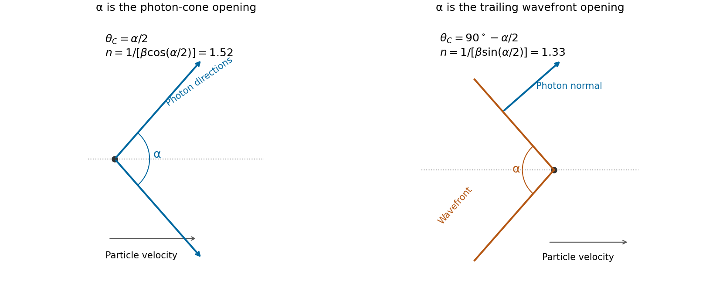
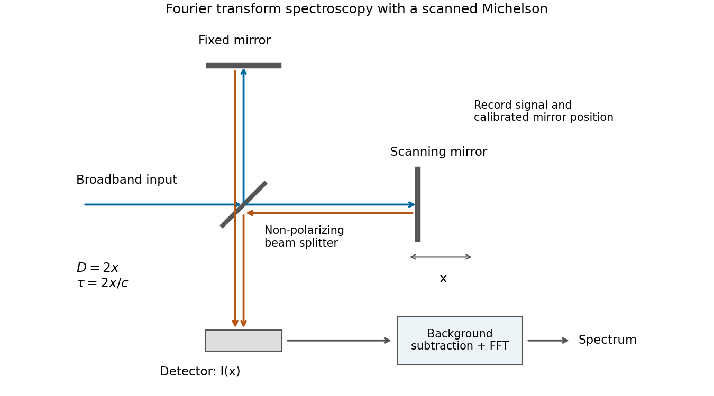
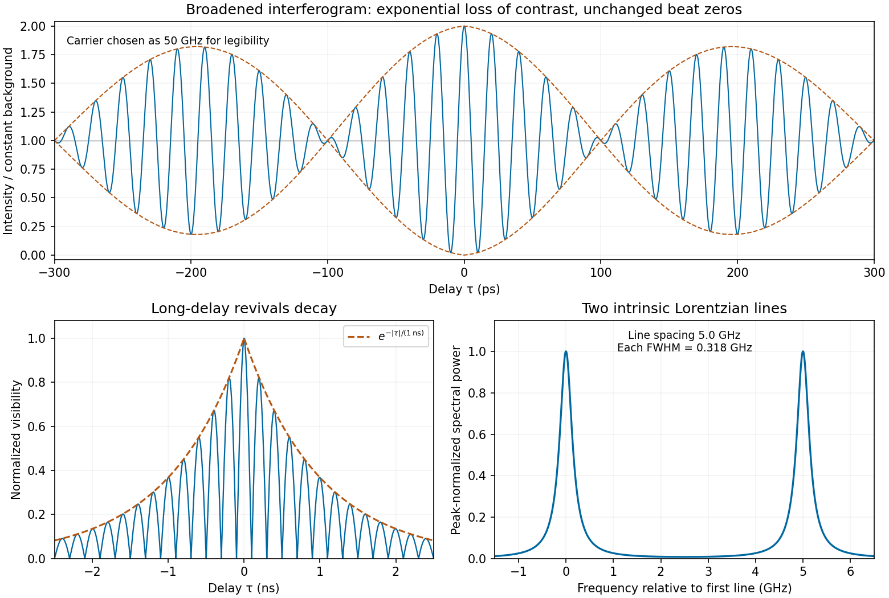
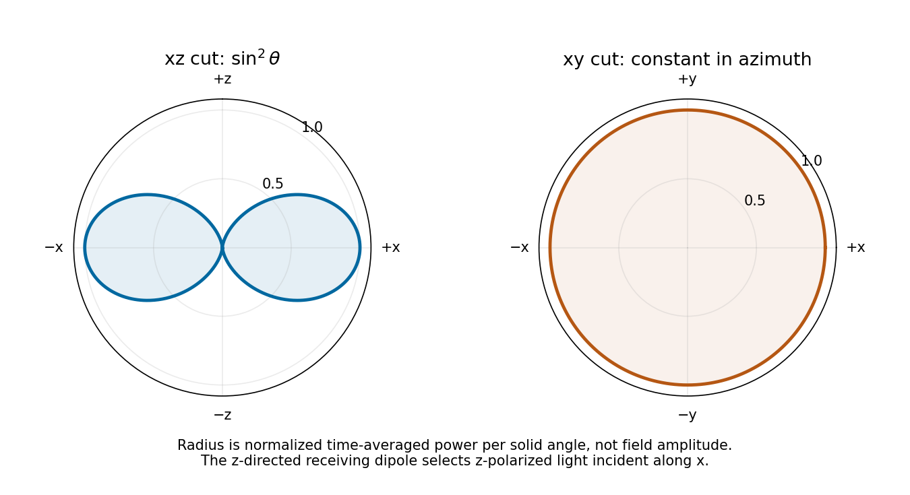

# 2018

↑ **Parent:** [Past exam of the optics and electrodynamics course of the University of Cambridge](../past-exam-of-the-optics-and-electrodynamics-course-of-the-university-of-cambridge.md)

[Original paper, released PDF pages 316–320](https://www.whatdotheyknow.com/request/natural_science_tripos_physics_e/response/2127325/attach/3/FOI%202022%20639%20Sullivan%20materials.pdf?cookie_passthrough=1#page=316)

The supplied PDF is marked as a draft dated 17 May 2018. These solutions follow all five pages of that document.

**Table of contents**

- [1](#1)
  - [a](#1/a)
    - [Solution](#1/a/solution)
  - [b](#1/b)
    - [Solution](#1/b/solution)
  - [c](#1/c)
    - [Solution](#1/c/solution)
- [Section B](#section-b)
  - [B2](#section-b/b2)
    - [Solution](#section-b/b2/solution)
      - [Spectrometer and resolution](#section-b/b2/spectrometer-and-resolution)
      - [Polarization-dependent visibility](#section-b/b2/polarization-dependent-visibility)
      - [Two-line frequency separation](#section-b/b2/two-line-frequency-separation)
      - [Pressure-broadened lines and interferogram](#section-b/b2/pressure-broadened-lines-and-interferogram)
      - [Equally spaced spectral components](#section-b/b2/equally-spaced-spectral-components)
  - [B3](#section-b/b3)
    - [Solution](#section-b/b3/solution)
      - [Oscillating current](#section-b/b3/oscillating-current)
      - [Vanishing field components](#section-b/b3/vanishing-field-components)
      - [Retarded vector potential](#section-b/b3/retarded-vector-potential)
      - [Radiation cuts and receiving polarization](#section-b/b3/radiation-cuts-and-receiving-polarization)
      - [Gain and effective collecting area](#section-b/b3/gain-and-effective-collecting-area)
      - [Power delivered to the second dipole](#section-b/b3/power-delivered-to-the-second-dipole)
      - [Returned pulse power](#section-b/b3/returned-pulse-power)
  - [B4](#section-b/b4)
    - [Solution](#section-b/b4/solution)
      - [Four-vectors and experimental charge invariance](#section-b/b4/four-vectors-and-experimental-charge-invariance)
      - [Charge density and four-current](#section-b/b4/charge-density-and-four-current)
      - [Magnetic force between neutral wires](#section-b/b4/magnetic-force-between-neutral-wires)
      - [Electrostatic calculation for parallel currents](#section-b/b4/electrostatic-calculation-for-parallel-currents)
      - [Opposite currents](#section-b/b4/opposite-currents)

## 1

↑ **Parent:** [2018](2018.md)

<h3 id="1/a">a</h3>

↑ **Parent:** [1](#1)

<h4 id="1/a/solution">Solution</h4>

↑ **Parent:** [A](#1/a)

The [London penetration depth](../magnetic-field.md#london-penetration-depth) measures the density-to-mass ratio of carriers participating in superconducting screening. With electron-counted density $n_s$ and the stipulated bare [electron mass](../physics.md#electron-mass) $m_e$,

$$
\lambda_L^2=\frac{m_e}{\mu_0n_se^2},\qquad
n_s=\frac{m_e}{\mu_0e^2\lambda_L^2}.
$$

Using $m_e=9.109\times10^{-31}\,\mathrm{kg}$, $e=1.602\times10^{-19}\,\mathrm C$, $\mu_0\simeq4\pi\times10^{-7}\,\mathrm{H\,m^{-1}}$ and $\lambda_L=22\times10^{-9}\,\mathrm m$ gives

$$
\boxed{n_s\simeq5.8\times10^{28}\,\mathrm{m^{-3}}.}
$$

This is the requested conduction-electron density within the assumed local [London equation](../magnetic-field.md#london-equations) model. More precisely, it is the [superconducting carrier density from London screening](../magnetic-field.md#superconducting-carrier-density-from-london-screening); identifying it with all conduction [electrons](../physics.md#electron) assumes that they participate in screening at the measurement [temperature](../temperature.md). No temperature-dependent normal-carrier fraction is supplied.

If the condensate is instead counted as [Cooper pairs](../fermi-liquid.md#cooper-pair), the pair mass is $2m_e$ and charge magnitude is $2e$, giving pair density $n_{\rm pair}=n_s/2\simeq2.9\times10^{28}\,\mathrm{m^{-3}}$. Keeping [electron](../physics.md#electron) and pair counting consistent avoids a spurious factor of two.

<h3 id="1/b">b</h3>

↑ **Parent:** [1](#1)

<h4 id="1/b/solution">Solution</h4>

↑ **Parent:** [B](#1/b)

At [normal incidence](../optics.md#normal-incidence), continuity of tangential [wave phase](../wave.md#phase-waves) makes both internal [wavevectors](../elasticity-physics.md#wavevector) normal to the parallel faces. For the [ordinary wave](../maxwell-equations.md#ordinary-wave) in a [uniaxial optical medium](../maxwell-equations.md#uniaxial-optical-medium), the [electric field](../electric-field.md) is an eigenpolarization of the [permittivity tensor](../permittivity.md#permittivity-tensor), so $\mathbf D\parallel\mathbf E$. Thus

$$
\boxed{\alpha_o=0.}
$$

Its [energy](../energy.md) path is also normal to the faces. The [extraordinary wave](../maxwell-equations.md#extraordinary-wave) differs because $\mathbf D\perp\mathbf k$ but $\mathbf E$ need not be perpendicular to $\mathbf k$. In a nonmagnetic crystal, $\mathbf H\parallel\mathbf B$ and $\mathbf S=\mathbf E\times\mathbf H$ is perpendicular to $\mathbf E$. The vectors $\mathbf D,\mathbf E,\mathbf k,\mathbf S$ lie in the same meridional plane, with $\mathbf D\perp\mathbf k$ and $\mathbf E\perp\mathbf S$. Therefore the [electric-displacement angle from birefringent walk-off](../maxwell-equations.md#electric-displacement-angle-from-birefringent-walk-off) equals the angular separation between $\mathbf S$ and $\mathbf k$.

The observed lateral separation is accumulated over thickness $L$, so $\Delta=L\tan\alpha_e$. With $L=10\,\mathrm{mm}$ and $\Delta=0.1\,\mathrm{mm}$,

$$
\boxed{\alpha_e=\arctan(0.1/10)=\arctan(0.010)\simeq0.0100\,\mathrm{rad}=0.573^\circ.}
$$

The two emergent rays are parallel because their outgoing wavevectors are both normal to the faces in air; their internal [energy](../energy.md) paths can nevertheless be displaced by [birefringent walk-off](../maxwell-equations.md#birefringent-walk-off). The angle quoted is the positive angle between the field vectors, so the unspecified lateral direction does not affect its value. The [unpolarized light](../wave.md#unpolarized-light) excites both eigenpolarizations; it does not require their [energy](../energy.md) paths to coincide.

<h3 id="1/c">c</h3>

↑ **Parent:** [1](#1)

<h4 id="1/c/solution">Solution</h4>

↑ **Parent:** [C](#1/c)

First obtain the particle speed from kinetic [energy](../energy.md) rather than treating $1\,\mathrm{GeV}$ as its total [energy](../energy.md). With [electron](../physics.md#electron) rest [energy](../energy.md) $m_ec^2=0.510999\,\mathrm{MeV}$,

$$
\gamma=1+\frac{1000\,\mathrm{MeV}}{0.510999\,\mathrm{MeV}}\simeq1957.95,\qquad
\beta=\sqrt{1-\gamma^{-2}}\simeq0.999999870.
$$

For [Cherenkov radiation](../electromagnetic-wave.md#cherenkov-radiation), the photon propagation direction makes angle $\theta_C$ to the particle trajectory, with $\cos\theta_C=1/(n\beta)$. The speed correction is negligible at three significant digits, but the [Cherenkov photon-cone and wavefront-cone angles](../electromagnetic-wave.md#cherenkov-photon-cone-and-wavefront-cone-angles) must be distinguished.

If the given opening $\alpha$ is the full cone of photon directions, $\theta_C=\alpha/2=48.75^\circ$. The result is

$$
\boxed{n=\frac1{\beta\cos(\alpha/2)}=1.52\quad\text{(full photon-direction opening)}.}
$$

If instead $\alpha$ denotes the full opening of the conical wavefront, its half-angle is complementary to the photon direction: $\theta_C=90^\circ-\alpha/2=41.25^\circ$. That convention gives

$$
\boxed{n=\frac1{\beta\sin(\alpha/2)}=1.33\quad\text{(full wavefront opening)}.}
$$

The original PDF supplies no cone diagram or definition distinguishing these geometries. Thus the literal full photon-cone interpretation gives $1.52$, while $1.33$ follows from the wavefront interpretation. It would be incorrect to interchange sine and cosine without stating which cone is meant.

**[Figure 1](#1/c/image-photon-direction-and-wavefront-cone-openings-are-complementary-geometries-giving-different-interpretations-of-the-supplied-angle). Photon-direction and wavefront cone openings are complementary geometries, giving different interpretations of the supplied angle**.

## Section B

↑ **Parent:** [2018](2018.md)

<h3 id="section-b/b2">B2</h3>

↑ **Parent:** [Section B](#section-b)

<h4 id="section-b/b2/solution">Solution</h4>

↑ **Parent:** [B2](#section-b/b2)

The five tasks below concern a scanned [Michelson interferometer](../physical-optics.md#michelson-interferometer). The original dashed curves are labelled visibility in arbitrary units; divide them by their maximum to obtain normalized [interferometric visibility](../physical-optics.md#interferometric-visibility), which lies between zero and one.

<h5 id="section-b/b2/spectrometer-and-resolution">Spectrometer and resolution</h5>

↑ **Parent:** [Solution](#section-b/b2/solution)

A non-polarizing [beam splitter](../optical-instrument.md#beam-splitter) divides the incident spectrum into a fixed arm and an arm with a translating mirror. Recombining their returned fields gives a detector signal as a function of mirror position $x$. The round-trip [optical path difference](../physical-optics.md#optical-path-difference) is $D=2x$ relative to the equal-arm position, so the delay is $\tau=2x/c$ in air approximated as [vacuum](../physics.md#vacuum). Record both detector signal and calibrated position, subtract the constant background, and take a [Fourier transform](../fourier-transform.md) of the [interferogram](../physical-optics.md#interferogram).

**[Figure 2](#section-b/b2/image-scanning-michelson-spectrometer-mirror-position-sets-delay-and-a-fourier-transform-of-the-recorded-interferogram-recovers-the-spectrum). Scanning Michelson spectrometer: mirror position sets delay, and a Fourier transform of the recorded interferogram recovers the spectrum**.

For matched arm polarizations and balanced throughput, write the ideal signal as

$$
I(\tau)=I_{\rm dc}+C\int_0^\infty S(\omega)\cos(\omega\tau)\,d\omega,
$$

where $S(\omega)$ is the incident spectral [power](../energy.md#power) density and $C$ is a constant set by the [beam splitter](../optical-instrument.md#beam-splitter) and detector. This is the cosine-transform form of [Fourier transform spectroscopy](../optical-instrument.md#fourier-transform-spectroscopy), or equivalently the [Wiener-Khinchin theorem](../fourier-analysis.md#wiener-khinchin-theorem) applied to delayed self-interference.

The [delay-range resolution in Fourier transform spectroscopy](../optical-instrument.md#delay-range-resolution-in-fourier-transform-spectroscopy) follows because recording a finite delay range multiplies the correlation by a window. Its transform broadens each [spectral line](../stellar-astrophysics.md#spectral-line) by an instrumental width of order the reciprocal delay range. A mirror travel range $L$ creates a delay range of order $2L/c$, so

$$
\delta\nu\sim\frac{c}{2L},\qquad
\delta\lambda\simeq\frac{\lambda^2}{c}\delta\nu,
\qquad \boxed{\delta\lambda\propto\frac{\lambda^2}{L}.}
$$

At fixed [wavelength](../wave-equation.md#wavelength), absolute [wavelength](../wave-equation.md#wavelength) resolution therefore improves inversely with travel range. The numerical coefficient depends on whether $L$ is a one-sided or total travel, on the window or apodization, and on whether resolution means first zero, half width or another criterion. The proportionality is the requested convention-independent result. Position sampling must also be fine enough to sample the fastest fringe variation without aliasing.

<h5 id="section-b/b2/polarization-dependent-visibility">Polarization-dependent visibility</h5>

↑ **Parent:** [Solution](#section-b/b2/solution)

Let the two arms deliver intensities $I_1,I_2$ with unit [Jones vectors](../wave.md#jones-vector) $\mathbf e_1,\mathbf e_2$. For a perfectly coherent input, the recombined intensity under relative phase $\phi$ is

$$
I(\phi)=I_1+I_2+2\sqrt{I_1I_2}\operatorname{Re}[\mathbf e_1^\dagger\mathbf e_2e^{i\phi}].
$$

Consequently the [polarization overlap in interferometric visibility](../physical-optics.md#polarization-overlap-in-interferometric-visibility) is

$$
\mathcal V=\frac{I_{\max}-I_{\min}}{I_{\max}+I_{\min}}
=\frac{2\sqrt{I_1I_2}}{I_1+I_2}|\mathbf e_1^\dagger\mathbf e_2|.
$$

For equal returned intensities, two [linear polarizations](../electromagnetic-wave.md#linear-polarization) at angle $\theta$ have overlap $\cos\theta$ and therefore

$$
\boxed{\mathcal V_{\rm linear,linear}=|\cos\theta|.}
$$

Choose one linear direction as $\mathbf e_L=(1,0)^T$ and a [circular polarization](../electromagnetic-wave.md#circular-polarization) as $\mathbf e_C=(1,\pm i)^T/\sqrt2$. Their overlap has magnitude $1/\sqrt2$, giving

$$
\boxed{\mathcal V_{\rm linear,circular}=\frac1{\sqrt2}.}
$$

A non-polarizing [beam splitter](../optical-instrument.md#beam-splitter) does not by itself guarantee equal arm losses; if $I_1\ne I_2$, multiply either boxed polarization factor by $2\sqrt{I_1I_2}/(I_1+I_2)$. Perfect temporal coherence does not compensate for polarization or intensity imbalance.

<h5 id="section-b/b2/two-line-frequency-separation">Two-line frequency separation</h5>

↑ **Parent:** [Solution](#section-b/b2/solution)

For equal line intensities, the correlation is proportional to $e^{-i\omega_1\tau}+e^{-i\omega_2\tau}=2e^{-i\bar\omega\tau}\cos(\Delta\omega\tau/2)$. The [two-line coherence beating](../physical-optics.md#two-line-coherence-beating) envelope is therefore $|\cos(\Delta\omega\tau/2)|$.

In the original first plot, the first visibility zeros are at approximately $\tau=\pm100\,\mathrm{ps}$; the envelope revives at $0$ and about $\pm200\,\mathrm{ps}$. Hence

$$
\frac{|\Delta\omega|}{2}(100\times10^{-12}\,\mathrm s)=\frac\pi2,
\qquad \boxed{|\Delta\omega|\simeq3.14\times10^{10}\,\mathrm{rad\,s^{-1}},\quad |\Delta\nu|\simeq5.0\,\mathrm{GHz}.}
$$

Use the envelope recurrence or its nulls, not the much faster carrier fringes. The visibility zeros indicate equal component intensities in the ideal model; unequal intensities would leave a nonzero minimum. The arbitrary vertical normalization does not affect the inferred separation.

<h5 id="section-b/b2/pressure-broadened-lines-and-interferogram">Pressure-broadened lines and interferogram</h5>

↑ **Parent:** [Solution](#section-b/b2/solution)

Interpret the stated $\tau_1=1\,\mathrm{ns}$ as the coherence-decay time, or the mean interval between fully phase-randomizing collisions in the simple impact model of [pressure broadening](../stellar-astrophysics.md#pressure-broadening). Then each line has correlation $e^{-|\tau|/\tau_1}e^{-i\omega_j\tau}$. The [collisional phase relaxation and Lorentzian linewidth](../stellar-astrophysics.md#collisional-phase-relaxation-and-lorentzian-linewidth) transform gives

$$
L_j(\omega)=\frac1\pi\frac{1/\tau_1}{(\omega-\omega_j)^2+(1/\tau_1)^2},
\qquad \boxed{\Delta\omega_{\rm FWHM}=\frac2{\tau_1}=2.0\times10^9\,\mathrm{rad\,s^{-1}},\quad
\Delta\nu_{\rm FWHM}=\frac1{\pi\tau_1}=0.318\,\mathrm{GHz}.}
$$

The intrinsic spectrum is the sum of two such [Lorentzian line shapes](../stellar-astrophysics.md#lorentzian-line-shape), still centred $5.0\,\mathrm{GHz}$ apart. With equal weights and balanced arms, its normalized visibility is

$$
\boxed{\mathcal V(\tau)=e^{-|\tau|/\tau_1}|\cos(\Delta\omega\tau/2)|.}
$$

For the intensity normalization of the first source plot, the corresponding model [interferogram](../physical-optics.md#interferogram) is

$$
I(\tau)=4+4e^{-|\tau|/\tau_1}\cos(\Delta\omega\tau/2)\cos(\bar\omega\tau).
$$

The constant background remains $4$; only the oscillatory contrast decays. The beating zeros and recurrence spacing remain fixed, but successive visibility revivals shrink, reaching a factor $e^{-0.2}\simeq0.819$ at $|\tau|=200\,\mathrm{ps}$ and $e^{-1}$ at $1\,\mathrm{ns}$. Long-delay fringes disappear toward the background.

**[Figure 3](#section-b/b2/image-calculated-pressure-broadened-interferogram-decaying-visibility-revivals-and-lorentzian-doublet-for-a-one-nanosecond-coherence-time). Calculated pressure-broadened interferogram, decaying visibility revivals and Lorentzian doublet for a one-nanosecond coherence time**.

The sketch chooses a carrier [frequency](../wave.md#frequency) for legibility; the envelope and linewidth follow from the inferred spacing and specified coherence time. A finite experimental delay window additionally convolves these intrinsic Lorentzians with the instrumental line profile. If $\tau_1$ were instead a population lifetime, the lifetime-limited field decay rate would be $1/(2\tau_1)$ and the corresponding linewidth would be half the boxed value. The source does not define that time convention explicitly; pressure-collision coherence decay is the interpretation used here.

<h5 id="section-b/b2/equally-spaced-spectral-components">Equally spaced spectral components</h5>

↑ **Parent:** [Solution](#section-b/b2/solution)

For $N$ equal-intensity lines of spacing $\Delta\omega$, sum their correlations as a [geometric series](../sequence-and-series.md#geometric-series):

$$
\sum_{n=0}^{N-1}e^{-i(\omega_0+n\Delta\omega)\tau}
=e^{-i[\omega_0+(N-1)\Delta\omega/2]\tau}
\frac{\sin(N\Delta\omega\tau/2)}{\sin(\Delta\omega\tau/2)}.
$$

The [interferogram of an equally spaced spectral multiplet](../optical-instrument.md#interferogram-of-an-equally-spaced-spectral-multiplet) has normalized visibility

$$
\mathcal V_N(\tau)=\left|\frac{\sin(N\Delta\omega\tau/2)}{N\sin(\Delta\omega\tau/2)}\right|.
$$

In the second original plot, full revivals occur at approximately $\tau=0,\pm100,\pm200\,\mathrm{ps}$, so

$$
\boxed{\Delta\omega=\frac{2\pi}{100\,\mathrm{ps}}\simeq6.28\times10^{10}\,\mathrm{rad\,s^{-1}},\qquad\Delta\nu\simeq10.0\,\mathrm{GHz}.}
$$

Between $0$ and $100\,\mathrm{ps}$ there are three zeros, near $25$, $50$ and $75\,\mathrm{ps}$, and two small subsidiary lobes. Since the model has $N-1$ zeros between adjacent revivals,

$$
\boxed{N=4.}
$$

The peak envelope of about $8$ and the intensity background of about $8$ are consistent with four equal components in the source's normalization, but the internal zero count is the useful shape-based check. The inference assumes the equal spectral weights represented by the graph; revival spacing alone does not fix the number of lines, and arbitrary unequal or hidden components would require more spectral information. Delayed self-interference measures spectral powers, not the relative phases between different source frequencies, so these revivals alone do not prove that the source emits a phase-locked pulse train.

<h3 id="section-b/b3">B3</h3>

↑ **Parent:** [Section B](#section-b)

<h4 id="section-b/b3/solution">Solution</h4>

↑ **Parent:** [B3](#section-b/b3)

Use the ideal electrically short [Hertzian dipole](../electrical-engineering.md#hertzian-dipole), $d\ll\lambda$, with negligible ohmic loss. Far-field statements additionally require an observation distance large compared with the [wavelength](../wave-equation.md#wavelength) and source dimensions. These assumptions distinguish its radiation from near-field coupling and from scattering by a general extended antenna structure.

<h5 id="section-b/b3/oscillating-current">Oscillating current</h5>

↑ **Parent:** [Solution](#section-b/b3/solution)

Choose $p(t)=p_0\cos\omega t$ along $+z$. If the end charges are $\pm Q(t)$ separated by fixed distance $d$, then $p(t)=Q(t)d$. The conventional current into the positive end is $I=dQ/dt$, so

$$
\boxed{I(t)=\frac{\dot p(t)}d=-\frac{\omega p_0}{d}\sin\omega t,\qquad I_{\max}=\frac{\omega p_0}{d}.}
$$

The current is in [phase quadrature](../wave.md#phase-quadrature) with the dipole moment. A different time origin or current orientation changes the sine's sign or phase but not its amplitude. Units check: $[\omega p_0/d]=\mathrm{s^{-1}}\mathrm{C\,m}/\mathrm m=\mathrm A$.

<h5 id="section-b/b3/vanishing-field-components">Vanishing field components</h5>

↑ **Parent:** [Solution](#section-b/b3/solution)

For a dipole along $z$, axial symmetry removes dependence on azimuth $\phi$. In the [Lorenz gauge](../relativistic-electromagnetism.md#lorenz-gauge-condition), its [magnetic vector potential](../electromagnetism.md#magnetic-vector-potential) points along $z$, so it has spherical components $A_r=A_z\cos\theta$, $A_\theta=-A_z\sin\theta$ and $A_\phi=0$. The scalar potential is also independent of $\phi$. Thus $E_\phi=0$, while taking $\nabla\times\mathbf A$ leaves only an azimuthal [magnetic field](../magnetic-field.md):

$$
\boxed{E_\phi=B_r=B_\theta=0.}
$$

The generally nonzero components are $E_r,E_\theta,B_\phi$. This statement includes the full dipole near field. In the leading $1/r$ [radiation zone](../electromagnetic-wave.md#radiation-zone) term, $E_r$ also vanishes; its nonzero full-field contributions fall faster than $1/r$. Confusing those two levels of approximation would incorrectly suggest four exact zeros everywhere.

<h5 id="section-b/b3/retarded-vector-potential">Retarded vector potential</h5>

↑ **Parent:** [Solution](#section-b/b3/solution)

For a localized [current density](../electric-charge.md#current-density), the retarded [magnetic vector potential](../electromagnetism.md#magnetic-vector-potential) is

$$
\mathbf A(\mathbf r,t)=\frac{\mu_0}{4\pi}\int
\frac{\mathbf J(\mathbf r',t-|\mathbf r-\mathbf r'|/c)}{|\mathbf r-\mathbf r'|}\,d^3r'.
$$

At large $r$, replace the amplitude denominator by $r$. For an electrically short dipole, the delay difference across its length is negligible compared with an oscillation period, so evaluate all currents at $t_r=t-r/c$. The [continuity equation for electric charge](../maxwell-equations.md#charge-continuity-equation) gives the identity

$$
\dot{\mathbf p}(t)=\frac{d}{dt}\int\mathbf r'\rho(\mathbf r',t)\,d^3r'
=-\int\mathbf r'\nabla'\cdot\mathbf J\,d^3r'
=\int\mathbf J\,d^3r',
$$

where localization makes the boundary term vanish. Hence

$$
\boxed{\mathbf A(\mathbf r,t)\simeq\frac{\mu_0}{4\pi r}\dot{\mathbf p}(t-r/c)
=-\frac{\mu_0\omega p_0}{4\pi r}\sin[\omega(t-r/c)]\widehat{\mathbf z}.}
$$

In this gauge its Cartesian direction is fixed and its magnitude depends only on $r$ and the retarded dipole motion, with $1/r$ spreading. Spherical components have the geometric factors $\cos\theta$ and $-\sin\theta$ above; the angular radiation pattern arises after differentiating the potentials, not from an isotropic radiated intensity.

<h5 id="section-b/b3/radiation-cuts-and-receiving-polarization">Radiation cuts and receiving polarization</h5>

↑ **Parent:** [Solution](#section-b/b3/solution)

The outgoing radiation field has magnitude $|E_\theta|=|\ddot p(t_r)|\sin\theta/(4\pi\epsilon_0c^2r)$ and $B_\phi=E_\theta/c$. The radial [Poynting vector](../electromagnetic-wave.md#poynting-vector), averaged over one cycle, gives

$$
\boxed{\frac{d\langle P\rangle}{d\Omega}=r^2\langle S_r\rangle
=\frac{\omega^4p_0^2}{32\pi^2\epsilon_0c^3}\sin^2\theta.}
$$

Thus the $(x,z)$ cut has a two-lobed $\sin^2\theta$ shape, with zeros along $\pm z$ and maxima along $\pm x$. In the $(x,y)$ plane, $\theta=\pi/2$ throughout and the cut is a circle: there is no azimuthal dependence. At fixed direction the flux falls as $1/r^2$, while [power](../energy.md#power) per solid angle is independent of observation radius.

**[Figure 4](#section-b/b3/image-original-angular-power-cuts-of-a-z-directed-hertzian-dipole-two-lobes-in-xz-and-a-circle-in-xy). Original angular-power cuts of a z-directed Hertzian dipole: two lobes in xz and a circle in xy**.

As a receiver for propagation along $x$, the antenna responds to the incident [electric field](../electric-field.md) component along $z$. For linear polarization at angle $\psi$ to $z$, the available load [power](../energy.md#power) is proportional to $\cos^2\psi$: it is maximal for $z$ polarization and zero for $y$ polarization. Equal incident intensity in circular $yz$ polarization gives half the matched-linear [power](../energy.md#power). This polarization response follows from the induced voltage's projection along the dipole axis.

<h5 id="section-b/b3/gain-and-effective-collecting-area">Gain and effective collecting area</h5>

↑ **Parent:** [Solution](#section-b/b3/solution)

[Antenna gain](../electrical-engineering.md#antenna-gain) in direction $(\theta,\phi)$ compares the far-field [power](../energy.md#power) per solid angle with an isotropic radiator using the same accepted input [power](../energy.md#power):

$$
G(\theta,\phi)=\frac{4\pi}{P_{\rm in}}\frac{dP}{d\Omega}.
$$

It includes radiation efficiency; for the lossless dipole $P_{\rm in}=P_{\rm rad}$. The [antenna effective area](../electrical-engineering.md#antenna-effective-area) is defined for incidence from a specified direction with matched polarization and conjugate impedance matching:

$$
P_{\rm available}=A_{\rm eff}(\theta,\phi)S_{\rm inc}.
$$

Its units are square metres and it need not equal the physical metal area.

For ordinary reciprocal antennas, [electromagnetic reciprocity](../electromagnetism.md#reciprocity-electromagnetism) makes the coupling between two matched ports the same when transmitter and receiver are exchanged. Free-space transfer in one direction is proportional to $G_1A_2$, while the reverse transfer is proportional to $G_2A_1$. Thus $A/G$ must be a universal factor at that [wavelength](../wave-equation.md#wavelength), independent of antenna or direction. The supplied relation fixes it as

$$
\boxed{A_{\rm eff}(\theta,\phi)=\frac{\lambda^2}{4\pi}G(\theta,\phi).}
$$

Equivalently, thermal detailed balance prevents an angular receiving pattern from collecting more radiation than its reciprocal emitting pattern would return in equilibrium. Reciprocity and the specified matching are the assumptions behind this statement; it is not a general theorem for active nonreciprocal devices.

<h5 id="section-b/b3/power-delivered-to-the-second-dipole">Power delivered to the second dipole</h5>

↑ **Parent:** [Solution](#section-b/b3/solution)

Integrating the $\sin^2\theta$ radiation pattern uses $\int\sin^2\theta\,d\Omega=8\pi/3$, so its lossless gain is

$$
G(\theta)=\frac32\sin^2\theta.
$$

The receiver lies on the $x$ axis, broadside to both $z$-directed dipoles. Thus $G_t=G_r=3/2$ and their linear polarizations match. At $f=100\,\mathrm{MHz}$, $\lambda=c/f\simeq3.00\,\mathrm m$, giving

$$
A_{\rm eff}=\frac{\lambda^2}{4\pi}\frac32\simeq1.07\,\mathrm{m^2}.
$$

At separation $r=100\,\mathrm m$, the incident flux is $P_0G_t/(4\pi r^2)$. The [Friis transmission equation](../electrical-engineering.md#friis-transmission-equation) therefore gives the matched-load [power](../energy.md#power)

$$
\boxed{P_2=P_0G_tG_r\left(\frac{\lambda}{4\pi r}\right)^2
\simeq1.28\times10^{-5}\,\mathrm W=12.8\,\mu\mathrm W.}
$$

The far-field and weak-coupling approximations are well satisfied at a distance of about $33$ wavelengths for an electrically short dipole. Matching refers to the available received [power](../energy.md#power), not interception of all [power](../energy.md#power) in a geometric area equal to the wire's physical size.

<h5 id="section-b/b3/returned-pulse-power">Returned pulse power</h5>

↑ **Parent:** [Solution](#section-b/b3/solution)

The receiving dipole remains matched. To model its actual reradiation, let its feed impedance be $R_{\rm rad}+iX$ with no ohmic loss, and its matched load be $R_{\rm rad}-iX$. The induced current dissipates equal powers in the load and in [radiation resistance](../electrical-engineering.md#radiation-resistance). Thus [matched-load scattering of a Hertzian dipole](../electrical-engineering.md#matched-load-scattering-of-a-hertzian-dipole) has $P_{\rm sca}=P_2$, even though its port is matched.

The scattered wave has the same dipole gain toward the original antenna. Applying the reciprocal link factor a second time gives the [reciprocal Hertzian-dipole echo](../electrical-engineering.md#reciprocal-hertzian-dipole-echo):

$$
\eta=G_tG_r\left(\frac{\lambda}{4\pi r}\right)^2\simeq1.28\times10^{-5},\qquad
\boxed{P_{\rm echo}=P_0\eta^2\simeq1.64\times10^{-10}\,\mathrm W=0.164\,\mathrm{nW},\quad P_{\rm echo}\propto r^{-4}.}
$$

Each leg supplies an inverse-square spreading factor. This is the carrier-averaged [power](../energy.md#power) during a returned pulse with the stated transmitted [power](../energy.md#power) during its pulse. The pulse-train average additionally depends on duty cycle, which is not given. Treating the pulses as narrowband keeps the same gain and [wavelength](../wave-equation.md#wavelength) approximation.

A matched feed does not make a physical dipole a perfect absorber with zero external scattering. A model retaining only an [antenna load-mismatch echo](../electrical-engineering.md#antenna-load-mismatch-echo) would set its reflected travelling-port wave to zero and would not determine this reradiation. Conversely, an arbitrary antenna structure can add scattering not fixed by gain and effective area alone. The numerical answer uses the ideal lossless Hertzian-dipole scattering model just stated.

<h3 id="section-b/b4">B4</h3>

↑ **Parent:** [Section B](#section-b)

<h4 id="section-b/b4/solution">Solution</h4>

↑ **Parent:** [B4](#section-b/b4)

Use a boost along the wire axis when comparing frames. The current variable in a [four-current](../electric-charge.md#four-current) must be [current density](../electric-charge.md#current-density), in $\mathrm{A\,m^{-2}}$, rather than a scalar total current in amperes. For the wire-force calculation it is convenient to integrate charge and current over each cross-section and work with line quantities.

<h5 id="section-b/b4/four-vectors-and-experimental-charge-invariance">Four-vectors and experimental charge invariance</h5>

↑ **Parent:** [Solution](#section-b/b4/solution)

A [Lorentz four-vector](../special-relativity.md#four-vector) is a set of four components transforming as $A'^\mu=\Lambda^\mu{}_{\nu}A^\nu$ under a [Lorentz transformation](../special-relativity.md#lorentz-transformation). Examples include the four-position and four-velocity. A [Lorentz invariant](../special-relativity.md#lorentz-invariance) is a quantity unchanged by that transformation. With metric signature $(+---)$, the scalar product $A_\mu B^\mu=A^0B^0-\mathbf A\cdot\mathbf B$ is invariant. The components of a four-vector are generally not individually invariant.

The proton's total [electric charge](../electric-charge.md) is taken to be a scalar: it does not acquire a factor $\gamma$ when the proton moves. Experimental evidence comes from sensitive [charge neutrality](../electric-charge.md#charge-neutrality) tests of matter. Hydrogen molecules and helium atoms remain neutral despite different binding and internal [electron](../physics.md#electron) and nuclear motions. If constituent charge scaled with kinetic [energy](../energy.md) as relativistic mass does, the same cancellation of fixed numbers of proton and [electron](../physics.md#electron) charges would generally fail in different bound systems.

In a [gas-efflux test of charge neutrality](../electric-charge.md#gas-efflux-test-of-charge-neutrality), gas escapes from an electrically isolated vessel connected to an [electrometer](../electric-charge.md#electrometer). Any net charge per escaping molecule would leave a measurable opposite vessel charge, after residual ions and charged contaminants are removed. The hydrogen/helium efflux experiment supports velocity-independent additive charge. [Search for a Small Charge Carried by Molecules (1960), hydrogen and helium efflux measurements](https://doi.org/10.1103/PhysRevLett.5.562)

This is evidence for [charge invariance](../electric-charge.md#charge-invariance), not merely [conservation of electric charge](../electric-charge.md#charge-conservation): the latter concerns constancy during a process, while invariance compares descriptions or internal motions without rescaling charge by a boost factor. Net-matter neutrality constrains combinations of constituent charges; it should not be described as an exact proof covering every possible velocity-dependent microscopic model.

<h5 id="section-b/b4/charge-density-and-four-current">Charge density and four-current</h5>

↑ **Parent:** [Solution](#section-b/b4/solution)

Let an object be at rest in $S_0$, with proper [charge density](../electric-charge.md#charge-density) $\rho_0$ and no rest-frame current. In a frame moving at $\mathbf v$ relative to it, the object moves with [velocity](../classical-mechanics.md#velocity) $-\mathbf v$. A simultaneous volume element is Lorentz-contracted along the motion, $dV=dV_0/\gamma$, while its charge is invariant. Therefore

$$
\boxed{\rho=\gamma\rho_0,\qquad\mathbf J=-\gamma\rho_0\mathbf v,\qquad
\gamma=(1-v^2/c^2)^{-1/2}.}
$$

The object's [four-velocity](../special-relativity.md#four-velocity) in this frame is $U^\mu=\gamma(c,-\mathbf v)$, so

$$
\boxed{J^\mu=(c\rho,\mathbf J)=\rho_0U^\mu.}
$$

A scalar proper density times a [Lorentz four-vector](../special-relativity.md#four-vector) transforms as a [Lorentz four-vector](../special-relativity.md#four-vector), demonstrating the claim. With the alternative convention that $\mathbf v$ denotes the object's [velocity](../classical-mechanics.md#velocity) in the observer frame, the spatial component is $+\gamma\rho_0\mathbf v$ instead. Summing the four-currents of different carrier species preserves this transformation law even when the combined current has no rest frame, as for a lab-neutral current-carrying wire.

<h5 id="section-b/b4/magnetic-force-between-neutral-wires">Magnetic force between neutral wires</h5>

↑ **Parent:** [Solution](#section-b/b4/solution)

A long straight wire carrying current $I_1$ produces field magnitude $B_1=\mu_0|I_1|/(2\pi d)$ at a parallel wire a distance $d$ away. The [magnetic force on a current-carrying wire](../relativistic-electromagnetism.md#magnetic-force-on-a-current-carrying-wire) is $d\mathbf F=I_2d\boldsymbol\ell\times\mathbf B_1$. Hence for equal currents,

$$
\boxed{\frac{|\mathbf F|}{\ell}=\frac{\mu_0I^2}{2\pi d},\qquad\text{attractive for parallel currents}.}
$$

The two forces have equal magnitude and opposite directions. Net electrical neutrality removes a lab-frame external electrostatic [force](../force.md) between ideal uniform wires, but does not remove their magnetic interaction.

<h5 id="section-b/b4/electrostatic-calculation-for-parallel-currents">Electrostatic calculation for parallel currents</h5>

↑ **Parent:** [Solution](#section-b/b4/solution)

Put wire 1 on the $z$ axis and wire 2 at $x=d$, with positive $x$ pointing away from wire 1. Let each wire have stationary positive [linear charge density](../electric-charge.md#linear-charge-density) $+\lambda$ and moving [electron](../physics.md#electron) line density $-\lambda$ in the lab. For equal currents, both [electron](../physics.md#electron) populations have drift [velocity](../classical-mechanics.md#velocity) $+v\widehat{\mathbf z}$, so the signed conventional current is $I=-\lambda v$.

First consider wire 2's positive charges in their own rest frame, which is the lab. Wire 1 has zero total line charge there, so its external electrostatic field is zero. The positive-charge [force](../force.md) per length is therefore $\boxed{f_+=0}$.

Next use the [electron](../physics.md#electron) rest frame $S'$ moving at $+v\widehat{\mathbf z}$. Wire 1's ion line density becomes $\lambda_+'=\gamma\lambda$. Its [electron](../physics.md#electron) density becomes $\lambda_-'=-\lambda/\gamma$: the [electron](../physics.md#electron) rest density is lower than its lab density. The transformed total is

$$
\lambda_1'=\gamma\lambda-\frac\lambda\gamma
=\gamma\lambda\frac{v^2}{c^2}.
$$

Equivalently this follows from the [four-current](../electric-charge.md#four-current) transformation $\lambda_1'=\gamma(\lambda_{1,\rm net}-vI_1/c^2)$, with $\lambda_{1,\rm net}=0$ and $I_1=-\lambda v$. By the electrostatic field of a [line charge](../electric-charge.md#line-charge),

$$
\mathbf E_1'=\frac{\lambda_1'}{2\pi\epsilon_0d}\widehat{\mathbf x}.
$$

A wire-2 [electron](../physics.md#electron) is at rest in $S'$ and feels only the electric [force](../force.md), $F'_{e,x}=-e\lambda_1'/(2\pi\epsilon_0d)$, toward wire 1.

Apply the supplied transverse [relativistic force transformation](../special-relativity.md#relativistic-force-transformation) with the [electron](../physics.md#electron)'s lab [velocity](../classical-mechanics.md#velocity) $\mathbf u=\mathbf v$. Its denominator is $\gamma(1-v^2/c^2)=1/\gamma$, so $F'_{e,x}=\gamma F_{e,x}$, or $F_{e,x}=F'_{e,x}/\gamma$. There are $\lambda/e$ [electrons](../physics.md#electron) per unit lab length. Thus

$$
\boxed{f_-\equiv\frac{F_{-,x}}\ell
=\frac\lambda e\frac{-e\lambda_1'}{2\pi\epsilon_0d\gamma}
=-\frac{\lambda^2v^2}{2\pi\epsilon_0c^2d}
=-\frac{\mu_0I^2}{2\pi d}.}
$$

Adding $f_+=0$ gives exactly the attractive magnetic result. This [electrostatic-frame derivation of parallel-wire forces](../relativistic-electromagnetism.md#electrostatic-frame-derivation-of-parallel-wire-forces) uses electrostatics in each test carrier's own rest frame; no magnetic [force](../force.md) acts on that stationary test carrier there. The other wire can still carry current in that frame. Transform the [force](../force.md) per [electron](../physics.md#electron) first and then count [electrons](../physics.md#electron) per lab length: transforming a [force](../force.md) per unit length as if it were a particle [force](../force.md) would introduce an incorrect extra contraction factor.

<h5 id="section-b/b4/opposite-currents">Opposite currents</h5>

↑ **Parent:** [Solution](#section-b/b4/solution)

Keep wire 1's [electrons](../physics.md#electron) moving at $+v$, but let wire 2's [electrons](../physics.md#electron) move at $-v$, so $I_2=-I_1$. The positive charges remain lab-stationary and still feel zero external electrostatic [force](../force.md) in the lab. The appropriate rest frame for wire 2's [electrons](../physics.md#electron) now moves at $-v$.

In this frame, wire 1's total line charge is

$$
\lambda_1''=\gamma\left(0-\frac{(-v)I_1}{c^2}\right)
=-\gamma\lambda\frac{v^2}{c^2}<0.
$$

It produces an [electric field](../electric-field.md) pointing toward wire 1. The stationary test [electron](../physics.md#electron) is negatively charged, so its electric [force](../force.md) points away from wire 1. Transforming back again divides the individual transverse [force](../force.md) by $\gamma$, and multiplying by $\lambda/e$ gives

$$
\boxed{\frac{F_x}\ell=+\frac{\lambda^2v^2}{2\pi\epsilon_0c^2d}
=+\frac{\mu_0I^2}{2\pi d},\qquad\text{repulsive}.}
$$

The changed sign arises from the changed transformed charge imbalance, without needing a magnetic-force calculation. More generally the signed result is $F_x/\ell=-\mu_0I_1I_2/(2\pi d)$ for the chosen outward radial direction.

## ↑ Ancestors (10)

1. [Past exam of the optics and electrodynamics course of the University of Cambridge](../past-exam-of-the-optics-and-electrodynamics-course-of-the-university-of-cambridge.md)
2. [Optics and Electrodynamics course of the University of Cambridge](../university-of-cambridge.md#optics-and-electrodynamics-course-of-the-university-of-cambridge)
3. [Physics course of the year 3 of the natural sciences course of the University of Cambridge](../university-of-cambridge.md#physics-course-of-the-year-3-of-the-natural-sciences-course-of-the-university-of-cambridge)
4. [Year 3 of the natural sciences course of the University of Cambridge](../university-of-cambridge.md#year-3-of-the-natural-sciences-course-of-the-university-of-cambridge)
5. [Year of the natural sciences course of the University of Cambridge](../university-of-cambridge.md#year-of-the-natural-sciences-course-of-the-university-of-cambridge)
6. [Natural sciences course of the University of Cambridge](../university-of-cambridge.md#natural-sciences-course-of-the-university-of-cambridge)
7. [Course of the University of Cambridge](../university-of-cambridge.md#course-of-the-university-of-cambridge)
8. [University of Cambridge](../university-of-cambridge.md)
9. [List of universities](../README.md#list-of-universities)
10. [Codex Wiki](../README.md)
