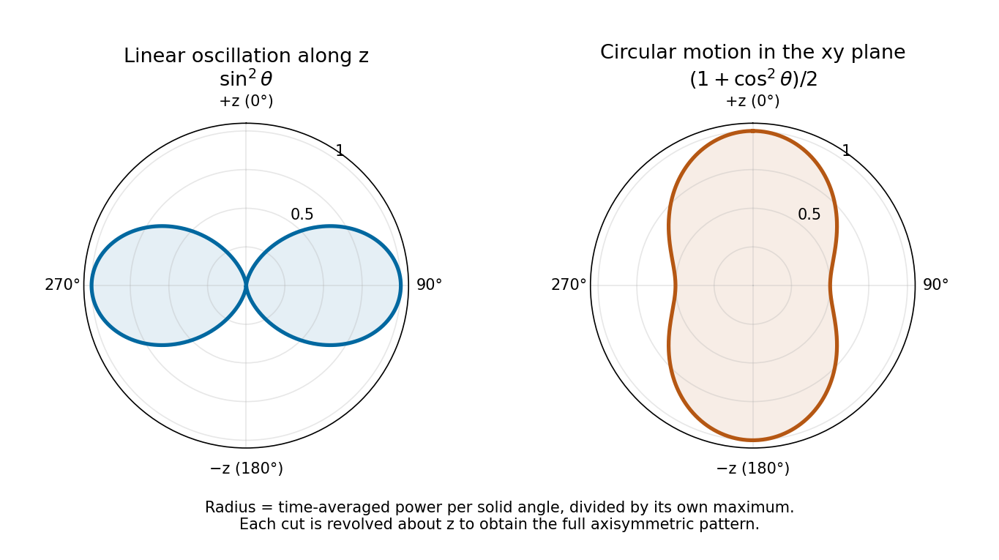

<h1 id="section-b/b4/circular-orbit">Circular orbit</h1>

↑ **Parent:** [Solution](solution.md)

Denote the orbit radius by $b$ here to distinguish it from observation distance; it is the quantity called $R$ in this part of the paper. Write

$$
\mathbf x(t_r)=b(\cos\omega t_r,\sin\omega t_r,0),\qquad
\mathbf a(t_r)=-b\omega^2(\cos\omega t_r,\sin\omega t_r,0).
$$

For observation at [spherical coordinates](../../../../spherical-coordinate-system.md) $(\theta,\phi)$, measured from the orbit normal,

$$
\mathbf n\cdot\mathbf a=-b\omega^2\sin\theta\cos(\omega t_r-\phi),\qquad
\langle(\mathbf n\cdot\mathbf a)^2\rangle=\tfrac12b^2\omega^4\sin^2\theta.
$$

The acceleration magnitude is constant, $|\mathbf a|=b\omega^2$. Therefore the [radiation pattern of a circularly moving nonrelativistic charge](../../../../radiation-pattern-of-a-circularly-moving-nonrelativistic-charge.md) is

$$
\boxed{\frac{d\langle P\rangle_{\rm circular}}{d\Omega}
=\frac{q^2b^2\omega^4}{32\pi^2\epsilon_0c^3}(1+\cos^2\theta),\qquad
\langle P\rangle_{\rm circular}=\frac{q^2b^2\omega^4}{6\pi\epsilon_0c^3}.}
$$

Time averaging removes the azimuthal dependence. The axial intensity is twice the equatorial intensity, and no direction has zero mean intensity: the instantaneous dipole axis continually rotates. This is also the sum of the two orthogonal linear-oscillation patterns with their relative [phase quadrature](../../../../phase-quadrature.md). At equal radius and linear-oscillation amplitude, the total mean [power](../../../../power.md) is twice the linear result. The calculation requires $b\omega\ll c$; relativistic [synchrotron radiation](../../../../synchrotron-radiation.md) is outside this approximation.

**[Figure 1](#section-b/b4/image-normalized-angular-power-for-linear-oscillation-and-nonrelativistic-circular-motion-with-angle-measured-from-the-same-z-axis). Normalized angular power for linear oscillation and nonrelativistic circular motion, with angle measured from the same z axis**.

## ↑ Ancestors (14)

1. [Solution](solution.md)
2. [B4](../b4.md)
3. [Section B](../../section-b.md)
4. [2019](../../../2019-split.md)
5. [Past exam of the optics and electrodynamics course of the University of Cambridge](../../../split.md)
6. [Optics and Electrodynamics course of the University of Cambridge](../../../../optics-and-electrodynamics-course-of-the-university-of-cambridge.md)
7. [Physics course of the year 3 of the natural sciences course of the University of Cambridge](../../../../physics-course-of-the-year-3-of-the-natural-sciences-course-of-the-university-of-cambridge.md)
8. [Year 3 of the natural sciences course of the University of Cambridge](../../../../year-3-of-the-natural-sciences-course-of-the-university-of-cambridge.md)
9. [Year of the natural sciences course of the University of Cambridge](../../../../year-of-the-natural-sciences-course-of-the-university-of-cambridge.md)
10. [Natural sciences course of the University of Cambridge](../../../../natural-sciences-course-of-the-university-of-cambridge.md)
11. [Course of the University of Cambridge](../../../../course-of-the-university-of-cambridge.md)
12. [University of Cambridge](../../../../university-of-cambridge-split.md)
13. [List of universities](../../../../list-of-universities.md)
14. [Codex Wiki](../../../../split.md)
