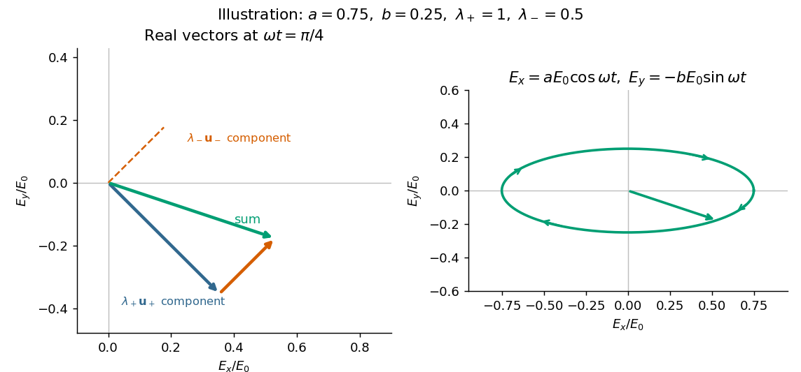

# 2021

↑ **Parent:** [Past exam of the optics and electrodynamics course of the University of Cambridge](../past-exam-of-the-optics-and-electrodynamics-course-of-the-university-of-cambridge.md)

[Original paper, released PDF pages 415–419](https://www.whatdotheyknow.com/request/natural_science_tripos_physics_e/response/2127325/attach/3/FOI%202022%20639%20Sullivan%20materials.pdf?cookie_passthrough=1#page=415)

**Table of contents**

- [Section A](#section-a)
  - [A1](#section-a/a1)
    - [a](#section-a/a1/a)
      - [Solution](#section-a/a1/a/solution)
    - [b](#section-a/a1/b)
      - [Solution](#section-a/a1/b/solution)
  - [A2](#section-a/a2)
    - [a](#section-a/a2/a)
      - [Solution](#section-a/a2/a/solution)
    - [b](#section-a/a2/b)
      - [Solution](#section-a/a2/b/solution)
  - [A3](#section-a/a3)
    - [Solution](#section-a/a3/solution)
- [Section B](#section-b)
  - [B4](#section-b/b4)
    - [a](#section-b/b4/a)
      - [Solution](#section-b/b4/a/solution)
    - [b](#section-b/b4/b)
      - [Solution](#section-b/b4/b/solution)
    - [c](#section-b/b4/c)
      - [Solution](#section-b/b4/c/solution)
    - [d](#section-b/b4/d)
      - [Solution](#section-b/b4/d/solution)
    - [e](#section-b/b4/e)
      - [Solution](#section-b/b4/e/solution)
    - [f](#section-b/b4/f)
      - [Solution](#section-b/b4/f/solution)
    - [g](#section-b/b4/g)
      - [Solution](#section-b/b4/g/solution)
  - [B5](#section-b/b5)
    - [a](#section-b/b5/a)
      - [Solution](#section-b/b5/a/solution)
    - [b](#section-b/b5/b)
      - [Solution](#section-b/b5/b/solution)
    - [c](#section-b/b5/c)
      - [Solution](#section-b/b5/c/solution)
    - [d](#section-b/b5/d)
      - [Solution](#section-b/b5/d/solution)
    - [e](#section-b/b5/e)
      - [Solution](#section-b/b5/e/solution)
    - [f](#section-b/b5/f)
      - [Solution](#section-b/b5/f/solution)
    - [g](#section-b/b5/g)
      - [Solution](#section-b/b5/g/solution)
  - [B6](#section-b/b6)
    - [a](#section-b/b6/a)
      - [i](#section-b/b6/a/i)
        - [Solution](#section-b/b6/a/i/solution)
      - [ii](#section-b/b6/a/ii)
        - [Solution](#section-b/b6/a/ii/solution)
      - [iii](#section-b/b6/a/iii)
        - [Solution](#section-b/b6/a/iii/solution)
      - [iv](#section-b/b6/a/iv)
        - [Solution](#section-b/b6/a/iv/solution)
    - [b](#section-b/b6/b)
      - [Solution](#section-b/b6/b/solution)
    - [c](#section-b/b6/c)
      - [Solution](#section-b/b6/c/solution)
    - [d](#section-b/b6/d)
      - [Solution](#section-b/b6/d/solution)
    - [e](#section-b/b6/e)
      - [Solution](#section-b/b6/e/solution)
    - [f](#section-b/b6/f)
      - [Solution](#section-b/b6/f/solution)

## Section A

↑ **Parent:** [2021](2021.md)

<h3 id="section-a/a1">A1</h3>

↑ **Parent:** [Section A](#section-a)

<h4 id="section-a/a1/a">a</h4>

↑ **Parent:** [A1](#section-a/a1)

<h5 id="section-a/a1/a/solution">Solution</h5>

↑ **Parent:** [A](#section-a/a1/a)

Work in the dilute, single-scattering limit and add the diffuse scattered [light intensities](../wave.md#light-intensity) of randomly positioned particles. The incident [unpolarized light](../wave.md#unpolarized-light) has equal, mutually uncorrelated $x$ and $y$ electric components. Each particle therefore has an induced [electric dipole moment](../electrostatics.md#electric-dipole-moment) along its permitted axis, with the same mean squared magnitude proportional to $|\alpha|^2$.

For an observer in direction $\widehat{\mathbf n}=(\sin\psi,0,\cos\psi)$, choose transverse unit directions $\mathbf e_\parallel=(\cos\psi,0,-\sin\psi)$ in the scattering plane and $\mathbf e_\perp=\widehat{\mathbf y}$ perpendicular to it. The [electric dipole radiation](../electromagnetic-wave.md#electric-dipole-radiation) field is proportional to the transverse projection of the [electric dipole](../electrostatics.md#electric-dipole). Hence an $x$ [electric dipole](../electrostatics.md#electric-dipole) contributes a [wave amplitude](../wave.md#wave-amplitude) factor $\cos\psi$ along $\mathbf e_\parallel$, while a $y$ [electric dipole](../electrostatics.md#electric-dipole) contributes its full [wave amplitude](../wave.md#wave-amplitude) along $\mathbf e_\perp$.

Let $C>0$ collect the common incident [light intensity](../wave.md#light-intensity), [electric polarizability](../electrostatics.md#electric-polarizability), distance and [frequency](../wave.md#frequency) factors. Then

$$
I_\parallel=CN_1\cos^2\psi,\qquad I_\perp=CN_2.
$$

The two components are uncorrelated, so the [coherency matrix](../wave.md#coherency-matrix) is diagonal in this basis. The [degree of polarization](../wave.md#degree-of-polarization) is

$$
\boxed{\mathcal P_{xz}(\psi)=\frac{|I_\perp-I_\parallel|}{I_\perp+I_\parallel}
=\frac{|N_2-N_1\cos^2\psi|}{N_2+N_1\cos^2\psi}.}
$$

A signed degree of [linear polarization](../electromagnetic-wave.md#linear-polarization), defined positive perpendicular to the scattering plane, has the same expression without the absolute value. The dominant direction is $\widehat{\mathbf y}$ when $N_2>N_1\cos^2\psi$, and $\mathbf e_\parallel$ when the inequality reverses. If the denominator vanishes there is no scattered signal and its [degree of polarization](../wave.md#degree-of-polarization) is undefined. A coherent exactly forward component, including the transmitted incident beam, is not part of this diffuse-intensity calculation; random particle positions do not by themselves destroy forward [optical coherence](../physical-optics.md#optical-coherence).

<h4 id="section-a/a1/b">b</h4>

↑ **Parent:** [A1](#section-a/a1)

<h5 id="section-a/a1/b/solution">Solution</h5>

↑ **Parent:** [B](#section-a/a1/b)

Now take $\widehat{\mathbf n}=(0,\sin\psi,\cos\psi)$, with the same angle to the incident $z$ direction. The perpendicular direction is $\widehat{\mathbf x}$ and the in-plane transverse direction is $(0,\cos\psi,-\sin\psi)$. The roles of the two [electric dipole](../electrostatics.md#electric-dipole) populations interchange: $x$ [electric dipoles](../electrostatics.md#electric-dipole) radiate at full strength, whereas the observed [wave amplitude](../wave.md#wave-amplitude) from a $y$ [electric dipole](../electrostatics.md#electric-dipole) is reduced by $\cos\psi$.

Thus $I_\perp=CN_1$ and $I_\parallel=CN_2\cos^2\psi$, giving

$$
\boxed{\mathcal P_{yz}(\psi)=\frac{|N_1-N_2\cos^2\psi|}{N_1+N_2\cos^2\psi}.}
$$

This is also obtained by the symmetry $x\leftrightarrow y$, $N_1\leftrightarrow N_2$ in part (a). For $N_1=N_2$, both planes give the familiar [Rayleigh scattering](../electromagnetic-radiation.md#rayleigh-scattering) [degree of polarization](../wave.md#degree-of-polarization) $\sin^2\psi/(1+\cos^2\psi)$: the diffuse signal is unpolarized forward and fully linearly polarized at right angles. At a dark direction with zero denominator, no [degree of polarization](../wave.md#degree-of-polarization) can be measured.

<h3 id="section-a/a2">A2</h3>

↑ **Parent:** [Section A](#section-a)

<h4 id="section-a/a2/a">a</h4>

↑ **Parent:** [A2](#section-a/a2)

<h5 id="section-a/a2/a/solution">Solution</h5>

↑ **Parent:** [A](#section-a/a2/a)

The transmitting [antenna](../electrical-engineering.md#antenna-radio) is matched to its input [transmission line](../electrical-engineering.md#transmission-line), so its real terminal [electrical resistance](../electric-charge.md#electrical-resistance) is $Z_i$. The identical receiving [antenna](../electrical-engineering.md#antenna-radio) has the same [electrical impedance](../electrical-circuit.md#electrical-impedance) at the operating [frequency](../wave.md#frequency). Its available received [power](../energy.md#power) for a matched load is the incident [energy flux](../mathematical-physics.md#energy-flux) times its [antenna effective area](../electrical-engineering.md#antenna-effective-area):

$$
P_{\rm av}=\frac{P_iG_a}{4\pi d^2}A_e
=P_i\left(\frac{G_a\lambda}{4\pi d}\right)^2\equiv P_i\mathcal F.
$$

The real receiving load is $Z_t$, so its voltage-wave [reflection coefficient](../partial-differential-equation.md#reflection-coefficient) relative to $Z_i$ is $\Gamma_L=(Z_t-Z_i)/(Z_t+Z_i)$. The fraction of available [power](../energy.md#power) delivered to the output line is

$$
1-|\Gamma_L|^2=\frac{4Z_iZ_t}{(Z_i+Z_t)^2}.
$$

Consequently, neglecting path losses, mismatch of [polarization of an electromagnetic wave](../electromagnetic-wave.md#polarization-of-an-electromagnetic-wave) and line losses,

$$
\boxed{P_t=P_i\left(\frac{G_a\lambda}{4\pi d}\right)^2
\frac{4Z_iZ_t}{(Z_i+Z_t)^2}.}
$$

This is the [Friis transmission equation](../electrical-engineering.md#friis-transmission-equation) with a receiving impedance-mismatch factor. For fixed $P_i,G_a,d,Z_i,Z_t$, it scales as $\lambda^2$. That scaling is conditional on holding [antenna gain](../electrical-engineering.md#antenna-gain) fixed: a fixed physical aperture can instead have $G_a\propto\lambda^{-2}$, and any [wavelength](../wave-equation.md#wavelength) dependence of the impedances also enters the expression. The matched-output check $Z_t=Z_i$ gives $P_t=P_i\mathcal F$.

<h4 id="section-a/a2/b">b</h4>

↑ **Parent:** [A2](#section-a/a2)

<h5 id="section-a/a2/b/solution">Solution</h5>

↑ **Parent:** [B](#section-a/a2/b)

Distinguish reflection at the input terminal, reflection at the receiving load, and a returned signal that traverses the free-space link twice. The input [antenna](../electrical-engineering.md#antenna-radio) is initially matched, so its direct terminal reflection is zero.

In the usual weak-coupling, matched-port [two-port network](../electrical-circuit.md#two-port-network) model for the [antenna](../electrical-engineering.md#antenna-radio) pair, let the forward and reverse [wave amplitude](../wave.md#wave-amplitude) transfer coefficients be $t_{21}$ and $t_{12}$. [Electromagnetic reciprocity](../electromagnetism.md#reciprocity-electromagnetism) gives equal [power](../energy.md#power) transfer factors $|t_{21}|^2=|t_{12}|^2=\mathcal F$, where $\mathcal F=(G_a\lambda/(4\pi d))^2$ from part (a). The receiving-load reflection returns [wave amplitude](../wave.md#wave-amplitude) $t_{12}\Gamma_Lt_{21}$ to the original input port. The load-mismatch contribution to the returned [power](../energy.md#power) is therefore

$$
\boxed{P_r^{\rm load}=P_i|\Gamma_L|^2\mathcal F^2
=P_i\left(\frac{Z_t-Z_i}{Z_t+Z_i}\right)^2
\left(\frac{G_a\lambda}{4\pi d}\right)^4.}
$$

For fixed gains and impedances this returned [power](../energy.md#power) scales as $\lambda^4$: it contains two link traversals. By contrast, the reflected [power](../energy.md#power) at the receiving load before that return traversal is $P_i\mathcal F|\Gamma_L|^2\propto\lambda^2$. Calling that local reflected [power](../energy.md#power) the [power](../energy.md#power) already back in the input line would omit one propagation loss.

The original wording does not specify an antenna scattering model. The boxed result is the load-dependent echo in an ideal matched-port link, with structural scattering and residual input coupling neglected. The actual total input return can include coherent scattering from the receiving antenna even when $\Gamma_L=0$; gains and effective areas alone do not specify that background. If “reflected back” means only the direct reflection at the stated matched transmitting antenna, its value is $0$. These meanings should not be conflated; the $\lambda^4$ result requires the two-pass echo interpretation and its stated model.

<h3 id="section-a/a3">A3</h3>

↑ **Parent:** [Section A](#section-a)

<h4 id="section-a/a3/solution">Solution</h4>

↑ **Parent:** [A3](#section-a/a3)

After [field electron emission](../quantum-mechanics.md#field-electron-emission), let $h$ denote the plate separation of the [parallel-plate capacitor](../electromagnetism.md#parallel-plate-capacitor), which the question does not specify. The uniform capacitor [electric field](../electric-field.md) has magnitude $E_c=|V|/h$, and a nonrelativistic [electron](../physics.md#electron) of [mass](../classical-mechanics.md#mass) $m_e$ has constant [acceleration](../classical-mechanics.md#acceleration) magnitude $a=eE_c/m_e$. The sign of its charge affects the direction of the radiation field but not its radiated [power](../energy.md#power).

In the supplied nonrelativistic [Liénard-Wiechert field](../relativistic-electromagnetism.md#lienard-wiechert-field), $\dot{\boldsymbol\beta}=\mathbf a/c$. At polar angle $\theta$ to the [acceleration](../classical-mechanics.md#acceleration), $|\widehat{\mathbf n}\times(\widehat{\mathbf n}\times\mathbf a)|=a\sin\theta$, hence

$$
E_{\rm rad}=\frac{ea\sin\theta}{4\pi\epsilon_0c^2R}.
$$

The outgoing [Poynting vector](../electromagnetic-wave.md#poynting-vector) has magnitude $S=\epsilon_0cE_{\rm rad}^2$. Its radiated [power](../energy.md#power) per [solid angle](../euclidean-geometry.md#solid-angle) is therefore

$$
\frac{dP}{d\Omega}=R^2S=\frac{e^2a^2}{16\pi^2\epsilon_0c^3}\sin^2\theta.
$$

Using $\int\sin^2\theta\,d\Omega=8\pi/3$ gives the [Larmor formula](../electromagnetic-radiation.md#larmor-formula) and the requested constant [power](../energy.md#power) during the uniform-field part of the flight:

$$
\boxed{P=\frac{e^2a^2}{6\pi\epsilon_0c^3}
=\frac{e^4E_c^2}{6\pi\epsilon_0m_e^2c^3}
=\frac{e^4V^2}{6\pi\epsilon_0m_e^2c^3h^2}.}
$$

The brackets in the given field require the [acceleration](../classical-mechanics.md#acceleration) at [retarded time](../relativistic-electromagnetism.md#retarded-time); the radiation reaches the far observer after the propagation delay. This derivation assumes that [radiation reaction](../electromagnetic-radiation.md#radiation-reaction) is a small correction to the [acceleration](../classical-mechanics.md#acceleration) and that the flight is nonrelativistic, for example $e|V|\ll m_ec^2$ for release from rest. Entry, emission and impact transients are not described by the uniform-field model. A result solely in terms of $V$ cannot be obtained without a plate spacing or a specified internal field.

## Section B

↑ **Parent:** [2021](2021.md)

<h3 id="section-b/b4">B4</h3>

↑ **Parent:** [Section B](#section-b)

<h4 id="section-b/b4/a">a</h4>

↑ **Parent:** [B4](#section-b/b4)

<h5 id="section-b/b4/a/solution">Solution</h5>

↑ **Parent:** [A](#section-b/b4/a)

The [characteristic polynomial](../linear-operator-theory.md#characteristic-polynomial) of the given [Jones matrix](../wave.md#jones-matrix) is

$$
\det(J-\lambda I)=(a-\lambda)^2-b^2,
$$

so a convenient choice of [eigenvalue](../linear-operator-theory.md#eigenvalue) labels is

$$
\boxed{\lambda_+=a+b,\quad \mathbf u_+=\frac1{\sqrt2}\begin{pmatrix}1\\-i\end{pmatrix};\qquad
\lambda_-=a-b,\quad\mathbf u_-=\frac1{\sqrt2}\begin{pmatrix}1\\i\end{pmatrix}.}
$$

Direct multiplication gives $J\mathbf u_\pm=\lambda_\pm\mathbf u_\pm$, and $\mathbf u_+^\dagger\mathbf u_-=0$. They represent opposite [circular polarizations](../electromagnetic-wave.md#circular-polarization). Since $a,b$ are real, $J$ is a [Hermitian matrix](../hilbert-space.md#hermitian-operator) and both [eigenvalues](../linear-operator-theory.md#eigenvalue) are real, but they need not be positive. A negative [eigenvalue](../linear-operator-theory.md#eigenvalue) adds a [wave phase](../wave.md#phase-waves) reversal to that mode. The labels are algebraic: $\lambda_+$ is the larger numerical [eigenvalue](../linear-operator-theory.md#eigenvalue) only when $b\geq0$. If $b=0$, the [eigenvalue](../linear-operator-theory.md#eigenvalue) is degenerate and every nonzero [Jones vector](../wave.md#jones-vector) is an [eigenvector](../linear-operator-theory.md#eigenvector); the circular pair remains a valid basis.

<h4 id="section-b/b4/b">b</h4>

↑ **Parent:** [B4](#section-b/b4)

<h5 id="section-b/b4/b/solution">Solution</h5>

↑ **Parent:** [B](#section-b/b4/b)

Take an incident field along $\widehat{\mathbf x}$, without loss of generality because this component has the same circular [eigenmodes](../wave-equation.md#normal-mode) for every direction of input [linear polarization](../electromagnetic-wave.md#linear-polarization). Resolve its [Jones vector](../wave.md#jones-vector) into equal circular components:

$$
E_0\widehat{\mathbf x}=\frac{E_0}{\sqrt2}(\mathbf u_++\mathbf u_-),\qquad
\mathbf E_{\rm out}=\frac{E_0}{\sqrt2}(\lambda_+\mathbf u_++\lambda_-\mathbf u_-)
=E_0\begin{pmatrix}a\\-ib\end{pmatrix}.
$$

Using the [complex amplitude](../wave.md#complex-amplitude) convention $\operatorname{Re}[\mathbf E e^{-i\omega t}]$, the real circular contributions are

$$
\mathbf E_+(t)=\frac{E_0\lambda_+}{2}(\widehat{\mathbf x}\cos\omega t-\widehat{\mathbf y}\sin\omega t),\qquad
\mathbf E_-(t)=\frac{E_0\lambda_-}{2}(\widehat{\mathbf x}\cos\omega t+\widehat{\mathbf y}\sin\omega t).
$$

They counter-rotate and add to

$$
\boxed{\mathbf E_{\rm out}(t)=E_0(a\widehat{\mathbf x}\cos\omega t-b\widehat{\mathbf y}\sin\omega t).}
$$

In general the tip traces an [ellipse](../euclidean-geometry.md#ellipse) with semiaxis lengths $|a|E_0$ and $|b|E_0$. Equal transmitted circular [wave amplitudes](../wave.md#wave-amplitude) produce a line; removal of one circular mode, $\lambda_+=0$ or $\lambda_-=0$, produces a [circle](../topology.md#circle). The special zero-output case has no defined [polarization of waves](../wave.md#polarization-waves).

**[Figure 1](#section-b/b4/b/image-original-vector-addition-of-circular-eigenmode-fields-and-the-resultant-elliptical-polarization). Original vector addition of circular eigenmode fields and the resultant elliptical polarization**.

<h4 id="section-b/b4/c">c</h4>

↑ **Parent:** [B4](#section-b/b4)

<h5 id="section-b/b4/c/solution">Solution</h5>

↑ **Parent:** [C](#section-b/b4/c)

The normalized circular [eigenvectors](../linear-operator-theory.md#eigenvector) from part (a) define the [orthogonal projection](../hilbert-space.md#orthogonal-projection) matrices

$$
P_+=\mathbf u_+\mathbf u_+^\dagger=\frac12\begin{pmatrix}1&i\\-i&1\end{pmatrix},\qquad
P_-=\mathbf u_-\mathbf u_-^\dagger=\frac12\begin{pmatrix}1&-i\\i&1\end{pmatrix}.
$$

Thus the [spectral decomposition](../linear-operator-theory.md#spectral-decomposition) of the [Jones matrix](../wave.md#jones-matrix) is

$$
\boxed{J=\lambda_+P_++\lambda_-P_-
=\frac12\begin{pmatrix}
\lambda_++\lambda_-&i(\lambda_+-\lambda_-)\\
-i(\lambda_+-\lambda_-)&\lambda_++\lambda_-
\end{pmatrix}.}
$$

This simply substitutes $a=(\lambda_++\lambda_-)/2$ and $b=(\lambda_+-\lambda_-)/2$ and makes each [eigenmode](../wave-equation.md#normal-mode)'s [wave amplitude](../wave.md#wave-amplitude) transmission explicit.

<h4 id="section-b/b4/d">d</h4>

↑ **Parent:** [B4](#section-b/b4)

<h5 id="section-b/b4/d/solution">Solution</h5>

↑ **Parent:** [D](#section-b/b4/d)

There are errors in the original PDF at this point, not merely in the TeX transcription. The second exponential must denote the [eigenvalue](../linear-operator-theory.md#eigenvalue) $\lambda_-(z)=e^{-\gamma^-z}$, not the propagation coefficient itself. More substantially, the printed prefactor $\operatorname{sech}(\delta z)$ is inconsistent with the stated exponential [eigenvalues](../linear-operator-theory.md#eigenvalue). It must be $\cosh(\delta z)$. The original's primed Jones-matrix label distinguishes the distributed component from the earlier static matrix; below write $\mathcal J(z)$ to avoid confusing that prime with a derivative.

Complex [eigenvalues](../linear-operator-theory.md#eigenvalue) have no intrinsic largest/smallest ordering, so $+$ and $-$ are modal labels. Keep the circular [eigenvectors](../linear-operator-theory.md#eigenvector) fixed, put $\gamma=(\gamma^++\gamma^-)/2$ and $\delta=(\gamma^+-\gamma^-)/2$, and use the [spectral decomposition](../linear-operator-theory.md#spectral-decomposition) from part (c):

$$
\mathcal J(z)=e^{-\gamma^+z}P_++e^{-\gamma^-z}P_-.
$$

Its diagonal entries are $(e^{-\gamma^+z}+e^{-\gamma^-z})/2=e^{-\gamma z}\cosh(\delta z)$, and its upper off-diagonal entry is $i(e^{-\gamma^+z}-e^{-\gamma^-z})/2=-ie^{-\gamma z}\sinh(\delta z)$. Therefore

$$
\boxed{\mathcal J(z)=e^{-\gamma z}
\begin{pmatrix}\cosh(\delta z)&-i\sinh(\delta z)\\i\sinh(\delta z)&\cosh(\delta z)\end{pmatrix}.}
$$

Where $\cosh(\delta z)\neq0$, this can be factored as

$$
\mathcal J(z)=e^{-\gamma z}\cosh(\delta z)
\begin{pmatrix}1&-i\tanh(\delta z)\\i\tanh(\delta z)&1\end{pmatrix}.
$$

The unfactored expression is valid even at zeros of the cosine-like factor when $\delta$ is imaginary. The printed expression is $\operatorname{sech}^2(\delta z)$ times this correct matrix; its [eigenvalues](../linear-operator-theory.md#eigenvalue) are consequently $e^{-\gamma^\pm z}\operatorname{sech}^2(\delta z)$ rather than those specified. A second check is $\det\mathcal J=e^{-2\gamma z}$, whereas the printed version has [determinant](../multilinear-algebra.md#determinant) $e^{-2\gamma z}\operatorname{sech}^4(\delta z)$. Thus the requested printed identity cannot be proved except in the degenerate case $\delta=0$; the following parts use the consistent propagator.

<h4 id="section-b/b4/e">e</h4>

↑ **Parent:** [B4](#section-b/b4)

<h5 id="section-b/b4/e/solution">Solution</h5>

↑ **Parent:** [E](#section-b/b4/e)

When $\gamma^\pm=\alpha^\pm$ are real, $\gamma$ and $\delta$ are real. The two opposite [circular polarizations](../electromagnetic-wave.md#circular-polarization) retain their [wave phases](../wave.md#phase-waves) but are attenuated at different [wave amplitude](../wave.md#wave-amplitude) rates. This [circular dichroism](../stereochemistry.md#circular-dichroism) changes the ellipticity without rotating the principal axis of the [ellipse](../euclidean-geometry.md#ellipse).

For input $E_0\widehat{\mathbf x}$, the corrected [Jones matrix](../wave.md#jones-matrix) gives

$$
\mathbf E_{\rm out}=E_0e^{-\gamma z}
\begin{pmatrix}\cosh(\delta z)\\i\sinh(\delta z)\end{pmatrix}.
$$

The common factor $e^{-\gamma z}$ describes the mea [wave amplitude](../wave.md#wave-amplitude) attenuation. The $\cosh(\delta z)$ factor reflects the sum of the two transmitted modal [wave amplitudes](../wave.md#wave-amplitude); $\tanh(\delta z)$ fixes their imbalance and hence the signed ellipticity. The real field has components proportional to $\cosh(\delta z)\cos\omega t$ and $\sinh(\delta z)\sin\omega t$, so

$$
\boxed{\frac{\text{minor semiaxis}}{\text{major semiaxis}}=|\tanh(\delta z)|,\qquad
\frac{I(z)}{I(0)}=e^{-2\gamma z}\cosh(2\delta z)
=\frac{e^{-2\alpha^+z}+e^{-2\alpha^-z}}2.}
$$

The [ellipse](../euclidean-geometry.md#ellipse)'s principal axis stays along the original input direction. For large differential optical depth it approaches the less attenuated circular [eigenmode](../wave-equation.md#normal-mode). A passive medium has $\alpha^\pm\geq0$, or $\gamma\geq|\delta|$, so the growing [hyperbolic function](../calculus.md#hyperbolic-function) factor does not imply net optical gain. Using the printed $\operatorname{sech}$ prefactor would give a spurious extra attenuation inconsistent with the modal laws.

<h4 id="section-b/b4/f">f</h4>

↑ **Parent:** [B4](#section-b/b4)

<h5 id="section-b/b4/f/solution">Solution</h5>

↑ **Parent:** [F](#section-b/b4/f)

Write $\gamma^\pm=-i\beta^\pm$, $\overline\beta=(\beta^++\beta^-)/2$ and $\chi=(\beta^+-\beta^-)z/2$. Then $\gamma z=-i\overline\beta z$ and $\delta z=-i\chi$. With $\cosh(-i\chi)=\cos\chi$ and $\sinh(-i\chi)=-i\sin\chi$, the corrected matrix becomes

$$
\boxed{\mathcal J(z)=e^{i\overline\beta z}
\begin{pmatrix}\cos\chi&-\sin\chi\\\sin\chi&\cos\chi\end{pmatrix}.}
$$

The scalar is a common propagation [wave phase](../wave.md#phase-waves) and the real [rotation matrix](../linear-algebra.md#rotation-matrix) rotates the input [linear polarization](../electromagnetic-wave.md#linear-polarization) through $\chi$. There is no attenuation and no generated ellipticity: the field map is a [unitary matrix](../linear-operator-theory.md#unitary-matrix). The two circular [eigenmodes](../wave-equation.md#normal-mode) accumulate different [wave phases](../wave.md#phase-waves), giving [circular birefringence](../maxwell-equations.md#circular-birefringence) and [optical activity](../stereochemistry.md#optical-activity).

The correct unfactored matrix remains finite where $\cos\chi=0$. In contrast, the printed $\operatorname{sech}$ form would give $e^{i\overline\beta z}\sec^2\chi$ times the rotation matrix, including unphysical divergent gain in this stipulated lossless case. This provides a direct physical check on the correction in part (d).

<h4 id="section-b/b4/g">g</h4>

↑ **Parent:** [B4](#section-b/b4)

<h5 id="section-b/b4/g/solution">Solution</h5>

↑ **Parent:** [G](#section-b/b4/g)

The circular [eigenmode](../wave-equation.md#normal-mode) [orthogonal projection](../hilbert-space.md#orthogonal-projection) matrices obey $P_\pm^2=P_\pm$, $P_+P_-=0$ and $P_++P_-=I$. Define the uniform-medium generator

$$
K=\gamma^+P_++\gamma^-P_-
=\boxed{\begin{pmatrix}\gamma&i\delta\\-i\delta&\gamma\end{pmatrix}.}
$$

Expanding its [matrix exponential](../linear-operator-theory.md#matrix-exponential) by its [power series](../sequence-and-series.md#power-series) and using these projection identities gives

$$
\boxed{e^{-Kz}=e^{-\gamma^+z}P_++e^{-\gamma^-z}P_-=\mathcal J(z).}
$$

Equivalently, with $Q=\begin{pmatrix}0&i\\-i&0\end{pmatrix}$, one has $Q^2=I$, $K=\gamma I+\delta Q$ and $e^{-Kz}=e^{-\gamma z}[I\cosh(\delta z)-Q\sinh(\delta z)]$. This is exactly the corrected matrix of part (d). The entries of $K$ have units of inverse length, and the map satisfies $d\mathcal J/dz=-K\mathcal J$, $\mathcal J(0)=I$ and the homogeneous propagation law $\mathcal J(z_1+z_2)=\mathcal J(z_1)\mathcal J(z_2)$.

The extra $\operatorname{sech}^2$ factor in the printed version violates this last law for nonzero $\delta$, so it cannot be generated by one constant $K$ with the stipulated [eigenvalues](../linear-operator-theory.md#eigenvalue). The constant-$K$ description assumes uniform coefficients and fixed circular [eigenmodes](../wave-equation.md#normal-mode).

<h3 id="section-b/b5">B5</h3>

↑ **Parent:** [Section B](#section-b)

<h4 id="section-b/b5/a">a</h4>

↑ **Parent:** [B5](#section-b/b5)

<h5 id="section-b/b5/a/solution">Solution</h5>

↑ **Parent:** [A](#section-b/b5/a)

Take $f(t)=a(t)e^{-i\omega t}$ at a fixed reference point, and define the full-field [temporal optical coherence](../physical-optics.md#temporal-optical-coherence) function by

$$
\boxed{\Gamma(t,\tau)=C\langle f^*(t)f(t+\tau)\rangle
=C\langle a^*(t)a(t+\tau)\rangle e^{-i\omega\tau},\qquad C=\frac{\epsilon_0c}{2}.}
$$

The angle brackets denote an ensemble [expected value](../expected-value.md), or a sufficiently long time average when justified. The factor $C$ puts $\Gamma$ in [light intensity](../wave.md#light-intensity) units for the chosen peak complex-field convention. The normalized [first-order optical coherence](../physical-optics.md#first-order-optical-coherence) is $g^{(1)}(\tau)=\Gamma(\tau)/\Gamma(0)$ for a stationary source.

“Independent of absolute time” means the second moment depends on the time difference $\tau$ but not on the starting time $t$: shifting both observation times by the same amount leaves it unchanged. Together with a constant mean this is second-order or [weak stationarity](../time-series.md#weakly-stationary-process); it does not mean that the random [electric field](../electric-field.md) is constant in time. Put $I_0=\Gamma(0)=C\langle|a|^2\rangle$. The full-field convention is important: an envelope-only correlation omits $e^{-i\omega\tau}$ and must have that carrier factor restored before deriving optical [interference fringes](../physical-optics.md#interference-fringe).

<h4 id="section-b/b5/b">b</h4>

↑ **Parent:** [B5](#section-b/b5)

<h5 id="section-b/b5/b/solution">Solution</h5>

↑ **Parent:** [B](#section-b/b5/b)

The given spatial and carrier factors combine into retarded copies of the same random field:

$$
\mathbf E'(\mathbf r,t)=\frac{f(t-t_1)+f(t-t_2)}{\sqrt2}\widehat{\mathbf z},\qquad
t_j=\frac{\mathbf k_j\cdot\mathbf r}{\omega}.
$$

On the $y$ axis, $t_1=ky/(\sqrt2\omega)$ and $t_2=-ky/(\sqrt2\omega)$. Expand the squared electric-field [wave amplitude](../wave.md#wave-amplitude). Each self term contributes $I_0/2$, and the two cross terms together contribute the real part of the full-field correlation. Stationarity and $\Gamma(-\tau)=\Gamma(\tau)^*$ give

$$
\boxed{I(y)=C\langle|\mathbf E'|^2\rangle
=I_0+\operatorname{Re}\Gamma(\tau(y)),\qquad
\tau(y)=\frac{\sqrt2ky}{\omega}.}
$$

In [vacuum](../physics.md#vacuum), $k=\omega/c$ and $\tau(y)=\sqrt2y/c$. Reversing the delay convention replaces $\tau$ by $-\tau$ without changing this real-part result. This $I$ is the electric-field [light intensity](../wave.md#light-intensity) convention of the question. For two nonparallel waves it should not automatically be identified with the magnitude of the net [Poynting vector](../electromagnetic-wave.md#poynting-vector); part (d) gives that geometric conversion explicitly.

<h4 id="section-b/b5/c">c</h4>

↑ **Parent:** [B5](#section-b/b5)

<h5 id="section-b/b5/c/solution">Solution</h5>

↑ **Parent:** [C](#section-b/b5/c)

A line with [lifetime broadening](../stellar-astrophysics.md#lifetime-broadening) has a [Lorentzian line shape](../stellar-astrophysics.md#lorentzian-line-shape). Write its half-width at half-maximum in angular-frequency units as $\kappa>0$. The [Wiener-Khinchin theorem](../fourier-analysis.md#wiener-khinchin-theorem), or the [Fourier transform](../fourier-transform.md) of the Lorentzian, gives

$$
\Gamma(\tau)=I_0e^{-\kappa|\tau|}e^{-i\omega\tau}.
$$

Therefore in [vacuum](../physics.md#vacuum)

$$
\boxed{I(y)=I_0\left[1+e^{-\sqrt2\kappa|y|/c}\cos(\sqrt2ky)\right].}
$$

The sketch is a cosine fringe pattern about baseline $I_0$, bounded by $I_0[1\pm e^{-\sqrt2\kappa|y|/c}]$. Its central value is $2I_0$, its spatial [interference fringe spacing](../physical-optics.md#interference-fringe-spacing) is $\lambda/\sqrt2$, and its visibility decays on length $c/(\sqrt2\kappa)$. For an isolated transition whose population lifetime is $T_1$ and which has no extra dephasing, $\kappa=1/(2T_1)$, so the field [coherence time](../physical-optics.md#optical-coherence-time) is $2T_1$, not $T_1$. Introducing $\kappa$ avoids confusing population, [wave amplitude](../wave.md#wave-amplitude) and spectral-width conventions when no numerical linewidth is given.

**[Figure 2](#section-b/b5/c/image-original-lifetime-broadened-interference-sketch-and-the-direction-of-the-mean-poynting-vector). Original lifetime-broadened interference sketch and the direction of the mean Poynting vector**.

<h4 id="section-b/b5/d">d</h4>

↑ **Parent:** [B5](#section-b/b5)

<h5 id="section-b/b5/d/solution">Solution</h5>

↑ **Parent:** [D](#section-b/b5/d)

For each beam in [vacuum](../physics.md#vacuum), its [magnetic field](../magnetic-field.md) is $\mathbf B_j=\widehat{\mathbf k}_j\times\mathbf E_j/c$. Write the two complex scalar contributions, including the [beam splitter](../optical-instrument.md#beam-splitter) factor, as $u_1=f(t-t_1)/\sqrt2$ and $u_2=f(t-t_2)/\sqrt2$. Since their [electric fields](../electric-field.md) are both along $z$,

$$
\mathbf E'=(u_1+u_2)\widehat{\mathbf z},\qquad
\mathbf B'=\frac1{c\sqrt2}\left[(u_1-u_2)\widehat{\mathbf x}-(u_1+u_2)\widehat{\mathbf y}\right].
$$

The optical-cycle and ensemble-averaged [Poynting vector](../electromagnetic-wave.md#poynting-vector) is

$$
\langle\mathbf S\rangle=\frac1{2\mu_0}\operatorname{Re}\langle\mathbf E'\times\mathbf B'^*\rangle
=\frac C{\sqrt2}\left[\langle|u_1+u_2|^2\rangle\widehat{\mathbf x}
+(\langle|u_1|^2\rangle-\langle|u_2|^2\rangle)\widehat{\mathbf y}\right].
$$

The mean individual [light intensities](../wave.md#light-intensity) are equal, so

$$
\boxed{\langle\mathbf S\rangle=\frac{I(y)}{\sqrt2}\widehat{\mathbf x}.}
$$

Thus [energy](../energy.md) flows along the bisector of the two beam directions, crossing a detector plane normal to $x$. Such a sensor can in principle record the variation across its $y$ coordinate. Its actual normal [energy](../energy.md) flux is $I(y)/\sqrt2$ in the normalization used above; this fixed factor does not change [interferometric visibility](../physical-optics.md#interferometric-visibility).

There is a practical resolution condition in addition to the direction of [energy](../energy.md) flow. The [interference fringe spacing](../physical-optics.md#interference-fringe-spacing) $\lambda/\sqrt2$ is very small, so direct pixels would need spacing no larger than $\lambda/(2\sqrt2)$ as required by the [Nyquist–Shannon sampling theorem](../fourier-analysis.md#nyquist-shannon-sampling-theorem), or optical magnification and sufficient angular aperture to preserve both incident directions. An ordinary [optical camera](../optical-instrument.md#optical-camera) with much larger effective pixels averages the [interference fringes](../physical-optics.md#interference-fringe). The Poynting-vector argument establishes the allowed measurement geometry, not guaranteed resolution with any [optical camera](../optical-instrument.md#optical-camera).

<h4 id="section-b/b5/e">e</h4>

↑ **Parent:** [B5](#section-b/b5)

<h5 id="section-b/b5/e/solution">Solution</h5>

↑ **Parent:** [E](#section-b/b5/e)

On the $x$ axis the two geometric delays are identical:

$$
t_1=t_2=\frac{kx}{\sqrt2\omega}.
$$

Their field [wave amplitudes](../wave.md#wave-amplitude) therefore add as equal copies at zero relative delay. Stationarity removes dependence on the common delay, giving

$$
\boxed{I(x)=I_0+\operatorname{Re}\Gamma(0)=2I_0,}
$$

independent of $x$ in the ideal overlapping plane-wave region. The corresponding mean normal [energy](../energy.md) flux through a transverse plane is $\sqrt2I_0$. There is no increasing path difference along the bisector, so finite [temporal optical coherence](../physical-optics.md#temporal-optical-coherence) does not produce a longitudinal visibility envelope on this axis.

<h4 id="section-b/b5/f">f</h4>

↑ **Parent:** [B5](#section-b/b5)

<h5 id="section-b/b5/f/solution">Solution</h5>

↑ **Parent:** [F](#section-b/b5/f)

The $x$ axis lies along the mean [Poynting vector](../electromagnetic-wave.md#poynting-vector). A two-dimensional [optical camera](../optical-instrument.md#optical-camera) sensor intended to sample many $x$ positions at once would have to lie along the [energy](../energy.md) flow, where it receives no normal flux in the ideal geometry; a side-view [optical camera](../optical-instrument.md#optical-camera) also sees no light from an empty nonscattering propagation region. Putting a detector normal to $x$ measures one transverse section instead, and absorbs the light before a downstream detector can sample the same rays.

One could translate a detector to successive $x$ positions or introduce a scattering screen, but that is a different measurement. Moreover the ideal result here is already the constant $I(x)=2I_0$, so it contains no longitudinal [optical coherence](../physical-optics.md#optical-coherence) structure for the [optical camera](../optical-instrument.md#optical-camera) to resolve. The difficulty is the longitudinal sampling geometry, rather than a hidden $x$-fringe period.

<h4 id="section-b/b5/g">g</h4>

↑ **Parent:** [B5](#section-b/b5)

<h5 id="section-b/b5/g/solution">Solution</h5>

↑ **Parent:** [G](#section-b/b5/g)

A physical delay is a time, whereas the stated $\lambda/(4\sqrt2)$ is a length. First interpret it literally as an additional optical path length $\ell=\lambda/(4\sqrt2)$ in arm 1, with the other arm unchanged. In [vacuum](../physics.md#vacuum) this delays its full field by $\tau_d=\ell/c$. The exact stationarity argument from part (b) then gives

$$
\boxed{I_{\rm new}(y)=I_0+\operatorname{Re}\Gamma\left(\frac{\sqrt2y}{c}+\frac{\lambda}{4\sqrt2c}\right).}
$$

Delaying arm 2 changes the plus sign before $\tau_d$ to a minus sign. As a function of $y$, the arm-1 result is the old pattern evaluated at $y+\ell/\sqrt2=y+\lambda/8$.

For a quasi-monochromatic source, $\tau_d$ is much shorter than the [coherence time](../physical-optics.md#optical-coherence-time). The envelope correlation can then be treated as unchanged, while the carrier [wave phase](../wave.md#phase-waves) cannot:

$$
\Gamma(\tau+\tau_d)\simeq e^{-i\omega\tau_d}\Gamma(\tau),\qquad
\phi_d=\omega\tau_d=\frac{\pi}{2\sqrt2}.
$$

Hence

$$
\boxed{I_{\rm new}(y)\simeq I_0+\cos\!\left(\frac{\pi}{2\sqrt2}\right)\operatorname{Re}\Gamma(\tau(y))
+\sin\!\left(\frac{\pi}{2\sqrt2}\right)\operatorname{Im}\Gamma(\tau(y)).}
$$

This literal optical-path delay is not a quarter-cycle [wave phase](../wave.md#phase-waves) shift. If the intended length instead specifies a displacement of the entire recorded fringe pattern by one quarter of its period, $\Delta y=\lambda/(4\sqrt2)$, the equivalent delay is $\sqrt2\Delta y/c=\lambda/(4c)$ and the [wave phase](../wave.md#phase-waves) shift is $\pi/2$. Under that different interpretation the narrow-band result is $I_0+\operatorname{Im}\Gamma(\tau(y))$, with its sign reversed for the opposite displacement. The exact expression is still a shifted argument of $\Gamma$, not merely a [wave phase](../wave.md#phase-waves) multiplier when the envelope varies. The original wording does not specify such a fringe-pattern displacement, so these interpretations must be distinguished.

<h3 id="section-b/b6">B6</h3>

↑ **Parent:** [Section B](#section-b)

<h4 id="section-b/b6/a">a</h4>

↑ **Parent:** [B6](#section-b/b6)

<h5 id="section-b/b6/a/i">i</h5>

↑ **Parent:** [A](#section-b/b6/a)

<h6 id="section-b/b6/a/i/solution">Solution</h6>

↑ **Parent:** [I](#section-b/b6/a/i)

The upper index identifies $P^\alpha$ as a contravariant [Lorentz four-vector](../special-relativity.md#four-vector), obeying the rank-one [contravariant tensor](../multilinear-algebra.md#contravariant-tensor) transformation law. Its components transform with the coordinate Jacobian,

$$
\boxed{P'^\alpha=\frac{\partial x'^\alpha}{\partial x^\beta}P^\beta.}
$$

It is not invariant component by component. Its contracted square $P_\alpha P^\alpha=m^2c^2$, for metric signature $(+,-,-,-)$, is a [Lorentz invariant](../special-relativity.md#lorentz-invariance). This distinguishes a contravariant transformation law from an invariant scalar.

<h5 id="section-b/b6/a/ii">ii</h5>

↑ **Parent:** [A](#section-b/b6/a)

<h6 id="section-b/b6/a/ii/solution">Solution</h6>

↑ **Parent:** [Ii](#section-b/b6/a/ii)

First lower the index of the [four-current](../electric-charge.md#four-current) with the [Minkowski metric](../special-relativity.md#minkowski-metric): $J_\beta=g_{\beta\alpha}J^\alpha$. The displayed expression is then

$$
\frac{\partial x^\beta}{\partial x'^\delta}J_\beta=J'_\delta.
$$

Therefore

$$
\boxed{\text{It is a covariant four-vector component, }J'_\delta.}
$$

Its one free lower index transforms with the inverse coordinate Jacobian. The contraction with the metric here lowers an index; it does not make the current a scalar because the index $\delta$ remains free.

<h5 id="section-b/b6/a/iii">iii</h5>

↑ **Parent:** [A](#section-b/b6/a)

<h6 id="section-b/b6/a/iii/solution">Solution</h6>

↑ **Parent:** [Iii](#section-b/b6/a/iii)

The [chain rule](../calculus.md#chain-rule) gives

$$
\frac\partial{\partial x'^\alpha}
=\frac{\partial x^\beta}{\partial x'^\alpha}\frac\partial{\partial x^\beta}.
$$

Thus

$$
\boxed{\partial_\alpha\equiv\frac\partial{\partial x^\alpha}\text{ transforms covariantly}.}
$$

Differentiation with respect to a contravariant coordinate has a lower transformation index. In inertial Cartesian coordinates in [Minkowski spacetime](../special-relativity.md#minkowski-spacetime), no connection term is needed for this coordinate transformation of a derivative acting on a scalar; Lorentz transformations have constant Jacobians.

<h5 id="section-b/b6/a/iv">iv</h5>

↑ **Parent:** [A](#section-b/b6/a)

<h6 id="section-b/b6/a/iv/solution">Solution</h6>

↑ **Parent:** [Iv](#section-b/b6/a/iv)

The lower derivative index and the upper [electromagnetic four-potential](../relativistic-electromagnetism.md#electromagnetic-four-potential) index are fully contracted. For a constant [Lorentz transformation](../special-relativity.md#lorentz-transformation),

$$
\partial'_\alpha A'^\alpha
=(\Lambda^{-1})^\beta{}_{\alpha}\partial_\beta(\Lambda^\alpha{}_{\gamma}A^\gamma)
=\partial_\beta A^\beta.
$$

Hence

$$
\boxed{\partial_\alpha A^\alpha\text{ is a Lorentz-invariant scalar}.}
$$

This is a statement about Lorentz transformations, not electromagnetic gauge transformations. The quantity is not generally gauge invariant; setting it to zero is the [Lorenz gauge condition](../relativistic-electromagnetism.md#lorenz-gauge-condition), which is Lorentz covariant because zero remains zero in every inertial frame.

<h4 id="section-b/b6/b">b</h4>

↑ **Parent:** [B6](#section-b/b6)

<h5 id="section-b/b6/b/solution">Solution</h5>

↑ **Parent:** [B](#section-b/b6/b)

Use coordinates $(ct,x,y,z)$ and put $\beta=v/c$, $\gamma=(1-\beta^2)^{-1/2}$. For an observer moving at $+v\widehat{\mathbf x}$, the coordinate [Lorentz boost](../special-relativity.md#lorentz-boost) is

$$
\Lambda=\begin{pmatrix}\gamma&-\beta\gamma&0&0\\-\beta\gamma&\gamma&0&0\\0&0&1&0\\0&0&0&1\end{pmatrix}.
$$

The given [electromagnetic field tensor](../relativistic-electromagnetism.md#electromagnetic-field-tensor) transforms as $F'=\Lambda F\Lambda^{\mathsf T}$. For example,

$$
F'^{02}=\gamma F^{02}-\beta\gamma F^{12}=-\frac\gamma c(E_y-vB_z),\qquad
F'^{03}=\gamma F^{03}-\beta\gamma F^{13}=-\frac\gamma c(E_z+vB_y),
$$

while

$$
F'^{12}=-\beta\gamma F^{02}+\gamma F^{12}=-\gamma(B_z-vE_y/c^2),\qquad
F'^{13}=-\beta\gamma F^{03}+\gamma F^{13}=\gamma(B_y+vE_z/c^2).
$$

The $01$ component is unchanged because its boost [determinant](../multilinear-algebra.md#determinant) is $\gamma^2(1-\beta^2)=1$. The $23$ component is unchanged because neither index lies in the boost plane. Reading off all six components gives

$$
\boxed{\begin{aligned}
E'_x&=E_x,&B'_x&=B_x,\\
E'_y&=\gamma(E_y-vB_z),&B'_y&=\gamma(B_y+vE_z/c^2),\\
E'_z&=\gamma(E_z+vB_y),&B'_z&=\gamma(B_z-vE_y/c^2).
\end{aligned}}
$$

The signs follow the stated positive observer [velocity](../classical-mechanics.md#velocity) and the supplied [tensor](../multilinear-algebra.md#tensor) convention. In vector form for a boost in any direction, $\mathbf E'_\parallel=\mathbf E_\parallel$, $\mathbf E'_\perp=\gamma(\mathbf E_\perp+\mathbf v\times\mathbf B)$, with analogous $\mathbf B'_\perp=\gamma(\mathbf B_\perp-\mathbf v\times\mathbf E/c^2)$.

<h4 id="section-b/b6/c">c</h4>

↑ **Parent:** [B6](#section-b/b6)

<h5 id="section-b/b6/c/solution">Solution</h5>

↑ **Parent:** [C](#section-b/b6/c)

A uniform [Lorentz boost](../special-relativity.md#lorentz-boost) preserves the [plane wave](../wave-function.md#plane-wave) form, while changing both its [frequency](../wave.md#frequency) and its vector [wave amplitude](../wave.md#wave-amplitude). Decompose vectors parallel and perpendicular to $\mathbf v$, so $\mathbf k=\mathbf k_\parallel+\mathbf k_\perp$. In the observer's primed coordinates,

$$
\boxed{\mathbf E'(\mathbf r',t')=\mathbf E'_0
\exp\!\left\{i\left[\mathbf k_\perp\cdot\mathbf r'_\perp+
\gamma\left(\mathbf k_\parallel-\frac\omega{c^2}\mathbf v\right)\cdot\mathbf r'_\parallel
-\gamma(\omega-\mathbf v\cdot\mathbf k)t'\right]\right\}.}
$$

The transformed [wave amplitude](../wave.md#wave-amplitude) is specified in part (d). The unprimed “[rest frame](../mathematical-physics.md#rest-frame)” in this question is the original coordinate frame, not a [rest frame](../mathematical-physics.md#rest-frame) of a vacuum light wave, which has no inertial [rest frame](../mathematical-physics.md#rest-frame).

<h4 id="section-b/b6/d">d</h4>

↑ **Parent:** [B6](#section-b/b6)

<h5 id="section-b/b6/d/solution">Solution</h5>

↑ **Parent:** [D](#section-b/b6/d)

Use the inverse coordinate transformation,

$$
\mathbf r_\perp=\mathbf r'_\perp,\qquad
\mathbf r_\parallel=\gamma(\mathbf r'_\parallel+\mathbf vt'),\qquad
t=\gamma\left(t'+\frac{\mathbf v\cdot\mathbf r'}{c^2}\right).
$$

Substitution into the [wave phase](../wave.md#phase-waves) $\mathbf k\cdot\mathbf r-\omega t$ and comparison of the coefficients of $\mathbf r'$ and $t'$ gives

$$
\boxed{\omega'=\gamma(\omega-\mathbf v\cdot\mathbf k),\qquad
\mathbf k'_\parallel=\gamma\left(\mathbf k_\parallel-\frac\omega{c^2}\mathbf v\right),\qquad
\mathbf k'_\perp=\mathbf k_\perp.}
$$

The first is the [relativistic Doppler effect](../wave.md#relativistic-doppler-effect); the changed direction of the [wavevector](../elasticity-physics.md#wavevector) describes [relativistic aberration](../mathematical-physics.md#relativistic-aberration). Equivalently,

$$
\mathbf k'=\mathbf k+\left[(\gamma-1)\frac{\mathbf v\cdot\mathbf k}{v^2}-\gamma\frac\omega{c^2}\right]\mathbf v.
$$

The electric-field [wave amplitude](../wave.md#wave-amplitude) follows from part (b), after rotating the boost axis to $\mathbf v$:

$$
\boxed{\mathbf E'_0=\mathbf E_{0,\parallel}+\gamma(\mathbf E_{0,\perp}+\mathbf v\times\mathbf B_0).}
$$

For a vacuum [plane wave](../wave-function.md#plane-wave), [Maxwell equations](../maxwell-equations.md) give $\mathbf B_0=\mathbf k\times\mathbf E_0/\omega$ and $\mathbf k\cdot\mathbf E_0=0$. Thus an expression using only the given electric [wave amplitude](../wave.md#wave-amplitude) and [wavevector](../elasticity-physics.md#wavevector) is

$$
\boxed{\mathbf E'_0=\mathbf E_{0,\parallel}+\gamma\left[\mathbf E_{0,\perp}
+\frac{\mathbf v\times(\mathbf k\times\mathbf E_0)}\omega\right].}
$$

Equivalently, $\mathbf E'_0=\gamma(\mathbf E_0+\mathbf v\times\mathbf B_0)-[\gamma^2/(\gamma+1)]\mathbf v(\mathbf v\cdot\mathbf E_0)/c^2$. The [wave amplitude](../wave.md#wave-amplitude) is not a scalar carried unchanged by the [wave phase](../wave.md#phase-waves) transformation; its direction must remain transverse to the transformed [wavevector](../elasticity-physics.md#wavevector).

<h4 id="section-b/b6/e">e</h4>

↑ **Parent:** [B6](#section-b/b6)

<h5 id="section-b/b6/e/solution">Solution</h5>

↑ **Parent:** [E](#section-b/b6/e)

The [frequency](../wave.md#frequency) and longitudinal [wavevector](../elasticity-physics.md#wavevector) formulas are exactly the boost of a contravariant [Lorentz four-vector](../special-relativity.md#four-vector):

$$
\begin{pmatrix}\omega'/c\\\mathbf k'_\parallel\end{pmatrix}
=\begin{pmatrix}\gamma&-\gamma\beta\\-\gamma\beta&\gamma\end{pmatrix}
\begin{pmatrix}\omega/c\\\mathbf k_\parallel\end{pmatrix},\qquad
\mathbf k'_\perp=\mathbf k_\perp,
$$

where the matrix is understood on the time component and the signed scalar component along the boost direction. Hence the [four-wavevector](../special-relativity.md#four-wavevector) obeys

$$
\boxed{K'^\alpha=\Lambda^\alpha{}_{\beta}K^\beta,\qquad K^\alpha=(\omega/c,\mathbf k).}
$$

For the metric signature $(+,-,-,-)$, lowering the position index gives $R_\alpha=(ct,-\mathbf r)$, so

$$
\boxed{R_\alpha K^\alpha=\omega t-\mathbf k\cdot\mathbf r.}
$$

It is a dimensionless [Lorentz scalar](../special-relativity.md#lorentz-scalar), equal to minus the [wave phase](../wave.md#phase-waves) used in the stated complex wave. Invariance follows by contracting the mutually inverse position and [wavevector](../elasticity-physics.md#wavevector) transformations. Reversing metric signature reverses this displayed scalar's sign, but not its invariance or any observable [phase difference](../wave.md#phase-difference). In vacuum, $K_\alpha K^\alpha=0$ is an additional null-vector check; the wave remains lightlike in every inertial frame.

<h4 id="section-b/b6/f">f</h4>

↑ **Parent:** [B6](#section-b/b6)

<h5 id="section-b/b6/f/solution">Solution</h5>

↑ **Parent:** [F](#section-b/b6/f)

**Yes: the same physical resonant cavity and its field remain resonant in every inertial description.** A [Lorentz transformation](../special-relativity.md#lorentz-transformation) changes the mirror worldlines and the field together. The boundary [phase matching](../physical-optics.md#phase-matching) and the constructive-interference condition are statements about the same reflection events, and the contracted [wave phase](../wave.md#phase-waves) is a [Lorentz scalar](../special-relativity.md#lorentz-scalar). A boosted resonant solution therefore still satisfies the moving-mirror [boundary conditions](../differential-equation.md#boundary-condition).

It would be incorrect merely to insert a Lorentz-contracted length into the formula for two stationary mirrors while leaving both propagation [frequencies](../wave.md#frequency) unchanged. For example, let the mirrors be separated by $L$ in their [rest frame](../mathematical-physics.md#rest-frame) and let $\omega_0L/c=m\pi$, including the usual equal-mirror reflection-phase convention. For an observer boosted at $+v$ along the cavity axis, the cavity moves at $-v$ and its two travelling components have [frequencies](../wave.md#frequency)

$$
\omega'_+=\gamma\omega_0(1-\beta),\qquad
\omega'_- =\gamma\omega_0(1+\beta).
$$

They need not have one common laboratory [frequency](../wave.md#frequency). The simultaneous mirror separation is $L'=L/\gamma$, while the forward and return flight times are $L'/(c+v)$ and $L'/(c-v)$. The round-trip interval between events on the same mirror is therefore $2\gamma L/c$.

Along that moving mirror the [wave phase](../wave.md#phase-waves) rate of either wave component is $\omega'-k'v_{\rm mirror}=\omega_0/\gamma$. Its advance over the round trip is

$$
\boxed{\frac{\omega_0}{\gamma}\frac{2\gamma L}{c}=\frac{2\omega_0L}{c}=2\pi m.}
$$

Thus the [resonance](../dynamical-systems.md#resonance) condition is unchanged even though the observed travelling [frequencies](../wave.md#frequency), lengths and flight times all change. For a boost in a general direction the beam directions also undergo [relativistic aberration](../mathematical-physics.md#relativistic-aberration); the event-by-event phase-invariance argument still applies. A separate stationary cavity placed in the new frame, or an external laser whose [frequency](../wave.md#frequency) is not transformed with the original setup, is a different physical system.

## ↑ Ancestors (10)

1. [Past exam of the optics and electrodynamics course of the University of Cambridge](../past-exam-of-the-optics-and-electrodynamics-course-of-the-university-of-cambridge.md)
2. [Optics and Electrodynamics course of the University of Cambridge](../university-of-cambridge.md#optics-and-electrodynamics-course-of-the-university-of-cambridge)
3. [Physics course of the year 3 of the natural sciences course of the University of Cambridge](../university-of-cambridge.md#physics-course-of-the-year-3-of-the-natural-sciences-course-of-the-university-of-cambridge)
4. [Year 3 of the natural sciences course of the University of Cambridge](../university-of-cambridge.md#year-3-of-the-natural-sciences-course-of-the-university-of-cambridge)
5. [Year of the natural sciences course of the University of Cambridge](../university-of-cambridge.md#year-of-the-natural-sciences-course-of-the-university-of-cambridge)
6. [Natural sciences course of the University of Cambridge](../university-of-cambridge.md#natural-sciences-course-of-the-university-of-cambridge)
7. [Course of the University of Cambridge](../university-of-cambridge.md#course-of-the-university-of-cambridge)
8. [University of Cambridge](../university-of-cambridge.md)
9. [List of universities](../README.md#list-of-universities)
10. [Codex Wiki](../README.md)
