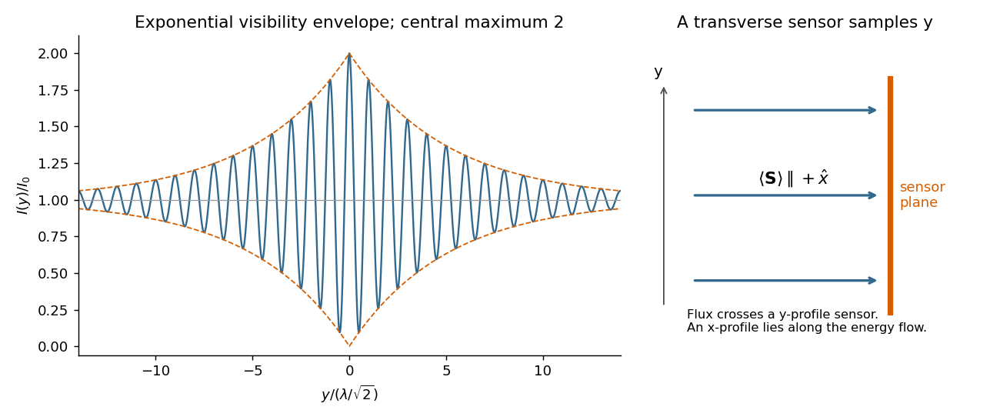

<h1 id="section-b/b5/c/solution">Solution</h1>

↑ **Parent:** [C](../c.md)

A line with [lifetime broadening](../../../../../lifetime-broadening.md) has a [Lorentzian line shape](../../../../../lorentzian-line-shape.md). Write its half-width at half-maximum in angular-frequency units as $\kappa>0$. The [Wiener-Khinchin theorem](../../../../../wiener-khinchin-theorem.md), or the [Fourier transform](../../../../../fourier-transform-split.md) of the Lorentzian, gives

$$
\Gamma(\tau)=I_0e^{-\kappa|\tau|}e^{-i\omega\tau}.
$$

Therefore in [vacuum](../../../../../vacuum.md)

$$
\boxed{I(y)=I_0\left[1+e^{-\sqrt2\kappa|y|/c}\cos(\sqrt2ky)\right].}
$$

The sketch is a cosine fringe pattern about baseline $I_0$, bounded by $I_0[1\pm e^{-\sqrt2\kappa|y|/c}]$. Its central value is $2I_0$, its spatial [interference fringe spacing](../../../../../interference-fringe-spacing.md) is $\lambda/\sqrt2$, and its visibility decays on length $c/(\sqrt2\kappa)$. For an isolated transition whose population lifetime is $T_1$ and which has no extra dephasing, $\kappa=1/(2T_1)$, so the field [coherence time](../../../../../optical-coherence-time.md) is $2T_1$, not $T_1$. Introducing $\kappa$ avoids confusing population, [wave amplitude](../../../../../wave-amplitude.md) and spectral-width conventions when no numerical linewidth is given.

**[Figure 2](#section-b/b5/c/image-original-lifetime-broadened-interference-sketch-and-the-direction-of-the-mean-poynting-vector). Original lifetime-broadened interference sketch and the direction of the mean Poynting vector**.

## ↑ Ancestors (14)

1. [C](../c.md)
2. [B5](../../b5.md)
3. [Section B](../../../section-b.md)
4. [2021](../../../../2021-split.md)
5. [Past exam of the optics and electrodynamics course of the University of Cambridge](../../../../split.md)
6. [Optics and Electrodynamics course of the University of Cambridge](../../../../../optics-and-electrodynamics-course-of-the-university-of-cambridge.md)
7. [Physics course of the year 3 of the natural sciences course of the University of Cambridge](../../../../../physics-course-of-the-year-3-of-the-natural-sciences-course-of-the-university-of-cambridge.md)
8. [Year 3 of the natural sciences course of the University of Cambridge](../../../../../year-3-of-the-natural-sciences-course-of-the-university-of-cambridge.md)
9. [Year of the natural sciences course of the University of Cambridge](../../../../../year-of-the-natural-sciences-course-of-the-university-of-cambridge.md)
10. [Natural sciences course of the University of Cambridge](../../../../../natural-sciences-course-of-the-university-of-cambridge.md)
11. [Course of the University of Cambridge](../../../../../course-of-the-university-of-cambridge.md)
12. [University of Cambridge](../../../../../university-of-cambridge-split.md)
13. [List of universities](../../../../../list-of-universities.md)
14. [Codex Wiki](../../../../../split.md)
