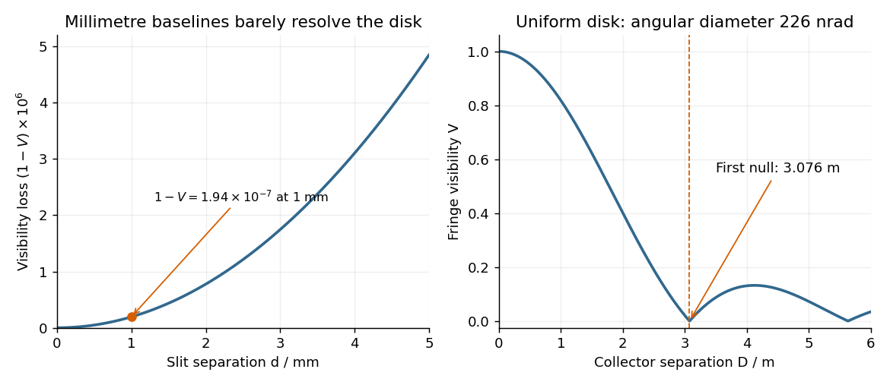

<h1 id="section-a/3/solution">Solution</h1>

↑ **Parent:** [3](../3.md)

Each mutually incoherent patch of an extended [star](../../../../star.md) produces a displaced [double-slit interference](../../../../double-slit-interference.md) pattern. The detector adds their [light intensities](../../../../light-intensity.md). For two apertures separated by a projected [interferometric baseline](../../../../interferometric-baseline.md) $D$, a source direction offset by a small [angle](../../../../angle.md) $\vartheta_x$ changes their [phase difference](../../../../phase-difference.md) by $2\pi D\vartheta_x/\lambda$. The normalized sum over the source's angular brightness distribution is its [first-order optical coherence](../../../../first-order-optical-coherence.md), whose magnitude is the [interferometric visibility](../../../../interferometric-visibility.md) for equally bright channels.

For a uniform circular stellar disk of full [angular diameter](../../../../angular-diameter.md) $\alpha$, the normalized angular [Fourier transform](../../../../fourier-transform-split.md) gives the [uniform-disk stellar visibility](../../../../uniform-disk-stellar-visibility.md)

$$
\mathcal V(D)=\left|\frac{2J_1(x)}x\right|,\qquad
x=\frac{\pi D\alpha}{\lambda}.
$$

Here $J_1$ is the order-one [Bessel function of the first kind](../../../../bessel-function-of-the-first-kind.md). This follows by integrating $e^{i(2\pi D/\lambda)\vartheta_x}$ over the disk and dividing by its area. In particular, its [power series](../../../../power-series.md) gives $2J_1(x)/x=1-x^2/8+O(x^4)$.

For an ordinary slit separation $d=1\,\mathrm{mm}$, using the paper's $\alpha=22.6\times10^{-8}\,\mathrm{rad}$ and observing [wavelength](../../../../wavelength.md) $\lambda=570\,\mathrm{nm}$,

$$
\frac{d\alpha}{\lambda}=3.965\times10^{-4},\qquad
x=1.2456\times10^{-3},\qquad
1-\mathcal V\simeq1.94\times10^{-7}.
$$

Even $d=10\,\mathrm{mm}$ gives a visibility loss of only $1.94\times10^{-5}$. Thus millimetre separation leaves the [interference fringes](../../../../interference-fringe.md) almost indistinguishable from those of a point source; it gives very little sensitivity to the diameter.

The movable mirrors in the [Michelson stellar interferometer](../../../../michelson-stellar-interferometer.md) collect light at a large adjustable separation $D$ and redirect it into closely spaced output beams. They increase the sampling [interferometric baseline](../../../../interferometric-baseline.md) independently of the fixed output slit spacing $d$: $D$ sets sensitivity to source structure, whereas the output optics set the screen's [interference fringe spacing](../../../../interference-fringe-spacing.md). The first [Bessel function](../../../../bessel-function-split.md) zero is $x_1=3.83170597$, hence

$$
\boxed{D_{\rm null}=\frac{x_1}{\pi}\frac\lambda\alpha
=1.21967\frac{570\times10^{-9}\,\mathrm m}{22.6\times10^{-8}}
=3.076\,\mathrm m\simeq3.08\,\mathrm m.}
$$

The [interference fringes](../../../../interference-fringe.md) disappear at this baseline even though each beam separately remains bright.

**[Figure 1](#section-a/3/image-original-calculated-interferometric-visibility-for-the-given-stellar-diameter-and-wavelength). Original calculated interferometric visibility for the given stellar diameter and wavelength**.

The value $3.08\,\mathrm m$ assumes a uniform disk. The original question supplies a diameter without a [surface brightness](../../../../surface-brightness.md) law; real [limb darkening](../../../../limb-darkening.md) changes the precise visibility zero. A one-dimensional uniformly bright strip of the same full angular width instead has a [sinc function](../../../../sinc-function.md) visibility and first zero $D=\lambda/\alpha=2.522\,\mathrm m$. That is a different source model, not the circular-disk result. The robust conclusion without a [surface brightness](../../../../surface-brightness.md) model is that a baseline of a few metres, rather than millimetres, is required.

## ↑ Ancestors (13)

1. [3](../3.md)
2. [Section A](../../section-a.md)
3. [2022](../../../2022-split.md)
4. [Past exam of the optics and electrodynamics course of the University of Cambridge](../../../split.md)
5. [Optics and Electrodynamics course of the University of Cambridge](../../../../optics-and-electrodynamics-course-of-the-university-of-cambridge.md)
6. [Physics course of the year 3 of the natural sciences course of the University of Cambridge](../../../../physics-course-of-the-year-3-of-the-natural-sciences-course-of-the-university-of-cambridge.md)
7. [Year 3 of the natural sciences course of the University of Cambridge](../../../../year-3-of-the-natural-sciences-course-of-the-university-of-cambridge.md)
8. [Year of the natural sciences course of the University of Cambridge](../../../../year-of-the-natural-sciences-course-of-the-university-of-cambridge.md)
9. [Natural sciences course of the University of Cambridge](../../../../natural-sciences-course-of-the-university-of-cambridge.md)
10. [Course of the University of Cambridge](../../../../course-of-the-university-of-cambridge.md)
11. [University of Cambridge](../../../../university-of-cambridge-split.md)
12. [List of universities](../../../../list-of-universities.md)
13. [Codex Wiki](../../../../split.md)
