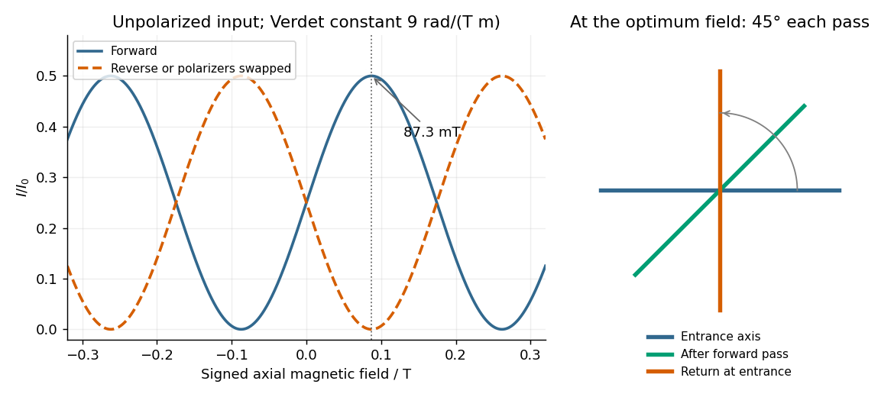

<h1 id="section-b/4/d/solution">Solution</h1>

↑ **Parent:** [D](../d.md)

Let $I_0$ be the incident [light intensity](../../../../../light-intensity.md). The first ideal [polarizer](../../../../../polarizer.md) transmits $I_0/2$ and produces [linear polarization](../../../../../linear-polarization.md) along $\mathbf e_1$. [Faraday rotation](../../../../../faraday-effect.md) turns that direction through $\theta=\Upsilon LB_\parallel$, and [Malus's law](../../../../../malus-s-law.md) at the second [polarizer](../../../../../polarizer.md) gives

$$
\boxed{I_f(B_\parallel)=\frac{I_0}{2}\cos^2\left(\frac\pi4-\Upsilon LB_\parallel\right).}
$$

Equivalently, use the input [coherency matrix](../../../../../coherency-matrix.md) $C_{\rm in}=(I_0/2)I_2$ and $I_f=\operatorname{tr}(JC_{\rm in}J^\dagger)$. This produces the same one-half factor required by [unpolarized light](../../../../../unpolarized-light.md).

Maxima satisfy $\theta=\pi/4+m\pi$, with $m\in\mathbb Z$. For $L=1\,\mathrm m$ and $\Upsilon=9\,\mathrm{rad\,T^{-1}\,m^{-1}}$, the smallest field magnitude is

$$
\boxed{|B|_{\min}=\frac{\pi}{4\Upsilon L}=0.0872665\,\mathrm T=87.3\,\mathrm{mT},\qquad I_{\max}=\frac{I_0}{2}.}
$$

Its direction is the axial direction that rotates the polarization passed by $P_1$ toward the pass axis of $P_2$ through the shorter $45^\circ$. In the right-handed ray-basis convention where $\rho=+\Upsilon B_\parallel$ and the depicted second axis is $+45^\circ$, this is $B_\parallel>0$, along $S\to O$. Reversing that field at the same magnitude gives $\theta=-\pi/4$ and zero transmission. A signed [Verdet constant](../../../../../verdet-constant.md) is meaningful only together with its rotation convention, so the polarization-alignment description fixes the physical direction without relying on ambiguous clockwise labels in a perspective diagram.

**[Figure 2](#section-b/4/d/image-original-forward-and-reverse-transmission-curves-and-laboratory-polarization-directions-at-the-optimum-faraday-rotation). Original forward and reverse transmission curves and laboratory polarization directions at the optimum Faraday rotation**.

## ↑ Ancestors (14)

1. [D](../d.md)
2. [4](../../4.md)
3. [Section B](../../../section-b.md)
4. [2022](../../../../2022-split.md)
5. [Past exam of the optics and electrodynamics course of the University of Cambridge](../../../../split.md)
6. [Optics and Electrodynamics course of the University of Cambridge](../../../../../optics-and-electrodynamics-course-of-the-university-of-cambridge.md)
7. [Physics course of the year 3 of the natural sciences course of the University of Cambridge](../../../../../physics-course-of-the-year-3-of-the-natural-sciences-course-of-the-university-of-cambridge.md)
8. [Year 3 of the natural sciences course of the University of Cambridge](../../../../../year-3-of-the-natural-sciences-course-of-the-university-of-cambridge.md)
9. [Year of the natural sciences course of the University of Cambridge](../../../../../year-of-the-natural-sciences-course-of-the-university-of-cambridge.md)
10. [Natural sciences course of the University of Cambridge](../../../../../natural-sciences-course-of-the-university-of-cambridge.md)
11. [Course of the University of Cambridge](../../../../../course-of-the-university-of-cambridge.md)
12. [University of Cambridge](../../../../../university-of-cambridge-split.md)
13. [List of universities](../../../../../list-of-universities.md)
14. [Codex Wiki](../../../../../split.md)
