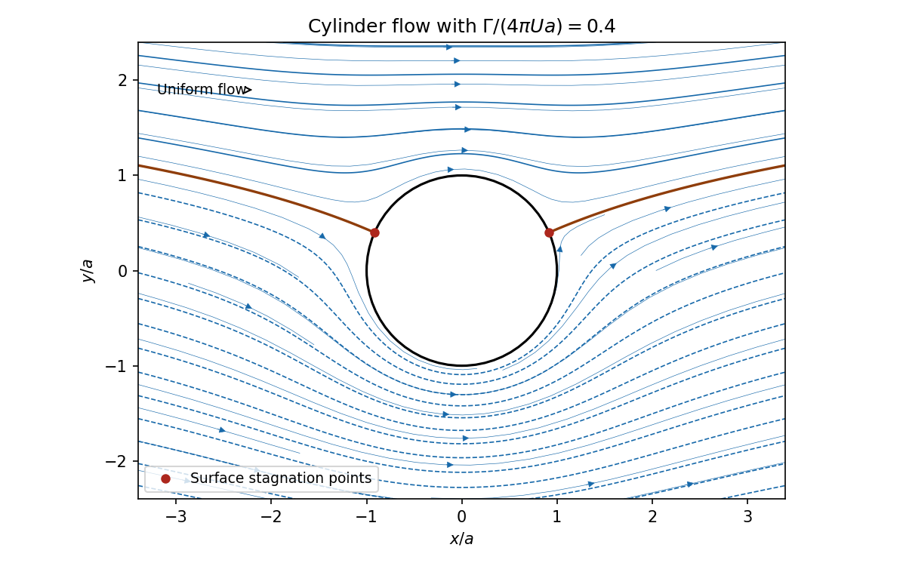

# 2005

↑ **Parent:** [Past exam of the options I course of the University of Oxford](../past-exam-of-the-options-i-course-of-the-university-of-oxford.md)

**Table of contents**

- [A](#a)
  - [1](#a/1)
    - [Solution](#a/1/solution)
- [B](#b)
  - [1](#b/1)
    - [i](#b/1/i)
      - [Solution](#b/1/i/solution)
    - [ii](#b/1/ii)
      - [Solution](#b/1/ii/solution)
    - [iii](#b/1/iii)
      - [Solution](#b/1/iii/solution)
- [C](#c)
  - [1](#c/1)
    - [a](#c/1/a)
      - [i](#c/1/a/i)
        - [Solution](#c/1/a/i/solution)
      - [ii](#c/1/a/ii)
        - [Solution](#c/1/a/ii/solution)
      - [iii](#c/1/a/iii)
        - [Solution](#c/1/a/iii/solution)
    - [b](#c/1/b)
      - [Solution](#c/1/b/solution)
- [D](#d)
  - [1](#d/1)
    - [i](#d/1/i)
      - [Solution](#d/1/i/solution)
    - [ii](#d/1/ii)
      - [Solution](#d/1/ii/solution)
    - [iii](#d/1/iii)
      - [Solution](#d/1/iii/solution)
  - [2](#d/2)
    - [i](#d/2/i)
      - [Solution](#d/2/i/solution)
    - [ii](#d/2/ii)
      - [Solution](#d/2/ii/solution)
- [E](#e)
  - [1](#e/1)
    - [Solution](#e/1/solution)
  - [2](#e/2)
    - [Solution](#e/2/solution)
- [F](#f)
  - [1](#f/1)
    - [i](#f/1/i)
      - [Solution](#f/1/i/solution)
    - [ii](#f/1/ii)
      - [Solution](#f/1/ii/solution)
    - [iii](#f/1/iii)
      - [Solution](#f/1/iii/solution)
    - [iv](#f/1/iv)
      - [Solution](#f/1/iv/solution)
- [G](#g)
  - [1](#g/1)
    - [Solution](#g/1/solution)
- [H](#h)
  - [1](#h/1)
    - [Solution](#h/1/solution)
- [J](#j)
  - [1](#j/1)
    - [Solution](#j/1/solution)
- [K](#k)
  - [1](#k/1)
    - [Solution](#k/1/solution)
  - [2](#k/2)
    - [Solution](#k/2/solution)
- [M](#m)
  - [1](#m/1)
    - [Solution](#m/1/solution)
- [N](#n)
  - [1](#n/1)
    - [Solution](#n/1/solution)
- [O](#o)
  - [1](#o/1)
    - [i](#o/1/i)
      - [Solution](#o/1/i/solution)
    - [ii](#o/1/ii)
      - [Solution](#o/1/ii/solution)
    - [iii](#o/1/iii)
      - [Solution](#o/1/iii/solution)
  - [2](#o/2)
    - [Solution](#o/2/solution)
- [P](#p)
  - [1](#p/1)
    - [Solution](#p/1/solution)
  - [2](#p/2)
    - [Solution](#p/2/solution)

## A

↑ **Parent:** [2005](2005.md)

<h3 id="a/1">1</h3>

↑ **Parent:** [A](#a)

<h4 id="a/1/solution">Solution</h4>

↑ **Parent:** [1](#a/1)

Use the right-action convention printed in the paper: $\omega1=\omega$ and $(\omega g)h=\omega(gh)$. The [orbit of a group action](../group-action.md#orbit-group-theory) and [stabilizer](../group-action.md#stabilizer-subgroup) are

$$
\operatorname{Orb}(\omega)=\{\omega g:g\in G\},\qquad H=\operatorname{Stab}(\omega)=\{g\in G:\omega g=\omega\}.
$$

The identity belongs to $H$, products of elements of $H$ fix $\omega$, and $\omega g=\omega$ implies $\omega g^{-1}=\omega$. Thus $H$ is a [subgroup](../group.md#subgroup). For $k\in G$,

$$
k\in\operatorname{Stab}(\omega g)\iff\omega gkg^{-1}=\omega\iff gkg^{-1}\in H,
$$

proving **$\operatorname{Stab}(\omega g)=g^{-1}Hg$**.

The rotational action on the eight vertices of a [cube](../euclidean-geometry.md#cube) is **[transitive](../set-theory.md#transitive-relation)**. Model the vertices as $(\pm1,\pm1,\pm1)$. For any desired sign triple, choose a permutation whose parity makes the corresponding [signed permutation matrix](../vector-space.md#signed-permutation-matrix) have [determinant](../multilinear-algebra.md#determinant) one; it maps $(1,1,1)$ to that vertex and preserves the [cube](../euclidean-geometry.md#cube). A [rotation](../riemannian-geometry.md#rotation-mathematics) fixing a vertex fixes the axis through that vertex, the centre and the opposite vertex. It cyclically permutes the three incident edges, giving precisely [rotations](../riemannian-geometry.md#rotation-mathematics) by $0,2\pi/3,4\pi/3$. Thus **the [stabilizer](../group-action.md#stabilizer-subgroup) is cyclic of order three**.

## B

↑ **Parent:** [2005](2005.md)

<h3 id="b/1">1</h3>

↑ **Parent:** [B](#b)

<h4 id="b/1/i">i</h4>

↑ **Parent:** [1](#b/1)

<h5 id="b/1/i/solution">Solution</h5>

↑ **Parent:** [I](#b/1/i)

An element is algebraic over $F$ when some nonzero [polynomial](../polynomial.md) in $F[x]$ vanishes at it. Its [minimal polynomial](../linear-operator-theory.md#minimal-polynomial) is the [monic polynomial](../polynomial.md#monic-polynomial) of least positive [degree](../polynomial.md#degree-of-a-polynomial) with this property; scaling a least-[degree](../polynomial.md#degree-of-a-polynomial) nonzero vanishing [polynomial](../polynomial.md) makes it monic.

If $m_1,m_2$ are two such [polynomials](../polynomial.md), they have the same least [degree](../polynomial.md#degree-of-a-polynomial). Their difference has smaller [degree](../polynomial.md#degree-of-a-polynomial) because both are monic, and it also vanishes at $a$. Minimality forces the difference to be zero. Hence **the monic [minimal polynomial](../linear-operator-theory.md#minimal-polynomial) is unique**.

<h4 id="b/1/ii">ii</h4>

↑ **Parent:** [1](#b/1)

<h5 id="b/1/ii/solution">Solution</h5>

↑ **Parent:** [Ii](#b/1/ii)

Divide $f$ by $m$ in the [polynomial ring](../commutative-algebra.md#polynomial-ring) over the field: $f=qm+r$, where $r=0$ or $\deg r<\deg m$. If $f(a)=0$, then $r(a)=0$, and minimality forces $r=0$. Conversely a multiple of $m$ vanishes at $a$. Therefore

$$
\boxed{f(a)=0\iff m\mid f.}
$$

This includes the zero [polynomial](../polynomial.md).

<h4 id="b/1/iii">iii</h4>

↑ **Parent:** [1](#b/1)

<h5 id="b/1/iii/solution">Solution</h5>

↑ **Parent:** [Iii](#b/1/iii)

If $m=uv$ with both factors of positive [degree](../polynomial.md#degree-of-a-polynomial), evaluation gives $u(a)v(a)=0$. Since $K$ is a field, one factor vanishes at $a$, contrary to the minimal [degree](../polynomial.md#degree-of-a-polynomial) of $m$. Thus **$m$ is an [irreducible polynomial](../polynomial.md#irreducible-polynomial) over $F$**.

For the final unnumbered request, $\zeta=e^{\pi i/3}=\frac12+i\frac{\sqrt3}2$ satisfies $\zeta^2-\zeta+1=0$. The monic quadratic $x^2-x+1$ has no rational root, since its discriminant is $-3$. It is therefore an [irreducible polynomial](../polynomial.md#irreducible-polynomial) over $\mathbb Q$, and

$$
\boxed{m_\zeta(x)=x^2-x+1.}
$$

## C

↑ **Parent:** [2005](2005.md)

<h3 id="c/1">1</h3>

↑ **Parent:** [C](#c)

<h4 id="c/1/a">a</h4>

↑ **Parent:** [1](#c/1)

<h5 id="c/1/a/i">i</h5>

↑ **Parent:** [A](#c/1/a)

<h6 id="c/1/a/i/solution">Solution</h6>

↑ **Parent:** [I](#c/1/a/i)

The [Legendre symbol](../quadratic-residue.md#legendre-symbol) is

$$
\boxed{\left(\frac ap\right)=\begin{cases}0,&p\mid a,\\1,&a\text{ is a nonzero square modulo }p,\\-1,&a\text{ is a nonsquare modulo }p.\end{cases}}
$$

The definition depends only on the residue class of $a$ modulo the odd [prime](../prime-number.md) $p$.

<h5 id="c/1/a/ii">ii</h5>

↑ **Parent:** [A](#c/1/a)

<h6 id="c/1/a/ii/solution">Solution</h6>

↑ **Parent:** [Ii](#c/1/a/ii)

[Euler's criterion](../quadratic-residue.md#euler-s-criterion) is

$$
\boxed{a^{(p-1)/2}\equiv\left(\frac ap\right)\pmod p.}
$$

It applies also when $p\mid a$. In particular, for a nonzero residue the power is one or minus one according as the residue is a square or a nonsquare.

<h5 id="c/1/a/iii">iii</h5>

↑ **Parent:** [A](#c/1/a)

<h6 id="c/1/a/iii/solution">Solution</h6>

↑ **Parent:** [Iii](#c/1/a/iii)

For distinct odd primes $p,q$, [quadratic reciprocity](../number-theory.md#quadratic-reciprocity) states

$$
\boxed{\left(\frac pq\right)\left(\frac qp\right)=(-1)^{(p-1)(q-1)/4}.}
$$

Thus the two symbols agree unless both primes are three modulo four, in which case they have opposite signs.

<h4 id="c/1/b">b</h4>

↑ **Parent:** [1](#c/1)

<h5 id="c/1/b/solution">Solution</h5>

↑ **Parent:** [B](#c/1/b)

[Euler's criterion](../quadratic-residue.md#euler-s-criterion) implies multiplicativity of the symbol on nonzero residues and gives $(-1/p)=(-1)^{(p-1)/2}$. Apply [quadratic reciprocity](../number-theory.md#quadratic-reciprocity) with the odd [prime](../prime-number.md) 3:

$$
\left(\frac{-3}p\right)=(-1)^{(p-1)/2}\left(\frac3p\right)=(-1)^{(p-1)/2}(-1)^{(p-1)/2}\left(\frac p3\right)=\left(\frac p3\right).
$$

The only nonzero square modulo three is one. Since $p>3$,

$$
\boxed{\left(\frac{-3}p\right)=\begin{cases}1,&p\equiv1\pmod3,\\-1,&p\equiv2\pmod3.\end{cases}}
$$

## D

↑ **Parent:** [2005](2005.md)

<h3 id="d/1">1</h3>

↑ **Parent:** [D](#d)

<h4 id="d/1/i">i</h4>

↑ **Parent:** [1](#d/1)

<h5 id="d/1/i/solution">Solution</h5>

↑ **Parent:** [I](#d/1/i)

A set $E\subseteq[0,1]$ is null when for every $\varepsilon>0$ it can be covered by countably many open intervals whose lengths sum to less than $\varepsilon$. Equivalently its [Lebesgue outer measure](../measure-theory.md#lebesgue-outer-measure) is zero. This definition does not presuppose measurability of $E$.

<h4 id="d/1/ii">ii</h4>

↑ **Parent:** [1](#d/1)

<h5 id="d/1/ii/solution">Solution</h5>

↑ **Parent:** [Ii](#d/1/ii)

Let $E_n$ be null. Given $\varepsilon>0$, cover $E_n$ by intervals of total length less than $\varepsilon2^{-n}$, for $n\geq1$. The union of all these interval families is [countable](../cardinal-number.md#countable-set), covers $\bigcup_nE_n$, and has total length less than $\sum_n\varepsilon2^{-n}=\varepsilon$. Thus **the [countable union](../set.md#countable-union) is null**.

<h4 id="d/1/iii">iii</h4>

↑ **Parent:** [1](#d/1)

<h5 id="d/1/iii/solution">Solution</h5>

↑ **Parent:** [Iii](#d/1/iii)

Take the middle-thirds [Cantor set](../geometry-and-topology.md#cantor-set) $C$. Its $n$th stage is the union of $2^n$ closed intervals of length $3^{-n}$, and contains $C$. Their total length is $(2/3)^n\to0$; slightly enlarging them to open intervals gives covers of arbitrarily small total length. Therefore **$C$ is null**.

For uncountability map every [binary sequence](../sequence-and-series.md#bitstream) $(\varepsilon_j)_{j\geq1}$ to $\sum_{j\geq1}2\varepsilon_j3^{-j}\in C$. If two sequences first differ at index $k$, their image difference in absolute value is at least $2\cdot3^{-k}-\sum_{j>k}2\cdot3^{-j}=3^{-k}>0$. Thus the map is injective. The set of [binary sequences](../sequence-and-series.md#bitstream) is [uncountable](../cardinal-number.md#uncountable-set) by [Cantor's diagonal argument](../cardinal-number.md#cantor-s-diagonal-argument), so **$C$ is [uncountable](../cardinal-number.md#uncountable-set)**.

<h3 id="d/2">2</h3>

↑ **Parent:** [D](#d)

<h4 id="d/2/i">i</h4>

↑ **Parent:** [2](#d/2)

<h5 id="d/2/i/solution">Solution</h5>

↑ **Parent:** [I](#d/2/i)

Since $\log x\leq0$ on $(0,1]$, substitute $x=e^{-s}$ to obtain

$$
\int_0^1|x^{t-1}\log x|\,dx=\int_0^\infty se^{-ts}\,ds=\frac1{t^2}<\infty\qquad(t>0).
$$

The [functions](../function.md) are measurable, so this proves [Lebesgue integrability](../measure-theory.md#integrability). Also $0<e^{-x}\leq1$ gives $|h_t(x)|\leq|g_t(x)|$. Hence **$h_t$ is integrable on $(0,1]$ as well**.

<h4 id="d/2/ii">ii</h4>

↑ **Parent:** [2](#d/2)

<h5 id="d/2/ii/solution">Solution</h5>

↑ **Parent:** [Ii](#d/2/ii)

A useful differentiation theorem says: if $f(t,x)$ is integrable in $x$, differentiable in $t$ for almost every $x$, and on a [neighborhood](../topology.md#neighbourhood-mathematics) of each parameter value the derivative is [bounded](../topological-analysis.md#boundedness) in absolute value by one [integrable function](../measure-theory.md#lebesgue-integrable-function) of $x$, then the integral is differentiable and its derivative is the integral of $\partial_tf$. The proof applies [dominated convergence](../measure-theory.md#dominated-convergence-theorem) to difference quotients, [bounded](../topological-analysis.md#boundedness) by that same majorant by the [mean value theorem](../calculus.md#mean-value-theorem).

Fix $t_0>0$ and choose $0<a<t_0<b$. For $t\in[a,b]$,

$$
|e^{-x}x^{t-1}\log x|\leq\begin{cases}x^{a-1}|\log x|,&0<x\leq1,\\ e^{-x}x^{b-1}\log x,&x\geq1.\end{cases}
$$

The first part is integrable by part (i). The second is integrable by the permitted hypothesis for $h_b$; alternatively [exponential decay](../analysis.md#exponential-decay) dominates its [polynomial](../polynomial.md) and logarithmic factors. The theorem therefore applies locally at every $t_0$, giving

$$
\boxed{\Gamma'(t)=\int_0^\infty e^{-x}x^{t-1}\log x\,dx\qquad(t>0).}
$$

## E

↑ **Parent:** [2005](2005.md)

<h3 id="e/1">1</h3>

↑ **Parent:** [E](#e)

<h4 id="e/1/solution">Solution</h4>

↑ **Parent:** [1](#e/1)

A [topology](../topology.md) on $X$ contains $\varnothing,X$, is closed under arbitrary unions and under finite intersections. The cofinite family has these properties: a nonempty union contains one cofinite member and therefore has finite complement; the complement of a finite intersection is a finite union of finite sets. The empty union and the sets $X,\varnothing$ are included explicitly.

Any two nonempty [open sets](../topology.md#open-set) intersect, because their intersection has finite complement in the infinite set $X$. Thus no two disjoint nonempty [open sets](../topology.md#open-set) can separate $X$, proving **[connectedness](../geometry-and-topology.md#connected-space)**. For [compactness](../topology.md#compact-space), take any [open cover](../topology.md#open-cover) and choose a nonempty member $U$. Only finitely many points lie outside $U$. Choose one covering member for each of those points. Together with $U$ these give a [finite subcover](../topology.md#finite-subcover). Thus **$X$ is compact**.

<h3 id="e/2">2</h3>

↑ **Parent:** [E](#e)

<h4 id="e/2/solution">Solution</h4>

↑ **Parent:** [2](#e/2)

[Continuity](../calculus.md#continuous-function) means that the [inverse image](../set-theory.md#preimage) of every open subset of $Y$ is open in $X$. If $x\in\overline A$ and $V$ is an [open neighborhood](../topology.md#open-neighbourhood) of $f(x)$, then $f^{-1}(V)$ is an [open neighborhood](../topology.md#open-neighbourhood) of $x$, so it meets $A$. Thus $V$ meets $f(A)$. The [closure](../topology.md#closure-topology) characterization gives

$$
\boxed{f(\overline A)\subseteq\overline{f(A)}.}
$$

If $B$ is empty the assertion is immediate. Otherwise, if $B$ is [bounded](../topological-analysis.md#boundedness), choose a centre $p$ and $R<\infty$ with $d(p,b)\leq R$ for all $b\in B$. The [closed ball](../topological-analysis.md#closed-ball) $\{y:d(p,y)\leq R\}$ is closed because $|d(p,y)-d(p,z)|\leq d(y,z)$. It therefore contains $\overline B$. Hence **the [closure](../topology.md#closure-topology) of a [bounded set](../topological-analysis.md#bounded-set) is [bounded](../topological-analysis.md#boundedness)**. Empty sets cause no exception. If $f(A)$ is [bounded](../topological-analysis.md#boundedness), its [closure](../topology.md#closure-topology) is [bounded](../topological-analysis.md#boundedness) by this result, and the displayed inclusion makes **$f(\overline A)$ [bounded](../topological-analysis.md#boundedness)** too.

## F

↑ **Parent:** [2005](2005.md)

<h3 id="f/1">1</h3>

↑ **Parent:** [F](#f)

<h4 id="f/1/i">i</h4>

↑ **Parent:** [1](#f/1)

<h5 id="f/1/i/solution">Solution</h5>

↑ **Parent:** [I](#f/1/i)

The [total derivative](../calculus.md#total-derivative) is a [linear map](../vector-space.md#linear-map) $Df(a):\mathbb R^n\to\mathbb R^n$ such that

$$
\boxed{f(a+h)=f(a)+Df(a)h+r(h),\qquad\frac{\|r(h)\|}{\|h\|}\longrightarrow0\quad(h\to0).}
$$

It is unique: the difference of two such [linear maps](../vector-space.md#linear-map), evaluated on $h=tv$, must vanish on every fixed [vector](../vector-space.md#vector) $v$ after division by $t$ and passage to the limit.

<h4 id="f/1/ii">ii</h4>

↑ **Parent:** [1](#f/1)

<h5 id="f/1/ii/solution">Solution</h5>

↑ **Parent:** [Ii](#f/1/ii)

The [directional derivative](../multivariable-calculus.md#directional-derivative) in the specified [vector](../vector-space.md#vector) direction is

$$
\boxed{D_{\mathbf u}f(a)=\lim_{t\to0}\frac{f(a+t\mathbf u)-f(a)}t=Df(a)\mathbf u.}
$$

The equality follows from the total-derivative remainder estimate; for the zero direction the result is zero. The convention keeps the supplied [vector](../vector-space.md#vector) and does not replace it by a unit [vector](../vector-space.md#vector).

<h4 id="f/1/iii">iii</h4>

↑ **Parent:** [1](#f/1)

<h5 id="f/1/iii/solution">Solution</h5>

↑ **Parent:** [Iii](#f/1/iii)

The $j$th column of the [matrix](../vector-space.md#matrix) of $Df(a)$ in the standard bases is $Df(a)e_j$. Its $i$th component is $\partial f_i/\partial x_j(a)$, found by taking increments $te_j$. Thus **the [matrix](../vector-space.md#matrix) of the [total derivative](../calculus.md#total-derivative) is the [Jacobian matrix](../multivariable-calculus.md#jacobian-matrix)**, with entry $(i,j)$ equal to $\partial f_i/\partial x_j(a)$.

<h4 id="f/1/iv">iv</h4>

↑ **Parent:** [1](#f/1)

<h5 id="f/1/iv/solution">Solution</h5>

↑ **Parent:** [Iv](#f/1/iv)

Applying the [chain rule](../calculus.md#chain-rule) to both inverse identities gives

$$
\boxed{D(f^{-1})(f(a))=[Df(a)]^{-1}.}
$$

For the unnumbered calculation, the requested point is $f(c,c)$. The Jacobian there is

$$
Df(c,c)=\begin{pmatrix}e^c&e^c\\e^c&-e^{-c}\end{pmatrix},\qquad\det Df(c,c)=-(e^{2c}+1)\ne0.
$$

To apply its inverse to $(1/2,1/2)$, solve $e^c(v_1+v_2)=1/2$, $e^cv_1-e^{-c}v_2=1/2$. Subtraction gives $v_2=0$, and hence

$$
\boxed{D_{(1/2,1/2)}f^{-1}(2e^c,2\cosh c)=\left(\frac{e^{-c}}2,0\right).}
$$

For precision, the displayed example maps bijectively onto $V=\{(s,t):s>0,t>0,st>1\}$, rather than the entire positive quadrant. Indeed writing $q=e^x$, the equations are $(s-q)(t-q)=1$ with $0<q<\min(s,t)$. This left side decreases continuously from $st$ to zero, giving exactly one $q$ if and only if $st>1$, after which $e^y=s-q$ is unique. Its Jacobian never vanishes, so the inverse is differentiable on $V$. The requested point lies in $V$, making the calculation well-defined.

## G

↑ **Parent:** [2005](2005.md)

<h3 id="g/1">1</h3>

↑ **Parent:** [G](#g)

<h4 id="g/1/solution">Solution</h4>

↑ **Parent:** [1](#g/1)

For fixed endpoint values, the [Euler-Lagrange equation](../analysis.md#euler-lagrange-equation) is

$$
\boxed{\frac d{dx}F_{y'}(x,y,y')-F_y(x,y,y')=0.}
$$

It follows by differentiating the functional along $y+\varepsilon\eta$ with $\eta(0)=\eta(\pi)=0$, integrating the $F_{y'}\eta'$ term by parts and applying the [fundamental lemma of the calculus of variations](../calculus-of-variations.md#fundamental-lemma-of-the-calculus-of-variations).

For this quadratic integrand it becomes $y''+ky=0$. If $k>0$, write $\nu=\sqrt k$; the condition at zero gives $y=B\sin(\nu x)$, and that at $\pi$ requires $B\sin(\nu\pi)=0$. Consequently **$y=0$ is the only [extremal](../calculus-of-variations.md#extremal) when $\sqrt k$ is not an integer**. If $\sqrt k=n$ is a positive integer, all [extremals](../calculus-of-variations.md#extremal) are

$$
\boxed{y(x)=B\sin(nx),\qquad B\in\mathbb R.}
$$

The integer case $n=0$ must be handled separately: $y''=0$ with both endpoints zero has only $y=0$. If negative real $k$ is allowed, the hyperbolic-[function](../function.md) solutions also yield only zero under these endpoints. These statements concern stationary [functions](../function.md); no minimum is assumed.

## H

↑ **Parent:** [2005](2005.md)

<h3 id="h/1">1</h3>

↑ **Parent:** [H](#h)

<h4 id="h/1/solution">Solution</h4>

↑ **Parent:** [1](#h/1)

[Polar coordinates](../multivariable-calculus.md#polar-coordinates) give speed squared $\dot r^2+r^2\dot\theta^2$, so unit [mass](../classical-mechanics.md#mass) has [kinetic energy](../energy.md#kinetic-energy) $T=\frac12(\dot r^2+r^2\dot\theta^2)$. The radial [force](../force.md) is $-1/r^2=-V'(r)$, giving $V=-1/r$ after choosing the additive constant zero. Therefore $L=T-V$ is the stated expression.

The two [Euler-Lagrange equations](../analysis.md#euler-lagrange-equation) are

$$
\boxed{\ddot r-r\dot\theta^2=-\frac1{r^2},\qquad\frac d{dt}(r^2\dot\theta)=0.}
$$

The second gives [conservation of angular momentum](../momentum.md#conservation-of-angular-momentum) $\ell=r^2\dot\theta$. The [mechanical energy](../energy.md#mechanical-energy) is

$$
\boxed{E=\frac12(\dot r^2+r^2\dot\theta^2)-\frac1r.}
$$

Direct differentiation expresses its derivative as

$$
\dot E=\dot r\left(\ddot r-r\dot\theta^2+\frac1{r^2}\right)+\dot\theta\frac d{dt}(r^2\dot\theta)=0.
$$

Thus [energy](../energy.md) is conserved for the motion wherever $r>0$.

## J

↑ **Parent:** [2005](2005.md)

<h3 id="j/1">1</h3>

↑ **Parent:** [J](#j)

<h4 id="j/1/solution">Solution</h4>

↑ **Parent:** [1](#j/1)

The [time-independent Schrödinger equation](../mathematical-physics.md#time-independent-schrodinger-equation) is

$$
-\frac{\hbar^2}{2m}\psi''(x)+\frac12m\omega^2x^2\psi(x)=E\psi(x).
$$

Put $\alpha=m\omega/\hbar$. For $\psi=e^{-\alpha x^2/2}$, differentiation gives $\psi''=(\alpha^2x^2-\alpha)\psi$. Substitution cancels the terms in $x^2$ and leaves $E_0=\hbar^2\alpha/(2m)=\hbar\omega/2$.

The [Gaussian integral](../integral.md#gaussian-integral) gives $\int e^{-\alpha x^2}\,dx=\sqrt{\pi/\alpha}$. Hence a normalized [wave function](../wave-function.md) is

$$
\boxed{\psi_0(x)=\left(\frac{m\omega}{\pi\hbar}\right)^{1/4}\exp\left(-\frac{m\omega x^2}{2\hbar}\right).}
$$

Multiplication by any constant of modulus one gives the same [quantum state](../quantum-system.md#quantum-state). The [position](../classical-mechanics.md#position) [probability density](../wave-function.md#probability-density) is $|\psi_0|^2=\sqrt{\alpha/\pi}e^{-\alpha x^2}$. Its first [moment](../expected-value.md#moment) vanishes by oddness. [Integration by parts](../calculus.md#integration-by-parts) gives $\int x^2e^{-\alpha x^2}\,dx=(2\alpha)^{-1}\int e^{-\alpha x^2}\,dx$, with the boundary term zero. Therefore

$$
\boxed{\langle x\rangle=0,\qquad\operatorname{Var}(x)=\langle x^2\rangle=\frac{\hbar}{2m\omega}.}
$$

## K

↑ **Parent:** [2005](2005.md)

<h3 id="k/1">1</h3>

↑ **Parent:** [K](#k)

<h4 id="k/1/solution">Solution</h4>

↑ **Parent:** [1](#k/1)

For a material fluid volume, [mass conservation](../continuum-mechanics.md#mass-conservation) yields $\rho_t+\nabla\cdot(\rho\mathbf u)=0$. Constant [mass density](../fluid-mechanics.md#density) reduces this to $\nabla\cdot\mathbf u=0$. For [inviscid flow](../fluid-mechanics.md#inviscid-flow), the [Cauchy stress tensor](../continuum-mechanics.md#cauchy-stress-tensor) is $-pI$; its net surface [force](../force.md) is the volume integral of $-\nabla p$ by the [divergence theorem](../multivariable-calculus.md#divergence-theorem). [Newton's second law](../force.md#newton-s-second-law) for each material volume therefore gives $\rho D\mathbf u/Dt=-\nabla p$. Since $D/Dt=\partial_t+\mathbf u\cdot\nabla$, these are exactly the two stated equations.

In two dimensions they read

$$
u_t+uu_x+vu_y=-p_x/\rho,\qquad v_t+uv_x+vv_y=-p_y/\rho,\qquad u_x+v_y=0.
$$

Differentiate the second momentum equation in $x$ and subtract the $y$ derivative of the first. The [pressure](../pressure.md) terms cancel. For $\omega=v_x-u_y$, collecting terms gives

$$
\omega_t+u\omega_x+v\omega_y+(u_x+v_y)\omega=0.
$$

[Incompressibility](../fluid-mechanics.md#incompressible-flow) removes the last term, giving

$$
\boxed{\frac{D\omega}{Dt}=0.}
$$

Thus **each fluid parcel retains its scalar [vorticity](../vorticity.md)** as it moves. In particular an initially [irrotational flow](../vorticity.md#irrotational-flow) remains irrotational in this smooth two-dimensional inviscid evolution. There is no [vortex stretching](../mathematical-physics.md#vortex-stretching) in this two-dimensional setting.

<h3 id="k/2">2</h3>

↑ **Parent:** [K](#k)

<h4 id="k/2/solution">Solution</h4>

↑ **Parent:** [2](#k/2)

Write the [complex potential of a two-dimensional potential flow](../fluid-mechanics.md#complex-potential-of-a-two-dimensional-potential-flow) as $w=\phi+i\psi$. Its [complex velocity](../fluid-mechanics.md#complex-velocity) is $u-iv=dw/dz$. Here

$$
\frac{dw}{dz}=U\left(1-\frac{a^2}{z^2}\right)-\frac{i\Gamma}{2\pi z}\longrightarrow U\quad(|z|\to\infty),
$$

so the far-field motion has velocity $(U,0)$ and speed $U$. In [polar coordinates](../multivariable-calculus.md#polar-coordinates) the [stream function](../fluid-mechanics.md#stream-function), shifted by a harmless constant, is

$$
\psi(r,\theta)=U\left(r-\frac{a^2}r\right)\sin\theta-\frac\Gamma{2\pi}\log(r/a).
$$

It is zero on $r=a$, proving the cylinder is a [streamline](../fluid-mechanics.md#streamline).

[Stagnation points](../fluid-mechanics.md#stagnation-point) are zeros of $dw/dz$, hence roots of $Uz^2-i\Gamma z/(2\pi)-Ua^2=0$. Put $\gamma=\Gamma/(4\pi Ua)\in(0,1)$. The two roots are

$$
\boxed{z_\pm=\pm a\sqrt{1-\gamma^2}+ia\gamma.}
$$

Both have modulus $a$ and are distinct. Their angles satisfy $\sin\theta=\gamma$, namely $\arcsin\gamma$ and $\pi-\arcsin\gamma$. The tangential velocity on the cylinder is $-2U\sin\theta+\Gamma/(2\pi a)$, confirming the same zeros. [Streamlines](../fluid-mechanics.md#streamline) are level curves of $\psi$; the positive [circulation](../vorticity.md#circulation-physics) places both [stagnation points](../fluid-mechanics.md#stagnation-point) on the upper side and increases the flow speed below the cylinder.

**[Figure 1](#k/2/image-streamlines-and-the-two-surface-stagnation-points-for-positive-subcritical-circulation). Streamlines and the two surface stagnation points for positive subcritical circulation**.

## M

↑ **Parent:** [2005](2005.md)

<h3 id="m/1">1</h3>

↑ **Parent:** [M](#m)

<h4 id="m/1/solution">Solution</h4>

↑ **Parent:** [1](#m/1)

The [moment-generating function](../probability-distribution.md#moment-generating-function) is $M_X(t)=\mathbb E[e^{tX}]$ where finite. For [independent](../random-variable.md#independent-random-variables) $X,Y$, [independence](../random-variable.md#independent-random-variables) factors the expectation, giving $M_{X+Y}(t)=M_X(t)M_Y(t)$ wherever both factors are finite.

For the given [probability density function](../continuous-probability-distribution.md#probability-density-function) and $t<1$, put $s=(1-t)x$ to obtain

$$
M_{X_n}(t)=\frac1{(n-1)!}\int_0^\infty x^{n-1}e^{-(1-t)x}\,dx=\frac{\Gamma(n)}{(n-1)!(1-t)^n}=\boxed{(1-t)^{-n}}.
$$

Here $\Gamma(n)=(n-1)!$, obtained by repeated [integration by parts](../calculus.md#integration-by-parts). For $t\geq1$ the defining integral diverges.

Each $Y_i$ has [moment-generating function](../probability-distribution.md#moment-generating-function) $(1-t)^{-1}$, so [independence](../random-variable.md#independent-random-variables) gives

$$
M_{\sum_{i=1}^nY_i}(t)=(1-t)^{-n}\quad(t<1).
$$

The [uniqueness theorem for moment-generating functions](../probability-distribution.md#uniqueness-theorem-for-moment-generating-functions) applies when the functions are finite on a [neighborhood](../topology.md#neighbourhood-mathematics) of zero. Hence **the sum has the same distribution as $X_n$**, a [Gamma distribution](../continuous-probability-distribution.md#gamma-distribution) of shape $n$ and rate one, with the displayed [probability density function](../continuous-probability-distribution.md#probability-density-function) in the source.

## N

↑ **Parent:** [2005](2005.md)

<h3 id="n/1">1</h3>

↑ **Parent:** [N](#n)

<h4 id="n/1/solution">Solution</h4>

↑ **Parent:** [1](#n/1)

States $i,j$ communicate when each is accessible from the other: $(P^m)_{ij}>0$ and $(P^n)_{ji}>0$ for some nonnegative integers $m,n$. The communicating classes are

$$
\boxed{\{1,4\}\text{ closed},\qquad\{2,3,5\}\text{ open},\qquad\{6\}\text{ closed}.}
$$

Indeed $1$ and $4$ move only between themselves; $2\to5\to3\to2$ links the second class, but it has exits to $1,4,6$ and no return from the closed classes; state 6 is absorbing.

Let $h_i$ be the [probability](../probability-theory.md#probability) of ever reaching 6 from state $i$. Then $h_1=h_4=0$, $h_6=1$, and first-step conditioning gives

$$
h_2=\frac34h_5,\qquad h_3=\frac12h_2+\frac12h_3,\qquad h_5=\frac14h_3+\frac14h_4+\frac14h_5+\frac14.
$$

Thus $h_3=h_2=3h_5/4$ and $3h_5=h_3+1$, giving $h_5=4/9$. Therefore

$$
\boxed{\mathbb P_3(\text{eventual absorption in }6)=\frac13.}
$$

## O

↑ **Parent:** [2005](2005.md)

<h3 id="o/1">1</h3>

↑ **Parent:** [O](#o)

<h4 id="o/1/i">i</h4>

↑ **Parent:** [1](#o/1)

<h5 id="o/1/i/solution">Solution</h5>

↑ **Parent:** [I](#o/1/i)

Under [independence](../random-variable.md#independent-random-variables), the cell [probability](../probability-theory.md#probability) is the product of its row and column probabilities. Estimate these by the sample proportions. If $R_i,C_j$ are row and column totals and $N$ is the grand total, the fitted [expected count](../probability-and-statistics.md#expected-frequency) is

$$
\boxed{E_{ij}=\frac{R_iC_j}{N}.}
$$

Here the row totals are $123,76,163,90$, the column totals $304,65,83$, and $N=452$. For example $E_{11}=123\cdot304/452=82.72566\ldots$, rounding to 82.73 as printed. The other entries follow identically.

<h4 id="o/1/ii">ii</h4>

↑ **Parent:** [1](#o/1)

<h5 id="o/1/ii/solution">Solution</h5>

↑ **Parent:** [Ii](#o/1/ii)

Pearson's statistic is

$$
\boxed{X^2=\sum_{i=1}^4\sum_{j=1}^3\frac{(O_{ij}-E_{ij})^2}{E_{ij}}.}
$$

For [independent](../random-variable.md#independent-random-variables) observations under the [independence](../random-variable.md#independent-random-variables) [null hypothesis](../statistical-hypothesis-test.md#null-hypothesis), its large-sample null distribution is approximately $\chi^2$ with $(4-1)(3-1)=6$ [statistical degrees of freedom](../statistical-inference.md#statistical-degrees-of-freedom). The fitted row and column probabilities account for the reduction in [statistical degrees of freedom](../statistical-inference.md#statistical-degrees-of-freedom). All [expected counts](../probability-and-statistics.md#expected-frequency) exceed five, so the usual approximation has adequate expected cell sizes here. Reject [independence](../random-variable.md#independent-random-variables) when the statistic exceeds the corresponding upper-tail [critical value](../differential-geometry.md#critical-value).

<h4 id="o/1/iii">iii</h4>

↑ **Parent:** [1](#o/1)

<h5 id="o/1/iii/solution">Solution</h5>

↑ **Parent:** [Iii](#o/1/iii)

There are six [statistical degrees of freedom](../statistical-inference.md#statistical-degrees-of-freedom), so the supplied 1% [critical value](../differential-geometry.md#critical-value) is $q_6=16.81$. Since $42.25>16.81$, **reject [independence](../random-variable.md#independent-random-variables) at the 1% [significance level](../statistical-hypothesis-test.md#significance-level)**. The data give strong evidence of an association between the two consumption classifications in this group of participants.

<h3 id="o/2">2</h3>

↑ **Parent:** [O](#o)

<h4 id="o/2/solution">Solution</h4>

↑ **Parent:** [2](#o/2)

A $100(1-\alpha)\%$ [confidence interval](../statistical-inference.md#confidence-interval) procedure produces random endpoints $L,U$ such that $\mathbb P_\mu(L\leq\mu\leq U)=1-\alpha$, under the model. In everyday terms, repeating the same sampling and interval construction many times would give intervals containing the true mean in about $100(1-\alpha)\%$ of repetitions.

For $n\geq2$, define the [sample mean](../variance.md#sample-mean) $\bar X=n^{-1}\sum_iX_i$ and the [sample variance](../statistical-inference.md#sample-variance) $S^2=(n-1)^{-1}\sum_i(X_i-\bar X)^2$. For [independent](../random-variable.md#independent-random-variables) observations from a [normal distribution](../probability-distribution.md#normal-distribution) with $\sigma^2>0$, the standard sampling results are

$$
\frac{\sqrt n(\bar X-\mu)}S\sim t_{n-1},\qquad\frac{(n-1)S^2}{\sigma^2}\sim\chi^2_{n-1}.
$$

The first follows from the [independent](../random-variable.md#independent-random-variables) [normal sample](../statistical-inference.md#normal-sample) mean and [sample variance](../statistical-inference.md#sample-variance). Let $q=t_{n-1,1-\alpha/2}$ be the positive Student [quantile](../probability-distribution.md#quantile-function). Symmetry gives the central [confidence interval](../statistical-inference.md#confidence-interval)

$$
\boxed{\left[\bar X-q\frac S{\sqrt n},\ \bar X+q\frac S{\sqrt n}\right].}
$$

Its width is $W=2qS/\sqrt n$, so

$$
\boxed{c=\frac{n(n-1)}{4t_{n-1,1-\alpha/2}^{\,2}},\qquad \frac{cW^2}{\sigma^2}=\frac{(n-1)S^2}{\sigma^2}\sim\chi^2_{n-1}.}
$$

## P

↑ **Parent:** [2005](2005.md)

<h3 id="p/1">1</h3>

↑ **Parent:** [P](#p)

<h4 id="p/1/solution">Solution</h4>

↑ **Parent:** [1](#p/1)

For a complex [matrix](../vector-space.md#matrix) $C=(c_{ij})$, Gershgorin's theorem puts every [eigenvalue](../linear-operator-theory.md#eigenvalue) in the union of the row discs $D_i=\{z:|z-c_{ii}|\leq R_i\}$, where $R_i=\sum_{j\ne i}|c_{ij}|$. To prove it, choose an [eigenvector](../linear-operator-theory.md#eigenvector) $v$ for an [eigenvalue](../linear-operator-theory.md#eigenvalue) $\lambda$ and an index $i$ maximizing $|v_i|>0$. Its $i$th equation gives

$$
|\lambda-c_{ii}|\,|v_i|\leq\sum_{j\ne i}|c_{ij}|\,|v_j|\leq R_i|v_i|.
$$

Division proves $\lambda\in D_i$.

The usual counting refinement says that a connected component made of $k$ discs contains exactly $k$ [eigenvalues](../linear-operator-theory.md#eigenvalue), with [algebraic multiplicity](../linear-operator-theory.md#algebraic-multiplicity). For completeness, deform the [matrix](../vector-space.md#matrix) from its diagonal part to the original by multiplying all off-diagonal entries by $t\in[0,1]$. Its discs have radii $tR_i$ and stay inside the original discs. Continuous variation of the roots of the [characteristic polynomial](../linear-operator-theory.md#characteristic-polynomial) keeps the number inside any contour separating one original component from the others constant. At $t=0$, the diagonal entries give exactly $k$ roots there, proving the refinement.

For the application put $s=-\mu>0$. The [matrix](../vector-space.md#matrix) is

$$
A+sB=\begin{pmatrix}2+2s&-2&0\\-3&5+2s&s\\1&2+s&3+2s\end{pmatrix}.
$$

Its three row discs have positive real centres and leftmost real coordinates

$$
(2+2s)-2=2s,\qquad(5+2s)-(3+s)=2+s,\qquad(3+2s)-(3+s)=s.
$$

All are strictly positive, so zero lies in none of the discs. It cannot be an [eigenvalue](../linear-operator-theory.md#eigenvalue). Thus **$A-\mu B$ is nonsingular for every real $\mu<0$**.

<h3 id="p/2">2</h3>

↑ **Parent:** [P](#p)

<h4 id="p/2/solution">Solution</h4>

↑ **Parent:** [2](#p/2)

Suppose an approximation has an error expansion $A(h)=I+ch^p+O(h^q)$ with $q>p$. With refinement factor $r>1$, combining the two approximations eliminates the leading term:

$$
\boxed{R(h)=\frac{r^pA(h/r)-A(h)}{r^p-1}=I+O(h^q).}
$$

If further expansion terms are known, repeat the elimination at their successive powers. For an even-power trapezium expansion and repeated halving, this gives the Romberg recurrence $R_{k,j}=(4^jR_{k,j-1}-R_{k-1,j-1})/(4^j-1)$, starting from $R_{k,0}=T(2^{-k})$.

For the stated cubic the one-panel trapezium value is $T(1)=[0^3+1^3]/2=1/2$. The two-panel value is

$$
T(1/2)=\frac14\left[0+2\left(\frac12\right)^3+1\right]=\frac5{16}.
$$

The leading power is two, so one extrapolation step gives

$$
\boxed{\frac{4T(1/2)-T(1)}3=\frac{4(5/16)-1/2}3=\frac14.}
$$

This equals the exact integral $[x^4/4]_0^1=1/4$; for a cubic the trapezium error has only the leading $h^2$ term, which this combination removes exactly.

## ↑ Ancestors (9)

1. [Past exam of the options I course of the University of Oxford](../past-exam-of-the-options-i-course-of-the-university-of-oxford.md)
2. [Options I course of the University of Oxford](../university-of-oxford.md#options-i-course-of-the-university-of-oxford)
3. [Year 2 of the mathematics course of the University of Oxford](../university-of-oxford.md#year-2-of-the-mathematics-course-of-the-university-of-oxford)
4. [Mathematics course of the University of Oxford](../university-of-oxford.md#mathematics-course-of-the-university-of-oxford)
5. [Undergraduate course of the University of Oxford](../university-of-oxford.md#undergraduate-course-of-the-university-of-oxford)
6. [Course of the University of Oxford](../university-of-oxford.md#course-of-the-university-of-oxford)
7. [University of Oxford](../university-of-oxford.md)
8. [List of universities](../README.md#list-of-universities)
9. [Codex Wiki](../README.md)
