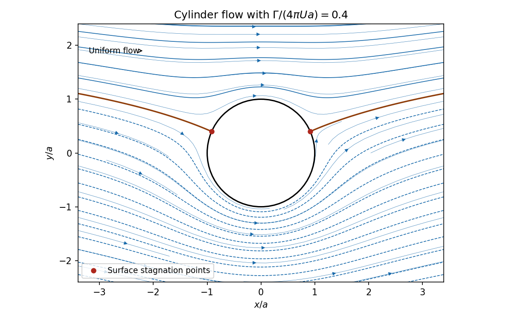

<h1 id="k/2/solution">Solution</h1>

↑ **Parent:** [2](../2.md)

Write the [complex potential of a two-dimensional potential flow](../../../../complex-potential-of-a-two-dimensional-potential-flow.md) as $w=\phi+i\psi$. Its [complex velocity](../../../../complex-velocity.md) is $u-iv=dw/dz$. Here

$$
\frac{dw}{dz}=U\left(1-\frac{a^2}{z^2}\right)-\frac{i\Gamma}{2\pi z}\longrightarrow U\quad(|z|\to\infty),
$$

so the far-field motion has velocity $(U,0)$ and speed $U$. In [polar coordinates](../../../../polar-coordinates.md) the [stream function](../../../../stream-function.md), shifted by a harmless constant, is

$$
\psi(r,\theta)=U\left(r-\frac{a^2}r\right)\sin\theta-\frac\Gamma{2\pi}\log(r/a).
$$

It is zero on $r=a$, proving the cylinder is a [streamline](../../../../streamline.md).

[Stagnation points](../../../../stagnation-point.md) are zeros of $dw/dz$, hence roots of $Uz^2-i\Gamma z/(2\pi)-Ua^2=0$. Put $\gamma=\Gamma/(4\pi Ua)\in(0,1)$. The two roots are

$$
\boxed{z_\pm=\pm a\sqrt{1-\gamma^2}+ia\gamma.}
$$

Both have modulus $a$ and are distinct. Their angles satisfy $\sin\theta=\gamma$, namely $\arcsin\gamma$ and $\pi-\arcsin\gamma$. The tangential velocity on the cylinder is $-2U\sin\theta+\Gamma/(2\pi a)$, confirming the same zeros. [Streamlines](../../../../streamline.md) are level curves of $\psi$; the positive [circulation](../../../../circulation-physics.md) places both [stagnation points](../../../../stagnation-point.md) on the upper side and increases the flow speed below the cylinder.

**[Figure 1](#k/2/image-streamlines-and-the-two-surface-stagnation-points-for-positive-subcritical-circulation). Streamlines and the two surface stagnation points for positive subcritical circulation**.

## ↑ Ancestors (12)

1. [2](../2.md)
2. [K](../../k.md)
3. [2005](../../../2005-split.md)
4. [Past exam of the options I course of the University of Oxford](../../../split.md)
5. [Options I course of the University of Oxford](../../../../options-i-course-of-the-university-of-oxford.md)
6. [Year 2 of the mathematics course of the University of Oxford](../../../../year-2-of-the-mathematics-course-of-the-university-of-oxford.md)
7. [Mathematics course of the University of Oxford](../../../../mathematics-course-of-the-university-of-oxford.md)
8. [Undergraduate course of the University of Oxford](../../../../undergraduate-course-of-the-university-of-oxford.md)
9. [Course of the University of Oxford](../../../../course-of-the-university-of-oxford.md)
10. [University of Oxford](../../../../university-of-oxford-split.md)
11. [List of universities](../../../../list-of-universities.md)
12. [Codex Wiki](../../../../split.md)
