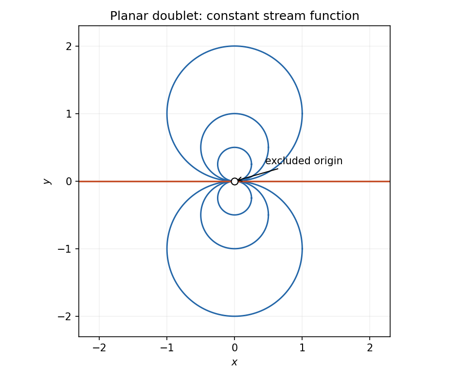

# 2006

↑ **Parent:** [Past exam of the options I course of the University of Oxford](../past-exam-of-the-options-i-course-of-the-university-of-oxford.md)

Options I, Honour School of Mathematics; Friday 23 June 2006, 9.30am–12.30pm. The complete nine-page source was supplied in [the disclosed past-papers archive](https://www.whatdotheyknow.com/request/maths_papers_2/response/1850333/attach/3/FOI%2020210708%201%20Data.zip?cookie_passthrough=1), member “FOI-20210708-1 - Data/4303 (6).pdf”, through [the original request](https://www.whatdotheyknow.com/request/maths_papers_2). The full source is privately transcribed. No exact worked-answer advertisement was found in the bounded availability check.

**Table of contents**

- [A](#a)
  - [A1](#a/a1)
    - [Solution](#a/a1/solution)
- [B](#b)
  - [B1](#b/b1)
    - [i](#b/b1/i)
      - [Solution](#b/b1/i/solution)
    - [ii](#b/b1/ii)
      - [Solution](#b/b1/ii/solution)
    - [Solution](#b/b1/solution)
- [C](#c)
  - [C1](#c/c1)
    - [Solution](#c/c1/solution)
- [D](#d)
  - [D1](#d/d1)
    - [i](#d/d1/i)
      - [Solution](#d/d1/i/solution)
    - [ii](#d/d1/ii)
      - [Solution](#d/d1/ii/solution)
  - [D2](#d/d2)
    - [Solution](#d/d2/solution)
- [E](#e)
  - [E1](#e/e1)
    - [a](#e/e1/a)
      - [Solution](#e/e1/a/solution)
    - [b](#e/e1/b)
      - [Solution](#e/e1/b/solution)
    - [Solution](#e/e1/solution)
  - [E2](#e/e2)
    - [Solution](#e/e2/solution)
    - [i](#e/e2/i)
      - [Solution](#e/e2/i/solution)
    - [ii](#e/e2/ii)
      - [Solution](#e/e2/ii/solution)
    - [iii](#e/e2/iii)
      - [Solution](#e/e2/iii/solution)
- [F](#f)
  - [F1](#f/f1)
    - [i](#f/f1/i)
      - [Solution](#f/f1/i/solution)
    - [ii](#f/f1/ii)
      - [Solution](#f/f1/ii/solution)
- [G](#g)
  - [G1](#g/g1)
    - [Solution](#g/g1/solution)
- [H](#h)
  - [H1](#h/h1)
    - [Solution](#h/h1/solution)
- [J](#j)
  - [J1](#j/j1)
    - [Solution](#j/j1/solution)
- [K](#k)
  - [K1](#k/k1)
    - [i](#k/k1/i)
      - [Solution](#k/k1/i/solution)
    - [ii](#k/k1/ii)
      - [Solution](#k/k1/ii/solution)
    - [iii](#k/k1/iii)
      - [Solution](#k/k1/iii/solution)
  - [K2](#k/k2)
    - [Solution](#k/k2/solution)
- [M](#m)
  - [M1](#m/m1)
    - [Solution](#m/m1/solution)
- [N](#n)
  - [N1](#n/n1)
    - [i](#n/n1/i)
      - [Solution](#n/n1/i/solution)
    - [ii](#n/n1/ii)
      - [Solution](#n/n1/ii/solution)
- [O](#o)
  - [O1](#o/o1)
    - [i](#o/o1/i)
      - [Solution](#o/o1/i/solution)
    - [ii](#o/o1/ii)
      - [Solution](#o/o1/ii/solution)
    - [iii](#o/o1/iii)
      - [Solution](#o/o1/iii/solution)
    - [Solution](#o/o1/solution)
  - [O2](#o/o2)
    - [Solution](#o/o2/solution)
- [P](#p)
  - [P1](#p/p1)
    - [Solution](#p/p1/solution)
    - [i](#p/p1/i)
      - [Solution](#p/p1/i/solution)
    - [ii](#p/p1/ii)
      - [Solution](#p/p1/ii/solution)
  - [P2](#p/p2)
    - [Solution](#p/p2/solution)

## A

↑ **Parent:** [2006](2006.md)

<h3 id="a/a1">A1</h3>

↑ **Parent:** [A](#a)

<h4 id="a/a1/solution">Solution</h4>

↑ **Parent:** [A1](#a/a1)

Write the [group action](../group-action.md) as $(\omega,g)\mapsto\omega g$. A right [group action](../group-action.md) satisfies $\omega1=\omega$ and $(\omega g)h=\omega(gh)$. Its [orbit](../dynamical-systems.md#orbit-dynamical-system) and [stabilizer](../group-action.md#stabilizer-subgroup) are

$$
\operatorname{Orb}(\omega)=\{\omega g:g\in G\},\qquad H=\operatorname{Stab}(\omega)=\{g\in G:\omega g=\omega\}.
$$

The identity belongs to $H$. If $g,h\in H$, then $\omega gh=(\omega g)h=\omega$, so $gh\in H$. Also $\omega g=\omega$ implies $\omega=(\omega g)g^{-1}=\omega g^{-1}$, so $g^{-1}\in H$. Thus $H$ is a [subgroup](../group.md#subgroup).

For the [orbit-stabilizer theorem](../group-action.md#orbit-stabilizer-theorem), the map $G\to\operatorname{Orb}(\omega)$, $g\mapsto\omega g$, is onto, and

$$
\omega g=\omega h\iff gh^{-1}\in H\iff g\in Hh.
$$

Its fibers are precisely the right [cosets](../group-theory.md#coset) $Hh$, each containing $|H|$ elements. Counting these disjoint fibers gives

$$
\boxed{|\operatorname{Orb}(\omega)|=|G|/|H|}.
$$

For the [symmetric group](../finite-group-theory.md#symmetric-group) $S_3$, the six [subgroups](../group.md#subgroup) are

$$
\{1\},\quad \langle(12)\rangle,\quad\langle(13)\rangle,\quad\langle(23)\rangle,\quad A_3=\{1,(123),(132)\},\quad S_3.
$$

The [group action](../group-action.md) $H\mapsto g^{-1}Hg$ has **four orbits**: each of $\{1\}$, $A_3$, and $S_3$ is fixed, while the three order-two [subgroups](../group.md#subgroup) form one [orbit](../dynamical-systems.md#orbit-dynamical-system). Here an [orbit](../dynamical-systems.md#orbit-dynamical-system) is a collection of [subgroups](../group.md#subgroup), rather than a collection of individual permutations.

## B

↑ **Parent:** [2006](2006.md)

<h3 id="b/b1">B1</h3>

↑ **Parent:** [B](#b)

<h4 id="b/b1/i">i</h4>

↑ **Parent:** [B1](#b/b1)

<h5 id="b/b1/i/solution">Solution</h5>

↑ **Parent:** [I](#b/b1/i)

A [field extension](../algebra.md#field-extension) $K/F$ is finite when $K$, regarded as a [vector space](../vector-space.md) over $F$, has finite [dimension](../vector-space.md#dimension-vector-space). Its [degree of a field extension](../algebra.md#degree-of-a-field-extension) is

$$
\boxed{[K:F]=\dim_F K}.
$$

Thus a finite [basis](../vector-space.md#basis) $u_1,\ldots,u_m$ means that every $k\in K$ is uniquely expressible as $\sum_i c_i u_i$ with coefficients $c_i\in F$.

<h4 id="b/b1/ii">ii</h4>

↑ **Parent:** [B1](#b/b1)

<h5 id="b/b1/ii/solution">Solution</h5>

↑ **Parent:** [Ii](#b/b1/ii)

Since $K$ is an $F$-[vector subspace](../vector-space.md#vector-subspace) of the finite-dimensional [vector space](../vector-space.md) $L$, it has a finite $F$-[basis](../vector-space.md#basis) $u_1,\ldots,u_m$. Any finite $F$-spanning set for $L$ also spans $L$ over $K$, so choose a finite $K$-[basis](../vector-space.md#basis) $v_1,\ldots,v_r$ of $L$.

Every $\ell\in L$ can be expanded first in the $v_j$ and then in the $u_i$, showing that the products $u_i v_j$ span $L$ over $F$. If $\sum_{i,j}c_{ij}u_i v_j=0$ with $c_{ij}\in F$, [independence](../random-variable.md#independent-random-variables) of the $v_j$ over $K$ gives $\sum_i c_{ij}u_i=0$ for every $j$; [independence](../random-variable.md#independent-random-variables) of the $u_i$ then gives every $c_{ij}=0$. The products form an $F$-[basis](../vector-space.md#basis), proving the [tower law for field extensions](../galois-theory.md#tower-law-for-field-extensions):

$$
\boxed{[L:F]=rm=[L:K][K:F]}.
$$

<h4 id="b/b1/solution">Solution</h4>

↑ **Parent:** [B1](#b/b1)

Put $E=F(a,b)$. The [tower law for field extensions](../galois-theory.md#tower-law-for-field-extensions) shows that both $m$ and $n$ divide $[E:F]$. Since $m,n$ are [coprime](../divisibility.md#coprime-integers), their product divides $[E:F]$, so $[E:F]\geq mn$.

The [minimal polynomial](../linear-operator-theory.md#minimal-polynomial) of $b$ over $F$ has degree $n$ and is still an annihilating [polynomial](../polynomial.md) over $F(a)$. The [minimal polynomial](../linear-operator-theory.md#minimal-polynomial) over $F(a)$ divides it, so

$$
[E:F(a)]\leq n,\qquad [E:F]=[E:F(a)]m\leq mn.
$$

The upper and lower bounds agree:

$$
\boxed{[F(a,b):F]=mn}.
$$

Coprimality is the step forcing the lower bound to equal the product; without it the two generated [fields](../algebra.md#field) can overlap substantially.

## C

↑ **Parent:** [2006](2006.md)

<h3 id="c/c1">C1</h3>

↑ **Parent:** [C](#c)

<h4 id="c/c1/solution">Solution</h4>

↑ **Parent:** [C1](#c/c1)

Use the agreed text encoding to split the plaintext into integer blocks $m_j\in\{0,\ldots,1072\}$. [RSA](../algebra.md#rsa-cryptosystem) encrypts each block by [modular exponentiation](../number-theory.md#modular-exponentiation):

$$
r_j\equiv m_j^{11}\pmod{1073}.
$$

Because $1073=29\cdot37$ is a product of distinct [primes](../prime-number.md), its [Euler totient function](../number-theory.md#euler-totient-function) is $\varphi(1073)=28\cdot36=1008$. The inverse exponent follows from

$$
11\cdot275=3025=1+3\cdot1008.
$$

Thus **a decryption exponent is 275**, and the three recovered blocks are

$$
\boxed{m_j\equiv r_j^{275}\pmod{1073},\quad0\leq m_j<1073,\quad j=1,2,3}.
$$

To check every block, including blocks not [coprime](../divisibility.md#coprime-integers) to the modulus, reduce modulo each prime. If $m_j$ is nonzero modulo 29, [Fermat's little theorem](../number-theory.md#fermat-little-theorem) gives $m_j^{3025}=m_j$ because $28\mid3024$; if it is zero the equality is immediate. The same argument works modulo 37 because $36\mid3024$. The [Chinese remainder theorem](../mathematics.md#chinese-remainder-theorem) then gives the equality modulo 1073. Finally reverse the agreed text encoding. The symbols $r_1,r_2,r_3$ are unspecified, so there are no numerical message blocks to evaluate further.

## D

↑ **Parent:** [2006](2006.md)

<h3 id="d/d1">D1</h3>

↑ **Parent:** [D](#d)

<h4 id="d/d1/i">i</h4>

↑ **Parent:** [D1](#d/d1)

<h5 id="d/d1/i/solution">Solution</h5>

↑ **Parent:** [I](#d/d1/i)

The Gaussian function is continuous and hence [Lebesgue measurable](../measure-theory.md#lebesgue-measurable-set). For $|x|\geq2$, $x^2/2\geq|x|$, and therefore

$$
0\leq e^{-x^2/2}\leq\mathbf1_{[-2,2]}(x)+e^{-|x|}.
$$

The right side has finite [Lebesgue integral](../measure-theory.md#lebesgue-integral): its first term has integral 4 and the second is [Lebesgue integrable](../measure-theory.md#lebesgue-integrable-function) by hypothesis. The comparison principle for the [Lebesgue integral](../measure-theory.md#lebesgue-integral) says that a measurable nonnegative function dominated by an [integrable function](../measure-theory.md#lebesgue-integrable-function) has finite integral. Consequently **the Gaussian function is [Lebesgue integrable](../measure-theory.md#lebesgue-integrable-function)**.

<h4 id="d/d1/ii">ii</h4>

↑ **Parent:** [D1](#d/d1)

<h5 id="d/d1/ii/solution">Solution</h5>

↑ **Parent:** [Ii](#d/d1/ii)

A real measurable function is [Lebesgue integrable](../measure-theory.md#lebesgue-integrable-function) precisely when the integral of its absolute value is finite. For every integer $k\geq1$, on $I_k=[k+1/6,k+5/6]$ one has $|\sin\pi x|\geq1/2$ and $x\leq k+1$. Consequently

$$
\int_{I_k}\frac{|\sin\pi x|}{x}\,dx\geq\frac{1}{3(k+1)}.
$$

The intervals have disjoint interiors. Countable additivity of the nonnegative [Lebesgue integral](../measure-theory.md#lebesgue-integral), or the [monotone convergence theorem](../measure-theory.md#monotone-convergence-theorem) applied to their finite unions, gives

$$
\int_1^\infty\frac{|\sin\pi x|}{x}\,dx\geq\frac13\sum_{k=1}^\infty\frac1{k+1}=\infty.
$$

The [harmonic series](../sequence-and-series.md#harmonic-series) diverges, so the function is **not [Lebesgue integrable](../measure-theory.md#lebesgue-integrable-function)**. Cancellation between adjacent oscillations cannot give absolute integrability.

<h3 id="d/d2">D2</h3>

↑ **Parent:** [D](#d)

<h4 id="d/d2/solution">Solution</h4>

↑ **Parent:** [D2](#d/d2)

The annulus is open and hence [Lebesgue measurable](../measure-theory.md#lebesgue-measurable-set); multiplying its indicator by the continuous Gaussian gives a measurable function. It is bounded by the indicator of $[-b,b]^2$, whose [Lebesgue integral](../measure-theory.md#lebesgue-integral) is $4b^2$. Thus it is [Lebesgue integrable](../measure-theory.md#lebesgue-integrable-function) by comparison.

Use the [change of variables formula](../multivariable-calculus.md#change-of-variables-formula) with [polar coordinates](../multivariable-calculus.md#polar-coordinates) $x=r\cos\theta$, $y=r\sin\theta$. Removing one radial cut makes this a smooth one-to-one coordinate map; the cut is a [null set](../measure-theory.md#null-set) and does not affect the integral. The absolute [Jacobian determinant](../multivariable-calculus.md#jacobian-determinant) is $r$. By [Fubini theorem](../measure-theory.md#fubini-s-theorem),

$$
\int_V e^{-(x^2+y^2)/2}\,d(x,y)=\int_0^{2\pi}\int_a^b e^{-r^2/2}r\,dr\,d\theta
=\boxed{2\pi(e^{-a^2/2}-e^{-b^2/2})}.
$$

The antiderivative is $-e^{-r^2/2}$, which also makes the sign of the answer transparent.

## E

↑ **Parent:** [2006](2006.md)

<h3 id="e/e1">E1</h3>

↑ **Parent:** [E](#e)

<h4 id="e/e1/a">a</h4>

↑ **Parent:** [E1](#e/e1)

<h5 id="e/e1/a/solution">Solution</h5>

↑ **Parent:** [A](#e/e1/a)

In a [metric space](../topological-analysis.md#metric-space), a [Cauchy sequence](../sequence-and-series.md#cauchy-sequence) has arbitrarily small distances between all sufficiently late terms:

$$
\boxed{\forall\varepsilon>0\;\exists N\;\forall m,n\geq N:\ d(x_m,x_n)<\varepsilon}.
$$

This condition compares terms to each other and does not assume that a limit exists in the space.

<h4 id="e/e1/b">b</h4>

↑ **Parent:** [E1](#e/e1)

<h5 id="e/e1/b/solution">Solution</h5>

↑ **Parent:** [B](#e/e1/b)

A sequence converges to $x\in X$ when

$$
\boxed{\forall\varepsilon>0\;\exists N\;\forall n\geq N:\ d(x_n,x)<\varepsilon}.
$$

The phrase [convergent sequence](../sequence-and-series.md#convergent-sequence) requires the limit to belong to the stated [metric space](../topological-analysis.md#metric-space); convergence in a larger ambient space alone does not suffice.

<h4 id="e/e1/solution">Solution</h4>

↑ **Parent:** [E1](#e/e1)

A [complete metric space](../topological-analysis.md#complete-metric-space) is a [metric space](../topological-analysis.md#metric-space) in which every [Cauchy sequence](../sequence-and-series.md#cauchy-sequence) converges to a point of that space.

If $x_n\to x$, choose $N$ so that $d(x_n,x)<\varepsilon/2$ for all $n\geq N$. The [triangle inequality](../topological-analysis.md#triangle-inequality) gives $d(x_m,x_n)\leq d(x_m,x)+d(x,x_n)<\varepsilon$, proving the [Cauchy sequence](../sequence-and-series.md#cauchy-sequence) property.

Now let $A$ be complete in the induced [metric](../topological-analysis.md#metric). If $x\in\overline A$, choose $a_n\in A$ with $d(a_n,x)<1/n$. The sequence converges to $x$ in $X$, so is a [Cauchy sequence](../sequence-and-series.md#cauchy-sequence). Completeness of $A$ supplies a limit $a\in A$. Uniqueness of limits in a [metric space](../topological-analysis.md#metric-space) gives $a=x$, hence $\overline A\subseteq A$. Therefore **a complete [metric](../topological-analysis.md#metric) subspace is closed**.

Completeness does not imply [sequential compactness](../geometry-and-topology.md#sequentially-compact-space). In the complete space $\mathbb R$, the sequence $x_n=n$ has no convergent [subsequence](../sequence-and-series.md#subsequence): a [subsequence](../sequence-and-series.md#subsequence) has strictly increasing indices $n_k\geq k$, so $x_{n_k}\to+\infty$ and is unbounded, whereas every convergent real sequence is bounded.

<h3 id="e/e2">E2</h3>

↑ **Parent:** [E](#e)

<h4 id="e/e2/solution">Solution</h4>

↑ **Parent:** [E2](#e/e2)

A [topological space](../topology.md#topological-space) is [connected](../geometry-and-topology.md#connected-space) when it cannot be written as the union of two disjoint nonempty [open sets](../topology.md#open-set). Equivalently, the only subsets that are simultaneously open and closed are the empty set and the whole space. For a subset, [connectedness](../geometry-and-topology.md#connected-space) refers to its [subspace topology](../topology.md#subspace-topology).

<h4 id="e/e2/i">i</h4>

↑ **Parent:** [E2](#e/e2)

<h5 id="e/e2/i/solution">Solution</h5>

↑ **Parent:** [I](#e/e2/i)

**True.** Suppose $A\cup B=U\sqcup V$ were a separation into nonempty relatively [open sets](../topology.md#open-set). Intersecting with $A$ gives a separation unless all of the [connected](../geometry-and-topology.md#connected-space) set $A$ lies on one side; similarly all of $B$ lies on one side. A point of $A\cap B$ forces both to lie on the same side. The other side would then be empty, a contradiction. Hence $A\cup B$ is [connected](../geometry-and-topology.md#connected-space).

<h4 id="e/e2/ii">ii</h4>

↑ **Parent:** [E2](#e/e2)

<h5 id="e/e2/ii/solution">Solution</h5>

↑ **Parent:** [Ii](#e/e2/ii)

**False.** Take $X=\mathbb R$ and $A=B=\{0\}$. Both complements are disconnected: their negative and positive halves form a separation. But

$$
(X\times X)\setminus(A\times B)=\mathbb R^2\setminus\{(0,0)\}
$$

is [path-connected](../geometry-and-topology.md#path-connected-space), hence [connected](../geometry-and-topology.md#connected-space). To see [path connectedness](../geometry-and-topology.md#path-connected-space) directly, move any nonzero point radially to its normalization on the unit circle; join the two normalized points by a circular arc; then reverse the radial path for the second point. Every segment of this path avoids the origin. Thus disconnected coordinate complements do not force a disconnected complement of their product.

<h4 id="e/e2/iii">iii</h4>

↑ **Parent:** [E2](#e/e2)

<h5 id="e/e2/iii/solution">Solution</h5>

↑ **Parent:** [Iii](#e/e2/iii)

**False.** In $X=\mathbb R$, take

$$
A=[0,1)\cup\{2\},\qquad B=[1,2].
$$

Then $A\cap B=\{2\}$ and $A\cup B=[0,2]$ are [connected](../geometry-and-topology.md#connected-space). Nevertheless $A$ is disconnected: $[0,1)$ and $\{2\}$ are disjoint nonempty relatively [open sets](../topology.md#open-set) partitioning $A$. For instance, intersecting $A$ with $(-1,3/2)$ and $(3/2,3)$ produces this separation. The endpoint missing from $[0,1)$ is supplied by $B$, so the union becomes [connected](../geometry-and-topology.md#connected-space) without forcing $A$ itself to be [connected](../geometry-and-topology.md#connected-space).

## F

↑ **Parent:** [2006](2006.md)

<h3 id="f/f1">F1</h3>

↑ **Parent:** [F](#f)

<h4 id="f/f1/i">i</h4>

↑ **Parent:** [F1](#f/f1)

<h5 id="f/f1/i/solution">Solution</h5>

↑ **Parent:** [I](#f/f1/i)

The rows of the [Jacobian matrix](../multivariable-calculus.md#jacobian-matrix) $Dg(a)$ are $\nabla g_1(a)^T,\ldots,\nabla g_k(a)^T$. Rank $k$ means precisely that these $k$ [gradients](../multivariable-calculus.md#gradient) are [linearly independent](../vector-space.md#linear-independence). The [Lagrange multiplier](../mathematical-optimization.md#lagrange-multiplier) condition is that real numbers $\lambda_1,\ldots,\lambda_k$ exist with

$$
\boxed{\nabla f(a)=\sum_{j=1}^k\lambda_j\nabla g_j(a)}.
$$

Geometrically, $\nabla f(a)$ is perpendicular to the [tangent space](../tangent-vector.md#tangent-space) of the constraint level set, whose tangent vectors form $\ker Dg(a)$. The full-rank hypothesis ensures this level set is a smooth local constraint [manifold](../topological-manifold.md).

<h4 id="f/f1/ii">ii</h4>

↑ **Parent:** [F1](#f/f1)

<h5 id="f/f1/ii/solution">Solution</h5>

↑ **Parent:** [Ii](#f/f1/ii)

The constraint set $S^1\times S^2$ is [compact](../topology.md#compact-space), so the continuous objective attains a maximum and minimum. The two constraint [gradients](../multivariable-calculus.md#gradient) are nonzero and supported on separate coordinates, so they are [linearly independent](../vector-space.md#linear-independence) everywhere on it. The [Lagrange multiplier](../mathematical-optimization.md#lagrange-multiplier) equations are

$$
y_2-y_3=2\lambda x_1,\quad0=2\lambda x_2,\quad0=2\mu y_1,\quad x_1=2\mu y_2,\quad-x_1=2\mu y_3.
$$

Both positive and negative values occur. At a maximizing or minimizing point the objective is therefore nonzero, so $x_1\ne0$, $y_2-y_3\ne0$, and both $\lambda,\mu$ are nonzero. The equations imply $x_2=0$, $y_1=0$, and $y_3=-y_2$. The constraints then give $x_1=\pm1$, $y_2=\pm1/\sqrt2$.

Consequently, writing $s=\pm1$, the complete list of extrema is

$$
\boxed{\max=\sqrt2:\ (x_1,x_2;y_1,y_2,y_3)=(s,0;0,s/\sqrt2,-s/\sqrt2)},
$$

$$
\boxed{\min=-\sqrt2:\ (x_1,x_2;y_1,y_2,y_3)=(s,0;0,-s/\sqrt2,s/\sqrt2)}.
$$

For an independent global check, [Cauchy-Schwarz inequality](../probability-and-statistics.md#cauchy-schwarz-inequality) gives $|x_1(y_2-y_3)|\leq|x_1|\sqrt{2(y_2^2+y_3^2)}\leq\sqrt2$, with equality exactly at the displayed points.

## G

↑ **Parent:** [2006](2006.md)

<h3 id="g/g1">G1</h3>

↑ **Parent:** [G](#g)

<h4 id="g/g1/solution">Solution</h4>

↑ **Parent:** [G1](#g/g1)

Let $\eta$ be a smooth [variation](../calculus-of-variations.md#variation) with $\eta(a)=\eta(b)=0$. Assuming the usual continuous second derivatives of $F$, stationarity of the [functional](../calculus-of-variations.md#functional) under $y+t\eta$ gives its [first variation](../calculus-of-variations.md#first-variation)

$$
0=\left.\frac d{dt}J[y+t\eta]\right|_{t=0}=\int_a^b(F_y\eta+F_{y'}\eta')\,dx.
$$

[Integration by parts](../calculus.md#integration-by-parts) removes the derivative of $\eta$; its boundary term vanishes because the endpoint values are fixed. Thus

$$
\int_a^b\left(F_y-\frac d{dx}F_{y'}\right)\eta\,dx=0
$$

for every such [variation](../calculus-of-variations.md#variation). The [fundamental lemma of the calculus of variations](../calculus-of-variations.md#fundamental-lemma-of-the-calculus-of-variations) implies the [Euler-Lagrange equation](../analysis.md#euler-lagrange-equation) $F_y=(d/dx)F_{y'}$.

For [arc length](../riemannian-geometry.md#arc-length), $F=\sqrt{1+(y')^2}$, so

$$
\frac d{dx}\frac{y'}{\sqrt{1+(y')^2}}=0.
$$

The function $s\mapsto s/\sqrt{1+s^2}$ is strictly increasing; hence $y'$ is constant. With endpoints $(a,A)$ and $(b,B)$, $a<b$, the extremal is

$$
\boxed{y(x)=A+\frac{B-A}{b-a}(x-a)}.
$$

It is also the global shortest curve: integrating the unit displacement vector dotted with the curve velocity gives the endpoint distance, which is at most the integrated speed by [Cauchy-Schwarz inequality](../probability-and-statistics.md#cauchy-schwarz-inequality); the straight segment attains equality. A vertical segment is described parametrically or after rotating axes, since it cannot be represented by $y(x)$ on a nontrivial horizontal interval.

## H

↑ **Parent:** [2006](2006.md)

<h3 id="h/h1">H1</h3>

↑ **Parent:** [H](#h)

<h4 id="h/h1/solution">Solution</h4>

↑ **Parent:** [H1](#h/h1)

For a holonomic conservative system the [Lagrangian](../calculus-of-variations.md#lagrangian) is $L(q,\dot q,t)=T-V$, the difference between [kinetic energy](../energy.md#kinetic-energy) and [potential energy](../energy.md#potential-energy). The [Euler-Lagrange equations](../analysis.md#euler-lagrange-equation) are

$$
\frac d{dt}\frac{\partial L}{\partial\dot q_j}-\frac{\partial L}{\partial q_j}=0,\qquad j=1,\ldots,n.
$$

If $\partial L/\partial q_j=0$, this gives $d p_j/dt=0$ for the [generalized momentum](../lagrangian-mechanics.md#generalized-momentum) $p_j=\partial L/\partial\dot q_j$. Such a coordinate is a [cyclic coordinate](../lagrangian-mechanics.md#cyclic-coordinate).

In [cylindrical coordinates](../multivariable-calculus.md#cylindrical-coordinate-system) the squared speed is $\dot r^2+r^2\dot\theta^2+\dot z^2$. The holonomic constraint $z=r^2/a$ gives $\dot z=2r\dot r/a$, while gravity has [potential energy](../energy.md#potential-energy) $V=mgz$. Therefore

$$
\boxed{L=\frac m2\left[\left(1+\frac{4r^2}{a^2}\right)\dot r^2+r^2\dot\theta^2\right]-\frac{mg r^2}{a}}.
$$

There is no explicit $\theta$ dependence, so $\theta$ is a [cyclic coordinate](../lagrangian-mechanics.md#cyclic-coordinate) and

$$
\boxed{p_\theta=mr^2\dot\theta=\text{constant}}.
$$

This is [angular momentum](../momentum.md#angular-momentum) about the vertical symmetry axis. At $r=0$ the polar angle is singular, but the Cartesian [angular momentum](../momentum.md#angular-momentum) $m(x\dot y-y\dot x)$ remains well defined and has the same conserved value.

## J

↑ **Parent:** [2006](2006.md)

<h3 id="j/j1">J1</h3>

↑ **Parent:** [J](#j)

<h4 id="j/j1/solution">Solution</h4>

↑ **Parent:** [J1](#j/j1)

In SI units, [Gauss's law](../maxwell-equations.md#gauss-s-law) for a closed surface with outward unit [normal vector](../differential-geometry.md#normal-vector) is

$$
\oint_S\mathbf E\cdot\mathbf n\,dS=\frac1{\varepsilon_0}\int_{\operatorname{inside}(S)}\rho\,dV=Q_{\rm enclosed}/\varepsilon_0.
$$

Spherical symmetry and the absence of an imposed external field make the [electric field](../electric-field.md) radial, $\mathbf E=E_r(r)\mathbf e_r$. For $0\leq r\leq a$ (with the physical radius $a>0$),

$$
Q(r)=4\pi K\int_0^r(a^2s^2-s^4)\,ds=4\pi K\left(\frac{a^2r^3}{3}-\frac{r^5}{5}\right).
$$

Outside the charge distribution this becomes $Q(a)=8\pi K a^5/15$. Applying [Gauss's law](../maxwell-equations.md#gauss-s-law) on spheres gives

$$
\boxed{\mathbf E(\mathbf x)=\begin{cases}\displaystyle\frac K{\varepsilon_0}\left(\frac{a^2r}{3}-\frac{r^3}{5}\right)\mathbf e_r,&0<r\leq a,\\[3pt]\displaystyle\frac{2Ka^5}{15\varepsilon_0 r^2}\mathbf e_r,&r\geq a,\\0,&r=0.\end{cases}}
$$

Both formulas agree at $r=a$, and the first tends to zero at the origin. Thus **the total charge is $8\pi K a^5/15$**. Negative $K$ reverses the field direction. If the radius is zero the distribution vanishes; a negative value of $a$ gives no nonnegative-radius support under the printed piecewise inequalities and likewise gives the zero distribution.

## K

↑ **Parent:** [2006](2006.md)

<h3 id="k/k1">K1</h3>

↑ **Parent:** [K](#k)

<h4 id="k/k1/i">i</h4>

↑ **Parent:** [K1](#k/k1)

<h5 id="k/k1/i/solution">Solution</h5>

↑ **Parent:** [I](#k/k1/i)

For a twice continuously differentiable [stream function](../fluid-mechanics.md#stream-function), equality of mixed derivatives gives

$$
\nabla\cdot\mathbf u=u_x+v_y=\psi_{yx}-\psi_{xy}=0.
$$

This is the [incompressible flow](../fluid-mechanics.md#incompressible-flow) condition in two dimensions. A [streamline](../fluid-mechanics.md#streamline) is a curve whose tangent at each regular point is parallel to the instantaneous velocity field. Parameterize it by $\gamma'(s)=c(s)(u,v)$. The [chain rule](../calculus.md#chain-rule) yields

$$
\frac d{ds}\psi(\gamma(s))=c(s)(\psi_x\psi_y-\psi_y\psi_x)=0.
$$

Therefore **the [stream function](../fluid-mechanics.md#stream-function) is constant on each [streamline](../fluid-mechanics.md#streamline)**. This proof includes arbitrary regular parametrizations; at a stagnation point the velocity vanishes and the usual tangent direction is not determined.

<h4 id="k/k1/ii">ii</h4>

↑ **Parent:** [K1](#k/k1)

<h5 id="k/k1/ii/solution">Solution</h5>

↑ **Parent:** [Ii](#k/k1/ii)

The [complex potential of a two-dimensional potential flow](../fluid-mechanics.md#complex-potential-of-a-two-dimensional-potential-flow) is $w=\phi+i\psi$, so

$$
w(z)=\frac{\mu(x-iy)}{x^2+y^2},\qquad\boxed{\psi=-\frac{\mu y}{x^2+y^2}},\quad z\ne0.
$$

For $\mu\ne0$, a nonzero level $\psi=c$ is

$$
x^2+\left(y+\frac{\mu}{2c}\right)^2=\left(\frac{\mu}{2c}\right)^2.
$$

Thus the [streamlines](../fluid-mechanics.md#streamline) are circles tangent to the horizontal axis at the excluded singular origin, with centers on the vertical axis. Each circle has the origin removed. The zero level is the horizontal axis without the origin, whose positive and negative rays are separate [streamlines](../fluid-mechanics.md#streamline). Since $w'=-\mu/z^2$ is nonzero away from the origin, no other stagnation points intervene. For $\mu=0$ the flow vanishes everywhere off the origin, so the circle description is replaced by the degenerate zero-velocity field.

**[Figure 1](#k/k1/ii/image-streamlines-of-a-planar-doublet). Streamlines of a planar doublet**. Circles tangent at the excluded origin and the two zero-level horizontal rays; the drawing uses positive doublet strength.

<h4 id="k/k1/iii">iii</h4>

↑ **Parent:** [K1](#k/k1)

<h5 id="k/k1/iii/solution">Solution</h5>

↑ **Parent:** [Iii](#k/k1/iii)

The [stream function](../fluid-mechanics.md#stream-function) gives $u=2\alpha xy$ and $v=-\alpha y^2$. Its scalar [vorticity](../vorticity.md) is

$$
v_x-u_y=-2\alpha x.
$$

For $\alpha\ne0$ this does not vanish on any nonempty open region of the plane. A [holomorphic](../holomorphic-function.md) [complex potential of a two-dimensional potential flow](../fluid-mechanics.md#complex-potential-of-a-two-dimensional-potential-flow) would produce an [irrotational flow](../vorticity.md#irrotational-flow) there. Equivalently, its imaginary part would be a [harmonic function](../partial-differential-equation.md#harmonic-function), whereas $\Delta\psi=2\alpha x$. Thus **no complex potential exists on any nonempty open region for this flow**; vanishing [vorticity](../vorticity.md) only along the vertical line does not provide a two-dimensional domain.

<h3 id="k/k2">K2</h3>

↑ **Parent:** [K](#k)

<h4 id="k/k2/solution">Solution</h4>

↑ **Parent:** [K2](#k/k2)

Start from the uniform-flow [complex potential of a two-dimensional potential flow](../fluid-mechanics.md#complex-potential-of-a-two-dimensional-potential-flow) $Uz$. [Milne-Thomson's circle theorem](../fluid-mechanics.md#milne-thomson-circle-theorem) adds the image doublet $Ua^2/z$, yielding constant [stream function](../fluid-mechanics.md#stream-function) on $|z|=a$. Add a [line vortex](../vorticity.md#line-vortex) with positive counterclockwise [circulation](../vorticity.md#circulation-physics) $\Gamma$:

$$
\boxed{w(z)=U\left(z+\frac{a^2}{z}\right)-\frac{i\Gamma}{2\pi}\log z}.
$$

Indeed, on $z=ae^{i\theta}$ the uniform-flow and doublet terms sum to the real number $2Ua\cos\theta$, while the vortex has imaginary part $-\Gamma\log a/(2\pi)$, also constant. Thus the cylinder is a [streamline](../fluid-mechanics.md#streamline) and satisfies the [impermeability condition](../viscous-fluid-flow.md#no-penetration-boundary-condition). The vortex velocity is $\Gamma/(2\pi r)$ in the counterclockwise direction. Although the potential is multivalued when $\Gamma\ne0$, its velocity is single-valued.

Differentiate and locate the coefficient of $z^{-1}$ in the square:

$$
w'=U-\frac{i\Gamma}{2\pi z}-\frac{Ua^2}{z^2},\qquad\operatorname{Res}_{z=0}(w')^2=-\frac{iU\Gamma}{\pi}.
$$

For the counterclockwise contour in the printed [Blasius force theorem](../fluid-mechanics.md#blasius-force-theorem), the [residue theorem](../analysis.md#residue-theorem) gives $\oint_C(w')^2dz=2U\Gamma$. Consequently

$$
F_x-iF_y=i\rho U\Gamma,\qquad\boxed{F_x=0,\quad F_y=-\rho U\Gamma}.
$$

These are force components per unit cylinder length; with the stated [circulation](../vorticity.md#circulation-physics) convention the lift is downward for positive $U\Gamma$.

## M

↑ **Parent:** [2006](2006.md)

<h3 id="m/m1">M1</h3>

↑ **Parent:** [M](#m)

<h4 id="m/m1/solution">Solution</h4>

↑ **Parent:** [M1](#m/m1)

[Convergence in probability](../convergence-of-random-variables.md#convergence-in-probability) means that for every $\varepsilon>0$, $\mathbb P(|X_n-X|\geq\varepsilon)\to0$. The use of $>$ instead of $\geq$ gives the equivalent definition by replacing $\varepsilon$ with a smaller positive number.

For $Y\geq0$, the pointwise inequality $Y\geq a\mathbf1_{\{Y\geq a\}}$ gives, on taking [expected values](../expected-value.md), [Markov's inequality](../probability-inequality.md#markov-s-inequality)

$$
\mathbb P(Y\geq a)\leq\frac{\mathbb EY}{a}.
$$

This also holds if the expectation is infinite, though the resulting bound is then uninformative. Apply it to $Y=(X-\mu)^2$ with threshold $\varepsilon^2$ to obtain [Chebyshev's inequality](../probability-inequality.md#chebyshev-s-inequality):

$$
\mathbb P(|X-\mu|\geq\varepsilon)\leq\sigma^2/\varepsilon^2.
$$

Set $S_n=n^{-1}\sum_{i=1}^n(Z_i-\mathbb EZ_i)$. Its mean is zero. [Independence](../random-variable.md#independent-random-variables) eliminates cross covariances, and boundedness gives $\operatorname{Var}(Z_i)\leq\mathbb EZ_i^2\leq1$. Hence

$$
\operatorname{Var}(S_n)=\frac1{n^2}\sum_{i=1}^n\operatorname{Var}(Z_i)\leq\frac1n,
\qquad\mathbb P(|S_n|\geq\varepsilon)\leq\frac1{n\varepsilon^2}\to0.
$$

Thus $\boxed{S_n\to0\text{ in probability}}$. Identical distributions were never needed.

## N

↑ **Parent:** [2006](2006.md)

<h3 id="n/n1">N1</h3>

↑ **Parent:** [N](#n)

<h4 id="n/n1/i">i</h4>

↑ **Parent:** [N1](#n/n1)

<h5 id="n/n1/i/solution">Solution</h5>

↑ **Parent:** [I](#n/n1/i)

Two states lie in the same [communicating class](../markov-chain.md#communicating-class) when each is reachable from the other by transitions of positive probability. Inspecting the directed transitions gives **three classes**:

$$
\{1\},\qquad\{2,3,6,7\},\qquad\{4,5,8\}.
$$

State 1 has no incoming transition from another state and can leave, so its singleton class is open and transient. More explicitly, the probability of returning to 1 after time zero is only $0.1$, since a departure can never be reversed.

States $2,3,6,7$ communicate: $2\to3\to7\to2$ and $2\to6\to7$ are positive-probability paths. The class is open because, for example, $2\to8$ and $6\to4$ leave it; no transition from the class $\{4,5,8\}$ returns to it. Every state of $\{2,3,6,7\}$ is transient. One can see eventual exit directly: from each of its four states there is a positive-probability path of at most three steps to 8; the minimum of these four path probabilities is positive, so survival through repeated three-step blocks has a geometrically decreasing upper bound.

Finally $4\to8\to5\to4$ shows that $\{4,5,8\}$ communicates, and every outgoing transition stays inside it. It is a closed finite irreducible class, so all its states are positive recurrent. Therefore **the first two classes are open and transient; the last is closed and recurrent**.

<h4 id="n/n1/ii">ii</h4>

↑ **Parent:** [N1](#n/n1)

<h5 id="n/n1/ii/solution">Solution</h5>

↑ **Parent:** [Ii](#n/n1/ii)

A [stationary distribution](../markov-chain.md#stationary-distribution) is a nonnegative row vector $\pi$ with $\pi P=\pi$ and $\sum_i\pi_i=1$. The balance equations give

$$
\pi_1=\tfrac12\pi_1+\tfrac12\pi_4,\quad
\pi_2=\tfrac12\pi_3+\tfrac14\pi_4,\quad
\pi_3=\pi_2+\tfrac14\pi_4,\quad
\pi_4=\tfrac12\pi_1+\tfrac12\pi_3.
$$

The first yields $\pi_1=\pi_4$. Substitution into the middle pair yields $\pi_2=3\pi_4/4$ and $\pi_3=\pi_4$; the fourth equation is then satisfied. Normalization gives $15\pi_4/4=1$, hence

$$
\boxed{\pi=(4,3,4,4)/15}.
$$

All states communicate, so this is the unique [stationary distribution](../markov-chain.md#stationary-distribution). The self-loop at state 1 additionally makes this finite [Markov chain](../markov-chain.md) aperiodic, although aperiodicity is not required for the balance calculation.

## O

↑ **Parent:** [2006](2006.md)

<h3 id="o/o1">O1</h3>

↑ **Parent:** [O](#o)

<h4 id="o/o1/i">i</h4>

↑ **Parent:** [O1](#o/o1)

<h5 id="o/o1/i/solution">Solution</h5>

↑ **Parent:** [I](#o/o1/i)

For independent daily counts $X_1,\ldots,X_N$ modeled by a [Poisson distribution](../discrete-probability-distribution.md#poisson-distribution), the [log-likelihood](../maximum-likelihood-estimation.md#log-likelihood) is

$$
\ell(\mu)=-N\mu+\left(\sum_jX_j\right)\log\mu-\sum_j\log(X_j!).
$$

Differentiating gives the [maximum-likelihood estimator](../maximum-likelihood-estimation.md#maximum-likelihood-estimator) $\widehat\mu=\overline X$. Here the observed frequencies sum to $N=1096$, and the expected frequencies are consistent with $\widehat\mu\approx2.157$ (their ratio $E_1/E_0$ estimates the same parameter). The final class is open-ended: its single observation is only reported as at least 9, so its exact contribution to the sample total cannot be recovered from this grouped table alone. The underlying ungrouped daily observations determine the exact [sample mean](../variance.md#sample-mean).

<h4 id="o/o1/ii">ii</h4>

↑ **Parent:** [O1](#o/o1)

<h5 id="o/o1/ii/solution">Solution</h5>

↑ **Parent:** [Ii](#o/o1/ii)

Fit the [Poisson distribution](../discrete-probability-distribution.md#poisson-distribution) using the estimated daily mean. For $k=0,\ldots,8$, its expected frequency is

$$
E_k=N e^{-\widehat\mu}\frac{\widehat\mu^k}{k!},
$$

and $E_{\geq9}=N\left(1-\sum_{k=0}^8e^{-\widehat\mu}\widehat\mu^k/k!\right)$. Each row's contribution to the [Pearson chi-squared statistic](../generalized-linear-model.md#pearson-chi-squared-statistic) is $(O_k-E_k)^2/E_k$. For example the zero-count class contributes $(162-126.784)^2/126.784\approx9.781$. Summing the class contributions gives the test statistic; expected frequencies depend on the fitted model, while observed frequencies come directly from counting days.

<h4 id="o/o1/iii">iii</h4>

↑ **Parent:** [O1](#o/o1)

<h5 id="o/o1/iii/solution">Solution</h5>

↑ **Parent:** [Iii](#o/o1/iii)

The expected counts in the final two separate classes are too small for a reliable [chi-squared asymptotic approximation](../probability-distribution.md#chi-squared-asymptotic-approximation). Pooling the last three classes gives the tail class $\geq7$, with observed frequency $8+3+1=12$ and expected frequency $5.464+1.473+0.447=7.384$. This exceeds the usual expected-count guideline of 5. Pooling only the last two would leave an expected count of $1.920$, still too small. Pooling requires recomputing the contribution from the pooled totals, rather than adding the old separate contributions.

<h4 id="o/o1/solution">Solution</h4>

↑ **Parent:** [O1](#o/o1)

After pooling, there are eight categories: $0,1,\ldots,6,\geq7$. Their frequencies have one constraint because they sum to $N$, and one model parameter was fitted. Thus the reference [chi-squared distribution](../probability-distribution.md#chi-squared-distribution) has

$$
\nu=8-1-1=6
$$

[degrees of freedom](../classical-mechanics.md#degree-of-freedom). The reported statistic satisfies $25.914>22.46$, the stated upper $0.001$ cutoff for six [degrees of freedom](../classical-mechanics.md#degree-of-freedom). Therefore **reject the Poisson model at the 0.1% significance level** under the [independence](../random-variable.md#independent-random-variables) and common-mean assumptions. The discrepancy is especially pronounced in the zero-count class, but the test assesses the whole fitted distribution. The conclusion uses the approximate [Pearson chi-squared goodness-of-fit test](../statistical-hypothesis-test.md#pearson-chi-squared-goodness-of-fit-test), not an exact finite-sample tail probability.

<h3 id="o/o2">O2</h3>

↑ **Parent:** [O](#o)

<h4 id="o/o2/solution">Solution</h4>

↑ **Parent:** [O2](#o/o2)

Assume each sampled response is truthful, card selection is independent of the student's status, and responses follow the usual independent sampling model. In [randomized response](../statistical-inference.md#randomized-response), a yes answer occurs either for a user receiving the first question or for a nonuser receiving the complementary question. Its probability is

$$
\boxed{q=xp+(1-x)(1-p)=(1-x)+(2x-1)p}.
$$

Consequently $Y\sim\operatorname{Bin}(n,q)$, and the [likelihood](../maximum-likelihood-estimation.md#likelihood-function) is

$$
L(p)=\binom nY[(1-x)+(2x-1)p]^Y[x-(2x-1)p]^{n-Y},\qquad0\leq p\leq1.
$$

For $x\ne1/2$, first maximize the [binomial likelihood](../discrete-probability-distribution.md#binomial-likelihood) in the unrestricted probability $q$: its maximum occurs at $Y/n$. Inverting the affine relation gives

$$
\widetilde p=\frac{Y-n(1-x)}{n(2x-1)}.
$$

For an interior value $0<Y<n$, the same result follows from the score

$$
\ell'(p)=(2x-1)\frac{Y-nq}{q(1-q)}.
$$

The endpoint cases follow by monotonicity. This [estimator](../statistical-modelling.md#estimator) has [expected value](../expected-value.md) $p$ and [variance](../variance.md)

$$
\boxed{\mathbb E\widetilde p=p,\qquad\operatorname{Var}(\widetilde p)=\frac{q(1-q)}{n(2x-1)^2}=\frac{p(1-p)}n+\frac{x(1-x)}{n(2x-1)^2}}.
$$

These identities follow immediately from $\mathbb EY=nq$ and $\operatorname{Var}(Y)=nq(1-q)$.

The printed claim needs a parameter-space qualification. The admissible yes probabilities lie in $[\min(x,1-x),\max(x,1-x)]$, which may exclude $Y/n$. The constrained [maximum-likelihood estimator](../maximum-likelihood-estimation.md#maximum-likelihood-estimator) is

$$
\boxed{\widehat p_{\rm ML}=\min\{1,\max\{0,\widetilde p\}\}}.
$$

The displayed untrimmed [estimator](../statistical-modelling.md#estimator) is the [maximum-likelihood estimator](../maximum-likelihood-estimation.md#maximum-likelihood-estimator) only when it already lies in $[0,1]$. Its [unbiased estimator](../statistical-modelling.md#unbiased-estimator) property does not carry over to the clipped [estimator](../statistical-modelling.md#estimator) in general. For example, if $n=1$, $x=3/4$ and $p=0$, the clipped estimate equals 1 exactly when the answer is yes, so its expectation is $1/4$, not zero. At $x=1/2$, $q=1/2$ for every $p$: the parameter is unidentifiable and the printed quotient is undefined. Thus the unbiased formula requires $x\ne1/2$, and the constrained [likelihood](../maximum-likelihood-estimation.md#likelihood-function) assertion requires the stated clipping.

## P

↑ **Parent:** [2006](2006.md)

<h3 id="p/p1">P1</h3>

↑ **Parent:** [P](#p)

<h4 id="p/p1/solution">Solution</h4>

↑ **Parent:** [P1](#p/p1)

The [Lagrange interpolation polynomial](../interpolation.md#lagrange-polynomial) constructs existence explicitly:

$$
\ell_j(x)=\prod_{\substack{0\leq k\leq n\\k\ne j}}\frac{x-x_k}{x_j-x_k},\qquad p(x)=\sum_{j=0}^n f_j\ell_j(x).
$$

Distinct nodes make every denominator nonzero, and $\ell_j(x_k)=\delta_{jk}$, so $p(x_k)=f_k$ and $p$ has degree at most $n$. If two such [polynomials](../polynomial.md) existed, their difference would have degree at most $n$ but at least $n+1$ distinct roots. The root bound for a nonzero [polynomial](../polynomial.md) forces that difference to vanish. Thus **the interpolating [polynomial](../polynomial.md) exists and is unique**.

<h4 id="p/p1/i">i</h4>

↑ **Parent:** [P1](#p/p1)

<h5 id="p/p1/i/solution">Solution</h5>

↑ **Parent:** [I](#p/p1/i)

The [polynomial](../polynomial.md) $p(x)=x^2-2x$ already has degree at most three and gives the specified data at every node. Uniqueness of [polynomial interpolation](../interpolation.md#polynomial-interpolation) therefore gives

$$
\boxed{p(x)=x^2-2x}.
$$

<h4 id="p/p1/ii">ii</h4>

↑ **Parent:** [P1](#p/p1)

<h5 id="p/p1/ii/solution">Solution</h5>

↑ **Parent:** [Ii](#p/p1/ii)

Let $f(x)=x^4-6x^3+11x^2-5x$. The node [polynomial](../polynomial.md) is

$$
\omega(x)=x(x-1)(x-2)(x-3)=x^4-6x^3+11x^2-6x.
$$

It vanishes at all four nodes, so subtracting it leaves the data unchanged. Since $f(x)-\omega(x)=x$, uniqueness of [polynomial interpolation](../interpolation.md#polynomial-interpolation) gives

$$
\boxed{p(x)=x}.
$$

<h3 id="p/p2">P2</h3>

↑ **Parent:** [P](#p)

<h4 id="p/p2/solution">Solution</h4>

↑ **Parent:** [P2](#p/p2)

The form is symmetric and bilinear by the corresponding properties of finite real sums. Its squared [norm](../normed-vector-space.md#norm) is $\langle p,p\rangle=\sum_i p(x_i)^2\geq0$. Equality means $p$ vanishes at all $n+1$ distinct nodes. A nonzero [polynomial](../polynomial.md) of degree at most $n$ has at most $n$ roots, so equality forces $p=0$. Thus this is an [inner product](../inner-product.md) on $\Pi_n$.

On $\Pi_{n+1}$ it is only [positive semidefinite](../quadratic-form.md#positive-semidefinite-matrix): the nonzero node [polynomial](../polynomial.md) $\omega(x)=\prod_{i=0}^n(x-x_i)$ satisfies $\langle\omega,\omega\rangle=0$. Hence **it is not an [inner product](../inner-product.md) on $\Pi_{n+1}$**. The [finite-evaluation inner product on polynomials](../inner-product.md#finite-evaluation-inner-product-on-polynomials) works exactly when the evaluation map is injective on the chosen space.

Finally, if $q\ne0$, positivity applied to $p-tq$ and the choice $t=\langle p,q\rangle/\langle q,q\rangle$ give

$$
0\leq\langle p,p\rangle-\frac{\langle p,q\rangle^2}{\langle q,q\rangle}.
$$

Rearranging proves [Cauchy-Schwarz inequality](../probability-and-statistics.md#cauchy-schwarz-inequality) in its required form:

$$
\boxed{\left(\sum_i p(x_i)q(x_i)\right)^2\leq\left(\sum_i p(x_i)^2\right)\left(\sum_i q(x_i)^2\right)}.
$$

If $q=0$ both sides of the asserted inequality are zero. Equality holds exactly when $p,q$ are [linearly dependent](../vector-space.md#linear-dependence), since in the nonzero case the minimizing $p-tq$ must have zero [norm](../normed-vector-space.md#norm).

## ↑ Ancestors (9)

1. [Past exam of the options I course of the University of Oxford](../past-exam-of-the-options-i-course-of-the-university-of-oxford.md)
2. [Options I course of the University of Oxford](../university-of-oxford.md#options-i-course-of-the-university-of-oxford)
3. [Year 2 of the mathematics course of the University of Oxford](../university-of-oxford.md#year-2-of-the-mathematics-course-of-the-university-of-oxford)
4. [Mathematics course of the University of Oxford](../university-of-oxford.md#mathematics-course-of-the-university-of-oxford)
5. [Undergraduate course of the University of Oxford](../university-of-oxford.md#undergraduate-course-of-the-university-of-oxford)
6. [Course of the University of Oxford](../university-of-oxford.md#course-of-the-university-of-oxford)
7. [University of Oxford](../university-of-oxford.md)
8. [List of universities](../README.md#list-of-universities)
9. [Codex Wiki](../README.md)
