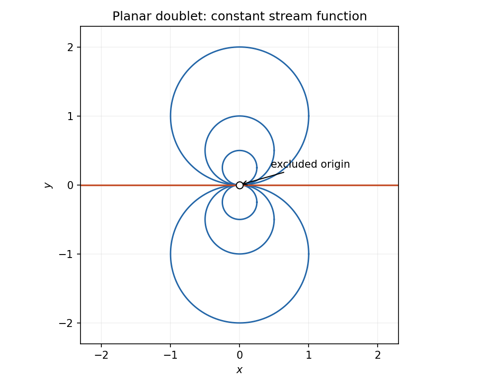

<h1 id="k/k1/ii/solution">Solution</h1>

↑ **Parent:** [Ii](../ii.md)

The [complex potential of a two-dimensional potential flow](../../../../../complex-potential-of-a-two-dimensional-potential-flow.md) is $w=\phi+i\psi$, so

$$
w(z)=\frac{\mu(x-iy)}{x^2+y^2},\qquad\boxed{\psi=-\frac{\mu y}{x^2+y^2}},\quad z\ne0.
$$

For $\mu\ne0$, a nonzero level $\psi=c$ is

$$
x^2+\left(y+\frac{\mu}{2c}\right)^2=\left(\frac{\mu}{2c}\right)^2.
$$

Thus the [streamlines](../../../../../streamline.md) are circles tangent to the horizontal axis at the excluded singular origin, with centers on the vertical axis. Each circle has the origin removed. The zero level is the horizontal axis without the origin, whose positive and negative rays are separate [streamlines](../../../../../streamline.md). Since $w'=-\mu/z^2$ is nonzero away from the origin, no other stagnation points intervene. For $\mu=0$ the flow vanishes everywhere off the origin, so the circle description is replaced by the degenerate zero-velocity field.

**[Figure 1](#k/k1/ii/image-streamlines-of-a-planar-doublet). Streamlines of a planar doublet**. Circles tangent at the excluded origin and the two zero-level horizontal rays; the drawing uses positive doublet strength.

## ↑ Ancestors (13)

1. [Ii](../ii.md)
2. [K1](../../k1.md)
3. [K](../../../k.md)
4. [2006](../../../../2006-split.md)
5. [Past exam of the options I course of the University of Oxford](../../../../split.md)
6. [Options I course of the University of Oxford](../../../../../options-i-course-of-the-university-of-oxford.md)
7. [Year 2 of the mathematics course of the University of Oxford](../../../../../year-2-of-the-mathematics-course-of-the-university-of-oxford.md)
8. [Mathematics course of the University of Oxford](../../../../../mathematics-course-of-the-university-of-oxford.md)
9. [Undergraduate course of the University of Oxford](../../../../../undergraduate-course-of-the-university-of-oxford.md)
10. [Course of the University of Oxford](../../../../../course-of-the-university-of-oxford.md)
11. [University of Oxford](../../../../../university-of-oxford-split.md)
12. [List of universities](../../../../../list-of-universities.md)
13. [Codex Wiki](../../../../../split.md)
