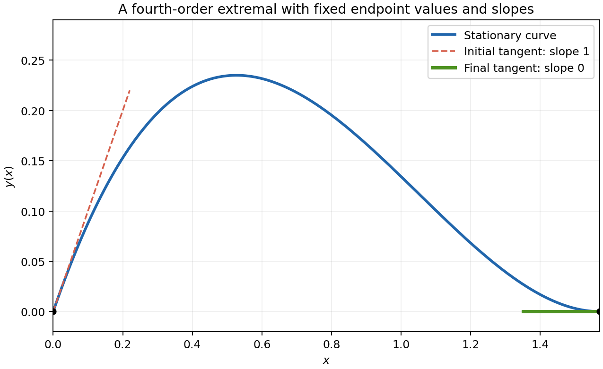

# 2007

↑ **Parent:** [Past exam of the options I course of the University of Oxford](../past-exam-of-the-options-i-course-of-the-university-of-oxford.md)

Options I, Honour School of Mathematics; Friday 22 June 2007, 9.30am–12.30pm. The complete ten-page source is privately transcribed from original Part A bundle pages 10–19, supplied through [the past-papers disclosure](https://www.whatdotheyknow.com/request/maths_past_papers_3). No exact worked-answer advertisement was found in the bounded availability check.

**Table of contents**

- [A](#a)
  - [A1](#a/a1)
    - [Solution](#a/a1/solution)
- [B](#b)
  - [B1](#b/b1)
    - [Solution](#b/b1/solution)
- [C](#c)
  - [C1](#c/c1)
    - [Solution](#c/c1/solution)
- [D](#d)
  - [D1](#d/d1)
    - [i](#d/d1/i)
      - [Solution](#d/d1/i/solution)
    - [ii](#d/d1/ii)
      - [Solution](#d/d1/ii/solution)
    - [iii](#d/d1/iii)
      - [Solution](#d/d1/iii/solution)
  - [D2](#d/d2)
    - [Solution](#d/d2/solution)
- [E](#e)
  - [E1](#e/e1)
    - [a](#e/e1/a)
      - [Solution](#e/e1/a/solution)
    - [b](#e/e1/b)
      - [Solution](#e/e1/b/solution)
    - [Solution](#e/e1/solution)
  - [E2](#e/e2)
    - [Solution](#e/e2/solution)
    - [i](#e/e2/i)
      - [Solution](#e/e2/i/solution)
    - [ii](#e/e2/ii)
      - [Solution](#e/e2/ii/solution)
    - [iii](#e/e2/iii)
      - [Solution](#e/e2/iii/solution)
    - [iv](#e/e2/iv)
      - [Solution](#e/e2/iv/solution)
- [F](#f)
  - [F1](#f/f1)
    - [Solution](#f/f1/solution)
- [G](#g)
  - [G1](#g/g1)
    - [Solution](#g/g1/solution)
- [H](#h)
  - [H1](#h/h1)
    - [Solution](#h/h1/solution)
- [J](#j)
  - [J1](#j/j1)
    - [Solution](#j/j1/solution)
- [K](#k)
  - [K1](#k/k1)
    - [i](#k/k1/i)
      - [Solution](#k/k1/i/solution)
    - [ii](#k/k1/ii)
      - [Solution](#k/k1/ii/solution)
  - [K2](#k/k2)
    - [Solution](#k/k2/solution)
- [M](#m)
  - [M1](#m/m1)
    - [Solution](#m/m1/solution)
  - [M2](#m/m2)
    - [Solution](#m/m2/solution)
- [O](#o)
  - [O1](#o/o1)
    - [Solution](#o/o1/solution)
  - [O2](#o/o2)
    - [Solution](#o/o2/solution)
- [P](#p)
  - [P1](#p/p1)
    - [Solution](#p/p1/solution)
  - [P2](#p/p2)
    - [Solution](#p/p2/solution)

## A

↑ **Parent:** [2007](2007.md)

<h3 id="a/a1">A1</h3>

↑ **Parent:** [A](#a)

<h4 id="a/a1/solution">Solution</h4>

↑ **Parent:** [A1](#a/a1)

[Burnside's lemma](../representation-theory.md#burnside-s-lemma) counts the orbits of a finite [group action](../group-action.md):

$$
|\Omega/G|=\frac1{|G|}\sum_{g\in G}|\operatorname{Fix}(g)|.
$$

Identify each face with its opposite vertex. Every symmetry induces the same [permutation](../combinatorics.md#permutation) on these two four-element sets, so a [permutation](../combinatorics.md#permutation) with $c$ cycles fixes $3^c2^c=6^c$ colorings. The rotational symmetry [group](../group.md) is $A_4$, with one identity, eight three-cycles, and three products of two disjoint transpositions. Their cycle counts are four, two and two. Thus the [rotation](../riemannian-geometry.md#rotation-mathematics) count is

$$
\boxed{\frac{6^4+8\cdot6^2+3\cdot6^2}{12}=141}.
$$

Allowing reflections gives the full tetrahedral [group](../group.md) $S_4$. In addition there are six transpositions with three cycles and six four-cycles with one cycle. The count becomes

$$
\boxed{\frac{6^4+6\cdot6^3+3\cdot6^2+8\cdot6^2+6\cdot6}{24}=126}.
$$

Equivalently, 30 of the 141 rotational classes form 15 mirror pairs, while 111 rotational classes are their own mirror class.

The product of fixed-coloring counts is an instance of the [orbit count for simultaneous colorings](../representation-theory.md#orbit-count-for-simultaneous-colorings).

## B

↑ **Parent:** [2007](2007.md)

<h3 id="b/b1">B1</h3>

↑ **Parent:** [B](#b)

<h4 id="b/b1/solution">Solution</h4>

↑ **Parent:** [B1](#b/b1)

The degree $[K:F]$ is the dimension of $K$ as a vector space over $F$. The tower theorem states that for intermediate fields $F\subseteq E\subseteq K$ in a finite extension,

$$
[K:F]=[K:E][E:F].
$$

If the degree is prime, one factor must be one, forcing $E=K$ or $E=F$; no strictly intermediate field exists.

Let $K$ have 32 elements. Its prime subfield is $\mathbb F_2$ and $[K:\mathbb F_2]=5$. Every element outside that subfield has [minimal polynomial](../linear-operator-theory.md#minimal-polynomial) of degree five, by the tower theorem. Also every member of $K$ satisfies $x^{32}=x$: nonzero elements form a [group](../group.md) of order 31. Hence $x^{32}-x$ splits over $K$, with distinct roots because its derivative is $-1=1$ in characteristic two.

Every irreducible degree-five polynomial over $\mathbb F_2$ divides $x^{32}-x$. Indeed its quotient field has 32 elements, and its [residue](../analysis.md#residue) class of $x$ satisfies that equation. Thus every such polynomial splits into five distinct roots in $K$. Conversely each of the 30 elements outside $\mathbb F_2$ has one such [minimal polynomial](../linear-operator-theory.md#minimal-polynomial), and different minimal polynomials have disjoint root sets. Consequently the number is

$$
\boxed{30/5=6}.
$$

There is no extra leading-coefficient factor, since every nonzero leading coefficient over $\mathbb F_2$ is one.

## C

↑ **Parent:** [2007](2007.md)

<h3 id="c/c1">C1</h3>

↑ **Parent:** [C](#c)

<h4 id="c/c1/solution">Solution</h4>

↑ **Parent:** [C1](#c/c1)

Euler's theorem states that $a^{\phi(m)}\equiv1\pmod m$ whenever $\gcd(a,m)=1$, where $\phi(m)$ counts the invertible [residue](../analysis.md#residue) classes. For each prime-power divisor, the same theorem gives $a^{\phi(p_i^{e_i})}\equiv1\pmod{p_i^{e_i}}$. Since the exponent defined in the source is a multiple of every one of these exponents, raising that congruence to the corresponding integer power gives

$$
a^{\lambda(m)}\equiv1\pmod{p_i^{e_i}}.
$$

The prime powers are pairwise [coprime](../divisibility.md#coprime-integers), so their product divides $a^{\lambda(m)}-1$, proving the congruence modulo $m$.

For the displayed composite integer,

$$
\lambda(561)=\operatorname{lcm}(2,10,16)=80,\qquad560=7\cdot80.
$$

Thus every integer [coprime](../divisibility.md#coprime-integers) to 561 satisfies $\boxed{a^{560}\equiv1\pmod{561}}$. This is a [Carmichael number](../number-theory.md#carmichael-number). The source's prime-power least common multiple need not be the minimal universal exponent for all moduli; for powers of two its definition can exceed the usual [Carmichael function](../number-theory.md#carmichael-function). No minimality claim is needed here.

## D

↑ **Parent:** [2007](2007.md)

<h3 id="d/d1">D1</h3>

↑ **Parent:** [D](#d)

<h4 id="d/d1/i">i</h4>

↑ **Parent:** [D1](#d/d1)

<h5 id="d/d1/i/solution">Solution</h5>

↑ **Parent:** [I](#d/d1/i)

The [monotone convergence theorem](../measure-theory.md#monotone-convergence-theorem) states that if measurable nonnegative functions satisfy $f_n\uparrow f$ almost everywhere on a measure space, then

$$
\int f=\lim_{n\to\infty}\int f_n,
$$

allowing either side to be $+\infty$.

<h4 id="d/d1/ii">ii</h4>

↑ **Parent:** [D1](#d/d1)

<h5 id="d/d1/ii/solution">Solution</h5>

↑ **Parent:** [Ii](#d/d1/ii)

Use the nonnegative increasing truncations $f_n=x^{-2}\mathbf1_{[1/n,1]}$. They increase almost everywhere to the specified function. On each [compact](../topology.md#compact-space) interval the [continuous function](../calculus.md#continuous-function) has equal Riemann and Lebesgue integrals, so the [fundamental theorem of calculus](../calculus.md#fundamental-theorem-of-calculus) gives

$$
\int f_n=\int_{1/n}^1x^{-2}\,dx=n-1.
$$

Monotone convergence yields $\int f=+\infty$. Since a nonnegative function is [Lebesgue integrable](../measure-theory.md#lebesgue-integrable-function) exactly when its integral is finite, **this function is not [Lebesgue integrable](../measure-theory.md#lebesgue-integrable-function)**.

<h4 id="d/d1/iii">iii</h4>

↑ **Parent:** [D1](#d/d1)

<h5 id="d/d1/iii/solution">Solution</h5>

↑ **Parent:** [Iii](#d/d1/iii)

The truncations $g_n=x^{1/2}\mathbf1_{[1/n,1]}$ are measurable, nonnegative, and increase almost everywhere to $g$. As before their integrals agree with the corresponding Riemann integrals, giving

$$
\int g_n=\int_{1/n}^1x^{1/2}\,dx=\frac23(1-n^{-3/2}).
$$

Monotone convergence therefore gives the finite value $\boxed{\int g=2/3}$. Nonnegativity makes this the integral of the absolute value as well, proving [Lebesgue integrability](../measure-theory.md#integrability).

<h3 id="d/d2">D2</h3>

↑ **Parent:** [D](#d)

<h4 id="d/d2/solution">Solution</h4>

↑ **Parent:** [D2](#d/d2)

A dominated differentiation theorem is the following. Suppose $\phi(x,t)$ is measurable in $x$ and differentiable in $t$ on an open interval, is integrable for at least one parameter value, and its parameter derivative is dominated in absolute value by an [integrable function](../measure-theory.md#lebesgue-integrable-function) independent of $t$. Then its integral is differentiable and

$$
\frac d{dt}\int\phi(x,t)\,dx=\int\partial_t\phi(x,t)\,dx.
$$

Local versions require the domination only on a neighbourhood of each parameter. The proof bounds the difference quotients by the dominating function, using the [fundamental theorem of calculus](../calculus.md#fundamental-theorem-of-calculus) or the mean-value theorem, then applies dominated convergence. Apply the argument to real and imaginary parts for a complex integrand.

For fixed $t$, $f(x)e^{itx}$ is measurable and has absolute value $|f(x)|$, so is integrable. Its derivative with respect to $t$ is $ixf(x)e^{itx}$, whose absolute value is the assumed [integrable function](../measure-theory.md#lebesgue-integrable-function) $|xf(x)|$. Hence

$$
\boxed{\widehat f'(t)=\int_{\mathbb R}ixf(x)e^{itx}\,dx}.
$$

Dominated convergence also shows this derivative is continuous, though only differentiability is required.

## E

↑ **Parent:** [2007](2007.md)

<h3 id="e/e1">E1</h3>

↑ **Parent:** [E](#e)

<h4 id="e/e1/a">a</h4>

↑ **Parent:** [E1](#e/e1)

<h5 id="e/e1/a/solution">Solution</h5>

↑ **Parent:** [A](#e/e1/a)

A sequence converges if there is $x\in X$ such that, for every $\epsilon>0$, some $N$ satisfies $d(x_n,x)<\epsilon$ whenever $n\ge N$. The limit must belong to $X$, not merely to a larger ambient space.

<h4 id="e/e1/b">b</h4>

↑ **Parent:** [E1](#e/e1)

<h5 id="e/e1/b/solution">Solution</h5>

↑ **Parent:** [B](#e/e1/b)

A [metric space](../topological-analysis.md#metric-space) is [sequentially compact](../geometry-and-topology.md#sequentially-compact-space) if every sequence in it has a [subsequence](../sequence-and-series.md#subsequence) converging to a point of the same space.

<h4 id="e/e1/solution">Solution</h4>

↑ **Parent:** [E1](#e/e1)

The sequence $x_n=1/(n+1)$ lies in the open interval and converges in the ambient real line to zero. Every [subsequence](../sequence-and-series.md#subsequence) also converges to zero, and uniqueness of limits prevents it converging to any point of the interval. Thus **the interval is not [sequentially compact](../geometry-and-topology.md#sequentially-compact-space)**.

For a sequence $(x_n,y_n)$ in the product, [sequential compactness](../geometry-and-topology.md#sequentially-compact-space) of $X$ supplies indices $n_j$ with $x_{n_j}\to x\in X$. Apply [sequential compactness](../geometry-and-topology.md#sequentially-compact-space) of $Y$ to the corresponding $y_{n_j}$, extracting a further [subsequence](../sequence-and-series.md#subsequence) $y_{n_{j_\ell}}\to y\in Y$. The first coordinate still tends to $x$. For any $\epsilon>0$, both coordinate distances are eventually less than $\epsilon/2$, so their sum is less than $\epsilon$. Hence the same [subsequence](../sequence-and-series.md#subsequence) converges in the given product metric to $(x,y)$. This proves **the product is [sequentially compact](../geometry-and-topology.md#sequentially-compact-space)**.

<h3 id="e/e2">E2</h3>

↑ **Parent:** [E](#e)

<h4 id="e/e2/solution">Solution</h4>

↑ **Parent:** [E2](#e/e2)

The [subspace topology](../topology.md#subspace-topology) is

$$
\boxed{\mathcal T_A=\{A\cap U:U\in\mathcal T\}}.
$$

These sets contain the empty set and $A$, are closed under arbitrary unions, and are closed under finite intersections because intersections distribute over the common factor $A$. Thus they form a topology on $A$.

<h4 id="e/e2/i">i</h4>

↑ **Parent:** [E2](#e/e2)

<h5 id="e/e2/i/solution">Solution</h5>

↑ **Parent:** [I](#e/e2/i)

For $U\in\mathcal T$, the inverse image under inclusion is $i^{-1}(U)=A\cap U$, which is open in the [subspace topology](../topology.md#subspace-topology) by definition. The inverse-image criterion for [continuity](../calculus.md#continuous-function) therefore proves **the inclusion is continuous**.

<h4 id="e/e2/ii">ii</h4>

↑ **Parent:** [E2](#e/e2)

<h5 id="e/e2/ii/solution">Solution</h5>

↑ **Parent:** [Ii](#e/e2/ii)

Every subspace-[open set](../topology.md#open-set) has the form $A\cap U=i^{-1}(U)$ for some $U\in\mathcal T$. [Continuity](../calculus.md#continuous-function) of $i:(A,\mathcal T')\to(X,\mathcal T)$ makes every such inverse image open in $\mathcal T'$. Hence $\boxed{\mathcal T_A\subseteq\mathcal T'}$.

<h4 id="e/e2/iii">iii</h4>

↑ **Parent:** [E2](#e/e2)

<h5 id="e/e2/iii/solution">Solution</h5>

↑ **Parent:** [Iii](#e/e2/iii)

If $A\cap U$ is subspace-open, then

$$
f^{-1}(A\cap U)=(i\circ f)^{-1}(U).
$$

The right side is open in $Z$ by the assumed [continuity](../calculus.md#continuous-function) of the composition. This holds for every subspace-[open set](../topology.md#open-set), proving **$f$ is continuous into the [subspace topology](../topology.md#subspace-topology)**.

<h4 id="e/e2/iv">iv</h4>

↑ **Parent:** [E2](#e/e2)

<h5 id="e/e2/iv/solution">Solution</h5>

↑ **Parent:** [Iv](#e/e2/iv)

Choose $Z=(A,\mathcal T_A)$ and let $f$ be the identity function on $A$. The composite $i\circ f$ is continuous by part (i). The stipulated universal implication therefore makes $f:(A,\mathcal T_A)\to(A,\mathcal T')$ continuous. Its inverse image of any $\mathcal T'$-[open set](../topology.md#open-set) is that set itself, so it must lie in $\mathcal T_A$. Thus $\boxed{\mathcal T'\subseteq\mathcal T_A}$.

## F

↑ **Parent:** [2007](2007.md)

<h3 id="f/f1">F1</h3>

↑ **Parent:** [F](#f)

<h4 id="f/f1/solution">Solution</h4>

↑ **Parent:** [F1](#f/f1)

The [implicit function theorem](../multivariable-calculus.md#implicit-function-theorem) applies when $D_2F(a,b)\ne0$. After shrinking the neighbourhood, this partial derivative stays nonzero along the implicit [graph](../graph.md). Differentiating its defining identity gives

$$
f'(x)=-\frac{D_1F(x,f(x))}{D_2F(x,f(x))}.
$$

For the specified smooth function, $F_x=y+\cos(x+y)$ and $F_y=x+\cos(x+y)$, so both equal one at zero. In particular the theorem applies and $f'(0)=-1$. Differentiate the identity a second time:

$$
F_{xx}+2F_{xy}f'+F_{yy}(f')^2+F_yf''=0.
$$

At zero, $F_{xx}=F_{yy}=0$ and $F_{xy}=1$. Therefore

$$
\boxed{f'(0)=-1,\qquad f''(0)=2}.
$$

## G

↑ **Parent:** [2007](2007.md)

<h3 id="g/g1">G1</h3>

↑ **Parent:** [G](#g)

<h4 id="g/g1/solution">Solution</h4>

↑ **Parent:** [G1](#g/g1)

Let $y_\epsilon=y+\epsilon\eta$, with $\eta=\eta'=0$ at both endpoints. At an extremal the [first variation](../calculus-of-variations.md#first-variation) is zero:

$$
0=\int_{x_1}^{x_2}(F_y\eta+F_{y'}\eta'+F_{y''}\eta'')\,dx.
$$

Integrate the second term by parts once and the third term twice. The boundary term is

$$
\left[F_{y'}\eta+F_{y''}\eta'-\frac d{dx}F_{y''}\eta\right]_{x_1}^{x_2}=0.
$$

The given fundamental lemma therefore gives

$$
\boxed{F_y-\frac d{dx}F_{y'}+\frac{d^2}{dx^2}F_{y''}=0}.
$$

This is the classical form under the usual smoothness hypotheses ensuring the displayed derivatives exist; without that extra regularity the variation first yields its distributional form.

For the concrete functional the equation is $y^{(4)}-y=0$. Write $L=\pi/2$, $C=\cosh L$ and $S=\sinh L$. A general solution is $A\cos x+B\sin x+D\cosh x+E\sinh x$. The two initial conditions give $D=-A$ and $B+E=1$. The final derivative condition gives $A=EC/(1+S)$, and the final value condition then gives $E=(1+S)/2$. Thus an extremal is

$$
\boxed{y(x)=\frac C2(\cos x-\cosh x)+\frac{1-S}{2}\sin x+\frac{1+S}{2}\sinh x}.
$$

It solves the differential equation, has initial value zero and initial derivative one, and at $L$ both its value and derivative vanish, using $C^2-S^2=1$. These checks verify all four prescribed endpoint conditions.

**[Figure 1](#g/g1/image-the-clamped-fourth-order-extremal). The clamped fourth-order extremal**. The computed curve satisfies both endpoint values, with initial slope one and final slope zero.

## H

↑ **Parent:** [2007](2007.md)

<h3 id="h/h1">H1</h3>

↑ **Parent:** [H](#h)

<h4 id="h/h1/solution">Solution</h4>

↑ **Parent:** [H1](#h/h1)

Time [independence](../random-variable.md#independent-random-variables) conserves the [energy](../energy.md) $E=T+mga\cos\theta$. The two cyclic coordinates give

$$
p_\psi=C(\dot\psi+\dot\phi\cos\theta)=Cn,\qquad
p_\phi=A\dot\phi\sin^2\theta+Cn\cos\theta=h.
$$

These are respectively [angular momentum](../momentum.md#angular-momentum) along the symmetry axis and [angular momentum](../momentum.md#angular-momentum) along the fixed upward vertical; $n$ is the axial spin rate. For $u=\cos\theta$ and $-1<u<1$, eliminate $\dot\phi$ using $\dot\phi=(h-Cnu)/[A(1-u^2)]$. The [energy](../energy.md) becomes

$$
E=\frac A2\dot\theta^2+\frac C2n^2+mga u+\frac{(h-Cnu)^2}{2A(1-u^2)}.
$$

Multiplying and rearranging gives

$$
\boxed{A^2\dot\theta^2=\frac{A(2E-Cn^2-2mga u)(1-u^2)-(h-Cnu)^2}{1-u^2}}.
$$

To justify the double-root condition, use the [effective potential](../mathematical-physics.md#effective-potential)

$$
U(u)=\frac C2n^2+mga u+\frac{(h-Cnu)^2}{2A(1-u^2)}.
$$

Eliminating the cyclic coordinates by Routh reduction gives the remaining equation $A\ddot\theta=-dU(\cos\theta)/d\theta$. A constant nonvertical angle therefore has $U'(u_0)=0$ and $E=U(u_0)$. Since $P(u)=2A(E-U(u))(1-u^2)$, both $P(u_0)$ and $P'(u_0)$ vanish. This argument uses the second-order equation; merely differentiating the [energy](../energy.md) identity at a stationary angle would not establish the derivative condition.

Thus **steady nonvertical [precession](../rigid-body-dynamics.md#precession) gives a common root in $(-1,1)$**. The nonvertical qualification is implicit in the denominator used by the source. A top spinning exactly upright or inverted is also possible but corresponds to an endpoint $u=\pm1$, not an interior root; the unrestricted literal claim would need that exception.

The distinction is captured by the [double-root criterion for steady precession of a symmetric top](../rigid-body-dynamics.md#double-root-criterion-for-steady-precession-of-a-symmetric-top).

## J

↑ **Parent:** [2007](2007.md)

<h3 id="j/j1">J1</h3>

↑ **Parent:** [J](#j)

<h4 id="j/j1/solution">Solution</h4>

↑ **Parent:** [J1](#j/j1)

[Ampère's law](../maxwell-equations.md#ampere-s-circuital-law) in magnetostatics is

$$
\oint_\Gamma B\cdot d\ell=\mu_0 I_S,\qquad I_S=\int_SJ\cdot n\,dS,
$$

with boundary and surface orientations related by the right-hand rule. Stokes' theorem gives the left side as $\int_S(\nabla\times B)\cdot n\,dS$, proving the integral law from the stated curl equation.

For a circular contour of radius $r$ about the axis, the left side is $2\pi rB_\theta$. For $r\le a$ the enclosed current is $Ir^2/a^2$; for $r\ge a$ it is $I$. Therefore

$$
\boxed{B(r)=\begin{cases}\dfrac{\mu_0 I r}{2\pi a^2}\,e_\theta,&0<r\le a,\\[2mm]\dfrac{\mu_0 I}{2\pi r}\,e_\theta,&r\ge a.\end{cases}}
$$

Both expressions agree at the boundary. At the axis the field is zero, interpreted by [continuity](../calculus.md#continuous-function) even though the angular unit vector is undefined there.

## K

↑ **Parent:** [2007](2007.md)

<h3 id="k/k1">K1</h3>

↑ **Parent:** [K](#k)

<h4 id="k/k1/i">i</h4>

↑ **Parent:** [K1](#k/k1)

<h5 id="k/k1/i/solution">Solution</h5>

↑ **Parent:** [I](#k/k1/i)

For steady flow the given equation gives $\nabla H=-\rho\,\omega\times u$. Dotting with $u$ yields $u\cdot\nabla H=0$, so **$H$ is constant along each [streamline](../fluid-mechanics.md#streamline)**. It can have different values on different streamlines. Dotting with $\omega$ also makes it constant along vortex lines where they are defined.

If the flow is additionally irrotational, $\omega=0$ and hence $\nabla H=0$. Thus **$H$ is one constant on each [connected](../geometry-and-topology.md#connected-space) fluid region**, the stronger global Bernoulli conclusion.

<h4 id="k/k1/ii">ii</h4>

↑ **Parent:** [K1](#k/k1)

<h5 id="k/k1/ii/solution">Solution</h5>

↑ **Parent:** [Ii](#k/k1/ii)

Take the curl. A [gradient](../multivariable-calculus.md#gradient) has zero curl, and the supplied identity, with $\nabla\cdot u=0$ and $\nabla\cdot\omega=\nabla\cdot(\nabla\times u)=0$, gives

$$
\partial_t\omega+(u\cdot\nabla)\omega-(\omega\cdot\nabla)u=0.
$$

Therefore $D\omega/Dt=(\omega\cdot\nabla)u$. In planar flow $\omega=(0,0,\partial_xv-\partial_yu)$ and $\partial_z u=0$, so the stretching term vanishes. Consequently

$$
\boxed{D\omega/Dt=0}.
$$

[Vorticity](../vorticity.md) is carried unchanged with each fluid particle. It need not be spatially uniform or independent of time at a fixed spatial point.

<h3 id="k/k2">K2</h3>

↑ **Parent:** [K](#k)

<h4 id="k/k2/solution">Solution</h4>

↑ **Parent:** [K2](#k/k2)

The [Milne-Thomson circle theorem](../fluid-mechanics.md#milne-thomson-circle-theorem) replaces a potential $f$ analytic inside the circle of radius $a$ by $f(z)+\overline{f(a^2/\bar z)}$ outside it, when its original singularities are outside. The circle becomes a [streamline](../fluid-mechanics.md#streamline), the imposed flow at infinity is preserved, and no extra [circulation](../vorticity.md#circulation-physics) is introduced.

Use the convention that positive [circulation](../vorticity.md#circulation-physics) is counterclockwise, so a vortex potential is $\Gamma\log(z-z_1)/(2\pi i)$ and its derivative is $u-iv$. With $b=a^2/\bar z_1$, the circle construction gives

$$
\boxed{w(z)=\frac{\Gamma}{2\pi i}\{\log(z-z_1)-\log(z-b)+\log z\}}
$$

up to an additive constant and local logarithm branches. There is an image vortex of strength $-\Gamma$ at $b$ and a central vortex of strength $\Gamma$. Their zero net interior [circulation](../vorticity.md#circulation-physics) is needed for the specified motion equation.

The original vortex moves with the regular velocity of the image flow, excluding its own singular velocity. Thus

$$
\frac{d\bar z_1}{dt}=\frac{\Gamma}{2\pi i}\left\{-\frac1{z_1-a^2/\bar z_1}+\frac1{z_1}\right\}
=\boxed{\frac{i\Gamma a^2}{2\pi z_1(|z_1|^2-a^2)}}.
$$

The conjugation in this equation matches the printed source. Write $z_1=re^{i\theta}$ and cancel $e^{-i\theta}$ to obtain

$$
\dot r-ir\dot\theta=\frac{i\Gamma a^2}{2\pi r(r^2-a^2)}.
$$

Real and imaginary parts give

$$
\boxed{\dot r=0,\qquad\dot\theta=-\frac{\Gamma a^2}{2\pi r^2(r^2-a^2)}}.
$$

The vortex moves uniformly on the circle determined by its initial radius, clockwise for positive $\Gamma$ in this convention.

## M

↑ **Parent:** [2007](2007.md)

<h3 id="m/m1">M1</h3>

↑ **Parent:** [M](#m)

<h4 id="m/m1/solution">Solution</h4>

↑ **Parent:** [M1](#m/m1)

The unit disk has area $\pi$, so its joint density is $f_{X,Y}(x,y)=\pi^{-1}\mathbf1_{\{x^2+y^2\le1\}}$. The polar-coordinate Jacobian has absolute [determinant](../multilinear-algebra.md#determinant) $r$. Therefore

$$
f_{R,\Theta}(r,\theta)=\frac r\pi,\qquad 0<r<1,\quad0\le\theta<2\pi,
$$

and is zero outside this rectangle, up to irrelevant boundary choices. Integrating gives

$$
\boxed{f_R(r)=2r\mathbf1_{(0,1)}(r),\qquad f_\Theta(\theta)=\frac1{2\pi}\mathbf1_{[0,2\pi)}(\theta),\qquad\mathbb ER=2/3}.
$$

The joint density equals the product of the two marginal densities, so **$R$ and $\Theta$ are independent**. The angle at the centre can be chosen arbitrarily since that point has probability zero.

<h3 id="m/m2">M2</h3>

↑ **Parent:** [M](#m)

<h4 id="m/m2/solution">Solution</h4>

↑ **Parent:** [M2](#m/m2)

A state $i$ is absorbing if $p_{ii}=1$, so once visited it is never left. Condition on the first step and use the [Markov property](../markov-chain.md#markov-property): for $i\ne1$, the subsequent probability of ever reaching state one is $h_j$ given $X_1=j$. Hence $h_i=\sum_jp_{ij}h_j$, with $h_1=1$.

In this chain state four is a separate [absorbing state](../markov-chain.md#absorbing-state), so $h_4=0$. The other two equations are

$$
h_2=\tfrac13+\tfrac23h_3,\qquad h_3=\tfrac14h_2.
$$

Solving gives

$$
\boxed{h_2=2/5,\qquad h_3=1/10,\qquad h_4=0}.
$$

Let $t_i$ be the mean time to hit the absorbing set. From either [transient state](../markov-chain.md#transient-state) the next-step absorption probability is at least $1/3$, so its tail is geometrically bounded and the expectations are finite. [First-step analysis](../analysis.md#first-step-analysis) gives $t_2=1+\tfrac23t_3$ and $t_3=1+\tfrac14t_2$. Thus $t_3=5/4+t_3/6$ and

$$
\boxed{\mathbb E_3\tau_{\{1,4\}}=3/2}.
$$

## O

↑ **Parent:** [2007](2007.md)

<h3 id="o/o1">O1</h3>

↑ **Parent:** [O](#o)

<h4 id="o/o1/solution">Solution</h4>

↑ **Parent:** [O1](#o/o1)

A frequentist [confidence interval](../statistical-inference.md#confidence-interval) is a pair of data-dependent endpoints whose random interval covers the fixed parameter with probability at least $1-\alpha$ under every allowed parameter value. In repeated uses of the same sampling procedure, at least the advertised fraction of intervals cover the true value. It is not a posterior probability assigned to the parameter after observing the data.

For a sample of size $n$ from a Poisson law with mean $\mu$, the sum $S$ is Poisson with mean $n\mu$. At observed $s>0$, define the lower and upper limits by

$$
\mathbb P_{nL}(S\ge s)=\alpha/2,\qquad
\mathbb P_{nU}(S\le s)=\alpha/2.
$$

At $s=0$ set $L=0$ and use the same upper equation. This inverts the two exact one-sided tail tests. Discreteness means the resulting central interval is generally conservative: its coverage is at least the nominal value, not identically equal to it.

Here one observes a four-year total of 39, so the lower endpoint satisfies $\phi_L(38)=0.975$ and the upper satisfies $\phi_U(39)=0.025$. Selecting the corresponding entries supplied in the source gives

$$
\boxed{[27.7,\ 53.3]}.
$$

This interval concerns the expected four-year total, not an annual rate. The other two supplied numbers correspond to the wrong inclusive tail for one of these endpoints.

<h3 id="o/o2">O2</h3>

↑ **Parent:** [O](#o)

<h4 id="o/o2/solution">Solution</h4>

↑ **Parent:** [O2](#o/o2)

The power of a test at a parameter value is its probability of rejecting the null there. Its size is the supremum of this probability over the null parameter set. The [Neyman-Pearson lemma](../statistical-hypothesis-test.md#neyman-pearson-lemma) states that for simple null and alternative densities $f_0,f_1$, a test rejecting where $f_1>cf_0$, accepting where $f_1<cf_0$, and randomizing as needed on equality to attain size $\alpha$, has greatest power among tests of size at most $\alpha$.

The specified function is nonnegative. Its integral is

$$
\frac{\theta^2}{\theta+1}\left\{\int_0^\infty xe^{-\theta x}\,dx+\int_0^\infty e^{-\theta x}\,dx\right\}
=\frac{\theta^2}{\theta+1}\left(\theta^{-2}+\theta^{-1}\right)=1.
$$

For independent observations write $S=\sum_iX_i$. The [likelihood ratio](../statistical-hypothesis-test.md#likelihood-ratio) of the smaller alternative parameter to the null is

$$
\frac{L(\theta_1)}{L(\theta_0)}=
\left\{\frac{\theta_1^2(\theta_0+1)}{\theta_0^2(\theta_1+1)}\right\}^n
\exp\{(\theta_0-\theta_1)S\}.
$$

It is strictly increasing in $S$. Thus the most powerful level-$\alpha$ test rejects for

$$
\boxed{S>c_\alpha,\qquad\mathbb P_{\theta_0}(S>c_\alpha)=\alpha}.
$$

The continuous distribution permits this size without randomization for $0<\alpha<1$. Its threshold depends only on the null and the desired size, not on which $\theta_1<\theta_0$ was chosen. The same test is therefore **uniformly most powerful against the entire one-sided alternative $\theta<\theta_0$**.

## P

↑ **Parent:** [2007](2007.md)

<h3 id="p/p1">P1</h3>

↑ **Parent:** [P](#p)

<h4 id="p/p1/solution">Solution</h4>

↑ **Parent:** [P1](#p/p1)

A [Givens rotation](../numerical-analysis.md#givens-rotation) equals the identity except in coordinates $i,j$, where its block can be taken as

$$
\begin{pmatrix}c&s\\-s&c\end{pmatrix},\qquad c=\cos\theta,\ s=\sin\theta.
$$

The two block columns are orthonormal because $c^2+s^2=1$; other coordinates are unchanged, so the full matrix is [orthogonal](../inner-product.md#orthogonal-vectors). If $(v_i,v_j)\ne(0,0)$, take $r=\sqrt{v_i^2+v_j^2}$, $c=v_i/r$ and $s=v_j/r$. The transformed pair is $(r,0)$. If both entries are zero, the identity already suffices.

For the specified vector one possible matrix is

$$
\boxed{Q=\begin{pmatrix}4/5&0&-3/5\\3/5&0&4/5\\0&-1&0\end{pmatrix},\qquad Qv=\begin{pmatrix}0\\5\\0\end{pmatrix}}.
$$

Its rows are orthonormal. It is **not unique**: premultiply by any [orthogonal](../inner-product.md#orthogonal-vectors) transformation fixing the second coordinate axis pointwise. This rotates or reflects the other two output coordinates without changing the required image. Equivalently its second row must be $v^T/\|v\|$, but any orthonormal completion of that row works.

<h3 id="p/p2">P2</h3>

↑ **Parent:** [P](#p)

<h4 id="p/p2/solution">Solution</h4>

↑ **Parent:** [P2](#p/p2)

[Richardson extrapolation](../numerical-analysis.md#richardson-extrapolation) cancels a leading discretization error by combining two mesh sizes. If $A(h)=I+ch^p+O(h^q)$ with $q>p$, then

$$
\frac{2^pA(h/2)-A(h)}{2^p-1}=I+O(h^q).
$$

Use a uniform grid $x_i=a+ih$, $0\le i\le n$, with even $n$. The composite trapezium rule is

$$
T_h=h\left[\frac{f_0+f_n}{2}+\sum_{i=1}^{n-1}f_i\right],\qquad f_i=f(x_i).
$$

The composite Simpson rule, formed by integrating a quadratic interpolant on each pair of successive panels, is

$$
S_h=\frac h3\left[f_0+f_n+4\sum_{i\text{ odd}}f_i+2\sum_{\substack{0<i<n\\i\text{ even}}}f_i\right].
$$

Assume an even-power trapezium error expansion $T_h=I+c_2h^2+O(h^4)$; continuous fourth derivative is a standard sufficient smoothness hypothesis. The coarse grid has step $2h$, so one extrapolation step is $(4T_h-T_{2h})/3$. Its endpoint coefficients are $h/3$, its odd-index coefficients are $4h/3$, and its interior even-index coefficients are $2h/3$. Therefore

$$
\boxed{S_h=\frac{4T_h-T_{2h}}3=I+O(h^4)}.
$$

The algebraic identity between the two rules holds for any sampled values; the smoothness and error assumptions are used to infer the improved accuracy.

## ↑ Ancestors (9)

1. [Past exam of the options I course of the University of Oxford](../past-exam-of-the-options-i-course-of-the-university-of-oxford.md)
2. [Options I course of the University of Oxford](../university-of-oxford.md#options-i-course-of-the-university-of-oxford)
3. [Year 2 of the mathematics course of the University of Oxford](../university-of-oxford.md#year-2-of-the-mathematics-course-of-the-university-of-oxford)
4. [Mathematics course of the University of Oxford](../university-of-oxford.md#mathematics-course-of-the-university-of-oxford)
5. [Undergraduate course of the University of Oxford](../university-of-oxford.md#undergraduate-course-of-the-university-of-oxford)
6. [Course of the University of Oxford](../university-of-oxford.md#course-of-the-university-of-oxford)
7. [University of Oxford](../university-of-oxford.md)
8. [List of universities](../README.md#list-of-universities)
9. [Codex Wiki](../README.md)
