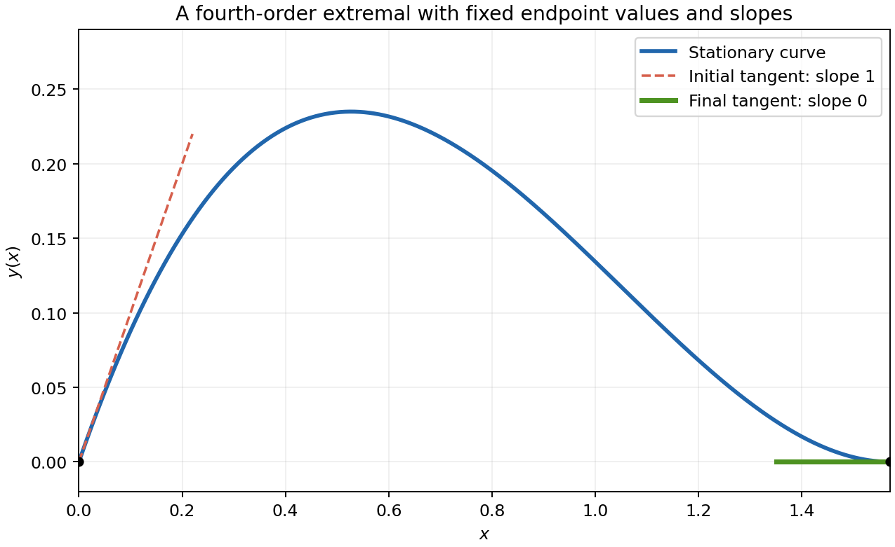

<h1 id="g/g1/solution">Solution</h1>

↑ **Parent:** [G1](../g1.md)

Let $y_\epsilon=y+\epsilon\eta$, with $\eta=\eta'=0$ at both endpoints. At an extremal the [first variation](../../../../first-variation.md) is zero:

$$
0=\int_{x_1}^{x_2}(F_y\eta+F_{y'}\eta'+F_{y''}\eta'')\,dx.
$$

Integrate the second term by parts once and the third term twice. The boundary term is

$$
\left[F_{y'}\eta+F_{y''}\eta'-\frac d{dx}F_{y''}\eta\right]_{x_1}^{x_2}=0.
$$

The given fundamental lemma therefore gives

$$
\boxed{F_y-\frac d{dx}F_{y'}+\frac{d^2}{dx^2}F_{y''}=0}.
$$

This is the classical form under the usual smoothness hypotheses ensuring the displayed derivatives exist; without that extra regularity the variation first yields its distributional form.

For the concrete functional the equation is $y^{(4)}-y=0$. Write $L=\pi/2$, $C=\cosh L$ and $S=\sinh L$. A general solution is $A\cos x+B\sin x+D\cosh x+E\sinh x$. The two initial conditions give $D=-A$ and $B+E=1$. The final derivative condition gives $A=EC/(1+S)$, and the final value condition then gives $E=(1+S)/2$. Thus an extremal is

$$
\boxed{y(x)=\frac C2(\cos x-\cosh x)+\frac{1-S}{2}\sin x+\frac{1+S}{2}\sinh x}.
$$

It solves the differential equation, has initial value zero and initial derivative one, and at $L$ both its value and derivative vanish, using $C^2-S^2=1$. These checks verify all four prescribed endpoint conditions.

**[Figure 1](#g/g1/image-the-clamped-fourth-order-extremal). The clamped fourth-order extremal**. The computed curve satisfies both endpoint values, with initial slope one and final slope zero.

## ↑ Ancestors (12)

1. [G1](../g1.md)
2. [G](../../g.md)
3. [2007](../../../2007-split.md)
4. [Past exam of the options I course of the University of Oxford](../../../split.md)
5. [Options I course of the University of Oxford](../../../../options-i-course-of-the-university-of-oxford.md)
6. [Year 2 of the mathematics course of the University of Oxford](../../../../year-2-of-the-mathematics-course-of-the-university-of-oxford.md)
7. [Mathematics course of the University of Oxford](../../../../mathematics-course-of-the-university-of-oxford.md)
8. [Undergraduate course of the University of Oxford](../../../../undergraduate-course-of-the-university-of-oxford.md)
9. [Course of the University of Oxford](../../../../course-of-the-university-of-oxford.md)
10. [University of Oxford](../../../../university-of-oxford-split.md)
11. [List of universities](../../../../list-of-universities.md)
12. [Codex Wiki](../../../../split.md)
