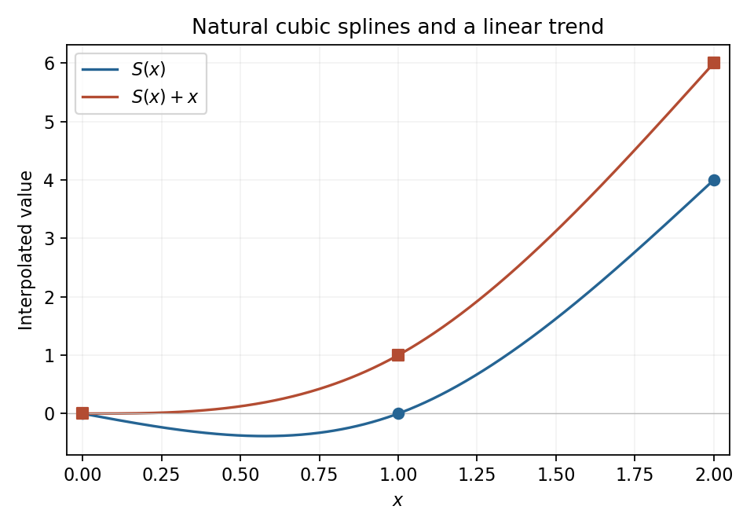

# 2008

↑ **Parent:** [Past exam of the options I course of the University of Oxford](../past-exam-of-the-options-i-course-of-the-university-of-oxford.md)

Options I, Honour School of Mathematics Part A, Trinity Term; Wednesday 18 June 2008, 9.30am–12.30pm. The full nine-page source, including its intact cover and all nineteen questions, is preserved in a private editable transcription. It was supplied through [the past-papers disclosure](https://www.whatdotheyknow.com/request/maths_past_papers_3), in original Part A bundle pages 71–79. No exact worked-answer advertisement was found in the bounded availability check.

**Table of contents**

- [A](#a)
  - [A1](#a/a1)
    - [Solution](#a/a1/solution)
- [B](#b)
  - [B1](#b/b1)
    - [Solution](#b/b1/solution)
- [C](#c)
  - [C1](#c/c1)
    - [Solution](#c/c1/solution)
- [D](#d)
  - [D1](#d/d1)
    - [a](#d/d1/a)
      - [Solution](#d/d1/a/solution)
    - [b](#d/d1/b)
      - [Solution](#d/d1/b/solution)
  - [D2](#d/d2)
    - [a](#d/d2/a)
      - [Solution](#d/d2/a/solution)
    - [b](#d/d2/b)
      - [i](#d/d2/b/i)
        - [Solution](#d/d2/b/i/solution)
      - [ii](#d/d2/b/ii)
        - [Solution](#d/d2/b/ii/solution)
- [E](#e)
  - [E1](#e/e1)
    - [a](#e/e1/a)
      - [i](#e/e1/a/i)
        - [Solution](#e/e1/a/i/solution)
      - [ii](#e/e1/a/ii)
        - [Solution](#e/e1/a/ii/solution)
    - [b](#e/e1/b)
      - [Solution](#e/e1/b/solution)
    - [c](#e/e1/c)
      - [i](#e/e1/c/i)
        - [Solution](#e/e1/c/i/solution)
      - [ii](#e/e1/c/ii)
        - [Solution](#e/e1/c/ii/solution)
  - [E2](#e/e2)
    - [i](#e/e2/i)
      - [Solution](#e/e2/i/solution)
    - [ii](#e/e2/ii)
      - [Solution](#e/e2/ii/solution)
    - [iii](#e/e2/iii)
      - [Solution](#e/e2/iii/solution)
- [F](#f)
  - [F1](#f/f1)
    - [a](#f/f1/a)
      - [Solution](#f/f1/a/solution)
    - [b](#f/f1/b)
      - [Solution](#f/f1/b/solution)
- [G](#g)
  - [G1](#g/g1)
    - [Solution](#g/g1/solution)
- [H](#h)
  - [H1](#h/h1)
    - [i](#h/h1/i)
      - [Solution](#h/h1/i/solution)
    - [ii](#h/h1/ii)
      - [Solution](#h/h1/ii/solution)
    - [Solution](#h/h1/solution)
- [J](#j)
  - [J1](#j/j1)
    - [Solution](#j/j1/solution)
- [K](#k)
  - [K1](#k/k1)
    - [i](#k/k1/i)
      - [Solution](#k/k1/i/solution)
    - [ii](#k/k1/ii)
      - [Solution](#k/k1/ii/solution)
    - [iii](#k/k1/iii)
      - [Solution](#k/k1/iii/solution)
    - [iv](#k/k1/iv)
      - [Solution](#k/k1/iv/solution)
  - [K2](#k/k2)
    - [i](#k/k2/i)
      - [Solution](#k/k2/i/solution)
    - [ii](#k/k2/ii)
      - [Solution](#k/k2/ii/solution)
    - [iii](#k/k2/iii)
      - [Solution](#k/k2/iii/solution)
- [M](#m)
  - [M1](#m/m1)
    - [Solution](#m/m1/solution)
  - [M2](#m/m2)
    - [Solution](#m/m2/solution)
- [O](#o)
  - [O1](#o/o1)
    - [i](#o/o1/i)
      - [Solution](#o/o1/i/solution)
    - [ii](#o/o1/ii)
      - [Solution](#o/o1/ii/solution)
    - [iii](#o/o1/iii)
      - [Solution](#o/o1/iii/solution)
    - [iv](#o/o1/iv)
      - [Solution](#o/o1/iv/solution)
    - [v](#o/o1/v)
      - [Solution](#o/o1/v/solution)
  - [O2](#o/o2)
    - [Solution](#o/o2/solution)
- [P](#p)
  - [P1](#p/p1)
    - [Solution](#p/p1/solution)
  - [P2](#p/p2)
    - [Solution](#p/p2/solution)

## A

↑ **Parent:** [2008](2008.md)

<h3 id="a/a1">A1</h3>

↑ **Parent:** [A](#a)

<h4 id="a/a1/solution">Solution</h4>

↑ **Parent:** [A1](#a/a1)

Fix $\omega_1$. For any $u,v\ne\omega_1$, apply the given two-point transitivity property to $(\omega_1,u)$ and $(\omega_1,v)$. The resulting element fixes $\omega_1$ and sends $u$ to $v$, so the [stabilizer](../group-action.md#stabilizer-subgroup) is transitive on the complement.

The whole group is transitive on $\Omega$: extend any desired first-coordinate pair by choosing a different second point on each side. By the [orbit-stabilizer theorem](../group-action.md#orbit-stabilizer-theorem), $|G|=n|\operatorname{Stab}_G(\omega_1)|$. Applying the same theorem inside the [stabilizer](../group-action.md#stabilizer-subgroup) to its [orbit](../dynamical-systems.md#orbit-dynamical-system) of size $n-1$ shows that $n-1$ divides the [stabilizer](../group-action.md#stabilizer-subgroup) order. Hence

$$
\boxed{n(n-1)\mid|G|}.
$$

In the action on ordered pairs there are exactly **two orbits**. One is the diagonal, transitive because the action on $\Omega$ is transitive. The other comprises distinct-coordinate pairs and is transitive by hypothesis. Equality of the two coordinates is preserved by every group element, so the two sets cannot merge into one [orbit](../dynamical-systems.md#orbit-dynamical-system). Faithfulness of the action is not required.

## B

↑ **Parent:** [2008](2008.md)

<h3 id="b/b1">B1</h3>

↑ **Parent:** [B](#b)

<h4 id="b/b1/solution">Solution</h4>

↑ **Parent:** [B1](#b/b1)

[Eisenstein criterion](../commutative-algebra.md#eisenstein-criterion) says that a primitive [integer](../integer.md) [polynomial](../polynomial.md) is irreducible over $\mathbb Q$ if some prime divides all coefficients except the leading one, does not divide the leading coefficient, and its square does not divide the constant coefficient. The passage from primitive [integer](../integer.md) factorization to rational factorization is [Gauss lemma for polynomials](../commutative-algebra.md#gauss-lemma-for-polynomials).

Translate the variable:

$$
(x+1)^8+1=x^8+8x^7+28x^6+56x^5+70x^4+56x^3+28x^2+8x+2.
$$

This is Eisenstein at two. Translation is an automorphism of $\mathbb Q[x]$, so $x^8+1$ itself is irreducible.

Set $\zeta=e^{i\pi/8}$ and $c=\cos(\pi/8)$. Since $\zeta$ is a root of that irreducible degree-eight [polynomial](../polynomial.md), $[\mathbb Q(\zeta):\mathbb Q]=8$. Also $c=(\zeta+\zeta^{-1})/2$, so $\mathbb Q(c)\subseteq\mathbb Q(\zeta)$ and $\zeta$ solves $T^2-2cT+1=0$. The extension degree is at most two. It is not one, since every element of $\mathbb Q(c)$ is real and $\zeta$ is not. The [tower law for field extensions](../galois-theory.md#tower-law-for-field-extensions) now gives

$$
\boxed{[\mathbb Q(\zeta):\mathbb Q(c)]=2,\qquad[\mathbb Q(c):\mathbb Q]=4}.
$$

## C

↑ **Parent:** [2008](2008.md)

<h3 id="c/c1">C1</h3>

↑ **Parent:** [C](#c)

<h4 id="c/c1/solution">Solution</h4>

↑ **Parent:** [C1](#c/c1)

The [quadratic reciprocity law](../number-theory.md#quadratic-reciprocity) states that distinct odd primes $a,b$ satisfy

$$
\left(\frac ab\right)\left(\frac ba\right)=(-1)^{((a-1)/2)((b-1)/2)}.
$$

First suppose $p\ne q$. If the odd prime $r$ equalled one of them, divisibility of $p-q$ by $r$ would force the other to equal $r$ too, a contradiction. Thus reciprocity applies to $r,p$ and $r,q$. The [modular congruence](../modular-arithmetic.md#modular-congruence) modulo $4r$ gives both $p\equiv q\pmod r$ and $p\equiv q\pmod4$. Therefore $(p/r)=(q/r)$, and the reciprocity signs are identical. Rearranging the two reciprocity identities proves $\boxed{(r/p)=(r/q)}$. If $p=q$, the equality is immediate, including a zero [Legendre symbol](../quadratic-residue.md#legendre-symbol) when $p=r$.

For general odd $n>1$, factor $n=\prod_jr_j^{e_j}$. If $p=q$ there is nothing to prove. Otherwise neither $p$ nor $q$ divides $n$, since any such divisor, together with $4n\mid p-q$, would force $p=q$. Each $4r_j$ divides $p-q$, so the first result and multiplicativity of the [Legendre symbol](../quadratic-residue.md#legendre-symbol) give

$$
\left(\frac np\right)=\prod_j\left(\frac{r_j}p\right)^{e_j}
=\prod_j\left(\frac{r_j}q\right)^{e_j}
=\boxed{\left(\frac nq\right)}.
$$

For $n=1$, both symbols equal one.

## D

↑ **Parent:** [2008](2008.md)

<h3 id="d/d1">D1</h3>

↑ **Parent:** [D](#d)

<h4 id="d/d1/a">a</h4>

↑ **Parent:** [D1](#d/d1)

<h5 id="d/d1/a/solution">Solution</h5>

↑ **Parent:** [A](#d/d1/a)

A [null set](../measure-theory.md#null-set) has [Lebesgue outer measure](../measure-theory.md#lebesgue-outer-measure) zero: for every $\varepsilon>0$ it can be covered by countably many open intervals with total length below $\varepsilon$. If $E_j$ are null, cover $E_j$ by intervals of total length below $\varepsilon2^{-j}$, for $j\geq1$. The [union](../set.md#set-union) of all these covers is countable and covers $\bigcup_jE_j$ with total length below $\varepsilon$. As $\varepsilon$ is arbitrary, **the countable [union](../set.md#set-union) is null**.

<h4 id="d/d1/b">b</h4>

↑ **Parent:** [D1](#d/d1)

<h5 id="d/d1/b/solution">Solution</h5>

↑ **Parent:** [B](#d/d1/b)

Let $A_n=\{x:f(x)\geq1/n\}$. To avoid presupposing finite measure of $A_n$, first truncate it: $A_{n,k}=A_n\cap[-k,k]$ is measurable and has finite measure. Its indicator divided by $n$ is integrable and is bounded above by $f$. The allowed monotonicity property gives

$$
0\leq\frac1n m(A_{n,k})\leq\int_{\mathbb R}f=0.
$$

Thus every $A_{n,k}$ is null. Their countable [union](../set.md#set-union) $A_n$ is null by part (a), and so is $E=\bigcup_nA_n$. Every positive value of $f$ is at least $1/n$ for some [integer](../integer.md) $n$, hence $\{f>0\}=E$. Consequently **$f=0$ outside a [null set](../measure-theory.md#null-set)**.

<h3 id="d/d2">D2</h3>

↑ **Parent:** [D](#d)

<h4 id="d/d2/a">a</h4>

↑ **Parent:** [D2](#d/d2)

<h5 id="d/d2/a/solution">Solution</h5>

↑ **Parent:** [A](#d/d2/a)

The integrand is positive and [continuous](../calculus.md#continuous-function) on the interval in question. Substitute $t=\log(1+x)$ to obtain

$$
\int_1^\infty f(x)\,dx=\int_{\log2}^\infty\frac{e^{(1-\alpha)t}}{t^2}\,dt.
$$

If $\alpha\geq1$, the exponential factor is at most one and the comparison integral of $t^{-2}$ converges. If $\alpha<1$, exponential growth dominates $t^2$, so the integrand eventually exceeds one and the integral diverges. Thus

$$
\boxed{\alpha\geq1}.
$$

The logarithmic square is what makes the boundary value $\alpha=1$ integrable.

<h4 id="d/d2/b">b</h4>

↑ **Parent:** [D2](#d/d2)

<h5 id="d/d2/b/i">i</h5>

↑ **Parent:** [B](#d/d2/b)

<h6 id="d/d2/b/i/solution">Solution</h6>

↑ **Parent:** [I](#d/d2/b/i)

The [function](../function.md) is measurable and $0\leq\cos^2(1/x)\leq1$. The interval has finite measure, so its integral is at most one. Hence **it is integrable**, despite its oscillations near zero.

<h5 id="d/d2/b/ii">ii</h5>

↑ **Parent:** [B](#d/d2/b)

<h6 id="d/d2/b/ii/solution">Solution</h6>

↑ **Parent:** [Ii](#d/d2/b/ii)

As $x\to\infty$, $\cos^2(1/x)\to1$. It is therefore at least $1/2$ on some infinite tail. The integral of that lower bound is infinite, so **it is not integrable** on this interval.

## E

↑ **Parent:** [2008](2008.md)

<h3 id="e/e1">E1</h3>

↑ **Parent:** [E](#e)

<h4 id="e/e1/a">a</h4>

↑ **Parent:** [E1](#e/e1)

<h5 id="e/e1/a/i">i</h5>

↑ **Parent:** [A](#e/e1/a)

<h6 id="e/e1/a/i/solution">Solution</h6>

↑ **Parent:** [I](#e/e1/a/i)

A map of [topological spaces](../topology.md#topological-space) is [continuous](../calculus.md#continuous-function) when the [preimage](../set-theory.md#preimage) $f^{-1}(U)$ is open in $X$ for every [open set](../topology.md#open-set) $U$ of $Y$. Equivalently, the [preimage](../set-theory.md#preimage) of every [closed subset](../topology.md#closed-set) of $Y$ is closed in $X$.

<h5 id="e/e1/a/ii">ii</h5>

↑ **Parent:** [A](#e/e1/a)

<h6 id="e/e1/a/ii/solution">Solution</h6>

↑ **Parent:** [Ii](#e/e1/a/ii)

For every $\varepsilon>0$ there must be a $\delta>0$ such that

$$
\operatorname{dist}_X(x,x_0)<\delta\quad\Longrightarrow\quad
\operatorname{dist}_Y(f(x),f(x_0))<\varepsilon.
$$

The choice of $\delta$ may depend on $x_0$ and $\varepsilon$. This is the [epsilon-delta definition of continuity](../calculus.md#epsilon-delta-definition-of-continuity).

<h4 id="e/e1/b">b</h4>

↑ **Parent:** [E1](#e/e1)

<h5 id="e/e1/b/solution">Solution</h5>

↑ **Parent:** [B](#e/e1/b)

A [basis for a topology](../topology.md#basis-of-a-topology) is a family of open sets such that every [open set](../topology.md#open-set) is a [union](../set.md#set-union) of members of the family. Equivalently, for every point in an [open set](../topology.md#open-set) there is a basis member containing that point and contained in the [open set](../topology.md#open-set).

For a basis $\mathcal B$ on $Y$, [continuity](../calculus.md#continuous-function) is equivalent to **$f^{-1}(B)$ being open for every $B\in\mathcal B$**. Necessity follows because basis sets are open. Conversely, taking preimages of a [union](../set.md#set-union) of basis sets gives a [union](../set.md#set-union) of open preimages, so every [open set](../topology.md#open-set) has an open [preimage](../set-theory.md#preimage).

<h4 id="e/e1/c">c</h4>

↑ **Parent:** [E1](#e/e1)

<h5 id="e/e1/c/i">i</h5>

↑ **Parent:** [C](#e/e1/c)

<h6 id="e/e1/c/i/solution">Solution</h6>

↑ **Parent:** [I](#e/e1/c/i)

Each interval $(a,b)$ is open in the usual metric: if $x\in(a,b)$, the ball with radius $\min(x-a,b-x)/2$ is contained in it. Conversely, if $U$ is open and $x\in U$, the metric definition supplies $r>0$ with $(x-r,x+r)\subseteq U$. Thus every [open set](../topology.md#open-set) is a [union](../set.md#set-union) of open intervals, which proves **they form a basis**.

<h5 id="e/e1/c/ii">ii</h5>

↑ **Parent:** [C](#e/e1/c)

<h6 id="e/e1/c/ii/solution">Solution</h6>

↑ **Parent:** [Ii](#e/e1/c/ii)

If $f$ is [continuous](../calculus.md#continuous-function), the sets in question are preimages of the open rays $(-\infty,\lambda)$ and $(\lambda,\infty)$, so they are open. Conversely, suppose all those sets are open. For every $a<b$,

$$
f^{-1}((a,b))=\{f>a\}\cap\{f<b\}
$$

is open as the [intersection](../set.md#set-intersection) of two open sets. Part (i) and the basis criterion of part (b) then prove **$f$ is [continuous](../calculus.md#continuous-function)**.

<h3 id="e/e2">E2</h3>

↑ **Parent:** [E](#e)

<h4 id="e/e2/i">i</h4>

↑ **Parent:** [E2](#e/e2)

<h5 id="e/e2/i/solution">Solution</h5>

↑ **Parent:** [I](#e/e2/i)

A subset is [connected](../geometry-and-topology.md#connected-space) when it has no separation into two disjoint nonempty relatively open sets. It is [path-connected](../geometry-and-topology.md#path-connected-space) when every pair of its points can be joined by a [continuous](../calculus.md#continuous-function) path from $[0,1]$ lying in the subset.

Path-[connectedness](../geometry-and-topology.md#connected-space) implies [connectedness](../geometry-and-topology.md#connected-space); the reverse fails in general, for example for the [topologist's sine curve](../geometry-and-topology.md#topologist-s-sine-curve). They are equivalent for open subsets of every [Euclidean space](../normed-vector-space.md#euclidean-norm) $\mathbb R^n$. More generally this holds for open subsets of [locally path-connected spaces](../geometry-and-topology.md#locally-path-connected-space).

<h4 id="e/e2/ii">ii</h4>

↑ **Parent:** [E2](#e/e2)

<h5 id="e/e2/ii/solution">Solution</h5>

↑ **Parent:** [Ii](#e/e2/ii)

If $f(A)$ were separated by two disjoint nonempty relatively open sets, their preimages under the restriction $f|_A$ would be disjoint nonempty relatively open sets covering $A$. [Continuity](../calculus.md#continuous-function) makes them open in $A$, contradicting its [connectedness](../geometry-and-topology.md#connected-space). Therefore **$f(A)$ is [connected](../geometry-and-topology.md#connected-space)**.

<h4 id="e/e2/iii">iii</h4>

↑ **Parent:** [E2](#e/e2)

<h5 id="e/e2/iii/solution">Solution</h5>

↑ **Parent:** [Iii](#e/e2/iii)

The circle is [path-connected](../geometry-and-topology.md#path-connected-space), using circular arcs, and hence [connected](../geometry-and-topology.md#connected-space). Its [continuous](../calculus.md#continuous-function) image is [connected](../geometry-and-topology.md#connected-space) by part (ii). A [connected](../geometry-and-topology.md#connected-space) subset of the [real line](../real-analysis.md#real-line) is an interval: if it contained values on opposite sides of a missing value $c$, [intersection](../set.md#set-intersection) with $(-\infty,c)$ and $(c,\infty)$ would separate it. Thus **$f(C)$ is an interval**. It is also [compact](../topology.md#compact-space), so it is a closed bounded interval, possibly reduced to one point.

## F

↑ **Parent:** [2008](2008.md)

<h3 id="f/f1">F1</h3>

↑ **Parent:** [F](#f)

<h4 id="f/f1/a">a</h4>

↑ **Parent:** [F1](#f/f1)

<h5 id="f/f1/a/solution">Solution</h5>

↑ **Parent:** [A](#f/f1/a)

For $f=(f_1,\ldots,f_k)$, the [Jacobian matrix](../multivariable-calculus.md#jacobian-matrix) is the matrix of its derivative in standard bases, with entries $(Df)_{ij}=\partial f_i/\partial x_j$. Here

$$
\boxed{Df(x,y)=\begin{pmatrix}e^x\sin y&e^x\cos y\\-e^{-y}\sin x&-e^{-y}\cos x\end{pmatrix}}.
$$

<h4 id="f/f1/b">b</h4>

↑ **Parent:** [F1](#f/f1)

<h5 id="f/f1/b/solution">Solution</h5>

↑ **Parent:** [B](#f/f1/b)

The [inverse function theorem](../multivariable-calculus.md#inverse-function-theorem) states: if $f$ is continuously differentiable on an open subset of $\mathbb R^n$ and $Df(a)$ is invertible, then some [open neighbourhood](../topology.md#open-neighbourhood) of $a$ is mapped bijectively onto an [open neighbourhood](../topology.md#open-neighbourhood) of $f(a)$, with continuously differentiable inverse. Its derivative at $f(a)$ is $(Df(a))^{-1}$.

The present map is smooth, and at $a=(\pi/2,\pi)$,

$$
Df(a)=\begin{pmatrix}0&-e^{\pi/2}\\-e^{-\pi}&0\end{pmatrix},\qquad
\det Df(a)=-e^{-\pi/2}\ne0.
$$

Also $f(a)=(0,0)$, so the theorem applies locally and gives

$$
\boxed{D(f^{-1})(0,0)=\begin{pmatrix}0&-e^{\pi}\\-e^{-\pi/2}&0\end{pmatrix}}.
$$

The inverse is defined near the image point $(0,0)$ and takes values near $a$; no assertion of a global inverse is required.

## G

↑ **Parent:** [2008](2008.md)

<h3 id="g/g1">G1</h3>

↑ **Parent:** [G](#g)

<h4 id="g/g1/solution">Solution</h4>

↑ **Parent:** [G1](#g/g1)

With fixed endpoint values, a smooth extremal satisfies the [Euler-Lagrange equation](../analysis.md#euler-lagrange-equation) $F_y-(d/dx)F_{y'}=0$. If $F$ has no explicit $x$ dependence, differentiation gives

$$
\frac d{dx}(F-y'F_{y'})=y'\left(F_y-\frac d{dx}F_{y'}\right)=0.
$$

Thus $F-y'F_{y'}$ is constant, the [Beltrami identity](../analysis.md#beltrami-identity).

For this integrand, $F_y=2y$ and $F_{y'}=1+2y'$, so the equation is $y''=y$. Consequently

$$
\boxed{y(x)=Ae^x+Be^{-x}}.
$$

The two constants are fixed uniquely by the prescribed values at distinct endpoints. Equivalently, writing these values as $y_1,y_2$,

$$
y(x)=\frac{y_1\sinh(x_2-x)+y_2\sinh(x-x_1)}{\sinh(x_2-x_1)}.
$$

Its first integral is $y^2-y'^2$, which is constant. Using only that first integral without the [Euler-Lagrange equation](../analysis.md#euler-lagrange-equation) could admit spurious constant functions, so the differential equation was used directly.

For any nonzero endpoint-vanishing perturbation $\eta$, the linear terms in $J[y+\eta]-J[y]$ vanish by the [Euler-Lagrange equation](../analysis.md#euler-lagrange-equation) and [integration by parts](../calculus.md#integration-by-parts); also $\int\eta'=0$. The remainder is

$$
J[y+\eta]-J[y]=\int_{x_1}^{x_2}(\eta^2+\eta'^2)\,dx>0.
$$

Hence the extremal is the **unique strict global minimum**, and cannot be a maximum.

## H

↑ **Parent:** [2008](2008.md)

<h3 id="h/h1">H1</h3>

↑ **Parent:** [H](#h)

<h4 id="h/h1/i">i</h4>

↑ **Parent:** [H1](#h/h1)

<h5 id="h/h1/i/solution">Solution</h5>

↑ **Parent:** [I](#h/h1/i)

A coordinate absent from the [Lagrangian](../calculus-of-variations.md#lagrangian) is [cyclic](../lagrangian-mechanics.md#cyclic-coordinate). Its [Euler-Lagrange equation](../analysis.md#euler-lagrange-equation) gives

$$
\frac d{dt}\frac{\partial L}{\partial\dot q_1}=\frac{\partial L}{\partial q_1}=0.
$$

Thus the corresponding [generalized momentum](../lagrangian-mechanics.md#generalized-momentum) $\boxed{p_1=\partial L/\partial\dot q_1}$ is conserved.

<h4 id="h/h1/ii">ii</h4>

↑ **Parent:** [H1](#h/h1)

<h5 id="h/h1/ii/solution">Solution</h5>

↑ **Parent:** [Ii](#h/h1/ii)

The [energy function](../energy.md#energy-function) is $E=\sum_a\dot q_a\,\partial L/\partial\dot q_a-L$. Along a solution,

$$
\frac{dE}{dt}=\sum_a\dot q_a\left(\frac d{dt}\frac{\partial L}{\partial\dot q_a}-\frac{\partial L}{\partial q_a}\right)-\frac{\partial L}{\partial t}
=-\frac{\partial L}{\partial t}.
$$

Therefore time [independence](../random-variable.md#independent-random-variables) gives the conserved quantity

$$
\boxed{E=\sum_a\dot q_a\frac{\partial L}{\partial\dot q_a}-L}.
$$

<h4 id="h/h1/solution">Solution</h4>

↑ **Parent:** [H1](#h/h1)

Put $A(r)=r^2/(r-2m)^2$ and $B(r)=r^3/(r-2m)$, so $L=A\dot r^2+B\dot\varphi^2$. Direct differentiation gives $A'=-4mr/(r-2m)^3$ and $B'=2r^2(r-3m)/(r-2m)^2$. The [Euler-Lagrange equations](../analysis.md#euler-lagrange-equation) are $2A\ddot r+A'\dot r^2-B'\dot\varphi^2=0$ and $(d/dt)(2B\dot\varphi)=0$, equivalently

$$
\boxed{\ddot r-\frac{2m}{r(r-2m)}\dot r^2-(r-3m)\dot\varphi^2=0},
$$

$$
\boxed{\ddot\varphi+\frac{2(r-3m)}{r(r-2m)}\dot r\dot\varphi=0}.
$$

The cyclic angular coordinate and time [independence](../random-variable.md#independent-random-variables) give the two conserved quantities

$$
\boxed{J=\frac{2r^3}{r-2m}\dot\varphi,\qquad E=\frac{r^2}{(r-2m)^2}\dot r^2+\frac{r^3}{r-2m}\dot\varphi^2}.
$$

The expression for $E$ equals $L$ here because $L$ is homogeneous quadratic in the velocities.

For a constant radius and nonzero angular motion, the radial equation requires $(r_*-3m)\dot\varphi^2=0$, so $\boxed{r_*=3m}$. This lies outside $2m$, and the angular equation then gives $\varphi=\Omega t+\varphi_0$, with any nonzero constant $\Omega$. This is the [photon sphere](../schwarzschild-spacetime.md#photon-sphere) radius in the stated coordinates. If both velocities are zero, the displayed variational equations also admit a stationary configuration at any radius; the moving circular photon solution is the nonzero-speed case just found.

## J

↑ **Parent:** [2008](2008.md)

<h3 id="j/j1">J1</h3>

↑ **Parent:** [J](#j)

<h4 id="j/j1/solution">Solution</h4>

↑ **Parent:** [J1](#j/j1)

[Gauss law](../maxwell-equations.md#gauss-s-law) states that for outward-oriented boundary $S=\partial V$,

$$
\boxed{\int_S\mathbf E\cdot\mathbf n\,dS=\frac1{\epsilon_0}\int_V\rho\,dV}.
$$

For a continuously differentiable field and [continuous](../calculus.md#continuous-function) density, the [divergence theorem](../multivariable-calculus.md#divergence-theorem) turns the left side into $\int_V\nabla\cdot\mathbf E$. Thus the differential law implies the integral law. Conversely, if the integral law holds for every suitable volume, the integral of $\nabla\cdot\mathbf E-\rho/\epsilon_0$ vanishes on every small ball. A nonzero [continuous](../calculus.md#continuous-function) value would keep one strict sign in some small ball, a contradiction. Hence $\nabla\cdot\mathbf E=\rho/\epsilon_0$. Weaker regularity gives the corresponding almost-everywhere or distributional formulation.

For the radial field, the flux on a radius-$r$ sphere is $4\pi r^2E(r)$, while its enclosed charge is $4\pi\int_0^r s^2\rho(s)\,ds$. Therefore

$$
\boxed{E(r)=\frac1{\epsilon_0r^2}\int_0^rs^2\rho(s)\,ds}.
$$

This uses the stated density as the full charge distribution, with no additional point charge at the origin. Since it vanishes beyond $a$, the total charge is

$$
\boxed{Q=4\pi\int_0^a s^2\rho(s)\,ds},
$$

and for $r>a$ the field is $\boxed{\mathbf E=Q\mathbf e_r/(4\pi\epsilon_0r^2)}$.

## K

↑ **Parent:** [2008](2008.md)

<h3 id="k/k1">K1</h3>

↑ **Parent:** [K](#k)

<h4 id="k/k1/i">i</h4>

↑ **Parent:** [K1](#k/k1)

<h5 id="k/k1/i/solution">Solution</h5>

↑ **Parent:** [I](#k/k1/i)

Use the [stream function](../fluid-mechanics.md#stream-function) convention $u=\psi_y$, $v=-\psi_x$. It gives $u=-\sin x\sin y$, $v=-\cos x\cos y$. Then

$$
u_x+v_y=-\cos x\sin y+\cos x\sin y=0,
$$

so **the flow is incompressible**.

<h4 id="k/k1/ii">ii</h4>

↑ **Parent:** [K1](#k/k1)

<h5 id="k/k1/ii/solution">Solution</h5>

↑ **Parent:** [Ii](#k/k1/ii)

The [vorticity](../vorticity.md) points normally to the plane and has scalar component

$$
\boxed{\omega_z=v_x-u_y=2\sin x\cos y=2\psi}.
$$

It is nonzero in general, so the flow is rotational.

<h4 id="k/k1/iii">iii</h4>

↑ **Parent:** [K1](#k/k1)

<h5 id="k/k1/iii/solution">Solution</h5>

↑ **Parent:** [Iii](#k/k1/iii)

For this steady, inviscid, constant-density flow without a body force, [Bernoulli's theorem](../euler-equations-for-an-inviscid-fluid.md#bernoulli-equation) says that

$$
\boxed{\frac p\rho+\frac12(u^2+v^2)\text{ is constant along each streamline}}.
$$

Its constant may vary from one [streamline](../fluid-mechanics.md#streamline) to another because the flow has [vorticity](../vorticity.md).

<h4 id="k/k1/iv">iv</h4>

↑ **Parent:** [K1](#k/k1)

<h5 id="k/k1/iv/solution">Solution</h5>

↑ **Parent:** [Iv](#k/k1/iv)

The convective acceleration is

$$
u u_x+v u_y=\sin x\cos x,\qquad
u v_x+v v_y=-\sin y\cos y.
$$

Steady [Euler equations](../euler-equations-for-an-inviscid-fluid.md) therefore give $p_x=-\rho\sin x\cos x$ and $p_y=\rho\sin y\cos y$. Integrating these compatible equations yields

$$
\boxed{p(x,y)=p_0-\frac\rho2\sin^2x+\frac\rho2\sin^2y},
$$

with arbitrary additive constant $p_0$. As a check, $p/\rho+(u^2+v^2)/2=p_0/\rho+1/2-\psi^2$, indeed constant on each [streamline](../fluid-mechanics.md#streamline). This is a [Steady Euler flow with vorticity proportional to its stream function](../fluid-mechanics.md#steady-euler-flow-with-vorticity-proportional-to-its-stream-function).

<h3 id="k/k2">K2</h3>

↑ **Parent:** [K](#k)

<h4 id="k/k2/i">i</h4>

↑ **Parent:** [K2](#k/k2)

<h5 id="k/k2/i/solution">Solution</h5>

↑ **Parent:** [I](#k/k2/i)

Condition (1b) is the [kinematic free-surface boundary condition](../fluid-mechanics.md#kinematic-boundary-condition-for-a-free-surface-graph): fluid particles on the surface remain there, since the material derivative of $y-\eta(x,t)$ vanishes. Condition (1c) is the [dynamic free-surface boundary condition](../fluid-mechanics.md#dynamic-boundary-condition-for-an-inviscid-interface), obtained from the unsteady Bernoulli equation with constant atmospheric pressure and a choice of potential gauge. Condition (1d) is [impermeability](../viscous-fluid-flow.md#no-penetration-boundary-condition): no normal flow through the horizontal bed.

<h4 id="k/k2/ii">ii</h4>

↑ **Parent:** [K2](#k/k2)

<h5 id="k/k2/ii/solution">Solution</h5>

↑ **Parent:** [Ii](#k/k2/ii)

Write the surface displacement and the perturbation [velocity potential](../fluid-mechanics.md#velocity-potential) as small quantities about rest, and drop their quadratic products. Evaluating the remaining surface terms at the unperturbed level $y=0$ gives

$$
\boxed{\phi_{xx}+\phi_{yy}=0\quad(-H<y<0)},
$$

$$
\boxed{\eta_t=\phi_y,\qquad\phi_t+g\eta=0\quad(y=0),\qquad\phi_y=0\quad(y=-H)}.
$$

The velocity components are $u=\phi_x$, $v=\phi_y$. The shift of the evaluation point from zero to $\eta$ contributes a product of perturbations, as do $u\eta_x$ and the kinetic-[energy](../energy.md) term, so they disappear at this order.

<h4 id="k/k2/iii">iii</h4>

↑ **Parent:** [K2](#k/k2)

<h5 id="k/k2/iii/solution">Solution</h5>

↑ **Parent:** [Iii](#k/k2/iii)

For positive wavenumber $k$, the [phase velocity](../dispersion-relation.md#phase-velocity) is $c_p=\omega/k$, the speed of a fixed phase. The [group velocity](../dispersion-relation.md#group-velocity) is $c_g=d\omega/dk$, the leading speed of a narrow wave packet. Differentiating the supplied [dispersion relation](../dispersion-relation.md) gives

$$
\boxed{c_p=\sqrt{\frac gk\tanh(kH)}},
$$

$$
\boxed{c_g=\frac{g[\tanh(kH)+kH\operatorname{sech}^2(kH)]}{2\omega}
=\frac{c_p}2\left(1+\frac{2kH}{\sinh(2kH)}\right)}.
$$

For fixed $k>0$, the shallow-depth limit uses $\tanh s/s\to1$:

$$
\boxed{\lim_{H\to0}\frac{c_p^2}H=g}.
$$

## M

↑ **Parent:** [2008](2008.md)

<h3 id="m/m1">M1</h3>

↑ **Parent:** [M](#m)

<h4 id="m/m1/solution">Solution</h4>

↑ **Parent:** [M1](#m/m1)

The inverse transformation is $x=2u+v$, $y=v$, with absolute [Jacobian determinant](../multivariable-calculus.md#jacobian-determinant) two. The original positivity constraints become $v>0$ and $2u+v>0$. Thus

$$
\boxed{A=\{(u,v):v>\max(0,-2u)\}},\qquad
f_{U,V}(u,v)=\tfrac12e^{-u-v}\mathbf1_A.
$$

Integrating out $v$ gives

$$
f_U(u)=\frac12e^{-u}\int_{\max(0,-2u)}^\infty e^{-v}\,dv
=\frac12e^{-u-\max(0,-2u)}
=\boxed{\frac12e^{-|u|}}.
$$

This is the centred [Laplace distribution](../continuous-probability-distribution.md#laplace-distribution) with scale one.

<h3 id="m/m2">M2</h3>

↑ **Parent:** [M](#m)

<h4 id="m/m2/solution">Solution</h4>

↑ **Parent:** [M2](#m/m2)

The [Markov property](../markov-chain.md#markov-property) says that conditional on the present state, the next-state law does not depend on the earlier history. For this time-homogeneous chain, $\mathbb P(X_{n+1}=j\mid X_0=i_0,\ldots,X_n=i)=p_{ij}$ whenever the conditioning event has positive probability.

States communicate when each is accessible from the other by a finite positive-probability path; the equivalence classes are the [communicating classes](../markov-chain.md#communicating-class). A class is closed if no one-step transition leaves it, and open otherwise. Probability nonnegativity adds the implicit restriction $p\geq0$ to the printed upper bound.

At $p=0$, every state is absorbing, so the classes are the singletons, all closed. For $0<p\leq1/2$, every neighbouring pair communicates, so the whole state space is one closed class, making the chain [irreducible](../markov-chain.md#irreducible-markov-chain). There are no open classes in either case.

For $m=3$ and $p>0$, [detailed balance](../markov-chain.md#detailed-balance) along the path gives $2p\pi_0=p\pi_1$, $\pi_1=\pi_2$, and $p\pi_2=2p\pi_3$. After normalization,

$$
\boxed{\pi=(1,2,2,1)/6}.
$$

For $0<p<1/2$, the self-loops have positive probability; the finite irreducible chain is [aperiodic](../markov-chain.md#aperiodic-markov-chain), so $\mathbb P_i(X_n=j)\to\pi_j$ for all fixed starting states and targets. For $p=1/2$, every step changes parity. The chain has period two, and for each fixed $i,j$ one parity of times has probability zero while $\pi_j>0$. Thus the stated convergence from a fixed starting state holds **exactly when $0<p<1/2$**. This is the [stationary law of a reflecting nearest-neighbor walk on a finite path](../markov-chain.md#stationary-law-of-a-reflecting-nearest-neighbor-walk-on-a-finite-path).

## O

↑ **Parent:** [2008](2008.md)

<h3 id="o/o1">O1</h3>

↑ **Parent:** [O](#o)

<h4 id="o/o1/i">i</h4>

↑ **Parent:** [O1](#o/o1)

<h5 id="o/o1/i/solution">Solution</h5>

↑ **Parent:** [I](#o/o1/i)

For a two-way [contingency table](../statistical-modelling.md#contingency-table), Pearson's statistic is

$$
\boxed{X^2=\sum_{i,j}\frac{(O_{ij}-E_{ij})^2}{E_{ij}},\qquad E_{ij}=\frac{O_{i+}O_{+j}}{N}}.
$$

Here $O_{i+},O_{+j}$ are the observed margins and $N$ their grand total. Under the [independence](../random-variable.md#independent-random-variables) null, its usual large-sample reference distribution has $(r-1)(c-1)$ [degrees of freedom](../classical-mechanics.md#degree-of-freedom) for an $r$-by-$c$ table.

<h4 id="o/o1/ii">ii</h4>

↑ **Parent:** [O1](#o/o1)

<h5 id="o/o1/ii/solution">Solution</h5>

↑ **Parent:** [Ii](#o/o1/ii)

Under the null, the common fitted CC frequency is its pooled proportion $133/3874$. Multiplying by the fixed number of cases gives

$$
\boxed{E_{\rm CC,case}=1939\frac{83+50}{1939+1935}=66.5687\ldots\approx66.6}.
$$

This estimates the common type frequency from both groups, rather than using the case frequency alone.

<h4 id="o/o1/iii">iii</h4>

↑ **Parent:** [O1](#o/o1)

<h5 id="o/o1/iii/solution">Solution</h5>

↑ **Parent:** [Iii](#o/o1/iii)

With both column totals fixed, each column is a three-category multinomial sample. Under the null the two columns share one probability vector, which has **two free parameters** because its three probabilities sum to one. Under the alternative each has its own vector, giving **four free parameters**. Their difference is two, the reference [degrees of freedom](../classical-mechanics.md#degree-of-freedom) for the association test.

<h4 id="o/o1/iv">iv</h4>

↑ **Parent:** [O1](#o/o1)

<h5 id="o/o1/iv/solution">Solution</h5>

↑ **Parent:** [Iv](#o/o1/iv)

Use two [degrees of freedom](../classical-mechanics.md#degree-of-freedom) from part (iii). Since $8.42>5.99$, the statistic exceeds the supplied five-percent threshold. Thus **reject no association at the five-percent level**: the observed [genotype](../genetics.md#genotype) frequencies provide evidence of a difference between cases and controls. The approximate p-value is $e^{-8.42/2}\approx0.0148$ under the $\chi^2_2$ reference law.

<h4 id="o/o1/v">v</h4>

↑ **Parent:** [O1](#o/o1)

<h5 id="o/o1/v/solution">Solution</h5>

↑ **Parent:** [V](#o/o1/v)

The recessive alternative distinguishes CC from the other two types while assigning CT and TT the same disease-risk category. Pooling those two types therefore removes a distinction that this alternative does not use. The resulting counts are $83,1856$ for cases and $50,1885$ for controls, arranged as CC versus non-CC.

The resulting two-by-two table has $\boxed{(2-1)(2-1)=1}$ reference degree of freedom. Since $8.41>3.84$, **reject no association at the five-percent level** using the supplied chi-squared test. The observed CC proportion is higher among cases, $83/1939$, than among controls, $50/1935$, so the direction agrees with the proposed increased-risk category.

<h3 id="o/o2">O2</h3>

↑ **Parent:** [O](#o)

<h4 id="o/o2/solution">Solution</h4>

↑ **Parent:** [O2](#o/o2)

The [normal equations for linear least squares](../linear-regression.md#normal-equations-for-linear-least-squares) are $X^TX\widehat\theta=X^TY$. Under full column rank, $\widehat\theta=(X^TX)^{-1}X^TY$. Since $\operatorname{Cov}(Y)=\sigma^2I$,

$$
\boxed{\operatorname{Cov}(\widehat\theta)=\sigma^2(X^TX)^{-1}X^TX(X^TX)^{-1}=\sigma^2(X^TX)^{-1}}.
$$

Here $\bar x=0$ and $\bar z=2$, so the design matrix is

$$
\boxed{X=\begin{pmatrix}1&-3&1\\1&-2&0\\1&-1&-1\\1&1&-1\\1&2&0\\1&3&1\end{pmatrix}}.
$$

Its columns are pairwise orthogonal and have squared lengths $6,28,4$. Consequently $X^TX=\operatorname{diag}(6,28,4)$, giving

$$
\boxed{\operatorname{Var}(\widehat\beta)=\frac{\sigma^2}{28},\quad\operatorname{Var}(\widehat\gamma)=\frac{\sigma^2}4,\quad\operatorname{Cov}(\widehat\beta,\widehat\gamma)=0}.
$$

Both estimators are linear functions of the [Jointly Gaussian](../probability-and-statistics.md#multivariate-normal-distribution) observation vector, so they are [Jointly Gaussian](../probability-and-statistics.md#multivariate-normal-distribution). Zero covariance then implies **[independence](../random-variable.md#independent-random-variables)**. This final implication uses the normal error model, whereas the [variance](../variance.md) calculation itself needs only its second moments.

## P

↑ **Parent:** [2008](2008.md)

<h3 id="p/p1">P1</h3>

↑ **Parent:** [P](#p)

<h4 id="p/p1/solution">Solution</h4>

↑ **Parent:** [P1](#p/p1)

Use [Gaussian elimination with partial pivoting](../numerical-linear-algebra.md#gaussian-elimination), choosing a largest absolute entry in the uneliminated part of each pivot column. The first pivot is two in row one, with multipliers $1/2,1/2,1/5$ for rows two, three and four. The second-column candidates are then $-1,0,-2/5$, so row two stays as pivot and the remaining nonzero multiplier is $2/5$ for row four. The augmented matrix at this stage is

$$
\left(\begin{array}{rrrr|r}2&-1&4&2&3\\0&-1&3&2&1\\0&0&-3/4&-3/2&0\\0&0&3&-2&0\end{array}\right).
$$

The third pivot is three, so swap rows three and four. The final multiplier is $-1/4$, leaving last pivot $-2$. Carrying that swap through the previously stored multipliers gives

$$
P=\begin{pmatrix}1&0&0&0\\0&1&0&0\\0&0&0&1\\0&0&1&0\end{pmatrix},\qquad
L=\begin{pmatrix}1&0&0&0\\1/2&1&0&0\\1/5&2/5&1&0\\1/2&0&-1/4&1\end{pmatrix},
$$

$$
\boxed{U=\begin{pmatrix}2&-1&4&2\\0&-1&3&2\\0&0&3&-2\\0&0&0&-2\end{pmatrix},\qquad PA=LU}.
$$

The transformed right side is $(3,1,0,0)^T$. Back substitution gives $z=0$, $y=0$, $x=-1$ and $w=1$, hence $\boxed{(w,x,y,z)=(1,-1,0,0)}$.

For the [eigenvalue](../linear-operator-theory.md#eigenvalue) claim, put $S=P^TL$. It is invertible because a [permutation matrix](../vector-space.md#permutation-matrix) and a unit [lower triangular matrix](../linear-algebra.md#lower-triangular-matrix) are invertible. The factorization gives $A=SU$, so

$$
\boxed{S^{-1}AS=US=UP^TL=B}.
$$

Similar matrices have the same [characteristic polynomial](../linear-operator-theory.md#characteristic-polynomial) and therefore the same eigenvalues with algebraic multiplicities. This proves the claim without changing the prescribed elimination method.

<h3 id="p/p2">P2</h3>

↑ **Parent:** [P](#p)

<h4 id="p/p2/solution">Solution</h4>

↑ **Parent:** [P2](#p/p2)

A [natural cubic spline](../uniform-approximation.md#natural-cubic-spline) is piecewise cubic, interpolates the data, has [continuous](../calculus.md#continuous-function) first and second derivatives at the knot, and has zero second derivative at the outer endpoints. Its nodal second derivatives here satisfy $M_0=M_2=0$ and the usual matching equation

$$
M_0+4M_1+M_2=6[(4-0)-(0-0)]=24,
$$

so $M_1=6$. The resulting pieces are

$$
\boxed{S(x)=\begin{cases}x^3-x,&0\leq x\leq1,\\2t+3t^2-t^3,\quad t=x-1,&1\leq x\leq2.\end{cases}}
$$

Directly, the values are $0,0,4$, both first derivatives at one equal two, both second derivatives there equal six, and $S''(0)=S''(2)=0$. Thus all spline conditions hold.

The second data set adds the values of the affine [function](../function.md) $x$ to the first. Adding $x$ to the spline preserves derivative matching and the zero endpoint second derivatives, so uniqueness of the natural interpolant gives **the new spline $S(x)+x$**. Its first piece is $x^3$, and its second is $1+3t+3t^2-t^3$. This is the [affine covariance of natural cubic spline interpolation](../uniform-approximation.md#affine-covariance-of-natural-cubic-spline-interpolation).

**[Figure 1](#p/p2/image-natural-cubic-interpolation-and-an-affine-change-of-the-data). Natural cubic interpolation and an affine change of the data**. The second interpolant is obtained by adding $x$ to the first. Dots mark the three interpolation nodes of each curve.

## ↑ Ancestors (9)

1. [Past exam of the options I course of the University of Oxford](../past-exam-of-the-options-i-course-of-the-university-of-oxford.md)
2. [Options I course of the University of Oxford](../university-of-oxford.md#options-i-course-of-the-university-of-oxford)
3. [Year 2 of the mathematics course of the University of Oxford](../university-of-oxford.md#year-2-of-the-mathematics-course-of-the-university-of-oxford)
4. [Mathematics course of the University of Oxford](../university-of-oxford.md#mathematics-course-of-the-university-of-oxford)
5. [Undergraduate course of the University of Oxford](../university-of-oxford.md#undergraduate-course-of-the-university-of-oxford)
6. [Course of the University of Oxford](../university-of-oxford.md#course-of-the-university-of-oxford)
7. [University of Oxford](../university-of-oxford.md)
8. [List of universities](../README.md#list-of-universities)
9. [Codex Wiki](../README.md)
