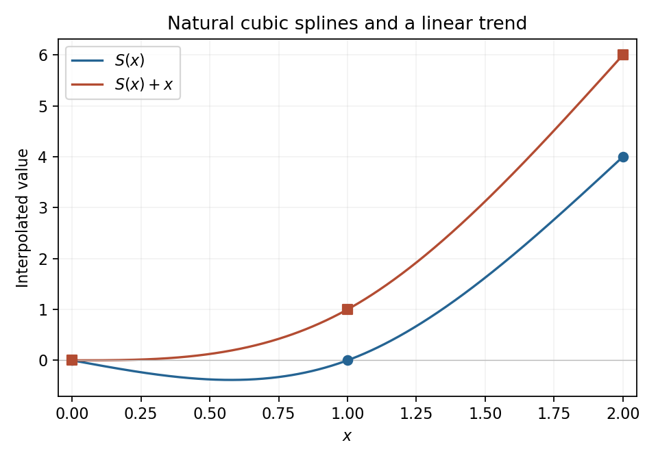

<h1 id="p/p2/solution">Solution</h1>

↑ **Parent:** [P2](../p2.md)

A [natural cubic spline](../../../../natural-cubic-spline.md) is piecewise cubic, interpolates the data, has [continuous](../../../../continuous-function.md) first and second derivatives at the knot, and has zero second derivative at the outer endpoints. Its nodal second derivatives here satisfy $M_0=M_2=0$ and the usual matching equation

$$
M_0+4M_1+M_2=6[(4-0)-(0-0)]=24,
$$

so $M_1=6$. The resulting pieces are

$$
\boxed{S(x)=\begin{cases}x^3-x,&0\leq x\leq1,\\2t+3t^2-t^3,\quad t=x-1,&1\leq x\leq2.\end{cases}}
$$

Directly, the values are $0,0,4$, both first derivatives at one equal two, both second derivatives there equal six, and $S''(0)=S''(2)=0$. Thus all spline conditions hold.

The second data set adds the values of the affine [function](../../../../function-split.md) $x$ to the first. Adding $x$ to the spline preserves derivative matching and the zero endpoint second derivatives, so uniqueness of the natural interpolant gives **the new spline $S(x)+x$**. Its first piece is $x^3$, and its second is $1+3t+3t^2-t^3$. This is the [affine covariance of natural cubic spline interpolation](../../../../affine-covariance-of-natural-cubic-spline-interpolation.md).

**[Figure 1](#p/p2/image-natural-cubic-interpolation-and-an-affine-change-of-the-data). Natural cubic interpolation and an affine change of the data**. The second interpolant is obtained by adding $x$ to the first. Dots mark the three interpolation nodes of each curve.

## ↑ Ancestors (12)

1. [P2](../p2.md)
2. [P](../../p.md)
3. [2008](../../../2008-split.md)
4. [Past exam of the options I course of the University of Oxford](../../../split.md)
5. [Options I course of the University of Oxford](../../../../options-i-course-of-the-university-of-oxford.md)
6. [Year 2 of the mathematics course of the University of Oxford](../../../../year-2-of-the-mathematics-course-of-the-university-of-oxford.md)
7. [Mathematics course of the University of Oxford](../../../../mathematics-course-of-the-university-of-oxford.md)
8. [Undergraduate course of the University of Oxford](../../../../undergraduate-course-of-the-university-of-oxford.md)
9. [Course of the University of Oxford](../../../../course-of-the-university-of-oxford.md)
10. [University of Oxford](../../../../university-of-oxford-split.md)
11. [List of universities](../../../../list-of-universities.md)
12. [Codex Wiki](../../../../split.md)
