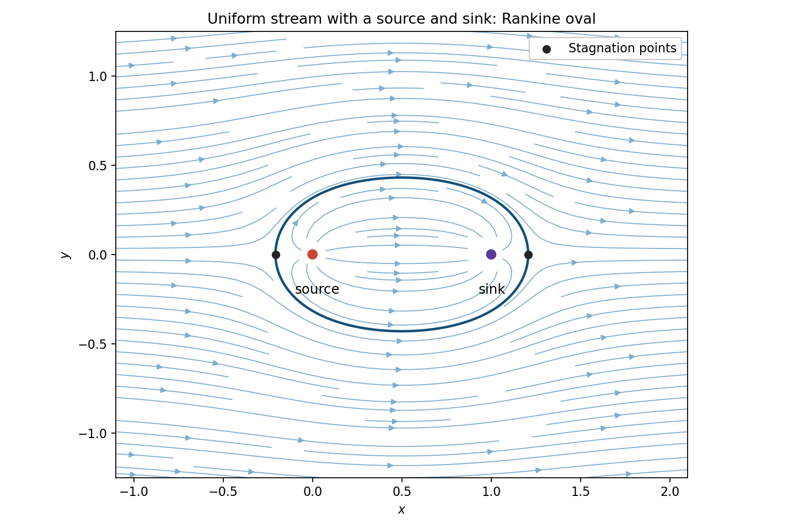

# 2009

↑ **Parent:** [Past exam of the options I course of the University of Oxford](../past-exam-of-the-options-i-course-of-the-university-of-oxford.md)

Options I, Honour School of Mathematics Part A, Trinity Term; Wednesday 24 June 2009, 9.30am–12.30pm. The nine-page source is preserved in a private editable transcription, including its intact cover and all nineteen questions. It was supplied through [the past-papers disclosure](https://www.whatdotheyknow.com/request/maths_past_papers_3), at original Part A bundle pages 132–140. No exact worked-answer advertisement was found in the bounded availability check.

**Table of contents**

- [A](#a)
  - [A1](#a/a1)
    - [Solution](#a/a1/solution)
    - [i](#a/a1/i)
      - [Solution](#a/a1/i/solution)
    - [ii](#a/a1/ii)
      - [Solution](#a/a1/ii/solution)
- [B](#b)
  - [B1](#b/b1)
    - [Solution](#b/b1/solution)
- [C](#c)
  - [C1](#c/c1)
    - [i](#c/c1/i)
      - [Solution](#c/c1/i/solution)
    - [ii](#c/c1/ii)
      - [Solution](#c/c1/ii/solution)
    - [iii](#c/c1/iii)
      - [Solution](#c/c1/iii/solution)
    - [iv](#c/c1/iv)
      - [Solution](#c/c1/iv/solution)
- [D](#d)
  - [D1](#d/d1)
    - [Solution](#d/d1/solution)
  - [D2](#d/d2)
    - [Solution](#d/d2/solution)
- [E](#e)
  - [E1](#e/e1)
    - [a](#e/e1/a)
      - [i](#e/e1/a/i)
        - [Solution](#e/e1/a/i/solution)
      - [ii](#e/e1/a/ii)
        - [Solution](#e/e1/a/ii/solution)
      - [iii](#e/e1/a/iii)
        - [Solution](#e/e1/a/iii/solution)
    - [b](#e/e1/b)
      - [i](#e/e1/b/i)
        - [Solution](#e/e1/b/i/solution)
      - [ii](#e/e1/b/ii)
        - [Solution](#e/e1/b/ii/solution)
      - [iii](#e/e1/b/iii)
        - [Solution](#e/e1/b/iii/solution)
  - [E2](#e/e2)
    - [a](#e/e2/a)
      - [i](#e/e2/a/i)
        - [Solution](#e/e2/a/i/solution)
      - [ii](#e/e2/a/ii)
        - [Solution](#e/e2/a/ii/solution)
    - [b](#e/e2/b)
      - [i](#e/e2/b/i)
        - [Solution](#e/e2/b/i/solution)
      - [ii](#e/e2/b/ii)
        - [Solution](#e/e2/b/ii/solution)
- [F](#f)
  - [F1](#f/f1)
    - [a](#f/f1/a)
      - [Solution](#f/f1/a/solution)
    - [b](#f/f1/b)
      - [Solution](#f/f1/b/solution)
- [G](#g)
  - [G1](#g/g1)
    - [Solution](#g/g1/solution)
- [H](#h)
  - [H1](#h/h1)
    - [Solution](#h/h1/solution)
    - [i](#h/h1/i)
      - [Solution](#h/h1/i/solution)
    - [ii](#h/h1/ii)
      - [Solution](#h/h1/ii/solution)
    - [iii](#h/h1/iii)
      - [Solution](#h/h1/iii/solution)
- [J](#j)
  - [J1](#j/j1)
    - [Solution](#j/j1/solution)
- [K](#k)
  - [K1](#k/k1)
    - [Solution](#k/k1/solution)
  - [K2](#k/k2)
    - [Solution](#k/k2/solution)
- [M](#m)
  - [M1](#m/m1)
    - [a](#m/m1/a)
      - [Solution](#m/m1/a/solution)
    - [b](#m/m1/b)
      - [Solution](#m/m1/b/solution)
    - [c](#m/m1/c)
      - [Solution](#m/m1/c/solution)
  - [M2](#m/m2)
    - [a](#m/m2/a)
      - [Solution](#m/m2/a/solution)
    - [b](#m/m2/b)
      - [Solution](#m/m2/b/solution)
    - [c](#m/m2/c)
      - [i](#m/m2/c/i)
        - [Solution](#m/m2/c/i/solution)
      - [ii](#m/m2/c/ii)
        - [Solution](#m/m2/c/ii/solution)
- [O](#o)
  - [O1](#o/o1)
    - [Solution](#o/o1/solution)
  - [O2](#o/o2)
    - [Solution](#o/o2/solution)
    - [i](#o/o2/i)
      - [Solution](#o/o2/i/solution)
    - [ii](#o/o2/ii)
      - [Solution](#o/o2/ii/solution)
    - [iii](#o/o2/iii)
      - [Solution](#o/o2/iii/solution)
- [P](#p)
  - [P1](#p/p1)
    - [Solution](#p/p1/solution)
  - [P2](#p/p2)
    - [Solution](#p/p2/solution)

## A

↑ **Parent:** [2009](2009.md)

<h3 id="a/a1">A1</h3>

↑ **Parent:** [A](#a)

<h4 id="a/a1/solution">Solution</h4>

↑ **Parent:** [A1](#a/a1)

The [splitting field](../galois-theory.md#splitting-field) is the smallest [subfield](../algebra.md#subfield) of $\mathbb C$ containing $\mathbb Q$ and all the [roots of a polynomial](../polynomial.md#root-of-a-polynomial) under consideration. Equivalently it is generated over $\mathbb Q$ by those roots, and the [polynomial](../polynomial.md) splits there into linear factors.

Put $\zeta_6=e^{\pi i/3}$. All sixth [roots of unity](../algebra.md#root-of-unity) are powers of $\zeta_6$, so the required [splitting field](../galois-theory.md#splitting-field) is

$$
\boxed{\mathbb Q(\zeta_6)=\mathbb Q(\sqrt{-3})}.
$$

Indeed $\zeta_6=(1+\sqrt{-3})/2$, and conversely $\sqrt{-3}=2\zeta_6-1$. Its [field extension degree](../algebra.md#degree-of-a-field-extension) is two.

<h4 id="a/a1/i">i</h4>

↑ **Parent:** [A1](#a/a1)

<h5 id="a/a1/i/solution">Solution</h5>

↑ **Parent:** [I](#a/a1/i)

The [polynomial identity](../polynomial.md#polynomial-identity)

$$
x^9-1=(x^3-1)(x^6+x^3+1)
$$

shows that the roots are the ninth [roots of unity](../algebra.md#root-of-unity) which are not third roots. These are precisely the primitive ninth [roots of unity](../algebra.md#root-of-unity), all powers of $\zeta_9=e^{2\pi i/9}$. Thus the [splitting field](../galois-theory.md#splitting-field) is $\mathbb Q(\zeta_9)$. The supplied [irreducibility](../polynomial.md#irreducible-polynomial) statement makes the displayed degree-six [polynomial](../polynomial.md) the [minimal polynomial](../linear-operator-theory.md#minimal-polynomial) of $\zeta_9$, giving

$$
\boxed{[\mathbb Q(\zeta_9):\mathbb Q]=6}.
$$

<h4 id="a/a1/ii">ii</h4>

↑ **Parent:** [A1](#a/a1)

<h5 id="a/a1/ii/solution">Solution</h5>

↑ **Parent:** [Ii](#a/a1/ii)

Write $g(x)=x^6+x^3+1$. The second [polynomial](../polynomial.md) is $g(-x)$. Negating the [roots of a polynomial](../polynomial.md#root-of-a-polynomial) does not change the [field](../algebra.md#field) generated by them: each original [root](../semisimple-lie-algebra.md#root-of-a-root-system) is minus a new [root](../semisimple-lie-algebra.md#root-of-a-root-system), and conversely. Hence this [splitting field](../galois-theory.md#splitting-field) is again $\mathbb Q(\zeta_9)$ and its [field extension degree](../algebra.md#degree-of-a-field-extension) is **six**. Equivalently, it is the [cyclotomic field](../galois-theory.md#cyclotomic-field) $\mathbb Q(\zeta_{18})=\mathbb Q(\zeta_9)$, since $\zeta_{18}=-\zeta_9^5$.

## B

↑ **Parent:** [2009](2009.md)

<h3 id="b/b1">B1</h3>

↑ **Parent:** [B](#b)

<h4 id="b/b1/solution">Solution</h4>

↑ **Parent:** [B1](#b/b1)

A [solvable group](../group-theory.md#solvable-group) has a finite [subnormal series](../group-theory.md#subnormal-series) from the identity to the [group](../group.md) with [abelian group](../group.md#abelian-group) factors. An equivalent definition uses the [derived series](../group-theory.md#derived-series): set $G^{(0)}=G$ and $G^{(j+1)}=[G^{(j)},G^{(j)}]$; the series must reach the identity. For [completeness](../topological-analysis.md#completeness), an abelian-factor series forces successive derived subgroups into its successive terms, while a terminating [derived series](../group-theory.md#derived-series) itself supplies such a series.

If $H\leq G$, induction gives $H^{(j)}\leq G^{(j)}$: every [commutator](../lie-algebra.md#commutator) of elements of $H^{(j)}$ is also a [commutator](../lie-algebra.md#commutator) in $G^{(j)}$. Thus termination for $G$ implies termination for $H$, proving that every [subgroup](../group.md#subgroup) of a [solvable group](../group-theory.md#solvable-group) is solvable.

In $S_4$, use

$$
\{1\}\triangleleft V_4\triangleleft A_4\triangleleft S_4,
\qquad V_4=\{1,(12)(34),(13)(24),(14)(23)\}.
$$

The [Klein four-group](../finite-group-theory.md#klein-four-group) is invariant under [conjugation](../group-action.md#conjugation) in $S_4$; the other normality assertions follow from the [alternating group](../finite-group-theory.md#alternating-group) being the kernel of the sign map. The [quotient group](../group-theory.md#quotient-group) factors are $V_4,C_3,C_2$, all abelian. Hence **$S_4$ is solvable**.

For the last example take $A_5\times C_2$. Its [subgroup](../group.md#subgroup) $\{1\}\times C_2$ is nontrivial, proper and normal, so the product is not a [simple group](../finite-group-theory.md#simple-group). Projection onto $A_5$ is surjective, and every quotient of a [solvable group](../group-theory.md#solvable-group) is solvable, because a homomorphism carries each [derived subgroup](../group-theory.md#commutator-subgroup) onto the [derived subgroup](../group-theory.md#commutator-subgroup) of its image. But the nonabelian [simple group](../finite-group-theory.md#simple-group) $A_5$ has $A_5'=A_5$: its [derived subgroup](../group-theory.md#commutator-subgroup) is nontrivial and normal. Thus the product is **not solvable either**. One standard justification of the simplicity used here is that the nonidentity [conjugacy class](../group-action.md#conjugacy-class) sizes of $A_5$ are $15,20,12,12$; no proper nontrivial [union](../set.md#set-union) with the identity has size dividing $60$, as a [normal subgroup](../group-theory.md#normal-subgroup) would require by [Lagrange's theorem for finite groups](../group-theory.md#lagrange-s-theorem).

## C

↑ **Parent:** [2009](2009.md)

<h3 id="c/c1">C1</h3>

↑ **Parent:** [C](#c)

<h4 id="c/c1/i">i</h4>

↑ **Parent:** [C1](#c/c1)

<h5 id="c/c1/i/solution">Solution</h5>

↑ **Parent:** [I](#c/c1/i)

[Fermat's little theorem](../number-theory.md#fermat-little-theorem) says that for a [prime number](../prime-number.md) $p$ and any [integer](../integer.md) $a$,

$$
\boxed{a^p\equiv a\pmod p}.
$$

If $p\nmid a$, cancellation gives the equivalent statement $a^{p-1}\equiv1\pmod p$.

<h4 id="c/c1/ii">ii</h4>

↑ **Parent:** [C1](#c/c1)

<h5 id="c/c1/ii/solution">Solution</h5>

↑ **Parent:** [Ii](#c/c1/ii)

[Wilson's theorem](../modular-arithmetic.md#wilson-s-theorem) states that an [integer](../integer.md) $p>1$ is a [prime number](../prime-number.md) if and only if

$$
\boxed{(p-1)!\equiv-1\pmod p}.
$$

In particular this holds for every prime, including $p=2$.

<h4 id="c/c1/iii">iii</h4>

↑ **Parent:** [C1](#c/c1)

<h5 id="c/c1/iii/solution">Solution</h5>

↑ **Parent:** [Iii](#c/c1/iii)

Apply [Fermat's little theorem](../number-theory.md#fermat-little-theorem) and [Wilson's theorem](../modular-arithmetic.md#wilson-s-theorem) in the [ring of integers modulo n](../modular-arithmetic.md) with modulus $p$. They give

$$
a^p+(p-1)!a\equiv a-a=0,\qquad
(p-1)!a^p+a\equiv-a+a=0\pmod p.
$$

A vanishing [modular congruence](../modular-arithmetic.md#modular-congruence) modulo $p$ is precisely divisibility by $p$, so **both divisibilities hold**, without requiring $p\nmid a$.

<h4 id="c/c1/iv">iv</h4>

↑ **Parent:** [C1](#c/c1)

<h5 id="c/c1/iv/solution">Solution</h5>

↑ **Parent:** [Iv](#c/c1/iv)

Because the primes are distinct, [Fermat's little theorem](../number-theory.md#fermat-little-theorem) gives $q^{p-1}\equiv1\pmod p$ and $p^{q-1}\equiv1\pmod q$. The other term in each modulus vanishes. Therefore

$$
p^{q-1}+q^{p-1}-1\equiv0\pmod p,\qquad
p^{q-1}+q^{p-1}-1\equiv0\pmod q.
$$

The distinct primes are [coprime](../divisibility.md#coprime-integers), so their product divides this [integer](../integer.md). Hence

$$
\boxed{p^{q-1}+q^{p-1}\equiv1\pmod{pq}}.
$$

## D

↑ **Parent:** [2009](2009.md)

<h3 id="d/d1">D1</h3>

↑ **Parent:** [D](#d)

<h4 id="d/d1/solution">Solution</h4>

↑ **Parent:** [D1](#d/d1)

The [Lebesgue outer measure](../measure-theory.md#lebesgue-outer-measure) can be defined by

$$
m^*(E)=\inf\left\{\sum_{j=1}^{\infty}|I_j|:E\subseteq\bigcup_{j=1}^{\infty}I_j,\ I_j\text{ open intervals}\right\}.
$$

A [null set](../measure-theory.md#null-set) has $m^*(E)=0$, equivalently it admits such a cover of total length below every positive $\varepsilon$.

The usual [Cantor set](../geometry-and-topology.md#cantor-set) is the [intersection](../set.md#set-intersection) of the sets obtained from $[0,1]$ by repeatedly removing every open middle third. At stage $n$ there are $2^n$ closed intervals of length $3^{-n}$. Enlarge them slightly to open intervals whose total added length is below $\varepsilon$. Thus $m^*(C)\leq(2/3)^n+\varepsilon$ for every $n$ and $\varepsilon>0$, proving $m^*(C)=0$.

For the different deletion rule in this problem, let $L_n$ be the total length of the stage-$n$ intervals. Removing the stated fraction from each component gives

$$
L_{n+1}=L_n\frac{2^n+1}{2^n+2},\qquad L_0=1.
$$

For $n\geq1$ the [telescoping product](../sequence-and-series.md#telescoping-product) simplifies to

$$
L_n=\prod_{j=0}^{n-1}\frac{2^j+1}{2^j+2}
=\frac23\prod_{j=1}^{n-1}\frac{2^j+1}{2(2^{j-1}+1)}
=\frac{2^{n-1}+1}{3\,2^{n-1}}.
$$

Because $K\subseteq K_n$, the same finite [interval](../real-analysis.md#interval-mathematics)-enlargement argument gives $m^*(K)\leq L_n$. Taking the limit proves

$$
\boxed{m^*(K)\leq\frac13}.
$$

Only [interval](../real-analysis.md#interval-mathematics) covers and their lengths were used; no [continuity](../calculus.md#continuous-function) theorem for integrals is needed.

<h3 id="d/d2">D2</h3>

↑ **Parent:** [D](#d)

<h4 id="d/d2/solution">Solution</h4>

↑ **Parent:** [D2](#d/d2)

One version of [dominated differentiation under the integral sign](../analysis.md#dominated-differentiation-under-the-integral-sign) is the following. Let the parameter range be open. Suppose $f(\cdot,y)$ is integrable, $\partial_yf(x,y)$ exists for almost every $x$, and near each parameter value its absolute value is bounded by an integrable [function](../function.md) of $x$ independent of $y$. Then

$$
F'(y)=\int_I\partial_yf(x,y)\,dx.
$$

This follows by applying the [dominated convergence theorem](../measure-theory.md#dominated-convergence-theorem) to difference quotients, bounded by that same integrable [function](../function.md) through the [mean value theorem](../calculus.md#mean-value-theorem).

On any [compact](../topology.md#compact-space) parameter [interval](../real-analysis.md#interval-mathematics) $0<y\leq B$, the original integrand is bounded by $B/(1+x^4)$, using $|\sin(x^2y)|\leq Bx^2$. Its first and second parameter derivatives are

$$
\frac{\cos(x^2y)}{1+x^4},\qquad
-\frac{x^2\sin(x^2y)}{1+x^4}.
$$

Their absolute values are bounded respectively by $(1+x^4)^{-1}$ and $x^2/(1+x^4)$, both integrable on $(0,\infty)$. Applying the theorem twice proves that $F$ is twice differentiable and gives

$$
F''(y)-F(y)
=-\int_0^\infty\frac{\sin(x^2y)}{x^2}\,dx.
$$

This last integral is absolutely convergent: its integrand is bounded near zero and bounded by $x^{-2}$ at infinity. Substituting $t=x\sqrt y$ yields

$$
\boxed{F''(y)-F(y)=c\sqrt y},\qquad
c=-\int_0^\infty\frac{\sin(t^2)}{t^2}\,dt.
$$

The expression for $c$ is finite and independent of $y$, which is all that is required.

## E

↑ **Parent:** [2009](2009.md)

<h3 id="e/e1">E1</h3>

↑ **Parent:** [E](#e)

<h4 id="e/e1/a">a</h4>

↑ **Parent:** [E1](#e/e1)

<h5 id="e/e1/a/i">i</h5>

↑ **Parent:** [A](#e/e1/a)

<h6 id="e/e1/a/i/solution">Solution</h6>

↑ **Parent:** [I](#e/e1/a/i)

The family $\mathcal F$ of [closed sets](../topology.md#closed-set) contains $\varnothing$ and $X$, is closed under arbitrary [intersection](../set.md#set-intersection), and is closed under finite [union](../set.md#set-union). Conversely these axioms define a [topology](../topology.md) by declaring the complements of the members of $\mathcal F$ to be the [open sets](../topology.md#open-set).

<h5 id="e/e1/a/ii">ii</h5>

↑ **Parent:** [A](#e/e1/a)

<h6 id="e/e1/a/ii/solution">Solution</h6>

↑ **Parent:** [Ii](#e/e1/a/ii)

The map is [continuous](../calculus.md#continuous-function) when the [preimage](../set-theory.md#preimage) $f^{-1}(U)$ is [open](../topology.md#open-set) in $X$ for every [open set](../topology.md#open-set) $U$ in $Y$. Equivalently the [preimage](../set-theory.md#preimage) of every [closed set](../topology.md#closed-set) in $Y$ is closed in $X$, since preimages commute with complementation.

<h5 id="e/e1/a/iii">iii</h5>

↑ **Parent:** [A](#e/e1/a)

<h6 id="e/e1/a/iii/solution">Solution</h6>

↑ **Parent:** [Iii](#e/e1/a/iii)

[Convergence of a sequence](../topology.md#convergence-of-a-sequence-in-a-topological-space) to $\ell$ means that every [open neighbourhood](../topology.md#open-neighbourhood) $U$ of $\ell$ contains all sufficiently late terms: there is $N$ such that $x_n\in U$ for all $n\geq N$. The threshold may depend on $U$.

<h4 id="e/e1/b">b</h4>

↑ **Parent:** [E1](#e/e1)

<h5 id="e/e1/b/i">i</h5>

↑ **Parent:** [B](#e/e1/b)

<h6 id="e/e1/b/i/solution">Solution</h6>

↑ **Parent:** [I](#e/e1/b/i)

Both $\varnothing$ and $X$ satisfy the condition. For an arbitrary [intersection](../set.md#set-intersection) of members, either every member contains $a$, in which case the [intersection](../set.md#set-intersection) contains $a$, or one does not, in which case that member is countable and so is the [intersection](../set.md#set-intersection). The empty [intersection](../set.md#set-intersection) is $X$.

For a finite [union](../set.md#set-union), either a member contains $a$, so the [union](../set.md#set-union) does too, or all members omit $a$ and are countable, so their finite [union](../set.md#set-union) is countable. Thus the [closed set](../topology.md#closed-set) axioms hold and define a [topology](../topology.md). This is a [Fortissimo space](../topology.md#fortissimo-space): every point other than $a$ is isolated, while the [open neighbourhoods](../topology.md#open-neighbourhood) of $a$ have countable complement.

<h5 id="e/e1/b/ii">ii</h5>

↑ **Parent:** [B](#e/e1/b)

<h6 id="e/e1/b/ii/solution">Solution</h6>

↑ **Parent:** [Ii](#e/e1/b/ii)

Let $S=\{x:f(x)\ne f(a)\}$, which is countable. For any [closed set](../topology.md#closed-set) $C\subseteq\mathbb R$, consider its [preimage](../set-theory.md#preimage). If $f(a)\in C$, then $a\in f^{-1}(C)$ and that [preimage](../set-theory.md#preimage) is closed by definition. If $f(a)\notin C$, then $f^{-1}(C)\subseteq S$, so it is countable and again closed. Therefore every [closed set](../topology.md#closed-set) has a closed [preimage](../set-theory.md#preimage), proving **[continuity](../calculus.md#continuous-function)**.

<h5 id="e/e1/b/iii">iii</h5>

↑ **Parent:** [B](#e/e1/b)

<h6 id="e/e1/b/iii/solution">Solution</h6>

↑ **Parent:** [Iii](#e/e1/b/iii)

Set $S=\{x_n:n\in\mathbb N,\ x_n\ne\ell\}$. This is a countable [set](../set.md), hence a [closed set](../topology.md#closed-set) in the stated [topology](../topology.md), and $\ell\notin S$. Consequently $X\setminus S$ is an [open neighbourhood](../topology.md#open-neighbourhood) of $\ell$. By [convergence of a sequence](../topology.md#convergence-of-a-sequence-in-a-topological-space), all sufficiently late terms lie outside $S$. A sequence term outside $S$ must equal $\ell$. Thus the sequence is **eventually constant**, and only finitely many indices have $x_n\ne\ell$.

<h3 id="e/e2">E2</h3>

↑ **Parent:** [E](#e)

<h4 id="e/e2/a">a</h4>

↑ **Parent:** [E2](#e/e2)

<h5 id="e/e2/a/i">i</h5>

↑ **Parent:** [A](#e/e2/a)

<h6 id="e/e2/a/i/solution">Solution</h6>

↑ **Parent:** [I](#e/e2/a/i)

A subset $A$ is [compact](../topology.md#compact-space) when every [open cover](../topology.md#open-cover) of $A$ has a finite [subcover](../topology.md#subcover). This may be stated using sets open in the ambient space or using the [subspace topology](../topology.md#subspace-topology) on $A$; the definitions agree because every subspace-[open set](../topology.md#open-set) is the [intersection](../set.md#set-intersection) of $A$ with an ambient-[open set](../topology.md#open-set).

<h5 id="e/e2/a/ii">ii</h5>

↑ **Parent:** [A](#e/e2/a)

<h6 id="e/e2/a/ii/solution">Solution</h6>

↑ **Parent:** [Ii](#e/e2/a/ii)

Let $(U_i)_{i\in I}$ be an [open cover](../topology.md#open-cover) of $f(X)$, with the sets open in $Y$. The [preimages](../set-theory.md#preimage) $f^{-1}(U_i)$ form an [open cover](../topology.md#open-cover) of $X$, because $f$ is [continuous](../calculus.md#continuous-function). By [compactness](../topology.md#compact-space), finitely many of these preimages cover $X$. Their corresponding sets $U_i$ cover $f(X)$, providing a finite [subcover](../topology.md#subcover). Hence **the [continuous](../calculus.md#continuous-function) image is [compact](../topology.md#compact-space)**.

<h4 id="e/e2/b">b</h4>

↑ **Parent:** [E2](#e/e2)

<h5 id="e/e2/b/i">i</h5>

↑ **Parent:** [B](#e/e2/b)

<h6 id="e/e2/b/i/solution">Solution</h6>

↑ **Parent:** [I](#e/e2/b/i)

The family contains the empty set and the entire [real line](../real-analysis.md#real-line). The [intersection](../set.md#set-intersection) of two proper nonempty members is

$$
(a,\infty)\cap(b,\infty)=(\max(a,b),\infty),
$$

so it is closed under finite [intersection](../set.md#set-intersection). For an arbitrary nonempty family of proper rays, put $c=\inf_i a_i$. If the thresholds are unbounded below, the [union](../set.md#set-union) is $\mathbb R$; otherwise the [union](../set.md#set-union) is $(c,\infty)$. In the latter case $c$ itself is in no ray, and every point greater than $c$ lies above some threshold, proving the equality. Empty unions and unions involving $\mathbb R$ cause no difficulty. Thus arbitrary [unions](../set.md#set-union) also belong to the family, establishing the [topology](../topology.md) axioms.

<h5 id="e/e2/b/ii">ii</h5>

↑ **Parent:** [B](#e/e2/b)

<h6 id="e/e2/b/ii/solution">Solution</h6>

↑ **Parent:** [Ii](#e/e2/b/ii)

If $m=\min A$, any [open cover](../topology.md#open-cover) contains a member containing $m$. Such a member is either $\mathbb R$ or a ray $(a,\infty)$ with $a<m$. It therefore contains every element of $A$, so that single member is already a [subcover](../topology.md#subcover).

Conversely suppose $A$ is nonempty and has no smallest element. Then

$$
\{(a,\infty):a\in A\}
$$

is an [open cover](../topology.md#open-cover) of $A$: for any $x\in A$, the lack of a minimum gives an $a\in A$ below $x$. A nonempty finite subcollection has [union](../set.md#set-union) $(a_0,\infty)$, where $a_0$ is the smallest of its thresholds. It misses $a_0\in A$. The empty subcollection cannot cover nonempty $A$ either. Hence there is no finite [subcover](../topology.md#subcover), and $A$ is not [compact](../topology.md#compact-space). Thus **[compactness](../topology.md#compact-space) is equivalent to having a smallest element**.

## F

↑ **Parent:** [2009](2009.md)

<h3 id="f/f1">F1</h3>

↑ **Parent:** [F](#f)

<h4 id="f/f1/a">a</h4>

↑ **Parent:** [F1](#f/f1)

<h5 id="f/f1/a/solution">Solution</h5>

↑ **Parent:** [A](#f/f1/a)

There are real [Lagrange multipliers](../mathematical-optimization.md#lagrange-multiplier) $\lambda_1,\lambda_2$ such that

$$
\boxed{\nabla g(x_0)=\lambda_1\nabla f_1(x_0)+\lambda_2\nabla f_2(x_0)}.
$$

Equivalently $Dg(x_0)=\lambda^T Df(x_0)$. The rank assumption says the two constraint gradients are [linearly independent](../vector-space.md#linear-independence); it rules out an abnormal constraint point.

<h4 id="f/f1/b">b</h4>

↑ **Parent:** [F1](#f/f1)

<h5 id="f/f1/b/solution">Solution</h5>

↑ **Parent:** [B](#f/f1/b)

Use constraints $h_1=x^2/4+y^2+z^2-1$ and $h_2=x+y-z$. Both constraints and the objective are [continuously differentiable](../multivariable-calculus.md#continuously-differentiable-function). The feasible set is a nonempty [closed subset](../topology.md#closed-set) of a bounded ellipsoid, hence [compact](../topology.md#compact-space), so the [extreme value theorem](../real-analysis.md#extreme-value-theorem) guarantees both extrema.

The gradients $(x/2,2y,2z)$ and $(1,1,-1)$ are independent everywhere feasible. If the first were $t$ times the second, then $x=2t$, $y=t/2$, $z=-t/2$. The plane constraint would give $3t=0$, forcing the origin, which is not on the ellipsoid. Thus the [Lagrange multiplier](../mathematical-optimization.md#lagrange-multiplier) theorem applies at every feasible point.

Its equations are

$$
1=\lambda x/2+\mu,\qquad
2=2\lambda y+\mu,\qquad
0=2\lambda z-\mu.
$$

Here $\lambda\ne0$, since otherwise the first two equations require $\mu=1=2$. Subtract twice the first equation from the second, and use $\mu=2\lambda z$ and $z=x+y$; the result is $0=-3\lambda x$, so $x=0$. Then $z=y$ and the ellipsoid gives $y=\pm1/\sqrt2$. The only candidates are therefore $(0,\pm1/\sqrt2,\pm1/\sqrt2)$, with matching signs. Consequently

$$
\boxed{\min g=-\sqrt2,\qquad\max g=\sqrt2}.
$$

## G

↑ **Parent:** [2009](2009.md)

<h3 id="g/g1">G1</h3>

↑ **Parent:** [G](#g)

<h4 id="g/g1/solution">Solution</h4>

↑ **Parent:** [G1](#g/g1)

Take a smooth [variation](../calculus-of-variations.md#variation) $u+\varepsilon\eta$ with $\eta$ vanishing on the boundary; compactly supported test functions suffice for the interior equation. At an extremum, the [first variation](../calculus-of-variations.md#first-variation) is zero:

$$
0=\left.\frac{d}{d\varepsilon}I[u+\varepsilon\eta]\right|_{\varepsilon=0}
=\int_V\left(F_u\eta+F_{u_x}\eta_x+F_{u_y}\eta_y+F_{u_z}\eta_z\right)\,dV.
$$

[Integration by parts](../calculus.md#integration-by-parts) removes the derivatives from $\eta$. The boundary terms vanish, giving

$$
\int_V\left(F_u-\partial_xF_{u_x}-\partial_yF_{u_y}-\partial_zF_{u_z}\right)\eta\,dV=0.
$$

The [fundamental lemma of the calculus of variations](../calculus-of-variations.md#fundamental-lemma-of-the-calculus-of-variations) gives the [Euler-Lagrange equation](../analysis.md#euler-lagrange-equation)

$$
\boxed{\partial_xF_{u_x}+\partial_yF_{u_y}+\partial_zF_{u_z}-F_u=0}.
$$

This is the classical equation for sufficiently smooth admissible extrema; for weaker regularity the first-[variation](../calculus-of-variations.md#variation) identity supplies its weak form.

For the squared-[gradient](../multivariable-calculus.md#gradient) integrand, the equation is $2(u_{xx}+u_{yy}+u_{zz})=0$, namely the [Laplace equation](../partial-differential-equation.md#laplace-equation). Put $u_0=ax+by+cz$ and write any admissible [function](../function.md) as $u=u_0+v$, with $v=0$ on the boundary. The [energy](../energy.md) identity is

$$
I[u]=(a^2+b^2+c^2)\operatorname{vol}V
+2\int_V(a,b,c)\cdot\nabla v\,dV+\int_V|\nabla v|^2\,dV.
$$

By the [divergence theorem](../multivariable-calculus.md#divergence-theorem), the middle integral is $\int_{\partial V}v(a,b,c)\cdot n\,dS=0$; equivalently it vanishes by weak [integration by parts](../calculus.md#integration-by-parts) for zero-trace functions. The final term is nonnegative and vanishes at $v=0$. Thus this is a global minimum, not merely a stationary value:

$$
\boxed{\min I=(a^2+b^2+c^2)\operatorname{vol}V}.
$$

## H

↑ **Parent:** [2009](2009.md)

<h3 id="h/h1">H1</h3>

↑ **Parent:** [H](#h)

<h4 id="h/h1/solution">Solution</h4>

↑ **Parent:** [H1](#h/h1)

With $\mathbf d=\mathbf q_1-\mathbf q_2$ and $r=|\mathbf d|$, the [Lagrangian](../calculus-of-variations.md#lagrangian) is

$$
L=\frac12\sum_{j=1}^3m_j|\dot{\mathbf q}_j|^2-f(r).
$$

At configurations with $r>0$, the [Euler-Lagrange equations](../analysis.md#euler-lagrange-equation) give

$$
m_1\ddot{\mathbf q}_1=-\frac{f'(r)}r\mathbf d,\qquad
m_2\ddot{\mathbf q}_2=\frac{f'(r)}r\mathbf d,\qquad
m_3\ddot{\mathbf q}_3=0.
$$

These formulas apply on the differentiable part of the potential; collision configurations require any additional smooth extension of $f(|\mathbf d|)$ to be specified. Summing the equations gives

$$
\frac d{dt}\sum_jm_j\dot{\mathbf q}_j=0,
$$

so the total [linear momentum](../momentum.md) is conserved. The total [energy](../energy.md) is

$$
E=\frac12\sum_jm_j|\dot{\mathbf q}_j|^2+f(r).
$$

Differentiating, the two interacting forces do work $-f'(r)\dot r$, while the potential derivative is $f'(r)\dot r$ and particle three contributes no force term. Hence $\dot E=0$. Both **total momentum and total [energy](../energy.md) are conserved**.

<h4 id="h/h1/i">i</h4>

↑ **Parent:** [H1](#h/h1)

<h5 id="h/h1/i/solution">Solution</h5>

↑ **Parent:** [I](#h/h1/i)

For the first particle, the derivative of its [angular momentum](../momentum.md#angular-momentum) about the origin is its [torque](../momentum.md#torque):

$$
\frac d{dt}\left(m_1\mathbf q_1\times\dot{\mathbf q}_1\right)
=\mathbf q_1\times\left(-\frac{f'(r)}r(\mathbf q_1-\mathbf q_2)\right)
=\frac{f'(r)}r\mathbf q_1\times\mathbf q_2.
$$

This need not vanish. For example take $f(r)=r^2/2$ and instantaneous positions $\mathbf q_1=(1,0,0)$, $\mathbf q_2=(0,1,0)$; the [torque](../momentum.md#torque) is $(0,0,1)$. Therefore **it is not conserved in general**, although it is in special configurations or for a constant potential.

<h4 id="h/h1/ii">ii</h4>

↑ **Parent:** [H1](#h/h1)

<h5 id="h/h1/ii/solution">Solution</h5>

↑ **Parent:** [Ii](#h/h1/ii)

The third particle is force-free, so its [torque](../momentum.md#torque) about the origin vanishes:

$$
\frac d{dt}\left(m_3\mathbf q_3\times\dot{\mathbf q}_3\right)
=\mathbf q_3\times m_3\ddot{\mathbf q}_3=0.
$$

Thus **this [angular momentum](../momentum.md#angular-momentum) is conserved**.

<h4 id="h/h1/iii">iii</h4>

↑ **Parent:** [H1](#h/h1)

<h5 id="h/h1/iii/solution">Solution</h5>

↑ **Parent:** [Iii](#h/h1/iii)

Let $\mathbf F$ be the force on particle one, so the force on particle two is $-\mathbf F$, with $\mathbf F$ parallel to $\mathbf q_1-\mathbf q_2$. The combined [torque](../momentum.md#torque) is

$$
\mathbf q_1\times\mathbf F+\mathbf q_2\times(-\mathbf F)
=(\mathbf q_1-\mathbf q_2)\times\mathbf F=0.
$$

Hence **the combined [angular momentum](../momentum.md#angular-momentum) of particles one and two is conserved**. Centrality of their interaction, in addition to equal and opposite forces, is what makes this [torque](../momentum.md#torque) sum zero.

## J

↑ **Parent:** [2009](2009.md)

<h3 id="j/j1">J1</h3>

↑ **Parent:** [J](#j)

<h4 id="j/j1/solution">Solution</h4>

↑ **Parent:** [J1](#j/j1)

For a [field](../algebra.md#field) point in the plane of the loop, both the directed line element $d\mathbf s$ and the displacement $\mathbf r-\mathbf s$ lie in that plane. Their [cross product](../vector-space.md#cross-product) is normal to it, so every term of the [Biot-Savart law](../electromagnetism.md#biot-savart-law) is normal, and their integral is normal as well. This argument also allows the [field](../algebra.md#field) to vanish at particular points.

Choose the loop in the $xy$-plane with centre at the origin and let positive current be counterclockwise as seen from $+z$. On its lower side, write $\mathbf s=(t,-a,0)$, $-a\leq t\leq a$, so

$$
d\mathbf s\times(-\mathbf s)=a\,dt\,\mathbf e_z.
$$

That side contributes

$$
\frac{\mu_0I}{4\pi}\int_{-a}^a\frac{a\,dt}{(t^2+a^2)^{3/2}}\,\mathbf e_z
=\frac{\mu_0I}{4\pi}\left[\frac{t}{a\sqrt{t^2+a^2}}\right]_{-a}^a\mathbf e_z
=\frac{\sqrt2\mu_0I}{4\pi a}\mathbf e_z.
$$

All four contributions have the same direction and size by [rotation](../riemannian-geometry.md#rotation-mathematics). Thus

$$
\boxed{\mathbf B(0)=\frac{\sqrt2\mu_0I}{\pi a}\,\mathbf n},
$$

where $\mathbf n$ follows the [right-hand rule](../electromagnetism.md#right-hand-rule) for the current.

## K

↑ **Parent:** [2009](2009.md)

<h3 id="k/k1">K1</h3>

↑ **Parent:** [K](#k)

<h4 id="k/k1/solution">Solution</h4>

↑ **Parent:** [K1](#k/k1)

For a planar [incompressible flow](../fluid-mechanics.md#incompressible-flow), a [stream function](../fluid-mechanics.md#stream-function) satisfies $u=\psi_y$, $v=-\psi_x$. A [velocity potential](../fluid-mechanics.md#velocity-potential) satisfies $u=\phi_x$, $v=\phi_y$ where the flow is irrotational; such a potential exists locally, and globally on a simply connected nonsingular region. The [irrotational flow](../vorticity.md#irrotational-flow) condition is $v_x-u_y=0$. Where both exist, the [Cauchy-Riemann equations](../analysis.md#cauchy-riemann-equations) make the [complex potential](../fluid-mechanics.md#complex-potential-of-a-two-dimensional-potential-flow) $w=\phi+i\psi$ analytic with $w'=u-iv$.

For the logarithmic potential, write $z-z_0=re^{i\theta}$. Then

$$
\phi=\frac m{2\pi}\log r,\qquad \psi=\frac m{2\pi}\theta,
\qquad u_r=\frac m{2\pi r},\quad u_\theta=0.
$$

The outward [volume flux](../fluid-mechanics.md#volumetric-flow-rate) per unit span across a circle is $2\pi r u_r=m$. Hence it is a [line source](../fluid-mechanics.md#line-source) of strength $m$. The potential may use local logarithm branches; its velocity is single-valued away from the source.

By [superposition](../vector-space.md#superposition-principle), the full flow has

$$
w(z)=Uz+\frac m{2\pi}\log z-\frac m{2\pi}\log(z-1),\qquad
w'(z)=U-\frac m{2\pi z(z-1)}.
$$

For positive $m$ and $U$, the [stagnation points](../fluid-mechanics.md#stagnation-point) are

$$
\boxed{z_\pm=\frac{1\pm\sqrt{1+2m/(\pi U)}}2}.
$$

They are real, one upstream of the source and one downstream of the sink. Away from the singularities, [streamlines](../fluid-mechanics.md#streamline) are level curves of

$$
\psi(x,y)=Uy+\frac m{2\pi}\bigl(\arg z-\arg(z-1)\bigr).
$$

The zero level through the two stagnation points contains an upper and a lower separating curve, symmetric about the real axis and about $x=1/2$. Together they bound a [Rankine oval](../fluid-mechanics.md#rankine-oval). Flow inside goes from source to sink; the external stream divides around this oval and tends to horizontal flow far away. This also specifies the sketch for every positive parameter ratio; the figure illustrates one ratio.

**[Figure 1](#k/k1/image-source-sink-flow-in-a-uniform-stream). Source–sink flow in a uniform stream**. Arrows follow the velocity; the bold separating streamline passes through both stagnation points. The illustrated ratio is $m/(2\pi U)=1/4$.

<h3 id="k/k2">K2</h3>

↑ **Parent:** [K](#k)

<h4 id="k/k2/solution">Solution</h4>

↑ **Parent:** [K2](#k/k2)

For the isolated [line vortex](../vorticity.md#line-vortex), use [polar coordinates](../multivariable-calculus.md#polar-coordinates) $z=re^{i\theta}$ to obtain

$$
\phi=\frac\Gamma{2\pi}\theta,\qquad
\psi=-\frac\Gamma{2\pi}\log r,\qquad
u_r=0,\quad u_\theta=\frac\Gamma{2\pi r}.
$$

Thus for nonzero $\Gamma$ the [streamlines](../fluid-mechanics.md#streamline) are circles and their counterclockwise [circulation](../vorticity.md#circulation-physics) is $2\pi r u_\theta=\Gamma$. If $\Gamma=0$ the fluid is stationary and the [streamline](../fluid-mechanics.md#streamline) description degenerates.

Place an opposite image [vortex](../critical-phenomenon.md#phase-vortex) at $z=-1$. The [method of images](../mathematics.md#method-of-images) gives

$$
\boxed{w(z)=-\frac{i\Gamma}{2\pi}\bigl(\log(z-1)-\log(z+1)\bigr)}.
$$

On $z=iy$, the distances to the two [vortex](../critical-phenomenon.md#phase-vortex) positions agree, so $\psi=-(\Gamma/2\pi)\log(|z-1|/|z+1|)=0$. Hence the wall is a [streamline](../fluid-mechanics.md#streamline). Directly the wall velocity has $u=0$ and

$$
v(0,y)=-\frac\Gamma{\pi(1+y^2)}.
$$

For the stipulated steady flow, [Bernoulli's equation](../euler-equations-for-an-inviscid-fluid.md#bernoulli-equation) in the irrotational fluid outside the [vortex](../critical-phenomenon.md#phase-vortex) core gives

$$
p(0,y)-p_\infty=-\frac12\rho v(0,y)^2
=-\frac{\rho\Gamma^2}{2\pi^2(1+y^2)^2}.
$$

The force exerted by the fluid on this wall points in the $-x$ direction for positive [pressure](../pressure.md). Relative to uniform [pressure](../pressure.md) $p_\infty$, however, its change is in the $+x$ direction. Using the supplied integral, the force change per unit span is

$$
\boxed{\Delta\mathbf F_{\rm wall}=\frac{\rho\Gamma^2}{4\pi}\,\mathbf e_x}.
$$

Thus the wall is attracted **towards the [vortex](../critical-phenomenon.md#phase-vortex)**, with this magnitude if the other side remains at $p_\infty$. Subtracting the uniform [pressure](../pressure.md) is essential for an infinite wall. A freely moving [vortex](../critical-phenomenon.md#phase-vortex) would translate parallel to the wall under its image-induced velocity; the calculation here is for the stated steady [vortex](../critical-phenomenon.md#phase-vortex) configuration, with its position held fixed.

## M

↑ **Parent:** [2009](2009.md)

<h3 id="m/m1">M1</h3>

↑ **Parent:** [M](#m)

<h4 id="m/m1/a">a</h4>

↑ **Parent:** [M1](#m/m1)

<h5 id="m/m1/a/solution">Solution</h5>

↑ **Parent:** [A](#m/m1/a)

Pointwise,

$$
a^2\mathbf1_{\{|Z|\geq a\}}\leq Z^2.
$$

Taking [expectations](../expected-value.md) and dividing by $a^2>0$ gives the second-moment form of [Markov's inequality](../probability-inequality.md#markov-s-inequality):

$$
\boxed{\mathbb P(|Z|\geq a)\leq\frac{\mathbb E Z^2}{a^2}}.
$$

<h4 id="m/m1/b">b</h4>

↑ **Parent:** [M1](#m/m1)

<h5 id="m/m1/b/solution">Solution</h5>

↑ **Parent:** [B](#m/m1/b)

The inverse transformation is $x=uv$, $y=u(1-v)$, with support $u>0$, $0<v<1$. Its absolute [Jacobian determinant](../multivariable-calculus.md#jacobian-determinant) is

$$
\left|\det\begin{pmatrix}v&u\\1-v&-u\end{pmatrix}\right|=u.
$$

The original joint [probability density function](../continuous-probability-distribution.md#probability-density-function), by [independence](../random-variable.md#independent-random-variables), is $\lambda^2e^{-\lambda(x+y)}$ on the positive quadrant. The [change of variables formula](../multivariable-calculus.md#change-of-variables-formula) therefore gives

$$
\boxed{f_{U,V}(u,v)=\lambda^2u e^{-\lambda u}\mathbf1_{\{u>0,\ 0<v<1\}}}.
$$

Integrating over $v$ gives

$$
\boxed{f_U(u)=\lambda^2u e^{-\lambda u}\mathbf1_{\{u>0\}}},
$$

the [gamma distribution](../continuous-probability-distribution.md#gamma-distribution) of shape two and rate $\lambda$. Integrating over $u$ gives $f_V(v)=1$ on $(0,1)$. The factorization also shows that $U$ and $V$ are independent.

<h4 id="m/m1/c">c</h4>

↑ **Parent:** [M1](#m/m1)

<h5 id="m/m1/c/solution">Solution</h5>

↑ **Parent:** [C](#m/m1/c)

The preceding marginal calculation makes each $V_i$ [uniformly distributed](../continuous-probability-distribution.md#continuous-uniform-distribution) on $(0,1)$, with [expectation](../expected-value.md) $1/2$ and [variance](../variance.md) $1/12$. By [independence](../random-variable.md#independent-random-variables),

$$
\mathbb E(S_n/n)=\frac12,\qquad
\operatorname{Var}(S_n/n)=\frac1{12n}.
$$

Apply part (a) to the centred [random variable](../random-variable.md) $Z=S_n/n-1/2$ to obtain

$$
\boxed{\mathbb P\left(\left|S_n/n-1/2\right|\geq a\right)\leq\frac1{12na^2}}.
$$

This is [Chebyshev's inequality](../probability-inequality.md#chebyshev-s-inequality) in this setting.

<h3 id="m/m2">M2</h3>

↑ **Parent:** [M](#m)

<h4 id="m/m2/a">a</h4>

↑ **Parent:** [M2](#m/m2)

<h5 id="m/m2/a/solution">Solution</h5>

↑ **Parent:** [A](#m/m2/a)

For $n=0$, the conditional transition probabilities are $\delta_{ij}$, the entries of $P^0=I$; for $n=1$ the assertion is the definition of $P$. For the induction step, condition on the state at time $n$ and use the [Markov property](../markov-chain.md#markov-property) and [time-homogeneity](../markov-chain.md#time-homogeneous-markov-property):

$$
\mathbb P(X_{n+1}=j\mid X_0=i)
=\sum_k\mathbb P(X_n=k\mid X_0=i)p_{kj}
=\sum_k(P^n)_{ik}p_{kj}=(P^{n+1})_{ij}.
$$

The countable sum is justified by the [law of total probability](../probability-space.md#law-of-total-probability); all terms are nonnegative. Thus the formula follows for every $n$ by induction. It is the [Chapman-Kolmogorov equation](../markov-process.md#chapman-kolmogorov-equation) for repeated one-step transitions.

<h4 id="m/m2/b">b</h4>

↑ **Parent:** [M2](#m/m2)

<h5 id="m/m2/b/solution">Solution</h5>

↑ **Parent:** [B](#m/m2/b)

Let $u_n=\mathbb P(X_n=1\mid X_0=1)$. Conditioning on $X_n$ gives

$$
u_{n+1}=(1-a)u_n+b(1-u_n)=b+(1-a-b)u_n,\qquad u_0=1.
$$

The fixed value is $b/(a+b)$. Subtracting it and iterating the scalar recurrence yields

$$
\boxed{u_n=\frac b{a+b}+\frac a{a+b}(1-a-b)^n},\qquad n\geq0.
$$

The formula includes $n=0$. If $a+b=1$, its value at $n=0$ is interpreted directly as $u_0=1$, while $u_n=b$ for all $n\geq1$. Since $|1-a-b|<1$, the limiting probability is $b/(a+b)$.

<h4 id="m/m2/c">c</h4>

↑ **Parent:** [M2](#m/m2)

<h5 id="m/m2/c/i">i</h5>

↑ **Parent:** [C](#m/m2/c)

<h6 id="m/m2/c/i/solution">Solution</h6>

↑ **Parent:** [I](#m/m2/c/i)

At the first step, the chain enters state two with probability $p$ and state four with probability $1-p$. The classes $\{2,3\}$ and $\{4,5\}$ are closed and disjoint, so only the first branch can reach state three. On $\{2,3\}$ the [transition matrix](../markov-chain.md#stochastic-matrix) is exactly the two-state [matrix](../vector-space.md#matrix) from part (b). Thus after the remaining $n-1$ steps, the probability of the second state in that class is

$$
\boxed{\mathbb P(X_n=3\mid X_0=1)
=\frac{pa}{a+b}\left(1-(1-a-b)^{n-1}\right)},\qquad n\geq1.
$$

For $n=1$ it is zero, as the original [matrix](../vector-space.md#matrix) requires; this statement covers the zero-base exponent case without ambiguity.

<h5 id="m/m2/c/ii">ii</h5>

↑ **Parent:** [C](#m/m2/c)

<h6 id="m/m2/c/ii/solution">Solution</h6>

↑ **Parent:** [Ii](#m/m2/c/ii)

State one is left after one step and never revisited. The eventual probability mass in the closed class $\{4,5\}$ is

$$
w=(1-p)\lambda_1+\lambda_4+\lambda_5.
$$

Within this class the [stationary distribution](../markov-chain.md#stationary-distribution) is $(b/(a+b),a/(a+b))$, because the balance equation is $a\pi_4=b\pi_5$. The two-state recurrence shows convergence from either starting state, since $|1-a-b|<1$. The other closed class never reaches state five. Therefore

$$
\boxed{\lim_{n\to\infty}\mathbb P(X_n=5)
=\frac a{a+b}\bigl((1-p)\lambda_1+\lambda_4+\lambda_5\bigr)}.
$$

## O

↑ **Parent:** [2009](2009.md)

<h3 id="o/o1">O1</h3>

↑ **Parent:** [O](#o)

<h4 id="o/o1/solution">Solution</h4>

↑ **Parent:** [O1](#o/o1)

By [continuity](../calculus.md#continuous-function) of the [cumulative distribution function](../probability-distribution.md#cumulative-distribution-function) and nonnegativity, $F(0)=0$; strict increase and $F(x)\to1$ allow inversion for every $0<t<1$. The [probability integral transform](../probability-distribution.md#probability-integral-transform) follows from

$$
\mathbb P(F(X)\leq t)=\mathbb P(X\leq F^{-1}(t))=t.
$$

Thus $F(X)$ is [uniformly distributed](../continuous-probability-distribution.md#continuous-uniform-distribution) on $(0,1)$.

The [order statistics](../probability-theory.md#order-statistic) arrange the sample increasingly: $X_{(1)}\leq\cdots\leq X_{(n)}$. Strict monotonicity means $F(X_{(i)})$ is the $i$th [order statistic](../probability-theory.md#order-statistic) of $n$ independent uniform variables. Its [density](../fluid-mechanics.md#density) is

$$
\frac{n!}{(i-1)!(n-i)!}\,t^{i-1}(1-t)^{n-i},\qquad0<t<1,
$$

obtained by choosing the $i-1$ observations below $t$ and the $n-i$ above it. This is the [beta distribution](../probability-distribution.md#beta-distribution) with parameters $i,n+1-i$, so

$$
\boxed{\mathbb E F(X_{(i)})=\frac i{n+1}}.
$$

For the given [log-logistic distribution](../continuous-probability-distribution.md#log-logistic-distribution), rearrangement gives

$$
\log\frac{F(x)}{1-F(x)}=(\beta-1)\log x-(\beta-1)\log\alpha.
$$

Consequently plot $y_i=\log(i/(n+1-i))$ vertically against $x_i^*=\log X_{(i)}$ horizontally. Under a good fit, replacing $F(X_{(i)})$ by its plotting position $i/(n+1)$ gives an approximate straight line with

$$
\boxed{\text{slope}=\beta-1,\qquad\text{intercept}=-(\beta-1)\log\alpha}.
$$

This is a diagnostic [probability plot](../probability-and-statistics.md#probability-plot), rather than an assertion that the [expectation](../expected-value.md) of the nonlinear transformed [order statistic](../probability-theory.md#order-statistic) equals that transformed plotting position. Positive observations occur almost surely under the model.

<h3 id="o/o2">O2</h3>

↑ **Parent:** [O](#o)

<h4 id="o/o2/solution">Solution</h4>

↑ **Parent:** [O2](#o/o2)

With immediate release and ideal independent uniform sampling of fish, each catch is a [Bernoulli trial](../discrete-probability-distribution.md#bernoulli-trial) with tagged-success probability $p=k/N$. Stopping at the $r$th success makes the count of untagged catches a [negative binomial random variable](../discrete-probability-distribution.md#negative-binomial-distribution). A total of $x$ failures requires $r-1$ successes among the first $x+r-1$ trials and a success on the last trial, so the probability is $\binom{x+r-1}{r-1}p^r(1-p)^x$. Separate days use disjoint independent sequences of trials, hence their counts form an [independent and identically distributed](../random-variable.md#independent-and-identically-distributed-random-variables) sample. Equal catch probabilities alone do not mathematically imply [independence](../random-variable.md#independent-random-variables); this is the usual repeated independent sampling assumption in the stated model.

<h4 id="o/o2/i">i</h4>

↑ **Parent:** [O2](#o/o2)

<h5 id="o/o2/i/solution">Solution</h5>

↑ **Parent:** [I](#o/o2/i)

Let $S=\sum_i x_i$ and $\bar x=S/n$. Terms independent of $p$ can be dropped from the [log-likelihood](../maximum-likelihood-estimation.md#log-likelihood), leaving

$$
\ell(p)=nr\log p+S\log(1-p)+C,
\quad\ell'(p)=\frac{nr}p-\frac S{1-p},
\quad\ell''(p)=-\frac{nr}{p^2}-\frac S{(1-p)^2}.
$$

For $S>0$, strict concavity gives the unique interior [maximum likelihood estimator](../maximum-likelihood-estimation.md#maximum-likelihood-estimator)

$$
\boxed{\widehat p=\frac{nr}{nr+S}=\frac r{r+\bar x}}.
$$

If $S=0$, the likelihood increases up to $p=1$: this is the boundary estimate on the closed parameter range, or a supremum if the model insists on $p<1$.

Using the given mean, the sample [Fisher information](../statistical-modelling.md#fisher-information-matrix) is

$$
I_n(p)=-\mathbb E\ell''(p)
=\frac{nr}{p^2}+\frac{nr(1-p)/p}{(1-p)^2}
=\boxed{\frac{nr}{p^2(1-p)}}.
$$

The information per observation is $I_1(p)=r/[p^2(1-p)]$.

<h4 id="o/o2/ii">ii</h4>

↑ **Parent:** [O2](#o/o2)

<h5 id="o/o2/ii/solution">Solution</h5>

↑ **Parent:** [Ii](#o/o2/ii)

For a fixed true parameter $0<p<1$, the usual [asymptotic normality of maximum likelihood estimators](../maximum-likelihood-estimation.md#asymptotic-normality-of-a-maximum-likelihood-estimator) gives

$$
\sqrt n(\widehat p-p)\ \xrightarrow{d}\ N\!\left(0,\frac{p^2(1-p)}r\right).
$$

Equivalently, for a large sample, $\widehat p$ is approximately [normally distributed](../probability-distribution.md#normal-distribution) with mean $p$ and [variance](../variance.md) $p^2(1-p)/(nr)$. Replacing the unknown [variance](../variance.md) by its consistent plug-in estimate gives the [Wald confidence interval](../statistical-inference.md#wald-confidence-interval)

$$
\boxed{\widehat p\ \pm\ z_{1-\alpha/2}\widehat p\sqrt{\frac{1-\widehat p}{nr}}}.
$$

Here $z_{1-\alpha/2}$ is a standard-normal [quantile](../probability-distribution.md#quantile-function). Intersect with the physical parameter range $(0,1)$ if needed. This is an interior, large-sample approximation; the degenerate estimate $\widehat p=1$ from $S=0$ does not justify a zero-width finite-sample [interval](../real-analysis.md#interval-mathematics).

<h4 id="o/o2/iii">iii</h4>

↑ **Parent:** [O2](#o/o2)

<h5 id="o/o2/iii/solution">Solution</h5>

↑ **Parent:** [Iii](#o/o2/iii)

The transformation $N=k/p$ is strictly decreasing for $p>0$. Therefore an [interval](../real-analysis.md#interval-mathematics) $[L,U]$ with $0<L<U\leq1$ transforms to

$$
\boxed{\left[\frac kU,\frac kL\right]}.
$$

The event $L\leq p\leq U$ is exactly the event $k/U\leq N\leq k/L$, so the approximate coverage is inherited. If the lower endpoint for $p$ reaches zero, the transformed upper endpoint for $N$ is $+\infty$; if the upper endpoint reaches one, the lower endpoint is $k$. Finally intersect with [integer](../integer.md) values $N>k$, rounding the lower bound upward and the upper bound downward. This respects the original discrete population constraint.

## P

↑ **Parent:** [2009](2009.md)

<h3 id="p/p1">P1</h3>

↑ **Parent:** [P](#p)

<h4 id="p/p1/solution">Solution</h4>

↑ **Parent:** [P1](#p/p1)

The [Gershgorin circle theorem](../numerical-analysis.md#gershgorin-circle-theorem) states that every complex [eigenvalue](../linear-operator-theory.md#eigenvalue) $\lambda$ of $A=(a_{ij})$ belongs to at least one closed disc

$$
D_i=\left\{z\in\mathbb C:|z-a_{ii}|\leq\sum_{j\ne i}|a_{ij}|\right\}.
$$

To prove it, take an [eigenvector](../linear-operator-theory.md#eigenvector) $v\ne0$ and choose $i$ with $|v_i|=\max_j|v_j|>0$. The $i$th row of $Av=\lambda v$ gives

$$
|\lambda-a_{ii}|\,|v_i|
=\left|\sum_{j\ne i}a_{ij}v_j\right|
\leq\sum_{j\ne i}|a_{ij}|\,|v_j|
\leq|v_i|\sum_{j\ne i}|a_{ij}|.
$$

Division by $|v_i|$ proves the assertion. The proof works for real matrices even when their eigenvalues or eigenvectors are complex.

For $B+\mu I$, the three discs have centres $2+\mu,3+\mu,4+\mu$ and radii $2,3,4$. Every point in their [union](../set.md#set-union) has real part at least $\mu$. Thus for $\mu>0$ no disc contains zero, and zero cannot be an [eigenvalue](../linear-operator-theory.md#eigenvalue). Hence **$B+\mu C$ is nonsingular**.

<h3 id="p/p2">P2</h3>

↑ **Parent:** [P](#p)

<h4 id="p/p2/solution">Solution</h4>

↑ **Parent:** [P2](#p/p2)

For any $q\in\Pi_n$, write $f-q=(f-p)+(p-q)$. The stated [orthogonality](../inner-product.md#orthogonal-vectors) makes the two summands perpendicular in the given [inner product](../inner-product.md), because $p-q\in\Pi_n$. The [Pythagorean theorem for inner product spaces](../inner-product.md#pythagorean-theorem-in-an-inner-product-space) therefore gives

$$
\|f-q\|^2=\|f-p\|^2+\|p-q\|^2\geq\|f-p\|^2.
$$

Equality is attained at $q=p$, and positive definiteness makes it unique. Thus $p$ is the [orthogonal projection](../hilbert-space.md#orthogonal-projection) of $f$ onto the [polynomial](../polynomial.md) subspace.

For the weighted example set $p(x)=A+Bx$. [Orthogonality](../inner-product.md#orthogonal-vectors) against the [basis](../vector-space.md#basis) $1,x$ gives

$$
0=\int_{-1}^1x^2(x^2-A-Bx)\,dx=\frac25-\frac{2A}3,
$$

$$
0=\int_{-1}^1x^3(x^2-A-Bx)\,dx=-\frac{2B}5.
$$

Odd terms vanish on the symmetric [interval](../real-analysis.md#interval-mathematics), so $A=3/5$ and $B=0$. Consequently

$$
\boxed{p(x)=\frac35}.
$$

The weight $x^2$ vanishes only at one point; its integral against $g^2$ is positive for every nonzero [continuous](../calculus.md#continuous-function) $g$, so it really does define an [inner product](../inner-product.md). For an optional error check, the squared minimum error is $2/7-12/25+6/25=8/175$.

## ↑ Ancestors (9)

1. [Past exam of the options I course of the University of Oxford](../past-exam-of-the-options-i-course-of-the-university-of-oxford.md)
2. [Options I course of the University of Oxford](../university-of-oxford.md#options-i-course-of-the-university-of-oxford)
3. [Year 2 of the mathematics course of the University of Oxford](../university-of-oxford.md#year-2-of-the-mathematics-course-of-the-university-of-oxford)
4. [Mathematics course of the University of Oxford](../university-of-oxford.md#mathematics-course-of-the-university-of-oxford)
5. [Undergraduate course of the University of Oxford](../university-of-oxford.md#undergraduate-course-of-the-university-of-oxford)
6. [Course of the University of Oxford](../university-of-oxford.md#course-of-the-university-of-oxford)
7. [University of Oxford](../university-of-oxford.md)
8. [List of universities](../README.md#list-of-universities)
9. [Codex Wiki](../README.md)
