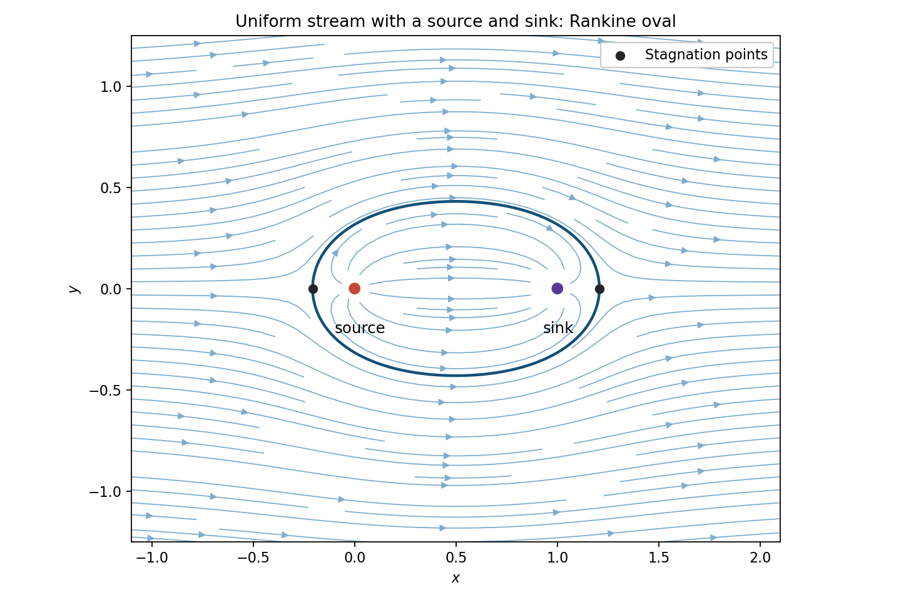

<h1 id="k/k1/solution">Solution</h1>

↑ **Parent:** [K1](../k1.md)

For a planar [incompressible flow](../../../../incompressible-flow.md), a [stream function](../../../../stream-function.md) satisfies $u=\psi_y$, $v=-\psi_x$. A [velocity potential](../../../../velocity-potential.md) satisfies $u=\phi_x$, $v=\phi_y$ where the flow is irrotational; such a potential exists locally, and globally on a simply connected nonsingular region. The [irrotational flow](../../../../irrotational-flow.md) condition is $v_x-u_y=0$. Where both exist, the [Cauchy-Riemann equations](../../../../cauchy-riemann-equations.md) make the [complex potential](../../../../complex-potential-of-a-two-dimensional-potential-flow.md) $w=\phi+i\psi$ analytic with $w'=u-iv$.

For the logarithmic potential, write $z-z_0=re^{i\theta}$. Then

$$
\phi=\frac m{2\pi}\log r,\qquad \psi=\frac m{2\pi}\theta,
\qquad u_r=\frac m{2\pi r},\quad u_\theta=0.
$$

The outward [volume flux](../../../../volumetric-flow-rate.md) per unit span across a circle is $2\pi r u_r=m$. Hence it is a [line source](../../../../line-source.md) of strength $m$. The potential may use local logarithm branches; its velocity is single-valued away from the source.

By [superposition](../../../../superposition-principle.md), the full flow has

$$
w(z)=Uz+\frac m{2\pi}\log z-\frac m{2\pi}\log(z-1),\qquad
w'(z)=U-\frac m{2\pi z(z-1)}.
$$

For positive $m$ and $U$, the [stagnation points](../../../../stagnation-point.md) are

$$
\boxed{z_\pm=\frac{1\pm\sqrt{1+2m/(\pi U)}}2}.
$$

They are real, one upstream of the source and one downstream of the sink. Away from the singularities, [streamlines](../../../../streamline.md) are level curves of

$$
\psi(x,y)=Uy+\frac m{2\pi}\bigl(\arg z-\arg(z-1)\bigr).
$$

The zero level through the two stagnation points contains an upper and a lower separating curve, symmetric about the real axis and about $x=1/2$. Together they bound a [Rankine oval](../../../../rankine-oval.md). Flow inside goes from source to sink; the external stream divides around this oval and tends to horizontal flow far away. This also specifies the sketch for every positive parameter ratio; the figure illustrates one ratio.

**[Figure 1](#k/k1/image-source-sink-flow-in-a-uniform-stream). Source–sink flow in a uniform stream**. Arrows follow the velocity; the bold separating streamline passes through both stagnation points. The illustrated ratio is $m/(2\pi U)=1/4$.

## ↑ Ancestors (12)

1. [K1](../k1.md)
2. [K](../../k.md)
3. [2009](../../../2009-split.md)
4. [Past exam of the options I course of the University of Oxford](../../../split.md)
5. [Options I course of the University of Oxford](../../../../options-i-course-of-the-university-of-oxford.md)
6. [Year 2 of the mathematics course of the University of Oxford](../../../../year-2-of-the-mathematics-course-of-the-university-of-oxford.md)
7. [Mathematics course of the University of Oxford](../../../../mathematics-course-of-the-university-of-oxford.md)
8. [Undergraduate course of the University of Oxford](../../../../undergraduate-course-of-the-university-of-oxford.md)
9. [Course of the University of Oxford](../../../../course-of-the-university-of-oxford.md)
10. [University of Oxford](../../../../university-of-oxford-split.md)
11. [List of universities](../../../../list-of-universities.md)
12. [Codex Wiki](../../../../split.md)
