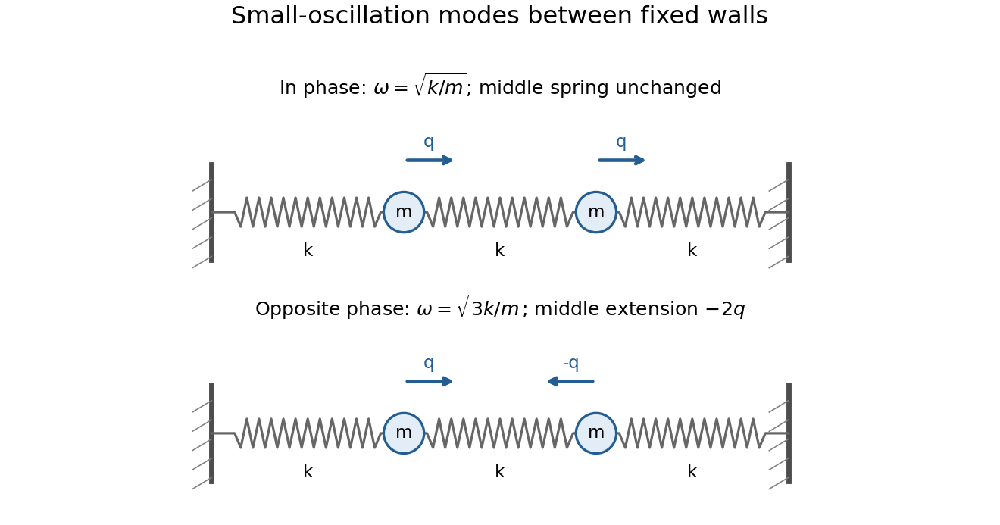

<h1 id="h/h1/solution">Solution</h1>

↑ **Parent:** [H1](../h1.md)

Expand about the equilibrium and keep only terms quadratic in displacement and velocity. Writing $M_{ij}=T_{ij}(0)$ and $K_{ij}=\partial_i\partial_jV(0)$, the linearized Lagrangian is $L_2=\dot x^TM\dot x/2-x^TKx/2$, up to a constant. Its equations are $M\ddot x+Kx=0$. With positive-definite [mass matrix](../../../../mass-matrix.md) $M$, the normal frequencies and mode vectors solve

$$
\boxed{Kv=\omega^2Mv,\qquad\det(K-\omega^2M)=0.}
$$

For a nondegenerate [stable equilibrium](../../../../stable-equilibrium.md), $K$ is positive definite and all these frequencies are positive. A zero [eigenvalue](../../../../eigenvalue.md) indicates a zero-frequency linearized mode requiring higher-order analysis if nonlinear stability is in question.

The three spring extensions are $x_1$, $x_2-x_1$ and $-x_2$. Hence

$$
\boxed{T=\frac m2(\dot x_1^2+\dot x_2^2),\qquad
V=\frac k2\big[x_1^2+(x_2-x_1)^2+x_2^2\big].}
$$

The matrices are $M=mI$ and $K=k\begin{pmatrix}2&-1\\-1&2\end{pmatrix}$. The two independent modes are

$$
\boxed{\begin{aligned}
v_1&=(1,1)^T,&\omega_1&=\sqrt{k/m},\\
v_2&=(1,-1)^T,&\omega_2&=\sqrt{3k/m}.
\end{aligned}}
$$

In the first mode both masses move together with equal displacement, leaving the middle spring unchanged. In the second they move in opposite directions with equal magnitude; the midpoint stays fixed and the middle spring changes length by twice either displacement. Arbitrary small motion is a superposition of sinusoidal motions in these two modes.

**[Figure 1](#h/h1/image-the-two-normal-modes-of-equal-masses-joined-to-fixed-walls-by-three-equal-springs). The two normal modes of equal masses joined to fixed walls by three equal springs**. The in-phase mode leaves the middle spring unchanged; the opposite-phase mode stretches or compresses it by twice either mass displacement.

These are the [normal modes of two equal masses between three springs](../../../../normal-modes-of-two-equal-masses-between-three-springs.md).

## ↑ Ancestors (12)

1. [H1](../h1.md)
2. [H](../../h.md)
3. [2010](../../../2010-split.md)
4. [Past exam of the options I course of the University of Oxford](../../../split.md)
5. [Options I course of the University of Oxford](../../../../options-i-course-of-the-university-of-oxford.md)
6. [Year 2 of the mathematics course of the University of Oxford](../../../../year-2-of-the-mathematics-course-of-the-university-of-oxford.md)
7. [Mathematics course of the University of Oxford](../../../../mathematics-course-of-the-university-of-oxford.md)
8. [Undergraduate course of the University of Oxford](../../../../undergraduate-course-of-the-university-of-oxford.md)
9. [Course of the University of Oxford](../../../../course-of-the-university-of-oxford.md)
10. [University of Oxford](../../../../university-of-oxford-split.md)
11. [List of universities](../../../../list-of-universities.md)
12. [Codex Wiki](../../../../split.md)
