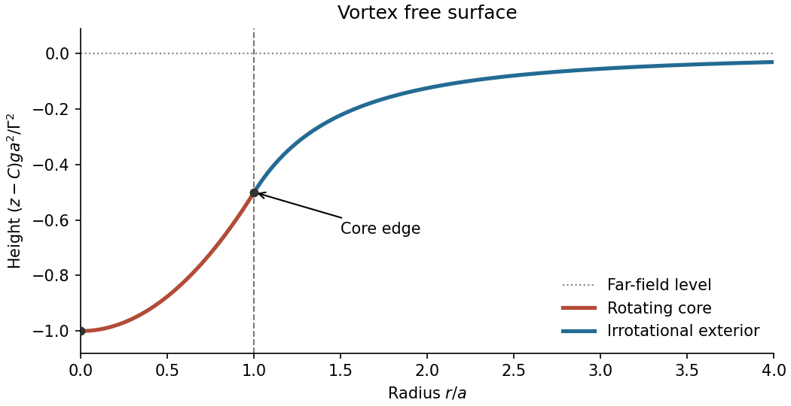
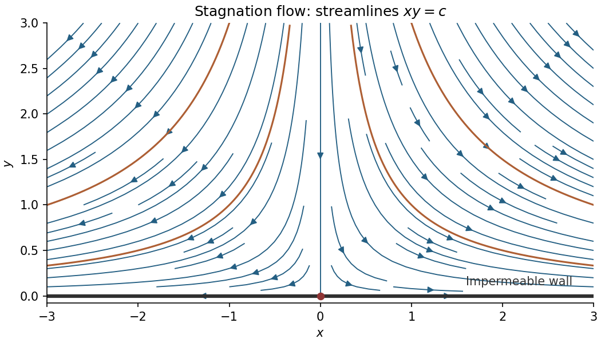

# 2012

↑ **Parent:** [Past exam of the options I course of the University of Oxford](../past-exam-of-the-options-i-course-of-the-university-of-oxford.md)

Source: [Mathematics Part A release](https://www.whatdotheyknow.com/request/maths_papers_2/response/1850333/attach/3/FOI%2020210708%201%20Data.zip?cookie_passthrough=1), member `FOI-20210708-1 - Data/4303 (1).pdf`, dated 20 June 2012. All nineteen questions and all fifty-nine printed source leaf parts are answered below.

Bounded exact-paper checks found no matching advertisement of worked answers. The department's [release policy](https://www.maths.ox.ac.uk/members/students/undergraduate-courses/examinations-assessments) establishes even-year releases back at least to 2016 without specifically confirming this paper; the answer archive requires Oxford SSO. No source parts are skipped.

**Table of contents**

- [A](#a)
  - [A1](#a/a1)
    - [a](#a/a1/a)
      - [Solution](#a/a1/a/solution)
    - [b](#a/a1/b)
      - [Solution](#a/a1/b/solution)
    - [c](#a/a1/c)
      - [Solution](#a/a1/c/solution)
- [B](#b)
  - [B1](#b/b1)
    - [a](#b/b1/a)
      - [Solution](#b/b1/a/solution)
    - [b](#b/b1/b)
      - [Solution](#b/b1/b/solution)
    - [c](#b/b1/c)
      - [Solution](#b/b1/c/solution)
- [C](#c)
  - [C1](#c/c1)
    - [a](#c/c1/a)
      - [Solution](#c/c1/a/solution)
    - [b](#c/c1/b)
      - [Solution](#c/c1/b/solution)
    - [c](#c/c1/c)
      - [Solution](#c/c1/c/solution)
    - [d](#c/c1/d)
      - [Solution](#c/c1/d/solution)
- [D](#d)
  - [D1](#d/d1)
    - [Solution](#d/d1/solution)
  - [D2](#d/d2)
    - [Solution](#d/d2/solution)
- [E](#e)
  - [E1](#e/e1)
    - [a](#e/e1/a)
      - [i](#e/e1/a/i)
        - [Solution](#e/e1/a/i/solution)
      - [ii](#e/e1/a/ii)
        - [Solution](#e/e1/a/ii/solution)
    - [b](#e/e1/b)
      - [Solution](#e/e1/b/solution)
    - [c](#e/e1/c)
      - [Solution](#e/e1/c/solution)
    - [d](#e/e1/d)
      - [Solution](#e/e1/d/solution)
  - [E2](#e/e2)
    - [a](#e/e2/a)
      - [Solution](#e/e2/a/solution)
    - [b](#e/e2/b)
      - [Solution](#e/e2/b/solution)
    - [c](#e/e2/c)
      - [Solution](#e/e2/c/solution)
    - [d](#e/e2/d)
      - [Solution](#e/e2/d/solution)
- [F](#f)
  - [F1](#f/f1)
    - [a](#f/f1/a)
      - [Solution](#f/f1/a/solution)
    - [b](#f/f1/b)
      - [Solution](#f/f1/b/solution)
    - [c](#f/f1/c)
      - [Solution](#f/f1/c/solution)
    - [d](#f/f1/d)
      - [Solution](#f/f1/d/solution)
    - [e](#f/f1/e)
      - [Solution](#f/f1/e/solution)
- [G](#g)
  - [G1](#g/g1)
    - [Solution](#g/g1/solution)
- [H](#h)
  - [H1](#h/h1)
    - [Solution](#h/h1/solution)
- [J](#j)
  - [J1](#j/j1)
    - [Solution](#j/j1/solution)
- [K](#k)
  - [K1](#k/k1)
    - [a](#k/k1/a)
      - [Solution](#k/k1/a/solution)
    - [b](#k/k1/b)
      - [Solution](#k/k1/b/solution)
    - [c](#k/k1/c)
      - [Solution](#k/k1/c/solution)
  - [K2](#k/k2)
    - [a](#k/k2/a)
      - [Solution](#k/k2/a/solution)
    - [b](#k/k2/b)
      - [Solution](#k/k2/b/solution)
    - [c](#k/k2/c)
      - [Solution](#k/k2/c/solution)
- [M](#m)
  - [M1](#m/m1)
    - [a](#m/m1/a)
      - [Solution](#m/m1/a/solution)
    - [b](#m/m1/b)
      - [i](#m/m1/b/i)
        - [Solution](#m/m1/b/i/solution)
      - [ii](#m/m1/b/ii)
        - [Solution](#m/m1/b/ii/solution)
      - [iii](#m/m1/b/iii)
        - [Solution](#m/m1/b/iii/solution)
  - [M2](#m/m2)
    - [a](#m/m2/a)
      - [Solution](#m/m2/a/solution)
    - [b](#m/m2/b)
      - [i](#m/m2/b/i)
        - [Solution](#m/m2/b/i/solution)
      - [ii](#m/m2/b/ii)
        - [Solution](#m/m2/b/ii/solution)
      - [iii](#m/m2/b/iii)
        - [Solution](#m/m2/b/iii/solution)
      - [iv](#m/m2/b/iv)
        - [Solution](#m/m2/b/iv/solution)
- [O](#o)
  - [O1](#o/o1)
    - [a](#o/o1/a)
      - [Solution](#o/o1/a/solution)
    - [b](#o/o1/b)
      - [Solution](#o/o1/b/solution)
    - [c](#o/o1/c)
      - [i](#o/o1/c/i)
        - [Solution](#o/o1/c/i/solution)
      - [ii](#o/o1/c/ii)
        - [Solution](#o/o1/c/ii/solution)
    - [d](#o/o1/d)
      - [Solution](#o/o1/d/solution)
  - [O2](#o/o2)
    - [a](#o/o2/a)
      - [i](#o/o2/a/i)
        - [Solution](#o/o2/a/i/solution)
      - [ii](#o/o2/a/ii)
        - [Solution](#o/o2/a/ii/solution)
    - [b](#o/o2/b)
      - [i](#o/o2/b/i)
        - [Solution](#o/o2/b/i/solution)
      - [ii](#o/o2/b/ii)
        - [Solution](#o/o2/b/ii/solution)
- [P](#p)
  - [P1](#p/p1)
    - [a](#p/p1/a)
      - [Solution](#p/p1/a/solution)
    - [b](#p/p1/b)
      - [Solution](#p/p1/b/solution)
    - [c](#p/p1/c)
      - [Solution](#p/p1/c/solution)
  - [P2](#p/p2)
    - [a](#p/p2/a)
      - [Solution](#p/p2/a/solution)
    - [b](#p/p2/b)
      - [Solution](#p/p2/b/solution)
    - [c](#p/p2/c)
      - [Solution](#p/p2/c/solution)

## A

↑ **Parent:** [2012](2012.md)

<h3 id="a/a1">A1</h3>

↑ **Parent:** [A](#a)

<h4 id="a/a1/a">a</h4>

↑ **Parent:** [A1](#a/a1)

<h5 id="a/a1/a/solution">Solution</h5>

↑ **Parent:** [A](#a/a1/a)

The [degree of a field extension](../algebra.md#degree-of-a-field-extension) is the dimension of the larger [field](../algebra.md#field), regarded as a [vector space](../vector-space.md) over the smaller field:

$$
\boxed{[K:F]=\dim_F K.}
$$

The [scalar multiplication](../vector-space.md#scalar-multiplication) is the multiplication of $K$ restricted to scalars in $F$. A finite extension has finite dimension; otherwise the degree is infinite.

<h4 id="a/a1/b">b</h4>

↑ **Parent:** [A1](#a/a1)

<h5 id="a/a1/b/solution">Solution</h5>

↑ **Parent:** [B](#a/a1/b)

The notation $K=F(\delta)$ means that $K$ is the smallest [subfield](../algebra.md#subfield) containing both $F$ and $\delta$, namely the [simple field extension](../algebra.md#simple-field-extension) generated by $\delta$. Its elements can be expressed as rational functions in $\delta$ with coefficients in $F$ and nonzero denominator.

Write $d=\delta^2\in F$. The element $\delta$ is a root of $X^2-d$, so its [minimal polynomial](../linear-operator-theory.md#minimal-polynomial) over $F$ has degree at most two. Since $\delta\notin F$, that degree cannot be one. The degree of the [simple field extension](../algebra.md#simple-field-extension) equals the degree of the [minimal polynomial](../linear-operator-theory.md#minimal-polynomial), giving

$$
\boxed{[F(\delta):F]=2.}
$$

In particular $1,\delta$ form an $F$-basis, so every element is uniquely $a+b\delta$. This argument also works in characteristic two; separability is not needed for this part.

<h4 id="a/a1/c">c</h4>

↑ **Parent:** [A1](#a/a1)

<h5 id="a/a1/c/solution">Solution</h5>

↑ **Parent:** [C](#a/a1/c)

Choose $\alpha\in K\setminus F$. Since $[K:F]=2$, the linearly independent elements $1,\alpha$ form a [basis](../vector-space.md#basis) of $K$ over $F$. Thus there are $a,b\in F$ with $\alpha^2=a+b\alpha$. The assumption on the [characteristic of a field](../algebra.md#characteristic-of-a-field) allows division by two. Set

$$
\delta=\alpha-\frac b2.
$$

Completing the square gives

$$
\boxed{\delta^2=a+\frac{b^2}{4}\in F.}
$$

Also $\delta\notin F$, since otherwise $\alpha=\delta+b/2$ would lie in $F$. Because $\alpha\in F(\delta)$ and $\delta\in F(\alpha)$, these generated [subfields](../algebra.md#subfield) agree. The basis representation shows $F(\alpha)=K$, hence

$$
\boxed{K=F(\delta),\qquad\delta^2\in F.}
$$

The square-root generator is obtained by translating an arbitrary generator to remove the linear term of its quadratic relation.

<h2 id="b">B</h2>

↑ **Parent:** [2012](2012.md)

<h3 id="b/b1">B1</h3>

↑ **Parent:** [B](#b)

<h4 id="b/b1/a">a</h4>

↑ **Parent:** [B1](#b/b1)

<h5 id="b/b1/a/solution">Solution</h5>

↑ **Parent:** [A](#b/b1/a)

A left [group action](../group-action.md) of $G$ on a [set](../set.md) $S$ is a map $G\times S\to S$, written $(g,s)\mapsto g\cdot s$, satisfying

$$
\boxed{e\cdot s=s,\qquad (gh)\cdot s=g\cdot(h\cdot s)}
$$

for every $s\in S$ and $g,h\in G$, where $e$ is the [identity element](../algebraic-operation.md#identity-element) of $G$. In particular each $g$ acts by a bijection, whose inverse is the action of $g^{-1}$.

<h4 id="b/b1/b">b</h4>

↑ **Parent:** [B1](#b/b1)

<h5 id="b/b1/b/solution">Solution</h5>

↑ **Parent:** [B](#b/b1/b)

Given a [group action](../group-action.md), define $\rho(g)(j)=g\cdot j$. Each $\rho(g)$ is a [permutation](../combinatorics.md#permutation), since $\rho(g^{-1})$ is its inverse. The action law gives, for every $j$,

$$
\rho(gh)(j)=(gh)\cdot j=g\cdot(h\cdot j)=(\rho(g)\rho(h))(j).
$$

Thus $\boxed{\rho:G\to S_n\text{ is a group homomorphism}}$.

Conversely, given a [group homomorphism](../group-theory.md#group-homomorphism) $\rho:G\to S_n$, put $g\cdot j=\rho(g)(j)$. Since a homomorphism sends the identity to the identity permutation, $e\cdot j=j$. Also

$$
(gh)\cdot j=\rho(gh)(j)=\rho(g)(\rho(h)(j))=g\cdot(h\cdot j).
$$

These are exactly the two [group action](../group-action.md) axioms, so the construction defines the required action.

<h4 id="b/b1/c">c</h4>

↑ **Parent:** [B1](#b/b1)

<h5 id="b/b1/c/solution">Solution</h5>

↑ **Parent:** [C](#b/b1/c)

The three nonzero [vectors](../vector-space.md#vector) in $\mathbb F_2^2$ are $e_1$, $e_2$ and $e_1+e_2$. An invertible [linear map](../vector-space.md#linear-map) permutes this three-element set, so part (b) gives a [group homomorphism](../group-theory.md#group-homomorphism)

$$
\rho:GL_2(\mathbb F_2)\longrightarrow S_3.
$$

If a matrix acts trivially on all three vectors, it fixes both basis vectors $e_1,e_2$, so it is the identity matrix. Thus the [kernel of a group homomorphism](../group-theory.md#kernel-of-a-group-homomorphism) is trivial and $\rho$ is injective.

To count the domain, its first column may be any of the three nonzero vectors. The second column must be outside the two-element span of the first, leaving two choices. Hence

$$
|GL_2(\mathbb F_2)|=3\cdot2=6=|S_3|.
$$

An injection between these finite sets of equal size is surjective, proving

$$
\boxed{GL_2(\mathbb F_2)\cong S_3.}
$$

<h2 id="c">C</h2>

↑ **Parent:** [2012](2012.md)

<h3 id="c/c1">C1</h3>

↑ **Parent:** [C](#c)

<h4 id="c/c1/a">a</h4>

↑ **Parent:** [C1](#c/c1)

<h5 id="c/c1/a/solution">Solution</h5>

↑ **Parent:** [A](#c/c1/a)

For a positive [integer](../integer.md) $n$, [Euler's totient function](../number-theory.md#euler-totient-function) counts the integers in a complete residue system that are [coprime](../divisibility.md#coprime-integers) to $n$:

$$
\boxed{\varphi(n)=\#\{k:1\leq k\leq n,\ \gcd(k,n)=1\}.}
$$

For $n>1$ this is equally the count with $0<k<n$. The convention gives $\varphi(1)=1$.

<h4 id="c/c1/b">b</h4>

↑ **Parent:** [C1](#c/c1)

<h5 id="c/c1/b/solution">Solution</h5>

↑ **Parent:** [B](#c/c1/b)

Let $R_n=\{k\in\mathbb Z:0<k<n,\ \gcd(k,n)=1\}$. The map $k\mapsto n-k$ sends $R_n$ to itself because

$$
\gcd(n,n-k)=\gcd(n,k)=1.
$$

Applying it twice returns $k$, so it is a bijection. Reindexing the finite sum by this bijection gives

$$
\boxed{\sum_{k\in R_n}k=\sum_{k\in R_n}(n-k).}
$$

There is no need to assume that every residue belongs to a pair of distinct elements; the reindexing also handles the fixed point when $n=2$.

<h4 id="c/c1/c">c</h4>

↑ **Parent:** [C1](#c/c1)

<h5 id="c/c1/c/solution">Solution</h5>

↑ **Parent:** [C](#c/c1/c)

Write $S=\sum_{k\in R_n}k$. Adding the two equal sums from part (b), and using $|R_n|=\varphi(n)$, gives

$$
2S=\sum_{k\in R_n}\{k+(n-k)\}=\sum_{k\in R_n}n=n\varphi(n).
$$

Therefore

$$
\boxed{S=\frac12n\varphi(n).}
$$

Equivalently, the average of the positive reduced residues is $n/2$, a consequence of their symmetry under reflection about that midpoint.

<h4 id="c/c1/d">d</h4>

↑ **Parent:** [C1](#c/c1)

<h5 id="c/c1/d/solution">Solution</h5>

↑ **Parent:** [D](#c/c1/d)

The positive integers below $30$ coprime to $30$ are

$$
1,7,11,13,17,19,23,29.
$$

There are eight, so $\varphi(30)=8$. Their sum can be grouped into four pairs summing to $30$:

$$
\boxed{1+7+11+13+17+19+23+29=120=\frac12\cdot30\cdot8.}
$$

This agrees with the formula.

<h2 id="d">D</h2>

↑ **Parent:** [2012](2012.md)

<h3 id="d/d1">D1</h3>

↑ **Parent:** [D](#d)

<h4 id="d/d1/solution">Solution</h4>

↑ **Parent:** [D1](#d/d1)

A [sigma-algebra](../measure-theory.md#sigma-algebra) $\mathcal F$ on $\Omega$ contains $\Omega$, is closed under complements relative to $\Omega$, and is closed under countable unions. Consequently it contains the empty set and is closed under countable intersections. A [measure space](../measure.md#measure-space) is a triple $(\Omega,\mathcal F,\mu)$ with a map $\mu:\mathcal F\to[0,\infty]$ satisfying $\mu(\varnothing)=0$ and [countable additivity](../measure.md#countable-additivity) on pairwise disjoint measurable sets.

For the increasing sequence, set $C_1=A_1$ and $C_n=A_n\setminus A_{n-1}$ for $n\geq2$. These measurable sets are disjoint, their union is $A$, and $A_N=\bigcup_{n=1}^NC_n$. Thus [countable additivity](../measure.md#countable-additivity) and finite additivity give

$$
\boxed{\mu(A)=\sum_{n=1}^{\infty}\mu(C_n)
=\lim_{N\to\infty}\sum_{n=1}^N\mu(C_n)
=\lim_{N\to\infty}\mu(A_N).}
$$

The identity permits the value infinity; it uses no subtraction of infinite measures. This is [continuity from below of a measure](../measure.md#continuity-from-below-of-a-measure).

For a decreasing sequence, the analogous assertion is **not always true**. On $\Omega=\mathbb N$ with the [counting measure](../measure.md#counting-measure), take $B_n=\{n,n+1,\ldots\}$. Then $\bigcap_nB_n=\varnothing$, so $\mu(B)=0$, whereas $\mu(B_n)=\infty$ for every $n$ and their limit is infinity.

A sufficient extra condition for [continuity from above of a measure](../measure.md#continuity-from-above-of-a-measure) is $\mu(B_1)<\infty$. Indeed $B_1\setminus B_n$ increases to $B_1\setminus B$, and the increasing-sequence result gives

$$
\mu(B_n)=\mu(B_1)-\mu(B_1\setminus B_n)\longrightarrow\mu(B).
$$

More generally it suffices that one of the $B_n$ has finite measure. The missing finiteness assumption is exactly what the counterexample violates.

<h3 id="d/d2">D2</h3>

↑ **Parent:** [D](#d)

<h4 id="d/d2/solution">Solution</h4>

↑ **Parent:** [D2](#d/d2)

On any bounded parameter interval $|t|\leq T$, the [derivative](../calculus.md#derivative) of the integrand has the integrable majorant

$$
\left|\frac\partial{\partial t}\bigl[e^{-x^2}\cos(2xt^2)\bigr]\right|
=|4xt e^{-x^2}\sin(2xt^2)|\leq4Tx e^{-x^2}.
$$

The [dominated convergence theorem](../measure-theory.md#dominated-convergence-theorem) therefore justifies [differentiation under the integral sign](../analysis.md#differentiation-under-the-integral-sign) at every real $t$, giving

$$
f'(t)=-4t\int_0^\infty xe^{-x^2}\sin(2xt^2)\,dx.
$$

Use [integration by parts](../calculus.md#integration-by-parts) in this absolutely convergent integral, with $xe^{-x^2}\,dx=-\tfrac12d(e^{-x^2})$. Both boundary terms vanish, since the sine is zero at $x=0$ and the Gaussian tends to zero at infinity. Hence

$$
\int_0^\infty xe^{-x^2}\sin(2xt^2)\,dx
=t^2\int_0^\infty e^{-x^2}\cos(2xt^2)\,dx=t^2f(t).
$$

It follows that $f'=-4t^3f$, or equivalently $(e^{t^4}f(t))'=0$. This identity holds on all of $\mathbb R$, including zero. With the supplied Gaussian integral value,

$$
\boxed{f(t)=\frac{\sqrt\pi}{2}e^{-t^4}\qquad(t\in\mathbb R).}
$$

The fourth power comes from the printed phase $2xt^2$; the parameter has been differentiated with that phase throughout.

## E

↑ **Parent:** [2012](2012.md)

<h3 id="e/e1">E1</h3>

↑ **Parent:** [E](#e)

<h4 id="e/e1/a">a</h4>

↑ **Parent:** [E1](#e/e1)

<h5 id="e/e1/a/i">i</h5>

↑ **Parent:** [A](#e/e1/a)

<h6 id="e/e1/a/i/solution">Solution</h6>

↑ **Parent:** [I](#e/e1/a/i)

The map is $K$-[Lipschitz continuous](../real-analysis.md#lipschitz-continuity) when

$$
\boxed{d_Y(f(x),f(x'))\leq Kd_X(x,x')\quad\text{for every }x,x'\in X.}
$$

The same finite [Lipschitz constant](../real-analysis.md#lipschitz-constant) $K$ must work for all pairs of points.

<h5 id="e/e1/a/ii">ii</h5>

↑ **Parent:** [A](#e/e1/a)

<h6 id="e/e1/a/ii/solution">Solution</h6>

↑ **Parent:** [Ii](#e/e1/a/ii)

The map is [uniformly continuous](../topological-analysis.md#uniform-continuity) when, for every $\epsilon>0$, there is a $\delta>0$ such that

$$
\boxed{d_X(x,x')<\delta\ \Longrightarrow\ d_Y(f(x),f(x'))<\epsilon
\quad\text{for all }x,x'\in X.}
$$

The choice of $\delta$ may depend on $\epsilon$ but must be independent of the locations of $x$ and $x'$.

<h4 id="e/e1/b">b</h4>

↑ **Parent:** [E1](#e/e1)

<h5 id="e/e1/b/solution">Solution</h5>

↑ **Parent:** [B](#e/e1/b)

Given $\epsilon>0$, choose $\delta=\epsilon/K>0$. If $d_X(x,x')<\delta$, the [Lipschitz condition](../real-analysis.md#lipschitz-continuity) yields

$$
d_Y(f(x),f(x'))\leq Kd_X(x,x')<K\delta=\epsilon.
$$

This single $\delta$ works for every pair, proving the map is [uniformly continuous](../topological-analysis.md#uniform-continuity):

$$
\boxed{\delta(\epsilon)=\epsilon/K.}
$$

<h4 id="e/e1/c">c</h4>

↑ **Parent:** [E1](#e/e1)

<h5 id="e/e1/c/solution">Solution</h5>

↑ **Parent:** [C](#e/e1/c)

The [distance to a set](../topological-analysis.md#distance-to-a-set) is finite and nonnegative because $A$ is nonempty. For $x,x'\in X$ and every $a\in A$, the [triangle inequality](../topological-analysis.md#triangle-inequality) gives

$$
d(x,a)\leq d(x,x')+d(x',a).
$$

Taking the infimum over $a$ yields $D_A(x)\leq d(x,x')+D_A(x')$. Interchanging $x$ and $x'$ gives the opposite inequality. Together these imply

$$
\boxed{|D_A(x)-D_A(x')|\leq d(x,x').}
$$

Thus the [distance to a set](../topological-analysis.md#distance-to-a-set) is $1$-[Lipschitz continuous](../real-analysis.md#lipschitz-continuity). No closedness, compactness or attainment of the infimum was used.

<h4 id="e/e1/d">d</h4>

↑ **Parent:** [E1](#e/e1)

<h5 id="e/e1/d/solution">Solution</h5>

↑ **Parent:** [D](#e/e1/d)

For fixed $x\in X$, the function $a\mapsto d(x,a)$ on $A$ is continuous, indeed $1$-[Lipschitz continuous](../real-analysis.md#lipschitz-continuity) by the [reverse triangle inequality](../topological-analysis.md#reverse-triangle-inequality). A continuous real-valued function on a nonempty [compact space](../topology.md#compact-space) attains its minimum by the [extreme value theorem](../real-analysis.md#extreme-value-theorem). Hence some $a_0\in A$ satisfies

$$
\boxed{d(x,a_0)=\min_{a\in A}d(x,a)=D_A(x).}
$$

The metric is symmetric, so this is also $d(a_0,x)$. Compactness supplies attainment of the infimum.

<h3 id="e/e2">E2</h3>

↑ **Parent:** [E](#e)

<h4 id="e/e2/a">a</h4>

↑ **Parent:** [E2](#e/e2)

<h5 id="e/e2/a/solution">Solution</h5>

↑ **Parent:** [A](#e/e2/a)

A [basis of a topology](../topology.md#basis-of-a-topology) $\mathcal B$ is a family of open subsets such that every open set is a union of members of $\mathcal B$. Equivalently, for every $U\in\mathcal T$ and $x\in U$, some $B\in\mathcal B$ satisfies

$$
\boxed{x\in B\subseteq U.}
$$

The empty open set is represented by the empty union.

<h4 id="e/e2/b">b</h4>

↑ **Parent:** [E2](#e/e2)

<h5 id="e/e2/b/solution">Solution</h5>

↑ **Parent:** [B](#e/e2/b)

Define $\mathcal T$ to be all unions of members of $\mathcal B$, including the empty union. Then $\varnothing\in\mathcal T$ and the covering assumption gives $X\in\mathcal T$. Arbitrary unions of such sets are again unions of basis members.

For two members $U=\bigcup_iB_i$ and $V=\bigcup_jB'_j$, distribute intersection over union:

$$
U\cap V=\bigcup_{i,j}(B_i\cap B'_j).
$$

Each intersection is a union of members of $\mathcal B$ by the second assumption, so $U\cap V\in\mathcal T$. Repeating gives closure under all finite intersections. These are precisely the [topology](../topology.md) axioms. Every $B\in\mathcal B$ belongs to $\mathcal T$, and every set in $\mathcal T$ is a union of such members by construction. Thus

$$
\boxed{\mathcal T=\left\{\bigcup\mathcal C:\mathcal C\subseteq\mathcal B\right\},\qquad
\mathcal B\text{ is a basis for }\mathcal T.}
$$

<h4 id="e/e2/c">c</h4>

↑ **Parent:** [E2](#e/e2)

<h5 id="e/e2/c/solution">Solution</h5>

↑ **Parent:** [C](#e/e2/c)

The [product topology](../geometry-and-topology.md#product-topology) on $X\times Y$ has as a basis all open rectangles

$$
\boxed{U\times V,\qquad U\in\mathcal T_X,\quad V\in\mathcal T_Y.}
$$

Thus a subset $W\subseteq X\times Y$ is open precisely when, around every $(x,y)\in W$, there are open $U\ni x$ and $V\ni y$ with $U\times V\subseteq W$. These rectangles cover the product, and their pairwise intersections are rectangles because $(U\times V)\cap(U'\times V')=(U\cap U')\times(V\cap V')$. Hence they define a topology by part (b).

This is equivalently the coarsest [topology](../topology.md) making the two coordinate [projection maps](../function.md#projection-map) continuous: the preimages of factor-open sets are the open strips $U\times Y$ and $X\times V$, whose finite intersections are the basis rectangles.

<h4 id="e/e2/d">d</h4>

↑ **Parent:** [E2](#e/e2)

<h5 id="e/e2/d/solution">Solution</h5>

↑ **Parent:** [D](#e/e2/d)

Let $\{B_i:i\in I\}$ and $\{C_j:j\in J\}$ be countable bases of the two factors. The family

$$
\mathcal D=\{B_i\times C_j:(i,j)\in I\times J\}
$$

is countable, since the Cartesian product of two countable sets is countable. It is a [basis of a topology](../topology.md#basis-of-a-topology) for the [product topology](../geometry-and-topology.md#product-topology): given a product-open neighbourhood of $(x,y)$, choose a contained open rectangle $U\times V$, then basis members with $x\in B_i\subseteq U$ and $y\in C_j\subseteq V$. Their product contains $(x,y)$ and is contained in the original neighbourhood. Therefore

$$
\boxed{\text{The product has a countable basis.}}
$$

In standard terminology, a finite product of [second-countable spaces](../topology.md#second-countable-space) is second-countable.

## F

↑ **Parent:** [2012](2012.md)

<h3 id="f/f1">F1</h3>

↑ **Parent:** [F](#f)

<h4 id="f/f1/a">a</h4>

↑ **Parent:** [F1](#f/f1)

<h5 id="f/f1/a/solution">Solution</h5>

↑ **Parent:** [A](#f/f1/a)

The function is [continuously differentiable](../multivariable-calculus.md#continuously-differentiable-function) when all its first [partial derivatives](../multivariable-calculus.md#partial-derivative) exist on $U$ and are continuous there. Equivalently, $h$ has a [Fréchet derivative](../multivariable-calculus.md#frechet-derivative) at every point and the map $x\mapsto Dh(x)$ is continuous. For a scalar-valued function,

$$
Dh(x)v=\sum_{j=1}^n\partial_jh(x)v_j.
$$

On the open domain, continuous first [partial derivatives](../multivariable-calculus.md#partial-derivative) ensure that this linear expression is the total [derivative](../calculus.md#derivative).

<h4 id="f/f1/b">b</h4>

↑ **Parent:** [F1](#f/f1)

<h5 id="f/f1/b/solution">Solution</h5>

↑ **Parent:** [B](#f/f1/b)

For differentiable maps with compatible domains, the multivariable [chain rule](../calculus.md#chain-rule) is

$$
\boxed{D(h_2\circ h_1)(x)=Dh_2(h_1(x))\circ Dh_1(x).}
$$

In [Jacobian matrix](../multivariable-calculus.md#jacobian-matrix) notation this is matrix multiplication. In particular, if both maps are [continuously differentiable](../multivariable-calculus.md#continuously-differentiable-function), the composition is continuously differentiable. Componentwise,

$$
\partial_j(h_2\circ h_1)_\ell(x)
=\sum_{r=1}^m\partial_r(h_2)_\ell(h_1(x))\,\partial_j(h_1)_r(x).
$$

<h4 id="f/f1/c">c</h4>

↑ **Parent:** [F1](#f/f1)

<h5 id="f/f1/c/solution">Solution</h5>

↑ **Parent:** [C](#f/f1/c)

Let $L(x,y,z)=(x-y,y-z,z-x)$. This is a [linear map](../vector-space.md#linear-map), hence smooth; composing it with the given $C^1$ function proves that $g=f\circ L$ is [continuously differentiable](../multivariable-calculus.md#continuously-differentiable-function) by the [chain rule](../calculus.md#chain-rule). Write $f_1,f_2,f_3$ for the first [partial derivatives](../multivariable-calculus.md#partial-derivative), evaluated at $L(p)$. Then

$$
g_x=f_1-f_3,\qquad g_y=-f_1+f_2,\qquad g_z=-f_2+f_3.
$$

Adding these identities gives

$$
\boxed{g_x(p)+g_y(p)+g_z(p)=0.}
$$

Geometrically, $L(p+t(1,1,1))=L(p)$, so $g$ is constant along every line in the diagonal direction; its [derivative](../calculus.md#derivative) in that direction must vanish.

<h4 id="f/f1/d">d</h4>

↑ **Parent:** [F1](#f/f1)

<h5 id="f/f1/d/solution">Solution</h5>

↑ **Parent:** [D](#f/f1/d)

An embedded $k$-dimensional [submanifold](../differential-geometry.md#submanifold) $M\subseteq\mathbb R^n$ is locally a coordinate $k$-plane: for every $p\in M$, there are open neighbourhoods $U\ni p$, $V\subseteq\mathbb R^n$ and a [diffeomorphism](../geometry-and-topology.md#diffeomorphism) $\Phi:U\to V$ with

$$
\Phi(M\cap U)=V\cap(\mathbb R^k\times\{0\}^{n-k}).
$$

For the present $C^1$ setting, $\Phi$ and its inverse are continuously differentiable; in the smooth convention both are smooth.

A [tangent vector](../tangent-vector.md) to $M$ at $p$ is a [velocity](../classical-mechanics.md#velocity) $\gamma'(0)$ of a continuously differentiable curve $\gamma:(-\epsilon,\epsilon)\to M$ with $\gamma(0)=p$. The [tangent space](../tangent-vector.md#tangent-space) is the collection of all these vectors:

$$
\boxed{T_pM=\{\gamma'(0):\gamma(0)=p,\ \gamma\text{ is a }C^1\text{ curve in }M\}.}
$$

In the local coordinates above, it is $D\Phi(p)^{-1}(\mathbb R^k\times\{0\}^{n-k})$, so it is a $k$-dimensional linear subspace of $\mathbb R^n$.

<h4 id="f/f1/e">e</h4>

↑ **Parent:** [F1](#f/f1)

<h5 id="f/f1/e/solution">Solution</h5>

↑ **Parent:** [E](#f/f1/e)

The [regular level set theorem](../differential-geometry.md#regular-level-set-theorem) says that for a $C^1$ map $g:U\subseteq\mathbb R^n\to\mathbb R^r$, if $Dg$ has rank $r$ on $g^{-1}(c)$, then $g^{-1}(c)$ is an $(n-r)$-dimensional [submanifold](../differential-geometry.md#submanifold) and

$$
T_p(g^{-1}(c))=\ker Dg(p).
$$

Here $r=1$ and the given rank condition makes the zero set a two-dimensional [submanifold](../differential-geometry.md#submanifold). It is nonempty because $g(0)=f(0)=0$. Part (c) gives

$$
Dg(p)(1,1,1)=g_x(p)+g_y(p)+g_z(p)=0.
$$

Consequently

$$
\boxed{(1,1,1)\in\ker Dg(p)=T_pM\quad\text{for every }p\in M.}
$$

There is also a direct curve proof: $g(p+t(1,1,1))=g(p)=0$, so the entire line through $p$ in this direction lies in $M$. Its [velocity](../classical-mechanics.md#velocity) at zero is exactly the required [tangent vector](../tangent-vector.md).

## G

↑ **Parent:** [2012](2012.md)

<h3 id="g/g1">G1</h3>

↑ **Parent:** [G](#g)

<h4 id="g/g1/solution">Solution</h4>

↑ **Parent:** [G1](#g/g1)

For variations vanishing at the endpoints, the [Euler-Lagrange equations](../analysis.md#euler-lagrange-equation) are

$$
\boxed{\frac d{dt}F_{\dot r}-F_r=0,\qquad
\frac d{dt}F_{\dot\theta}-F_\theta=0.}
$$

Differentiate the stated energy expression using the [chain rule](../calculus.md#chain-rule). The acceleration terms cancel, leaving

$$
\begin{aligned}
\frac{dH}{dt}
&=\dot r\left(\frac d{dt}F_{\dot r}-F_r\right)
+\dot\theta\left(\frac d{dt}F_{\dot\theta}-F_\theta\right)-F_t.
\end{aligned}
$$

Along a stationary trajectory the two brackets vanish. Thus $dH/dt=-F_t$, and in the absence of explicit time dependence $\boxed{H\text{ is constant}}$.

In plane [polar coordinates](../multivariable-calculus.md#polar-coordinates), the squared speed is $\dot r^2+r^2\dot\theta^2$, so the [kinetic energy](../energy.md#kinetic-energy) is $T=\tfrac12m(\dot r^2+r^2\dot\theta^2)$. An inverse-square central [gravitational force](../physics.md#gravitational-force) has [potential energy](../energy.md#potential-energy) proportional to $1/r$. With the sign convention printed in this paper, write $V=km/r$, giving

$$
F=T-V=\frac m2(\dot r^2+r^2\dot\theta^2)-\frac{km}{r}.
$$

For attraction to a star of mass $M_\star$, this convention has $k=-GM_\star<0$. Keeping $k$ real and signed is essential; no sign is changed in differentiating the printed functional.

Since $F_r=mr\dot\theta^2+km/r^2$, $F_{\dot r}=m\dot r$, $F_\theta=0$ and $F_{\dot\theta}=mr^2\dot\theta$, the equations of motion are

$$
\boxed{\ddot r-r\dot\theta^2=\frac{k}{r^2},\qquad
\frac d{dt}(mr^2\dot\theta)=0.}
$$

The second equation gives the conserved [angular momentum](../momentum.md#angular-momentum) $J=mr^2\dot\theta$; equivalently $r\ddot\theta+2\dot r\dot\theta=0$. The autonomous-functional identity gives a second conserved quantity,

$$
\boxed{H=\dot rF_{\dot r}+\dot\theta F_{\dot\theta}-F
=\frac m2(\dot r^2+r^2\dot\theta^2)+\frac{km}{r}=T+V.}
$$

This is the total [mechanical energy](../energy.md#mechanical-energy); for attractive gravity the potential contribution is negative because $k<0$.

## H

↑ **Parent:** [2012](2012.md)

<h3 id="h/h1">H1</h3>

↑ **Parent:** [H](#h)

<h4 id="h/h1/solution">Solution</h4>

↑ **Parent:** [H1](#h/h1)

Away from a collision, let $r=q_1-q_2$ and $D=|r|>0$. The [Lagrangian](../calculus-of-variations.md#lagrangian) is

$$
\boxed{L=\frac12m_1|\dot q_1|^2+\frac12m_2|\dot q_2|^2-V(D).}
$$

Differentiating $D^2=r\cdot r$ with respect to $x_1$ and $x_2$ gives $2D\partial_{x_1}D=2(x_1-x_2)$ and $2D\partial_{x_2}D=-2(x_1-x_2)$. Therefore

$$
\boxed{\partial_{x_1}D=-\partial_{x_2}D=\frac{x_1-x_2}{D}.}
$$

The other coordinates give $\nabla_{q_1}D=r/D$ and $\nabla_{q_2}D=-r/D$. Substituting these into the [Euler-Lagrange equations](../analysis.md#euler-lagrange-equation) yields equal and opposite central forces:

$$
\boxed{m_1\ddot q_1=-\frac{V'(D)}D r,\qquad
m_2\ddot q_2=\frac{V'(D)}D r.}
$$

Adding the equations shows that the [derivative](../calculus.md#derivative) of the total [linear momentum](../momentum.md) is zero, so $P=m_1\dot q_1+m_2\dot q_2$ is constant. For the total [angular momentum](../momentum.md#angular-momentum), the terms $\dot q_i\times\dot q_i$ vanish, giving

$$
\begin{aligned}
\frac d{dt}(m_1q_1\times\dot q_1+m_2q_2\times\dot q_2)
&=q_1\times\left(-\frac{V'}D r\right)+q_2\times\left(\frac{V'}D r\right)\\
&=-\frac{V'}D(q_1-q_2)\times r=0.
\end{aligned}
$$

Thus both stated vectors are [conserved quantities](../hamiltonian-mechanics.md#conserved-quantity).

**The total energy is also constant.** Define $E=\tfrac12m_1|\dot q_1|^2+\tfrac12m_2|\dot q_2|^2+V(D)$. Since $\dot D=r\cdot(\dot q_1-\dot q_2)/D$,

$$
\begin{aligned}
\dot E&=m_1\dot q_1\cdot\ddot q_1+m_2\dot q_2\cdot\ddot q_2+V'\dot D\\
&=-\frac{V'}D r\cdot(\dot q_1-\dot q_2)+V'\frac{r\cdot(\dot q_1-\dot q_2)}D=0.
\end{aligned}
$$

Hence $\boxed{E=T+V(D)\text{ is conserved}}$. The explicit cancellation establishes energy conservation for an arbitrary smooth separation-dependent potential, throughout any collision-free trajectory.

## J

↑ **Parent:** [2012](2012.md)

<h3 id="j/j1">J1</h3>

↑ **Parent:** [J](#j)

<h4 id="j/j1/solution">Solution</h4>

↑ **Parent:** [J1](#j/j1)

The interior [time-independent Schrödinger equation](../mathematical-physics.md#time-independent-schrodinger-equation) for a free particle is

$$
\boxed{-\frac{\hbar^2}{2m}(\psi_{xx}+\psi_{yy})=E\psi.}
$$

Confinement by the rectangular infinite well imposes [Dirichlet boundary conditions](../differential-equation.md#dirichlet-boundary-condition): $\psi=0$ at $x=0,b$ and $y=0,\sqrt5b$. The wave function is [square-integrable](../measure-theory.md#square-integrable-function) and may be normalized to unit [probability](../probability-theory.md#probability) on the rectangle.

Separation of variables gives products of the one-dimensional well states,

$$
\psi_{n,\ell}(x,y)=\frac{2}{5^{1/4}b}\sin\frac{n\pi x}{b}\sin\frac{\ell\pi y}{\sqrt5b},
\qquad n,\ell=1,2,\ldots.
$$

The Hamiltonian is the sum of the independent $x$ and $y$ kinetic-energy operators, so the one-dimensional energies add. Put $C=\pi^2\hbar^2/(2mb^2)$. Then

$$
E_{n,\ell}=C\left(n^2+\frac{\ell^2}{5}\right).
$$

For $n=1$, increasing $\ell$ gives $6C/5,9C/5,14C/5,21C/5$. The smallest energy with $n\geq2$ is also $21C/5$, attained at $(2,1)$; all $n\geq3$ give larger energies. Thus the ground and first three distinct excited energy levels are

$$
\boxed{\begin{array}{c|c|c}
\text{level}&E& (n,\ell)\\\hline
\text{ground}&6C/5&(1,1)\\
\text{first excited}&9C/5&(1,2)\\
\text{second excited}&14C/5&(1,3)\\
\text{third excited}&21C/5&(1,4),(2,1)
\end{array}}
$$

The largest listed energy therefore has [energy-level degeneracy](../quantum-mechanics.md#energy-level-degeneracy) $\boxed{2}$, since the two product eigenfunctions are linearly independent and no other pair solves $5n^2+\ell^2=21$.

## K

↑ **Parent:** [2012](2012.md)

<h3 id="k/k1">K1</h3>

↑ **Parent:** [K](#k)

<h4 id="k/k1/a">a</h4>

↑ **Parent:** [K1](#k/k1)

<h5 id="k/k1/a/solution">Solution</h5>

↑ **Parent:** [A](#k/k1/a)

For a steady flow the local time [derivative](../calculus.md#derivative) in the [Euler equations](../euler-equations-for-an-inviscid-fluid.md) vanishes. The vector identity

$$
(u\cdot\nabla)u=\nabla\frac{|u|^2}{2}-u\times(\nabla\times u)
$$

reduces to a gradient when the [vorticity](../vorticity.md) $\nabla\times u$ is zero. With constant density and gravity $-gk$, the momentum equation becomes

$$
\nabla\left(\frac p\rho+\frac{|u|^2}{2}+gz\right)=0.
$$

Thus on each connected flow region,

$$
\boxed{p+\frac12\rho|u|^2+\rho gz=\text{constant}.}
$$

This is [Bernoulli's theorem](../euler-equations-for-an-inviscid-fluid.md#bernoulli-equation) for a steady irrotational flow: irrotationality makes the same constant apply throughout a connected region, rather than only along an individual streamline.

<h4 id="k/k1/b">b</h4>

↑ **Parent:** [K1](#k/k1)

<h5 id="k/k1/b/solution">Solution</h5>

↑ **Parent:** [B](#k/k1/b)

This is a [Rankine vortex](../critical-phenomenon.md#rankine-vortex). Write $r=\sqrt{x^2+y^2}$. Inside the core the [velocity](../classical-mechanics.md#velocity) is $u=(\Gamma y/a^2,-\Gamma x/a^2,0)$, so

$$
\boxed{\omega=\nabla\times u=-\frac{2\Gamma}{a^2}k\quad(r<a).}
$$

This is the core value obtained from the inner formula; outside, the given irrotationality makes the [vorticity](../vorticity.md) zero. For nonzero $\Gamma$, the sharp boundary $r=a$ has different one-sided velocity gradients, so a single classical [vorticity](../vorticity.md) is not defined exactly on that edge; the inner trace is the boxed value and the outer trace is zero.

Inside the core, direct differentiation gives $(u\cdot\nabla)u=-\Gamma^2(x,y,0)/a^4$. The steady [Euler equations](../euler-equations-for-an-inviscid-fluid.md) therefore give $p_r=\rho\Gamma^2r/a^4$ and $p_z=-\rho g$. Integrating,

$$
p_{\rm in}=A+\frac{\rho\Gamma^2r^2}{2a^4}-\rho gz.
$$

Outside, $|u|^2=\Gamma^2/r^2$, so part (a) gives

$$
p_{\rm out}=B-\frac{\rho\Gamma^2}{2r^2}-\rho gz.
$$

Matching [pressure](../pressure.md) at the core edge $r=a$ yields $A=B-\rho\Gamma^2/a^2$. Hence the complete [pressure](../pressure.md) field, up to one additive constant $B$, is

$$
\boxed{p(r,z)=\begin{cases}
B-\rho gz-\dfrac{\rho\Gamma^2(2a^2-r^2)}{2a^4},&r\leq a,\\
B-\rho gz-\dfrac{\rho\Gamma^2}{2r^2},&r>a.
\end{cases}}
$$

Both the [velocity](../classical-mechanics.md#velocity) and [pressure](../pressure.md) are continuous at $r=a$. The inside expression has been derived from the momentum equation because the core is rotational.

<h4 id="k/k1/c">c</h4>

↑ **Parent:** [K1](#k/k1)

<h5 id="k/k1/c/solution">Solution</h5>

↑ **Parent:** [C](#k/k1/c)

The [Free surface of a Rankine vortex](../critical-phenomenon.md#free-surface-of-a-rankine-vortex) follows from setting its pressure constant. At a [free surface](../fluid-mechanics.md#free-surface) with constant [pressure](../pressure.md) $p_s$, solve the two [pressure](../pressure.md) expressions from part (b) for $z$. With $C=(B-p_s)/(\rho g)$, this gives

$$
\boxed{z(r)=\begin{cases}
C-\dfrac{\Gamma^2(2a^2-r^2)}{2ga^4},&r\leq a,\\
C-\dfrac{\Gamma^2}{2gr^2},&r>a.
\end{cases}}
$$

Substituting $r^2=x^2+y^2$ recovers the required Cartesian form. The two values coincide at $r=a$, and both radial slopes there equal $\Gamma^2/(ga^3)$. The surface is parabolic in the core and approaches height $C$ as $r\to\infty$; at the centre its depression below $C$ is $\Gamma^2/(ga^2)$.

**[Figure 1](#k/k1/c/image-free-surface-through-the-vortex-core-and-irrotational-exterior). Free surface through the vortex core and irrotational exterior**.

<h3 id="k/k2">K2</h3>

↑ **Parent:** [K](#k)

<h4 id="k/k2/a">a</h4>

↑ **Parent:** [K2](#k/k2)

<h5 id="k/k2/a/solution">Solution</h5>

↑ **Parent:** [A](#k/k2/a)

Use the convention $w=\phi+i\psi$, with $dw/dz=u_x-i u_y$. Then

$$
\boxed{w(z)=\frac12z^2,\qquad\phi=\frac12(x^2-y^2),\quad\psi=xy.}
$$

Indeed $w'(z)=z=x+iy$, giving [velocity](../classical-mechanics.md#velocity) components $(x,-y)$. The [streamlines](../fluid-mechanics.md#streamline) are the level sets of the [stream function](../fluid-mechanics.md#stream-function):

$$
\boxed{xy=c.}
$$

For $c\neq0$ these are rectangular hyperbolas, restricted to $y>0$. The level $c=0$ consists of the vertical axis and the wall $y=0$. Directly on the wall the normal [velocity](../classical-mechanics.md#velocity) is $-y=0$, so it is a streamline. The arrows point down toward the wall and then away from the stagnation point along the wall.

**[Figure 2](#k/k2/a/image-streamlines-and-velocity-directions-above-an-impermeable-wall). Streamlines and velocity directions above an impermeable wall**.

<h4 id="k/k2/b">b</h4>

↑ **Parent:** [K2](#k/k2)

<h5 id="k/k2/b/solution">Solution</h5>

↑ **Parent:** [B](#k/k2/b)

A [point vortex](../vorticity.md#line-vortex) of circulation $\Gamma$ at $z_0$ contributes the [complex potential of a two-dimensional potential flow](../fluid-mechanics.md#complex-potential-of-a-two-dimensional-potential-flow) $-i\Gamma\log(z-z_0)/(2\pi)$ with the stated convention. The [method of images](../mathematics.md#method-of-images) places a vortex of the opposite circulation at $\overline z_0$ below the wall, outside the fluid domain. Superposition with the stagnation flow gives

$$
\boxed{w(z)=\frac12z^2-\frac{i\Gamma}{2\pi}\log(z-z_0)
+\frac{i\Gamma}{2\pi}\log(z-\overline z_0).}
$$

For real $z=x$, the distances $|x-z_0|$ and $|x-\overline z_0|$ agree. The two vortex contributions to the [stream function](../fluid-mechanics.md#stream-function) are $-\Gamma\log|x-z_0|/(2\pi)$ and $+\Gamma\log|x-\overline z_0|/(2\pi)$, which cancel. The background [stream function](../fluid-mechanics.md#stream-function) is also zero there, so $y=0$ remains an impermeable streamline. The image changes the boundary condition without introducing another singularity in the upper fluid region.

<h4 id="k/k2/c">c</h4>

↑ **Parent:** [K2](#k/k2)

<h5 id="k/k2/c/solution">Solution</h5>

↑ **Parent:** [C](#k/k2/c)

For a [point vortex in stagnation flow beside a wall](../vorticity.md#point-vortex-in-stagnation-flow-beside-a-wall), a freely moving [point vortex](../vorticity.md#line-vortex) is transported by the regular [velocity](../classical-mechanics.md#velocity) due to the background and its image, excluding its own singular [velocity](../classical-mechanics.md#velocity). Differentiate the potential and evaluate that regular part at $z_0=x+iy$:

$$
\dot x-i\dot y=z_0+\frac{i\Gamma}{2\pi(z_0-\overline z_0)}
=x+iy+\frac{\Gamma}{4\pi y}.
$$

Thus the equations of motion are

$$
\boxed{\dot x=x+\frac{\Gamma}{4\pi y},\qquad\dot y=-y.}
$$

Writing $c=\Gamma/(4\pi)$, differentiate the proposed path function:

$$
\frac d{dt}(xy+c\log y)=\left(x+\frac cy\right)y+x(-y)+c\frac{-y}{y}=0.
$$

Hence

$$
\boxed{xy+\frac{\Gamma}{4\pi}\log y=\text{constant}.}
$$

For initial position $(x_0,y_0)$, an explicit check is $y(t)=y_0e^{-t}$ and $x(t)=e^t(x_0+ct/y_0)$. Their substitution makes the linear terms in $t$ cancel in the path function and also shows that the vortex stays above the wall at every finite time.

## M

↑ **Parent:** [2012](2012.md)

<h3 id="m/m1">M1</h3>

↑ **Parent:** [M](#m)

<h4 id="m/m1/a">a</h4>

↑ **Parent:** [M1](#m/m1)

<h5 id="m/m1/a/solution">Solution</h5>

↑ **Parent:** [A](#m/m1/a)

The sequence is a [Markov chain](../markov-chain.md) when the conditional law of its next state depends on the past only through the current state. Precisely, for each history of positive [probability](../probability-theory.md#probability) and every $j\in S$,

$$
\boxed{\Pr(X_{n+1}=j\mid X_n=i_n,\ldots,X_0=i_0)
=\Pr(X_{n+1}=j\mid X_n=i_n).}
$$

A time-homogeneous chain additionally has transition probabilities independent of $n$, written $P_{ij}=\Pr(X_{n+1}=j\mid X_n=i)$. The displayed single transition matrix in the subsequent parts specifies this time-homogeneous case.

<h4 id="m/m1/b">b</h4>

↑ **Parent:** [M1](#m/m1)

<h5 id="m/m1/b/i">i</h5>

↑ **Parent:** [B](#m/m1/b)

<h6 id="m/m1/b/i/solution">Solution</h6>

↑ **Parent:** [I](#m/m1/b/i)

First the entries must be nonnegative: together with the given $a,b\geq0$, validity of the [transition matrix](../markov-chain.md#stochastic-matrix) requires $0\leq a\leq1$ and $0\leq b\leq1/3$. Every row then sums to one.

The only incoming edge to state $2$ is $1\to2$, of [probability](../probability-theory.md#probability) $a$. If $a=0$, no other state can reach $2$, so the chain is not irreducible. If $a>0$, all edges in the directed cycle

$$
1\longrightarrow2\longrightarrow3\longrightarrow4\longrightarrow1
$$

have positive [probability](../probability-theory.md#probability), since $P_{23}=1/3+b>0$, $P_{34}=1$ and $P_{41}=1/2$. Traversing this cycle connects every state to every other state. Therefore

$$
\boxed{\text{Irreducible exactly when }0<a\leq1,\quad0\leq b\leq\frac13.}
$$

<h5 id="m/m1/b/ii">ii</h5>

↑ **Parent:** [B](#m/m1/b)

<h6 id="m/m1/b/ii/solution">Solution</h6>

↑ **Parent:** [Ii](#m/m1/b/ii)

Within the valid parameter rectangle, suppose $a>0$ and $b<1/3$. The chain is then irreducible by part (i). State $1$ has a two-step return $1\to2\to1$ and a three-step return $1\to2\to4\to1$, both of positive [probability](../probability-theory.md#probability). Its [period of a state in a Markov chain](../markov-chain.md#period-of-a-state-in-a-markov-chain) therefore divides both two and three, hence equals one. Irreducibility gives the same period to every state, so the chain is aperiodic.

If $b=1/3$ and $a>0$, every transition goes between the two classes $\{1,3\}$ and $\{2,4\}$. Returns must have even length, while $1\to2\to1$ has length two. Thus the irreducible chain has period two.

If $a=0$, the closed communicating class $\{1,3,4\}$ alternates between $\{1,3\}$ and $\{4\}$. Its states have period two, using the positive two-step returns through $4$. Consequently the chain is not aperiodic, regardless of how the transient state $2$ is classified. Combining the cases,

$$
\boxed{\text{Aperiodic exactly when }0<a\leq1,\quad0\leq b<\frac13.}
$$

<h5 id="m/m1/b/iii">iii</h5>

↑ **Parent:** [B](#m/m1/b)

<h6 id="m/m1/b/iii/solution">Solution</h6>

↑ **Parent:** [Iii](#m/m1/b/iii)

Here the valid parameters lie in the irreducible aperiodic range. The finite-state theorem on [convergence to an invariant distribution](../markov-chain.md#convergence-to-an-invariant-distribution) therefore implies convergence to the unique [stationary distribution](../markov-chain.md#stationary-distribution), independently of the initial state.

Solve $\pi P=\pi$ and $\sum_i\pi_i=1$. The equations for states $1,2,3$ give

$$
\pi_2=\frac12\pi_1,\qquad
\pi_1=\frac13\pi_2+\frac12\pi_4,\qquad
\pi_3=\frac13\pi_2+\frac12\pi_4.
$$

Hence $\pi_3=\pi_1$ and $\pi_4=5\pi_1/3$. Normalization gives $\pi_1(1+1/2+1+5/3)=1$, so

$$
\pi=\frac1{25}(6,3,6,10),\qquad
\boxed{\lim_{n\to\infty}\Pr(X_n=1\mid X_0=2)=\frac6{25}.}
$$

Stationarity alone would not guarantee convergence of the one-time distributions; irreducibility and aperiodicity justify that final limit.

<h3 id="m/m2">M2</h3>

↑ **Parent:** [M](#m)

<h4 id="m/m2/a">a</h4>

↑ **Parent:** [M2](#m/m2)

<h5 id="m/m2/a/solution">Solution</h5>

↑ **Parent:** [A](#m/m2/a)

A [joint probability density function](../continuous-probability-distribution.md#joint-probability-density) must be measurable, nonnegative almost everywhere, and normalized:

$$
\boxed{f(x,y)\geq0\text{ almost everywhere},\qquad
\int_{\mathbb R^2}f(x,y)\,dx\,dy=1.}
$$

It determines the joint law by $\Pr((X,Y)\in B)=\int_B f(x,y)\,dx\,dy$ for measurable sets $B$. Values on sets of planar measure zero may be changed without changing that law.

<h4 id="m/m2/b">b</h4>

↑ **Parent:** [M2](#m/m2)

<h5 id="m/m2/b/i">i</h5>

↑ **Parent:** [B](#m/m2/b)

<h6 id="m/m2/b/i/solution">Solution</h6>

↑ **Parent:** [I](#m/m2/b/i)

**The variables are not independent.** Their joint support excludes $X>1/2$ and $Y>1/2$ simultaneously, since every point with positive joint density satisfies $X+Y\leq1$. Yet each event separately has positive [probability](../probability-theory.md#probability): the density is strictly positive on open triangular subregions where $X>1/2$, and similarly where $Y>1/2$. Thus

$$
\Pr(X>1/2,Y>1/2)=0<\Pr(X>1/2)\Pr(Y>1/2).
$$

This contradicts the event factorization required for [independence of random variables](../random-variable.md#independent-random-variables). The product-shaped formula $24xy$ on its support does not undo the dependence created by the triangular support.

<h5 id="m/m2/b/ii">ii</h5>

↑ **Parent:** [B](#m/m2/b)

<h6 id="m/m2/b/ii/solution">Solution</h6>

↑ **Parent:** [Ii](#m/m2/b/ii)

For $0\leq x\leq1$, integrate the [joint probability density function](../continuous-probability-distribution.md#joint-probability-density) over its allowed $y$-range:

$$
f_X(x)=\int_0^{1-x}24xy\,dy=12x(1-x)^2.
$$

Outside this interval it is zero. Therefore the [marginal density](../probability-distribution.md#marginal-density) is

$$
\boxed{f_X(x)=\begin{cases}12x(1-x)^2,&0\leq x\leq1,\\0,&\text{otherwise}.\end{cases}}
$$

Its integral is $12(1/2-2/3+1/4)=1$, also checking the original joint normalization. By symmetry $Y$ has the same marginal density.

<h5 id="m/m2/b/iii">iii</h5>

↑ **Parent:** [B](#m/m2/b)

<h6 id="m/m2/b/iii/solution">Solution</h6>

↑ **Parent:** [Iii](#m/m2/b/iii)

From the marginal density,

$$
\mathbb E X=12\int_0^1x^2(1-x)^2\,dx=\frac25,
\qquad\mathbb E Y=\frac25.
$$

The mixed moment is

$$
\mathbb E[XY]=\int_0^1\int_0^{1-x}24x^2y^2\,dy\,dx
=8\int_0^1x^2(1-x)^3\,dx=\frac2{15}.
$$

Thus the [covariance](../variance.md#covariance) is

$$
\boxed{\operatorname{Cov}(X,Y)=\frac2{15}-\frac4{25}=-\frac2{75}.}
$$

The negative sign is consistent with the support constraint: a large value of one variable leaves a smaller available range for the other.

<h5 id="m/m2/b/iv">iv</h5>

↑ **Parent:** [B](#m/m2/b)

<h6 id="m/m2/b/iv/solution">Solution</h6>

↑ **Parent:** [Iv](#m/m2/b/iv)

For $0<x<1$, the conditional density is obtained by dividing the joint density by the positive marginal density:

$$
f_{Y\mid X=x}(y)=\frac{24xy}{12x(1-x)^2}
=\frac{2y}{(1-x)^2},\qquad0\leq y\leq1-x.
$$

Consequently

$$
\boxed{f_{Y\mid X=1/2}(y)=\begin{cases}8y,&0\leq y\leq1/2,\\0,&\text{otherwise},\end{cases}}
$$

which integrates to one. Its [conditional expectation](../measure-theory.md#conditional-expectation) is

$$
\boxed{\mathbb E(Y\mid X=1/2)=\int_0^{1/2}y(8y)\,dy=\frac13.}
$$

This uses the usual continuous conditional-density version, defined by the density ratio at a point where $f_X$ is positive; conditioning does not require the event $X=1/2$ itself to have positive [probability](../probability-theory.md#probability).

## O

↑ **Parent:** [2012](2012.md)

<h3 id="o/o1">O1</h3>

↑ **Parent:** [O](#o)

<h4 id="o/o1/a">a</h4>

↑ **Parent:** [O1](#o/o1)

<h5 id="o/o1/a/solution">Solution</h5>

↑ **Parent:** [A](#o/o1/a)

Let $\ell_n(\theta)=\sum_{i=1}^n\log f(X_i;\theta)$ be the [log-likelihood](../maximum-likelihood-estimation.md#log-likelihood). Under the usual regularity conditions, the expected [Fisher information](../statistical-modelling.md#fisher-information-matrix) in the whole sample is

$$
\boxed{I_n(\theta)=\mathbb E_\theta\!\left[\{\ell_n'(\theta)\}^2\right]
=-\mathbb E_\theta[\ell_n''(\theta)]=nI_1(\theta).}
$$

The equality of the two expressions uses [mean](../expected-value.md)-zero score and permitted differentiation of the normalization identity. Independent observations make the information additive. The [maximum-likelihood estimator](../maximum-likelihood-estimation.md#maximum-likelihood-estimator) has [asymptotic normality](../statistical-inference.md#asymptotic-normality):

$$
\sqrt n(\widehat\theta-\theta)\xrightarrow{d}N(0,I_1(\theta)^{-1}),
\qquad
\boxed{\widehat\theta\ \text{approximately}\ N(\theta,I_n(\theta)^{-1}).}
$$

The factor $n$ is included in $I_n$; it must not be inserted a second time into the [variance](../variance.md).

<h4 id="o/o1/b">b</h4>

↑ **Parent:** [O1](#o/o1)

<h5 id="o/o1/b/solution">Solution</h5>

↑ **Parent:** [B](#o/o1/b)

Let $z=\Phi^{-1}(1-\alpha/2)$ for the standard normal cumulative distribution function. Consistency of the [maximum-likelihood estimator](../maximum-likelihood-estimation.md#maximum-likelihood-estimator) and [Slutsky's theorem](../statistical-inference.md#slutsky-theorem) give the asymptotic standardization

$$
\sqrt{I_n(\widehat\theta)}(\widehat\theta-\theta)\xrightarrow{d}N(0,1).
$$

Its [probability](../probability-theory.md#probability) of lying between $-z$ and $z$ tends to $1-\alpha$. Solving those inequalities for the unknown parameter yields the [Wald confidence interval](../statistical-inference.md#wald-confidence-interval)

$$
\boxed{\left[\widehat\theta-\frac{z}{\sqrt{I_n(\widehat\theta)}},\quad
\widehat\theta+\frac{z}{\sqrt{I_n(\widehat\theta)}}\right].}
$$

Thus the estimated [standard error](../statistical-inference.md#standard-error) is $I_n(\widehat\theta)^{-1/2}$. Its coverage is approximate and relies on the large-sample regularity assumptions.

<h4 id="o/o1/c">c</h4>

↑ **Parent:** [O1](#o/o1)

<h5 id="o/o1/c/i">i</h5>

↑ **Parent:** [C](#o/o1/c)

<h6 id="o/o1/c/i/solution">Solution</h6>

↑ **Parent:** [I](#o/o1/c/i)

For the stated [geometric distribution](../discrete-probability-distribution.md#geometric-distribution), write $S=\sum_iX_i$. Then

$$
\ell_n(\theta)=n\log\theta+(S-n)\log(1-\theta),
\qquad
-\ell_n''(\theta)=\frac n{\theta^2}+\frac{S-n}{(1-\theta)^2}.
$$

Since $\mathbb E X_i=1/\theta$, we have $\mathbb E(S-n)=n(1-\theta)/\theta$. Taking [expectation](../expected-value.md) gives the sample [Fisher information](../statistical-modelling.md#fisher-information-matrix)

$$
I_n(\theta)=\frac n{\theta^2}+\frac n{\theta(1-\theta)}
=\boxed{\frac n{\theta^2(1-\theta)}}.
$$

The support begins at one, so this [expectation](../expected-value.md) uses the trials-until-first-success convention of the geometric law.

<h5 id="o/o1/c/ii">ii</h5>

↑ **Parent:** [C](#o/o1/c)

<h6 id="o/o1/c/ii/solution">Solution</h6>

↑ **Parent:** [Ii](#o/o1/c/ii)

For the [Bernoulli distribution](../discrete-probability-distribution.md#bernoulli-distribution), with $S=\sum_iX_i$,

$$
\ell_n(\theta)=S\log\theta+(n-S)\log(1-\theta),
\qquad
-\ell_n''(\theta)=\frac S{\theta^2}+\frac{n-S}{(1-\theta)^2}.
$$

Using $\mathbb ES=n\theta$, the expected [Fisher information](../statistical-modelling.md#fisher-information-matrix) is

$$
I_n(\theta)=\frac n\theta+\frac n{1-\theta}
=\boxed{\frac n{\theta(1-\theta)}}.
$$

<h4 id="o/o1/d">d</h4>

↑ **Parent:** [O1](#o/o1)

<h5 id="o/o1/d/solution">Solution</h5>

↑ **Parent:** [D](#o/o1/d)

For the same sample size $n$, the [geometric distribution](../discrete-probability-distribution.md#geometric-distribution) provides more [Fisher information](../statistical-modelling.md#fisher-information-matrix):

$$
\frac{I_n^{\rm geom}(\theta)}{I_n^{\rm Bern}(\theta)}=\frac1\theta>1
\qquad(0<\theta<1).
$$

The corresponding asymptotic variances of the [maximum-likelihood estimators](../maximum-likelihood-estimation.md#maximum-likelihood-estimator) are

$$
\operatorname{Var}(\widehat\theta_{\rm geom})\approx\frac{\theta^2(1-\theta)}n,
\qquad
\operatorname{Var}(\widehat\theta_{\rm Bern})\approx\frac{\theta(1-\theta)}n.
$$

Hence **choose the geometric sample for more precise inference at equal numbers of observations**. Its asymptotic [variance](../variance.md) is $\theta$ times as large, and its [standard error](../statistical-inference.md#standard-error) is $\sqrt\theta$ times as large. This illustrates [Fisher information per observation and per trial](../statistical-modelling.md#fisher-information-per-observation-and-per-trial). It is a per-observation comparison: one geometric observation records a waiting time containing, on average, $1/\theta$ Bernoulli trials. A constraint on the total number of underlying trials would be a different sampling-budget comparison.

<h3 id="o/o2">O2</h3>

↑ **Parent:** [O](#o)

<h4 id="o/o2/a">a</h4>

↑ **Parent:** [O2](#o/o2)

<h5 id="o/o2/a/i">i</h5>

↑ **Parent:** [A](#o/o2/a)

<h6 id="o/o2/a/i/solution">Solution</h6>

↑ **Parent:** [I](#o/o2/a/i)

For the full-column-rank [design matrix](../linear-regression.md#design-matrix), the normal-error [maximum-likelihood estimator](../maximum-likelihood-estimation.md#maximum-likelihood-estimator) is the least-squares estimator

$$
\boxed{\widehat\theta=(X^TX)^{-1}X^TY.}
$$

Indeed maximizing the Gaussian likelihood over $\theta$ minimizes $\|Y-X\theta\|^2$, whose [normal equations](../normal-linear-model.md#normal-equation) are $X^TX\widehat\theta=X^TY$; rank $p$ makes $X^TX$ invertible. Substitution of the model gives

$$
\widehat\theta=\theta+(X^TX)^{-1}X^T\epsilon.
$$

Since $\mathbb E\epsilon=0$, it follows that $\boxed{\mathbb E\widehat\theta=\theta}$, proving unbiasedness.

<h5 id="o/o2/a/ii">ii</h5>

↑ **Parent:** [A](#o/o2/a)

<h6 id="o/o2/a/ii/solution">Solution</h6>

↑ **Parent:** [Ii](#o/o2/a/ii)

Independence and common error [variance](../variance.md) give $\operatorname{Var}(\epsilon)=\sigma^2I_n$. For the fixed matrix $A=(X^TX)^{-1}X^T$, the [covariance](../variance.md#covariance) transformation rule gives

$$
\begin{aligned}
\operatorname{Var}(\widehat\theta)&=A\operatorname{Var}(\epsilon)A^T\\
&=\sigma^2(X^TX)^{-1}X^TX(X^TX)^{-1}\\
&=\boxed{\sigma^2(X^TX)^{-1}}.
\end{aligned}
$$

Thus the [covariance](../variance.md#covariance) is determined by the error [variance](../variance.md) and the inverse [Gram matrix](../inner-product.md#gram-matrix) of the design columns.

<h4 id="o/o2/b">b</h4>

↑ **Parent:** [O2](#o/o2)

<h5 id="o/o2/b/i">i</h5>

↑ **Parent:** [B](#o/o2/b)

<h6 id="o/o2/b/i/solution">Solution</h6>

↑ **Parent:** [I](#o/o2/b/i)

The design columns are $1$, $x$ and $z$. Their pairwise inner products are zero by the three supplied sums. Put $S_{xx}=\sum_ix_i^2$ and $S_{zz}=\sum_iz_i^2$, positive under the full-rank assumption. Then

$$
X^TX=\operatorname{diag}(n,S_{xx},S_{zz}).
$$

Applying part (a),

$$
\boxed{\widehat\theta=\begin{pmatrix}\widehat\alpha\\\widehat\beta\\\widehat\gamma\end{pmatrix}
=\begin{pmatrix}\overline Y\\\displaystyle\frac{\sum_ix_iY_i}{S_{xx}}\\\displaystyle\frac{\sum_iz_iY_i}{S_{zz}}\end{pmatrix},
\qquad
\operatorname{Var}(\widehat\theta)=\sigma^2\operatorname{diag}\left(\frac1n,\frac1{S_{xx}},\frac1{S_{zz}}\right).}
$$

The off-diagonal covariances vanish because the design columns are [orthogonal](../inner-product.md#orthogonal-vectors). With Gaussian errors, the coefficient estimators are also jointly normal and therefore independent.

<h5 id="o/o2/b/ii">ii</h5>

↑ **Parent:** [B](#o/o2/b)

<h6 id="o/o2/b/ii/solution">Solution</h6>

↑ **Parent:** [Ii](#o/o2/b/ii)

The future [mean](../expected-value.md) response is $E_*=\alpha+\beta x_*+\gamma z_*$. By invariance of [maximum likelihood estimation](../maximum-likelihood-estimation.md), its estimator is the fitted [mean](../expected-value.md)

$$
\boxed{\widehat E_*=\widehat\alpha+x_*\widehat\beta+z_*\widehat\gamma.}
$$

Its sampling [variance](../variance.md) is the quadratic form of the coefficient [covariance matrix](../variance.md#covariance-matrix) with $c=(1,x_*,z_*)^T$:

$$
\boxed{\operatorname{Var}(\widehat E_*)=c^T\operatorname{Var}(\widehat\theta)c
=\sigma^2\left(\frac1n+\frac{x_*^2}{S_{xx}}+\frac{z_*^2}{S_{zz}}\right).}
$$

This estimator is unbiased because each fitted coefficient is unbiased. The future error $\epsilon_*$ does not enter the estimator of the [mean](../expected-value.md), so its independent [variance](../variance.md) is not part of this expression.

## P

↑ **Parent:** [2012](2012.md)

<h3 id="p/p1">P1</h3>

↑ **Parent:** [P](#p)

<h4 id="p/p1/a">a</h4>

↑ **Parent:** [P1](#p/p1)

<h5 id="p/p1/a/solution">Solution</h5>

↑ **Parent:** [A](#p/p1/a)

A polynomial $p_n\in\Pi_n$ is a best [polynomial least-squares approximation](../uniform-approximation.md#polynomial-least-squares-approximation) when it minimizes the weighted error [norm](../normed-vector-space.md#norm) over all polynomials of degree at most $n$:

$$
\boxed{\|f-p_n\|\leq\|f-q\|\quad\text{for every }q\in\Pi_n.}
$$

Equivalently it minimizes $\int_0^1x^{-1/2}(f(x)-q(x))^2\,dx$. The weight is integrable, so the expression is finite for continuous functions; it defines a genuine [norm](../normed-vector-space.md#norm) because a continuous function with zero weighted squared integral must be identically zero.

<h4 id="p/p1/b">b</h4>

↑ **Parent:** [P1](#p/p1)

<h5 id="p/p1/b/solution">Solution</h5>

↑ **Parent:** [B](#p/p1/b)

Take any $q\in\Pi_n$. Write $f-q=(f-p_n)+(p_n-q)$. The second term belongs to $\Pi_n$, so the assumed orthogonality gives $\langle f-p_n,p_n-q\rangle=0$. Expanding the squared [norm](../normed-vector-space.md#norm) yields the [Pythagorean theorem](../euclidean-geometry.md#pythagorean-theorem) in this [inner product](../inner-product.md):

$$
\|f-q\|^2=\|f-p_n\|^2+\|p_n-q\|^2\geq\|f-p_n\|^2.
$$

Taking square roots proves

$$
\boxed{p_n\text{ is a best least-squares approximation}.}
$$

Equality can hold only when $\|p_n-q\|=0$, hence $p_n=q$, so the best polynomial is unique. Completeness of the ambient space is unnecessary for this orthogonality argument.

<h4 id="p/p1/c">c</h4>

↑ **Parent:** [P1](#p/p1)

<h5 id="p/p1/c/solution">Solution</h5>

↑ **Parent:** [C](#p/p1/c)

Write $p_1(x)=a+bx$. It suffices to impose orthogonality of the error to the basis $1,x$ of $\Pi_1$. With the printed weight $x^{-1/2}$ and $f=x^{3/2}$, the [normal equations](../normal-linear-model.md#normal-equation) are

$$
\begin{pmatrix}2&2/3\\2/3&2/5\end{pmatrix}
\begin{pmatrix}a\\b\end{pmatrix}
=\begin{pmatrix}1/2\\1/3\end{pmatrix}.
$$

Here, for example, $\langle f,1\rangle=\int_0^1x\,dx=1/2$ and $\langle f,x\rangle=\int_0^1x^2\,dx=1/3$. Solving gives $a=-1/16$, $b=15/16$. Therefore

$$
\boxed{p_1(x)=\frac{15x-1}{16}.}
$$

The two [normal equations](../normal-linear-model.md#normal-equation) make the error [orthogonal](../inner-product.md#orthogonal-vectors) to every linear polynomial, and part (b) then proves optimality, rather than merely furnishing a candidate fit.

<h3 id="p/p2">P2</h3>

↑ **Parent:** [P](#p)

<h4 id="p/p2/a">a</h4>

↑ **Parent:** [P2](#p/p2)

<h5 id="p/p2/a/solution">Solution</h5>

↑ **Parent:** [A](#p/p2/a)

The leading error term can be removed by comparing the two step sizes $h$ and $h/2$:

$$
I_h=I-K_2h^2-K_4h^4-\cdots,\qquad
I_{h/2}=I-\frac14K_2h^2-\frac1{16}K_4h^4-\cdots.
$$

Multiply the second expression by four and subtract the first. The $h^2$ terms cancel, so the first [Richardson extrapolation](../numerical-analysis.md#richardson-extrapolation) step is

$$
\boxed{R_1(h)=\frac{4I_{h/2}-I_h}{3},\qquad I-R_1(h)=-\frac14K_4h^4+O(h^6).}
$$

Repeat with $R_1(h/2)$ and $R_1(h)$, now cancelling the fourth-order error using the factor $16$. In general, with $R_0(h)=I_h$,

$$
\boxed{R_j(h)=\frac{4^jR_{j-1}(h/2)-R_{j-1}(h)}{4^j-1}.}
$$

Under the stated even-power expansion, successive columns have errors of orders $h^4,h^6,h^8,\ldots$. Each step uses the known scaling of the leading error to eliminate its unknown coefficient.

<h4 id="p/p2/b">b</h4>

↑ **Parent:** [P2](#p/p2)

<h5 id="p/p2/b/solution">Solution</h5>

↑ **Parent:** [B](#p/p2/b)

For one interval, the [trapezoidal rule](../runge-kutta-method.md#trapezoidal-rule) gives

$$
\boxed{I_1=\frac12\{0^4+1^4\}=\frac12.}
$$

For two intervals of width $h=1/2$, the composite [trapezoidal rule](../runge-kutta-method.md#trapezoidal-rule) gives half weights at the endpoints and full weight at the internal node:

$$
\boxed{I_{1/2}=\frac12\left\{\frac12\,0^4+\left(\frac12\right)^4+\frac12\,1^4\right\}
=\frac9{32}.}
$$

<h4 id="p/p2/c">c</h4>

↑ **Parent:** [P2](#p/p2)

<h5 id="p/p2/c/solution">Solution</h5>

↑ **Parent:** [C](#p/p2/c)

Apply the first [Richardson extrapolation](../numerical-analysis.md#richardson-extrapolation) step to the two computed approximations:

$$
\boxed{R_1(1)=\frac{4(9/32)-1/2}{3}=\frac5{24}.}
$$

The exact integral is $I=\int_0^1x^4\,dx=1/5$, so the actual absolute error is

$$
\boxed{\left|\frac5{24}-\frac15\right|=\frac1{120}\approx0.00833<10^{-2}.}
$$

Thus the requested strict error bound is verified directly. This first extrapolation of trapezoidal approximations is also the one-panel [Simpson's rule](../numerical-integration.md#simpson-s-rule) value on the three nodes $0,1/2,1$.

## ↑ Ancestors (9)

1. [Past exam of the options I course of the University of Oxford](../past-exam-of-the-options-i-course-of-the-university-of-oxford.md)
2. [Options I course of the University of Oxford](../university-of-oxford.md#options-i-course-of-the-university-of-oxford)
3. [Year 2 of the mathematics course of the University of Oxford](../university-of-oxford.md#year-2-of-the-mathematics-course-of-the-university-of-oxford)
4. [Mathematics course of the University of Oxford](../university-of-oxford.md#mathematics-course-of-the-university-of-oxford)
5. [Undergraduate course of the University of Oxford](../university-of-oxford.md#undergraduate-course-of-the-university-of-oxford)
6. [Course of the University of Oxford](../university-of-oxford.md#course-of-the-university-of-oxford)
7. [University of Oxford](../university-of-oxford.md)
8. [List of universities](../README.md#list-of-universities)
9. [Codex Wiki](../README.md)
